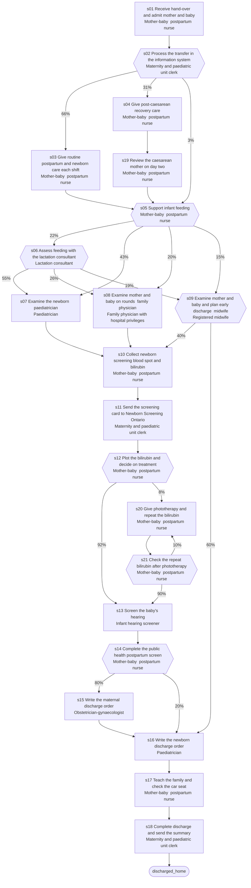

# Provide postpartum and newborn care

`hosp-wc-postpartum-newborn-care` · healthcare (public hospital) · women's and children's program · part of `community-hospital-corp`

After the birth, mother and baby stay together on the mother-baby unit for about one to three days. Postpartum nurses check the mother's recovery and the baby's feeding, weight and jaundice each shift, a lactation consultant helps with harder feeding problems, the newborn screening blood spot, bilirubin and hearing screens are done after 24 hours of age, a public health screen is completed, and the physicians or midwife write the discharge orders. Stays run long when discharge waits for morning rounds, a screen that cannot be done before 24 hours, a lactation consultant who works weekdays only, or phototherapy for jaundice.

| | |
|---|---|
| Unit of work | one mother-newborn stay |
| Starts when | The labour and delivery nurse hands over the mother and baby (or the mother alone when the baby is in the NICU) to the mother-baby unit. |
| Done when | Mother and baby leave the hospital with discharge teaching, follow-up arranged, the newborn screening card sent to Newborn Screening Ontario and the public health screen shared. |
| Organisation | A three-site Ontario community hospital corporation with about 4,300 to 4,700 births a year and about 45 mother-baby beds. (5,790 employees, 2019-2022) |
| Volume | 360 cases a month (range 333 to 391) |

## Where it sits

- Starts with **mother_newborn_pair** from wc-labour-delivery (92% of cases)
- Starts with **maternity_patient** from wc-labour-delivery (5% of cases)
- Starts with **newborn** from wc-nicu-care (3% of cases)
- Relies on **staff_schedule** from hr-staff-scheduling (a standing input; it does not start a case)
- Sends **newborn_screening_card** to newborn_screening (outcome: any)
- Sends **public_health_referral** to public_health_unit (outcome: any)
- Sends **discharge_summary** to primary_care (outcome: discharged_home)
- Sends **discharge_instructions** to patient (outcome: discharged_home)
- Sends **patient_chart** to dh-chart-coding (outcome: discharged_home)
- Sends **cleaning_request** to fs-environmental-cleaning (outcome: discharged_home)

## Flow

## Roles

| Role | Department | Layer | FTE on this process | Loaded cost per hour | Evidence |
|---|---|---|---:|---:|---|
| Mother-baby (postpartum) nurse | Maternity (birthing and mother-baby units) | individual contributor | 38 | 61 CAD | C |
| Lactation consultant | Maternity (birthing and mother-baby units) | senior specialist | 3 | 62 CAD | C |
| Paediatrician | Medical, dental and midwifery staff | senior specialist | 2 | 185 CAD | C |
| Family physician with hospital privileges | Medical, dental and midwifery staff | senior specialist | 2 | 140 CAD | C |
| Obstetrician-gynaecologist | Medical, dental and midwifery staff | senior specialist | 1.5 | 215 CAD | C |
| Registered midwife | Medical, dental and midwifery staff | senior specialist | 1 | 70 CAD | C |
| Maternity and paediatric unit clerk | Women's and children's program | individual contributor | 3 | 35 CAD | C |
| Infant hearing screener | Maternity (birthing and mother-baby units) | individual contributor | 2 | 36 CAD | C |

## Steps

Hands-on time and the wait before each step show the most common value. Evidence tier A is a sourced number, B a sourced description, C the author's estimate.

| Step | Who | Kind | Hands-on | Wait before | Control | Evidence |
|---|---|---|---:|---:|---|---|
| **s01 Receive hand-over and admit mother and baby.** The postpartum nurse takes report from the labour nurse, checks that mother and baby identification bands match, does a first assessment of both (vital signs, uterus, bleeding, pain; baby's colour, temperature, breathing) and orients the family to the room and infant security rules. | Mother-baby (postpartum) nurse | intake | 30 min | 15 min | Infant security and identification policy: match bands at every transfer | C |
| **s02 Process the transfer in the information system.** The unit clerk moves the mother and newborn encounters to the mother-baby bed in the hospital information system, updates the bed board and prepares the paper forms the unit still uses (screening card, consent forms). | Maternity and paediatric unit clerk | data entry | 5 min | 10 min |  | B [cihi_stays] |
| **s03 Give routine postpartum and newborn care each shift.** Across the stay the nurse checks the mother's vital signs, uterus, bleeding, perineum, bladder and pain, and the baby's temperature, breathing, feeds, wet and dirty diapers and weight, gives medications and charts each assessment in the hospital information system. | Mother-baby (postpartum) nurse | physical | 1.7 h | 0 min |  | C |
| **s04 Give post-caesarean recovery care.** For a caesarean mother the nurse also manages the wound, urinary catheter removal, intravenous fluids and pain control, helps her get up and walk, gives blood-clot prevention and watches for bleeding and infection, while doing the routine newborn checks. | Mother-baby (postpartum) nurse | physical | 2.8 h | 0 min |  | C |
| **s05 Support infant feeding.** The nurse watches feeds, helps with latch and positioning, teaches hand expression, and when supplements are needed explains options and records volumes. Babies who feed poorly or lose too much weight are referred to the lactation consultant. | Mother-baby (postpartum) nurse | physical | 1.0 h | 0 min |  | C |
| **s06 Assess feeding with the lactation consultant.** The lactation consultant reviews the feeding chart and weight loss, watches a full feed, assesses latch, milk transfer and tongue movement, and writes a feeding plan with the parents. Consultants work weekdays, so a referral made on Friday evening waits for Monday or is handled by the nurses. | Lactation consultant | analysis | 45 min | 5.0 h |  | C |
| **s07 Examine the newborn (paediatrician).** On morning rounds the paediatrician reviews the chart, birth history and feeding, examines the baby head to toe (heart, hips, eyes, palate), reviews jaundice and blood sugar results and writes orders. Babies born in the evening are seen the next morning. | Paediatrician | judgment | 15 min | 6.0 h | Hospital medical staff rules: physician or midwife newborn examination before discharge | C |
| **s08 Examine mother and baby on rounds (family physician).** The family physician visits before or after office hours, examines the mother and the baby, reviews feeding, bleeding and test results, and writes orders for both. Office schedules make the visit time hard to predict. | Family physician with hospital privileges | judgment | 20 min | 8.0 h | Hospital medical staff rules: physician or midwife newborn examination before discharge | C |
| **s09 Examine mother and baby and plan early discharge (midwife).** The midwife examines her client and the baby, reviews feeding, and usually plans discharge within the first day with home visits; she may do the newborn screen and bilirubin herself at the home visit if the family leaves before 24 hours. | Registered midwife | judgment | 30 min | 4.0 h | Midwifery Act and hospital privileges: midwife is most responsible provider for her clients | C |
| **s10 Collect newborn screening blood spot and bilirubin.** Once the baby is 24 hours old the nurse warms the heel, collects drops onto the Newborn Screening Ontario card and a tube for total serum bilirubin from the same poke, checks the card details against the bands, and also does the pulse oximetry screen for critical heart disease. If parents decline, a refusal form is signed. | Mother-baby (postpartum) nurse | physical | 20 min | 4.0 h | Newborn Screening Ontario program: screening sample at 24 to 48 hours with informed refusal documented | B [nso_dbs], [cps_bili] |
| **s11 Send the screening card to Newborn Screening Ontario.** The unit clerk logs the dried card in the unit's courier log and puts it in the daily courier pack to Newborn Screening Ontario in Ottawa. The card leaves after the family may already have gone home, so this step does not hold the stay. | Maternity and paediatric unit clerk | data entry | 3 min | 0 min |  | B [nso_dbs] |
| **s12 Plot the bilirubin and decide on treatment.** When the result comes back from the laboratory the nurse plots it by the baby's age in hours on the risk nomogram and calls the physician for babies in the higher-risk zones, who orders phototherapy or a repeat test. | Mother-baby (postpartum) nurse | analysis | 5 min | 1.5 h |  | B [cps_bili] |
| **s13 Screen the baby's hearing.** The Infant Hearing Program screener brings the screening equipment to the room, tests each ear while the baby sleeps, enters the pass or refer result, and books an outpatient rescreen for babies who refer. | Infant hearing screener | physical | 15 min | 1.0 h |  | B [nygh_home] |
| **s14 Complete the public health postpartum screen.** The nurse asks the mother the Healthy Babies Healthy Children screening questions (social support, mood, feeding, finances), records consent and answers in the BORN Information System so the local public health unit can call the family. | Mother-baby (postpartum) nurse | data entry | 15 min | 30 min | Healthy Babies Healthy Children program: postpartum screen offered with informed consent | B [born_hbhc] |
| **s15 Write the maternal discharge order.** On rounds the obstetrician (or family physician) reviews the mother's bleeding, blood count, wound and pain, confirms she is ready, writes the discharge order, prescriptions and follow-up instructions, and dictates or types the discharge summary. | Obstetrician-gynaecologist | approval | 10 min | 4.0 h | Public Hospitals Act: discharge on the order of the attending physician or midwife | C |
| **s16 Write the newborn discharge order.** The baby's physician or midwife checks the weight loss, feeding, bilirubin zone, screening status and hearing result, writes the newborn discharge order and arranges a follow-up visit within two to three days. | Paediatrician | approval | 5 min | 1.0 h | Public Hospitals Act: discharge on the order of the attending physician or midwife | B [nygh_home] |
| **s17 Teach the family and check the car seat.** The nurse goes through discharge teaching: feeding and signs of enough intake, jaundice, safe sleep, bleeding and infection warning signs, postpartum mood, and when to call; checks the baby is buckled correctly in the car seat, removes the security tag and gives the written instructions. | Mother-baby (postpartum) nurse | communication | 30 min | 45 min | Infant security system: tag removed only at discharge with band check | B [nygh_home] |
| **s18 Complete discharge and send the summary.** The unit clerk discharges both encounters in the hospital information system so the bed shows as dirty on the bed board, faxes the discharge summaries to the family physician or paediatrician and files the paper forms for scanning. | Maternity and paediatric unit clerk | data entry | 10 min | 20 min |  | C |
| **s19 Review the caesarean mother on day two.** On the second post-operative day the nurse and obstetrician check the wound, removal of the dressing, bowel and bladder function and pain on oral medication before planning discharge. | Mother-baby (postpartum) nurse | judgment | 15 min | 15.0 h |  | B [cihi_stays], [nygh_home] |
| **s20 Give phototherapy and repeat the bilirubin.** The nurse places the baby under phototherapy lights with eye shields, keeps feeding on schedule, checks temperature and hydration, and repeats the bilirubin after the ordered interval; the stay usually extends by a day. | Mother-baby (postpartum) nurse | physical | 1.0 h | 30 min |  | C |
| **s21 Check the repeat bilirubin after phototherapy.** After 12 to 24 hours of lights the nurse sends the repeat bilirubin and the physician decides whether to stop phototherapy and allow discharge. | Mother-baby (postpartum) nurse | lookup | 5 min | 15.0 h |  | C |

## Exceptions

| Exception | Share of cases | What happens |
|---|---:|---|
| Jaundice needing phototherapy | 8% | The timed bilirubin is in a high-risk zone; the baby has phototherapy and a repeat test, and the stay extends by about a day. |
| Feeding problem | 22% | Poor latch or high weight loss leads to a lactation consultant referral, which waits for a weekday. |
| Midwifery early discharge | 9% | A midwifery client goes home before 24 hours; the midwife does the newborn screen and bilirubin at a home visit. |
| Repeat newborn screen | 3% | Newborn Screening Ontario asks for a repeat sample because the card was taken too early or the spots were insufficient. |

## Benchmarks

| Metric | Value | Unit | Population | Evidence |
|---|---|---|---|---|
| cycle_time_days | p50 1.5, p90 2.8 | calendar days from arrival on the mother-baby unit to discharge | Ontario community hospital mother-baby units, 2019-2022 | B [cihi_stays], [nygh_home] |
| average_length_of_stay_caesarean | 2.7 | days, whole hospital stay | Canada, 2021-2022 | A [cihi_stays] |

## Pain points

- Discharge waits for physician rounds the next morning even when mother and baby are ready in the evening, and discharges bunch at late morning when nurses are busiest with teaching. (steps s15, s16, s17; C)
- Newborn screening and bilirubin cannot be done before 24 hours of age, so a family ready to go earlier either waits or needs a return visit or midwife home visit. (steps s10, s12; B [nso_dbs])
- Lactation consultants work weekdays, so feeding problems found on weekends wait or fall to busy nurses. (steps s06; C)
- The same information is entered in the hospital chart, the BORN system and paper screening cards, and discharge summaries are faxed. (steps s10, s14, s18; B [born_hbhc], [nso_dbs])

## Assumptions

- Describes the common practice of an Ontario community hospital mother-baby unit in 2019-2022, not Halton Healthcare's own procedures.
- The hearing screen is done by an Infant Hearing Program screener (added as hearing_screener, not in the organisation file). The organisation file also lacks the link from labour and delivery for a mother whose baby is in the NICU (maternity_patient) and lists no cleaning request to environmental cleaning at discharge.
- The bilirubin approach is the 2007 Canadian Paediatric Society one in force during 2019-2022 (timed serum bilirubin between 18 and 72 hours plotted on a nomogram), as described in the 2025 statement that replaced it.
- Step s15 uses the obstetrician role and s16 the paediatrician role; family physicians sign both orders for their own patients and midwives for their clients, so physician cost is somewhat overstated in these steps.
- The bed resource is held for the whole stay and recorded on the admission step (s01).
- Provider shares (paediatrician 43%, family physician 20%, midwife 15% of babies), feeding referral (22%), phototherapy (8%) and midwifery early discharge are tier C estimates.
- The organisation file links NICU babies back to this process (wc-nicu-care newborn); these are counted as 3% of stays when a baby rejoins the mother before discharge.
- Loaded costs are the organisation file's (wage times 1.35); the hearing screener cost is an estimate on the same basis.
- Postpartum nurse FTE (38) is set by around-the-clock ratio staffing of about one nurse to three or four couplets; the simulated hands-on minutes imply about a third of that, because nurses also spend unmeasured time on call bells, rounds, breaks and empty beds.
- At 360 stays a month and a median stay of about 1.5 days the unit needs about 18 to 20 occupied beds on average, or about 23 to 25 beds at 80% occupancy. The organisation file's 45 mother-baby beds would run at about 40% occupancy, so its bed count probably includes antepartum, gynaecology or paediatric beds.

## Sources

- [halton2122] [Halton Healthcare 2021-2022 Annual Community Report (By the Numbers)](https://www.haltonhealthcare.on.ca/about/reports-and-publications/2021-2022-annual-community-report) (Halton Healthcare, 2022). 2021/22: 4,690 babies born; 161,049 emergency department visits; 37,964 dialysis visits; 62,508 mental health and addictions ambulatory visits; 5,228 staff.
- [halton2021] [Halton Healthcare 2020-2021 Annual Community Report (By the Numbers)](https://www.haltonhealthcare.on.ca/about/reports-and-publications/2020-2021-annual-community-report) (Halton Healthcare, 2021). 2020/21: 4,277 babies born; 126,357 emergency department visits; 37,171 dialysis visits; 89,823 addictions and mental health visits; top five in Ontario for patients on home dialysis (Ontario Renal Network, March 2021).
- [cihi_stays] [Hospital stays in Canada, 2021-2022](https://www.cihi.ca/en/hospital-stays-in-canada-2021-2022) (Canadian Institute for Health Information, 2022). Giving birth was the most common reason for hospitalization, average acute stay 2.1 days; caesarean section the most common inpatient surgery, average stay 2.7 days; total caesarean rate 31.7% in 2021-2022, up from 28.8% in 2017-2018.
- [nso_dbs] [Dried Blood Spot Screening](https://www.newbornscreening.on.ca/en/screening/types-of-screening/dried-blood-spot/) (Newborn Screening Ontario (CHEO), 2026). The optimal time for newborn screening is 24 to 48 hours after birth; the sample is taken from the baby's heel onto a newborn screening card; samples are sent to Newborn Screening Ontario by courier; results go to the ordering provider at the birth hospital or midwifery practice.
- [cps_bili] [Guidelines for detection and management of hyperbilirubinemia in term and late preterm newborns (E. Ng et al., CPS Fetus and Newborn Committee)](https://cps.ca/documents/position/hyperbilirubinemia-newborns) (Canadian Paediatric Society, 2025). Replaces the 2007 CPS statement, under which all healthy newborns were screened with a timed total serum bilirubin between 18 and 72 hours of age and a nomogram guided follow-up; the bilirubin can be drawn at the same time as the newborn metabolic screen.
- [nygh_home] [Going Home (maternal newborn care after delivery)](https://nygh.on.ca/areas-care/maternal-newborn-and-paediatric-care/pregnancy-and-birth/after-delivery/going-home) (North York General Hospital, 2026). Ontario community teaching hospital: discharge about 24 hours after an uncomplicated vaginal birth, at least 36 hours after a caesarean; most babies have a hearing screen before discharge; a public health nurse calls within two to three days; baby to see a care provider within two to three days.
- [born_hbhc] [Healthy Babies Healthy Children Program](https://www.bornontario.ca/initiatives-resources/perinatal-and-paediatric-care/healthy-babies-healthy-children-program/) (BORN Ontario, 2026). Maternal-child screening data are shared electronically between hospitals and public health units through the BORN Information System; participation is optional and based on informed consent; public health nurses contact eligible families within 48 hours of hospital discharge.

Written by claude-opus on 2026-11-24.
