# Hire to onboard: filling one professional job requisition

`hr-hire-to-onboard` · cross-industry · human resources

This process fills one approved professional position, from the hiring manager's requisition through budget and HR approvals, advertising and sourcing, screening and interviews, the offer and its approvals, a background check and the new employee's first day. It involves the hiring manager, a department head, finance, an HR business partner, a recruiter and coordinator, an interview panel, HR operations, IT and outside parties (candidates, referees and a screening vendor). Most of the elapsed time is waiting: for approvers, for applications to arrive, for calendars to line up and for the candidate's notice period. It is error-prone where requirements are unclear at intake, where data is re-keyed from the applicant tracking system into the HR system, and where a slate produces no hire and sourcing starts again.

| | |
|---|---|
| Unit of work | one professional job requisition |
| Starts when | A hiring manager needs to fill a vacancy left by a leaver or a new position in the approved plan and opens a requisition. |
| Done when | The new employee has completed the first day with paperwork, I-9, accounts and equipment in place; or the requisition is cancelled, the offer is withdrawn or the candidate reneges. |
| Organisation | A US employer of about 2,000 people with a central talent acquisition team, an applicant tracking system separate from the HR information system, and an outside background screening vendor. (2,000 employees, 2019-2022) |
| Volume | 15 cases a month (range 10 to 22) |

## Where it sits

- Starts with **backfill request** from Employee separation (resignation or termination) (60% of cases)
- Starts with **approved new position** from Workforce planning and annual budgeting (35% of cases)
- Starts with **backfill request** from Internal transfer or promotion that leaves a vacancy (5% of cases)
- Sends **new employee record with pay and tax details** to Payroll (outcome: hired_and_onboarded)
- Sends **benefits enrolment event** to Benefits administration (outcome: hired_and_onboarded)
- Sends **mandatory training assignment** to Learning and development (outcome: hired_and_onboarded)
- Sends **signed offer and onboarding plan** to Candidate (now employee) (outcome: hired_and_onboarded)
- Sends **closed requisition** to Workforce planning and annual budgeting (outcome: requisition_cancelled)
- Sends **adverse action notice** to Candidate (outcome: offer_rescinded)
- Sends **applicant and interview records** to HR records retention (outcome: any)

## Flow

```mermaid
flowchart TD
    s01["s01 Draft job requisition<br/>Hiring manager"]
    s02{{"s02 Department head approves headcount<br/>Department head  budget holder"}}
    s03{{"s03 Finance checks budget and cost centre<br/>Finance business partner  FP&A"}}
    s04{{"s04 HR validates grade and opens requisition<br/>HR business partner"}}
    s05["s05 Hold intake meeting with hiring manager<br/>Corporate recruiter"]
    s06["s06 Write and post job advert<br/>Corporate recruiter"]
    s07["s07 Source candidates directly<br/>Corporate recruiter"]
    s08{{"s08 Screen applications in the ATS<br/>Corporate recruiter"}}
    s09{{"s09 Hiring manager reviews shortlist<br/>Hiring manager"}}
    s10{{"s10 Recruiter phone screens<br/>Corporate recruiter"}}
    s11{{"s11 Hiring manager screening interviews<br/>Hiring manager"}}
    s12["s12 Coordinate panel interview schedule<br/>Recruiting coordinator"]
    s13{{"s13 Conduct panel interviews and submit scorecards<br/>Interview panel member  peer or stakeholder"}}
    s14{{"s14 Debrief and select finalist<br/>Hiring manager"}}
    s15{{"s15 Check references<br/>Corporate recruiter"}}
    s16["s16 Prepare offer proposal<br/>Corporate recruiter"]
    s17{{"s17 HR checks offer against pay range and equity<br/>HR business partner"}}
    s18{{"s18 Department head approves offer<br/>Department head  budget holder"}}
    s19["s19 Extend verbal offer<br/>Corporate recruiter"]
    s20{{"s20 Candidate considers offer<br/>Outside party"}}
    s21["s21 Issue written offer and collect signature<br/>Corporate recruiter"]
    s22["s22 Send disclosure and order background check<br/>HR operations assistant"]
    s23["s23 Screening vendor completes checks<br/>Outside party"]
    s24{{"s24 Review background report<br/>HR operations assistant"}}
    s25{{"s25 Run pre-adverse action process<br/>HR operations assistant"}}
    s26["s26 Create new hire record in the HRIS<br/>HR operations assistant"]
    s27["s27 Provision accounts and equipment<br/>IT support specialist"]
    s28{{"s28 Wait for start date<br/>Outside party"}}
    s29["s29 First day paperwork and orientation<br/>HR operations assistant"]
    s30["s30 Manager welcomes new hire and sets first-week plan<br/>Hiring manager"]
    s01 --> s02
    s02 -->|"88%"| s03
    s02 -->|"7%"| s01
    s02 -->|"5%"| end0
    s03 -->|"92%"| s04
    s03 -->|"5%"| s01
    s03 -->|"3%"| end0
    s04 -->|"95%"| s05
    s04 -->|"5%"| s01
    s05 --> s06
    s06 --> s07
    s07 --> s08
    s08 -->|"95%"| s09
    s08 -->|"5%"| s07
    s09 -->|"92%"| s10
    s09 -->|"8%"| s07
    s10 -->|"96%"| s11
    s10 -->|"4%"| s07
    s11 -->|"92%"| s12
    s11 -->|"8%"| s07
    s12 --> s13
    s13 -->|"95%"| s14
    s13 -->|"5%"| s12
    s14 -->|"73%"| s15
    s14 -->|"10%"| s12
    s14 -->|"14%"| s07
    s14 -->|"3%"| end0
    s15 -->|"96%"| s16
    s15 -->|"4%"| s14
    s16 --> s17
    s17 -->|"90%"| s18
    s17 -->|"10%"| s16
    s18 -->|"95%"| s19
    s18 -->|"5%"| s16
    s19 --> s20
    s20 -->|"75%"| s21
    s20 -->|"8%"| s16
    s20 -->|"17%"| s14
    s21 --> s22
    s22 --> s23
    s23 --> s24
    s24 -->|"92%"| s26
    s24 -->|"8%"| s25
    s25 -->|"75%"| s26
    s25 -->|"25%"| end1
    s26 --> s27
    s27 --> s28
    s28 -->|"97%"| s29
    s28 -->|"3%"| end2
    s29 --> s30
    s30 --> end3
    end0(["requisition_cancelled"])
    end1(["offer_rescinded"])
    end2(["candidate_reneged"])
    end3(["hired_and_onboarded"])
```

## Roles

| Role | Department | Layer | FTE on this process | Loaded cost per hour | Evidence |
|---|---|---|---:|---:|---|
| Hiring manager | Business function that owns the vacancy | manager | 1 | 77 USD | B [bls_oews2021], [bls_ecec2021] |
| Department head (budget holder) | Business function | director | 0.08 | 90 USD | B [bls_oews2021], [bls_ecec2021] |
| Finance business partner (FP&A) | Finance | manager | 0.04 | 103 USD | B [bls_oews2021], [bls_ecec2021], [aihr_req] |
| HR business partner | Human resources | senior specialist | 0.12 | 99 USD | B [bls_oews2021], [bls_ecec2021] |
| Corporate recruiter | Human resources, talent acquisition | individual contributor | 2 | 49 USD | B [bls_oews2021], [bls_ecec2021] |
| Recruiting coordinator | Human resources, talent acquisition | individual contributor | 0.25 | 36 USD | B [bls_oews2021], [bls_ecec2021] |
| Interview panel member (peer or stakeholder) | Business function | individual contributor | 1.4 | 60 USD | B [bls_oews2021], [bls_ecec2021], [ashby_productivity] |
| HR operations assistant | Human resources, shared services | individual contributor | 0.4 | 36 USD | B [bls_oews2021], [bls_ecec2021] |
| IT support specialist | IT service desk | individual contributor | 0.12 | 39 USD | B [bls_oews2021], [bls_ecec2021] |

## Steps

Hands-on time and the wait before each step show the most common value. Evidence tier A is a sourced number, B a sourced description, C the author's estimate.

| Step | Who | Kind | Hands-on | Wait before | Control | Evidence |
|---|---|---|---:|---:|---|---|
| **s01 Draft job requisition.** The hiring manager opens the requisition form in the applicant tracking system, picks or creates the position, writes the business justification, attaches or edits the job description and proposes a grade, salary range, location and target start date. | Hiring manager | drafting | 1.0 h | 12.0 h |  | B [aihr_req] |
| **s02 Department head approves headcount.** The department head receives the approval request by email, checks that the role is needed now and fits the department plan, and approves, returns it with questions or cancels it. Requests often wait while the approver travels or batches approvals weekly. | Department head (budget holder) | approval | 15 min | 1.5 d | Delegation of authority: budget holder approves new and replacement headcount | B [aihr_req] |
| **s03 Finance checks budget and cost centre.** The finance business partner compares the requested salary and cost centre with the approved headcount budget in the planning spreadsheet, confirms whether the post is a budgeted backfill or a new cost, and approves or rejects in the workflow. | Finance business partner (FP&A) | validation | 20 min | 1.5 d | Headcount and budget control: finance sign-off for positions outside or above budget | B [aihr_req] |
| **s04 HR validates grade and opens requisition.** The HR business partner checks the title and grade against the job architecture, sets the salary range from the salary structure, confirms the posting rules that apply (internal first, pay range disclosure for covered states) and releases the requisition with a number. | HR business partner | validation | 30 min | 1.0 d | Job architecture and pay equity policy: HR sets grade and range for every opened position | B [aihr_req] |
| **s05 Hold intake meeting with hiring manager.** The assigned recruiter books a 30 to 60 minute call with the hiring manager to agree must-have skills, the interview stages and panel, sourcing channels, target companies and the timeline, and records the plan in the applicant tracking system. | Corporate recruiter | coordination | 45 min | 1.0 d |  | B [aihr_req] |
| **s06 Write and post job advert.** The recruiter turns the job description into an advert, adds the pay range and benefits summary where state law requires it, posts internally and on the careers site, and pushes the advert to paid and free job boards through the applicant tracking system. | Corporate recruiter | drafting | 1.0 h | 12.0 h | Colorado Equal Pay for Equal Work Act (from January 2021) and similar local pay transparency laws: postings must state a good-faith pay range and describe benefits | B [aihr_req], [crowell_co2021] |
| **s07 Source candidates directly.** The recruiter searches the professional networking site, the applicant database and referrals for people who match the profile, sends personalised outreach messages and follow-ups, and adds interested people to the requisition. | Corporate recruiter | analysis | 3.0 h | 12.0 h |  | B [gem2022] |
| **s08 Screen applications in the ATS.** After applications have built up for about a week, the recruiter reads each resume and screening answer in the applicant tracking system, rejects clear mismatches with a template email and moves a shortlist forward. A typical professional opening draws dozens to over a hundred applicants. | Corporate recruiter | review | 2.5 h | 5.0 d |  | A [gem2022], [ashby_productivity] |
| **s09 Hiring manager reviews shortlist.** The hiring manager opens the shortlisted profiles in the applicant tracking system, marks each as yes, maybe or no with a short comment, and sometimes asks the recruiter to recalibrate the search. | Hiring manager | review | 40 min | 1.5 d |  | C |
| **s10 Recruiter phone screens.** The recruiter schedules and runs 20 to 30 minute phone screens with roughly five to eight candidates, checking motivation, salary expectations, notice period and work authorisation, and writes notes in the applicant tracking system. | Corporate recruiter | communication | 3.5 h | 2.0 d |  | A [glassdoor2015], [gem2022] |
| **s11 Hiring manager screening interviews.** The hiring manager holds 30 to 45 minute video interviews with the two to four strongest candidates, focusing on technical fit and team needs, and records a decision in the applicant tracking system. | Hiring manager | judgment | 2.0 h | 3.0 d |  | A [glassdoor2015] |
| **s12 Coordinate panel interview schedule.** The recruiting coordinator checks the calendars of four or five interviewers, proposes slots to each candidate, books video links or rooms, sends confirmations with the agenda, and reschedules when someone drops out. | Recruiting coordinator | coordination | 1.5 h | 1.0 d |  | C |
| **s13 Conduct panel interviews and submit scorecards.** Four interviewers each spend 45 to 60 minutes with each of two or three finalists on a planned topic, then write a scorecard in the applicant tracking system and attend a short debrief. The wait covers finding dates that suit the candidates and a busy panel. | Interview panel member (peer or stakeholder) | judgment | 10.0 h | 4.0 d |  | A [glassdoor2015], [ashby_productivity] |
| **s14 Debrief and select finalist.** The hiring manager chairs the debrief, compares scorecards and decides whether to move a finalist to references, interview another candidate, reopen sourcing, or put the role on hold. | Hiring manager | judgment | 1.0 h | 1.0 d |  | A [gem2022], [eeoc_records] |
| **s15 Check references.** The recruiter asks the finalist for two or three referees, emails them to book calls, asks a standard set of questions about past performance and records the answers. Most of the elapsed time is waiting for referees. | Corporate recruiter | lookup | 1.5 h | 2.0 d | Company hiring policy: references before offer for professional roles | C |
| **s16 Prepare offer proposal.** The recruiter compares the candidate's expectations with the salary range, internal peers and market data, drafts base pay, bonus, start date and any sign-on payment, and enters the offer in the applicant tracking system for approval. | Corporate recruiter | drafting | 1.0 h | 12.0 h |  | C |
| **s17 HR checks offer against pay range and equity.** The HR business partner checks the proposed salary against the range and the pay of current staff in the same job, flags offers above the midpoint or with sign-on payments, and approves or sends back. | HR business partner | validation | 30 min | 12.0 h | Compensation policy and pay equity review of every offer | C |
| **s18 Department head approves offer.** The department head receives the offer approval request in the applicant tracking system or by email, checks the cost against budget and approves or asks for changes. | Department head (budget holder) | approval | 15 min | 1.0 d | Delegation of authority: a second manager above the recruiter and hiring manager approves compensation commitments | C |
| **s19 Extend verbal offer.** The recruiter calls the candidate, presents the offer and benefits, answers questions and notes any counter request. A follow-up email summarises the terms. | Corporate recruiter | communication | 45 min | 7.2 h |  | C |
| **s20 Candidate considers offer.** The candidate weighs the offer, often against other offers or a counter-offer from the current employer, and then accepts, asks for better terms or declines. | Outside party | external wait | 0 min | 2.0 d |  | A [gem2022] |
| **s21 Issue written offer and collect signature.** The recruiter generates the offer letter from the template in the applicant tracking system, checks the merged fields, sends it for electronic signature with the contingencies stated, and chases the candidate until it is signed. | Corporate recruiter | drafting | 30 min | 1.0 d |  | C |
| **s22 Send disclosure and order background check.** The HR operations assistant sends the stand-alone background check disclosure and authorisation through the screening vendor portal, selects the package (criminal search, employment and education verification) and waits for the candidate to complete the form. | HR operations assistant | data entry | 20 min | 12.0 h | Fair Credit Reporting Act: stand-alone written disclosure and written authorisation before obtaining a consumer report | A [ftc_fcra] |
| **s23 Screening vendor completes checks.** The screening vendor searches county and federal court records, contacts past employers and schools, and posts the report. Delays come from courts without online access and former employers that do not answer. | Outside party | external wait | 0 min | 4.0 d |  | B [bgc_tat], [glassdoor2015] |
| **s24 Review background report.** The HR operations assistant reads the report, compares employment dates and degrees with the resume, and either clears the candidate or flags a discrepancy or record for review under the company's screening policy. | HR operations assistant | review | 15 min | 12.0 h | Pre-employment screening policy: offers are contingent on a satisfactory check | B [ftc_fcra] |
| **s25 Run pre-adverse action process.** HR sends the candidate a pre-adverse action notice with a copy of the report and the summary of rights, waits several business days for an explanation, reviews it with the HR business partner or counsel, and then clears the candidate or sends the final adverse action notice. | HR operations assistant | communication | 1.0 h | 12.0 h | Fair Credit Reporting Act: pre-adverse action notice with report copy and summary of rights, then adverse action notice | A [ftc_fcra] |
| **s26 Create new hire record in the HRIS.** The HR operations assistant re-keys or imports the candidate's personal details, job, pay, manager and start date from the applicant tracking system into the HR information system, which triggers payroll, benefits and IT account requests. | HR operations assistant | data entry | 40 min | 1.0 d |  | C |
| **s27 Provision accounts and equipment.** An IT support specialist picks up the new starter ticket, creates the directory and email accounts, assigns the software licences and access the manager requested, and images and ships or sets out a laptop before the start date. | IT support specialist | physical | 1.5 h | 4.8 h |  | C |
| **s28 Wait for start date.** The new hire works out a notice period of about two weeks with the current employer while preboarding emails, benefits material and new hire forms are sent. A few candidates accept a counter-offer and withdraw in this period. | Outside party | external wait | 0 min | 7.0 d |  | B [shrm_onboarding] |
| **s29 First day paperwork and orientation.** On the first day HR examines the new hire's identity and work authorisation documents and completes Form I-9 Section 2, collects tax and direct deposit forms, explains benefits enrolment deadlines and runs the orientation session on policies and mandatory training. | HR operations assistant | physical | 1.5 h | 0 min | Immigration Reform and Control Act: Form I-9 Section 2 within 3 business days of the first day of work for pay | A [uscis_i9], [shrm_onboarding] |
| **s30 Manager welcomes new hire and sets first-week plan.** The hiring manager meets the new hire, introduces the team and the onboarding buddy, checks that accounts and equipment work, walks through the first 30 days of goals and logs any missing access for IT. | Hiring manager | communication | 2.0 h | 0 min |  | B [shrm_onboarding] |

## Exceptions

| Exception | Share of cases | What happens |
|---|---:|---|
| No hire from the first slate | 20% | The panel finds no suitable finalist or the shortlist is rejected, so the recruiter sources again and the interview cycle repeats, adding two to four weeks. |
| Offer declined or countered | 22% | The candidate declines (often for pay or a counter-offer) or asks for better terms; the offer is revised and re-approved, or the runner-up is approached. |
| Requisition returned or cancelled during approval | 20% | An approver returns the requisition for more justification, a grade change or a budget fix, or cancels it because of a hiring freeze. |
| Background check discrepancy | 7% | The report shows a criminal record or a mismatch in dates or degrees; HR follows the FCRA pre-adverse action process before clearing the candidate or withdrawing the offer. |
| Candidate reneges before start | 3% | The new hire accepts a counter-offer during the notice period; the requisition is reopened as a new case. |

## Benchmarks

| Metric | Value | Unit | Population | Evidence |
|---|---|---|---|---|
| cycle_time_days | p50 65, p90 110 | calendar days from requisition draft to the new hire's first day | Professional requisitions at mid-sized US employers (composite) | B [hrdive_bersin2023], [aihr_req], [gem2022] |
| time_to_fill_days | 43 | average calendar days from requisition approval to offer acceptance | Josh Bersin Company and AMS benchmark, 2022 (44 days in early 2023); professional services 47 days | A [hrdive_bersin2023] |
| time_to_hire_days | p50 23 | median days, candidate entry to hire | Gem customers, September 2021 to March 2022 (20 days non-technical, 39 technical) | A [gem2022] |
| offer_acceptance_rate | 0.81 | share of offers accepted | Gem customers, 2021 to 2022 | A [gem2022] |
| candidates_per_hire | 74 | candidates per hire | Gem customers, 2021 to 2022 | A [gem2022] |
| cost_per_hire | 4700 | USD per hire, average (external costs and internal recruiting costs) | SHRM benchmarking data reported in 2022 | A [shrm_cost2022] |
| days_added_by_background_check | low 3.1, high 3.4 | days | Glassdoor interview reviews, regression estimate | A [glassdoor2015] |

## Pain points

- Requisitions wait days for each approver in a serial chain (department head, finance, HR) before any recruiting starts. (steps s02, s03, s04; B [aihr_req])
- Scheduling interviews across several busy interviewers and candidates adds days per stage; each added interview stage lengthens the process. (steps s10, s11, s12, s13; A [glassdoor2015])
- Unclear requirements at intake lead to rejected shortlists and restarted sourcing. (steps s05, s09, s14; C)
- Candidate data is re-keyed from the applicant tracking system into the HR system, causing pay and start date errors that surface at first payroll. (steps s26; C)
- Background checks stall on court searches and unresponsive former employers, delaying start dates. (steps s23; B [bgc_tat])
- Candidates drop out or decline during long processes; offer acceptance averaged 81%. (steps s13, s20; A [gem2022])

## Assumptions

- One requisition fills one position; a requisition with several openings is treated as several cases.
- Touch time for each step is the summed hands-on time of the named role across all candidates handled at that step (for example all phone screens). The hiring manager's time in the intake meeting and the panel's debrief time are folded into s05 and s13.
- The simulator adds step times in sequence; IT provisioning (s27) runs during the notice period and so has near-zero wait.
- The cycle time benchmark is a composite of a published average time to fill and author estimates for approval and notice periods; no single source measures requisition draft to first day.
- Pay transparency posting rules applied only in some states during 2021 and 2022 (for example Colorado); the control at s06 is mandatory only for covered locations.
- Applicant records are kept for at least one year under EEOC rules; this retention is not modelled as a step.
- Loaded hourly cost = BLS May 2021 median wage x 1.42 benefits factor (ECEC December 2021) x 1.15 overhead factor.
- Recent figures from Ashby (2025 to 2026) are used only for interview-hours context; reference-period sources are preferred.

## Sources

- [glassdoor2015] [Why is hiring taking longer? New insights from Glassdoor data (blog summary: growing hiring times)](https://api.glassdoor.com/blog/growing-hiring-times/) (Glassdoor Economic Research, 2015). Interview processes of about 22 to 32 days across six countries in 2014; days added by each screening method (phone interview +6.8 to +8.2, one-on-one +4.1 to +5.3, panel +5.6 to +6.8, background check +3.1 to +3.4); based on 340,000 interview reviews.
- [shrm_cost2022] [The real costs of recruitment](https://shrm.org/topics-tools/news/talent-acquisition/real-costs-recruitment) (Society for Human Resource Management (SHRM), 2022). Average cost per hire of nearly 4,700 USD from SHRM benchmarking data; soft costs are manager time spent on hiring.
- [gem2022] [2022 recruiting benchmarks: 52 metrics to guide your hiring strategy](https://gem.com/blog/2022-recruiting-benchmarks) (Gem, 2022). September 2021 to March 2022: median time to hire 23 days (20 non-technical, 39 technical); 74 candidates per hire; stage pass-through rates (pre-onsite 11%, onsite 34%, offer 45%, hire 81%); average offer acceptance 81%.
- [hrdive_bersin2023] [Time-to-hire rates increasing significantly for almost all roles](https://www.hrdive.com/news/time-to-hire-rates-increasing-significantly-for-almost-all-roles/652449/) (HR Dive, 2023). Josh Bersin Company and AMS benchmark: jobs take an average of 44 days to fill, up from 43 days a year earlier; professional services 47 days.
- [ftc_fcra] [Background checks: what employers need to know](https://www.ftc.gov/business-guidance/resources/background-checks-what-employers-need-know) (US Federal Trade Commission, n.d.). FCRA duties: stand-alone written disclosure and written permission before a check; pre-adverse action notice with a copy of the report and summary of rights; adverse action notice.
- [uscis_i9] [Completing Section 2, employer review and attestation](https://www.uscis.gov/i-9-central/complete-correct-form-i-9/completing-section-2-employer-review-and-attestation) (US Citizenship and Immigration Services (I-9 Central), n.d.). Employers must complete Form I-9 Section 2 within 3 business days of the first day of work for pay.
- [eeoc_records] [Recordkeeping requirements](https://www.eeoc.gov/employers/recordkeeping-requirements) (US Equal Employment Opportunity Commission, n.d.). EEOC regulations require employers to keep all personnel or employment records for one year.
- [bls_oews2021] [May 2021 national occupational employment and wage estimates, United States](https://www.bls.gov/oes/2021/may/oes_nat.htm) (US Bureau of Labor Statistics, 2022). Median hourly wages: 11-1021 47.10, 11-3031 63.32, 11-3121 60.69, 13-1071 29.95, 13-0000 36.81, 43-4161 21.94, 15-1232 23.93 USD.
- [bls_ecec2021] [Employer costs for employee compensation, December 2021](https://www.bls.gov/news.release/archives/ecec_03182022.htm) (US Bureau of Labor Statistics, 2022). Private industry wages and salaries were 70.5% of employer compensation costs and benefits 29.5% (December 2021).
- [aihr_req] [What is a job requisition? A full guide and free form template](https://www.aihr.com/blog/job-requisition/) (AIHR (Academy to Innovate HR), n.d.). Requisition steps: manager initiates, HR reviews, department head approves, finance approves added budget, executive approval for senior roles, HR assigns a requisition number, intake meeting, internal and external posting; example with HR approval about a week after submission.
- [shrm_onboarding] [Onboarding: process](https://www.shrm.org/topics-tools/topics/onboarding/process) (Society for Human Resource Management (SHRM), n.d.). Preboarding after offer acceptance, orientation covering paperwork, policies and mandatory training spread over days, onboarding buddy.
- [bgc_tat] [How long do background checks take](https://www.backgroundchecks.com/blog/how-long-do-background-checks-take) (BackgroundChecks.com, n.d.). Vendor-stated traditional turnaround: county criminal search 3 to 7 days, employment verification 5 to 10 days, education verification 7 to 14 days; delays from courts and unresponsive former employers.
- [ashby_productivity] [Recruiter productivity, talent trends report](https://www.ashbyhq.com/talent-trends-report/reports/2023-recruiter-productivity-trends-report?) (Ashby, 2026). Applications per hire about 121 in Q1 2021; interview hours per hire 12.2 for business roles and 23.3 for technical roles (2025 to 2026 data).
- [crowell_co2021] [Colorado's new pay equity law takes effect January 1, 2021](https://www.crowell.com/NewsEvents/AlertsNewsletters/all/Colorados-New-Pay-Equity-Law-Takes-Effect-January-1-2021) (Crowell and Moring, 2020). Colorado Equal Pay for Equal Work Act: postings for Colorado or remote jobs must state the pay range and describe benefits from January 2021; ban on asking salary history.

Written by claude-opus on 2026-11-17.
