# Personal auto physical damage claim

`ins-auto-claim` · property and casualty insurance · claims

This process handles one first-party physical damage claim under a personal auto policy (collision or comprehensive) from the first notice of loss to payment and, where another driver was at fault, subrogation recovery. A call centre or app records the loss, the system checks coverage and assigns a desk adjuster, an appraiser writes the estimate, and the claim follows a repair, cash settlement or total loss path, with special investigations for suspicious claims. Most elapsed time is spent waiting for inspections, repair shop slots and parts, police reports, title and lien paperwork, and, for recoveries, the other insurer. State unfair claims practices rules set deadlines for acknowledgment, decisions and payment.

| | |
|---|---|
| Unit of work | one personal auto physical damage claim (one insured vehicle) |
| Starts when | A policyholder reports damage to or theft of an insured vehicle. |
| Done when | The claim is paid and closed, closed without payment, denied in writing, or, after payment, the subrogation recovery is collected or abandoned. |
| Organisation | A US personal lines insurer insuring about one million private passenger vehicles, with a central claims contact centre, desk adjusters, staff and independent appraisers, a total loss unit, an SIU and a subrogation unit. (4,000 employees, 2019-2022) |
| Volume | 5,500 cases a month (range 4,500 to 7,000) |

## Where it sits

- Starts with **first notice of loss** from Policyholders (phone and agents) (75% of cases)
- Starts with **first notice of loss** from Policyholders (mobile app and website) (25% of cases)
- Sends **claim payment** to Policyholders and repair shops (outcome: paid)
- Sends **total loss vehicle and title** to Salvage auction vendor (outcome: paid)
- Sends **deductible refund** to Policyholders (outcome: paid_recovered)
- Sends **written denial** to Policyholders (outcome: denied)
- Sends **paid loss and reserve data** to Actuarial reserving and financial reporting (outcome: any)
- Sends **loss history and at-fault record** to Policy renewal and underwriting (outcome: any)
- Sends **fraud referral** to State insurance fraud bureau (when fraud is suspected) (outcome: denied)

## Flow

```mermaid
flowchart TD
    s01{{"s01 Report loss<br/>Outside party"}}
    s02["s02 Record first notice of loss<br/>Claims call centre  first notice of loss  representative"]
    s03{{"s03 Verify policy and coverage<br/>Automated"}}
    s04{{"s04 Investigate coverage question<br/>Auto physical damage desk adjuster"}}
    s05{{"s05 Triage, set reserve and assign claim<br/>Automated"}}
    s06{{"s06 Contact insured and take statement<br/>Auto physical damage desk adjuster"}}
    s07["s07 Request police report and other-party information<br/>Auto physical damage desk adjuster"]
    s08["s08 Wait for police report and other carrier's position<br/>Outside party"]
    s09{{"s09 Determine liability<br/>Auto physical damage desk adjuster"}}
    s10{{"s10 Investigate SIU referral<br/>Special investigations unit investigator"}}
    s11["s11 Inspect vehicle and write damage estimate<br/>Auto damage appraiser  staff or independent"]
    s12{{"s12 Review estimate and decide repair or total loss<br/>Auto physical damage desk adjuster"}}
    s13["s13 Authorize repair and arrange rental<br/>Auto physical damage desk adjuster"]
    s14{{"s14 Shop tears down vehicle<br/>Outside party"}}
    s15{{"s15 Review supplement<br/>Auto damage appraiser  staff or independent"}}
    s16{{"s16 Shop completes repairs<br/>Outside party"}}
    s17["s17 Approve payment above authority<br/>Auto claims supervisor"]
    s18{{"s18 Issue repair payment<br/>Auto physical damage desk adjuster"}}
    s19["s19 Value total loss<br/>Total loss specialist"]
    s20{{"s20 Present total loss offer and negotiate<br/>Total loss specialist"}}
    s21["s21 Wait for title and lien documents<br/>Outside party"]
    s22{{"s22 Pay total loss settlement and assign salvage<br/>Claims payment and title clerk"}}
    s23["s23 Draft claim denial<br/>Auto physical damage desk adjuster"]
    s24{{"s24 Review and send denial<br/>Auto claims supervisor"}}
    s25["s25 Send subrogation demand<br/>Subrogation specialist"]
    s26{{"s26 Wait for at-fault carrier response<br/>Outside party"}}
    s27{{"s27 File inter-company arbitration<br/>Subrogation specialist"}}
    s28["s28 Record recovery and refund deductible<br/>Subrogation specialist"]
    s01 -->|"75%"| s02
    s01 -->|"25%"| s03
    s02 --> s03
    s03 -->|"93%"| s05
    s03 -->|"7%"| s04
    s04 -->|"80%"| s05
    s04 -->|"20%"| s23
    s05 -->|"97%"| s06
    s05 -->|"3%"| s10
    s06 -->|"50%"| s07
    s06 -->|"50%"| s11
    s07 --> s08
    s08 --> s09
    s09 -->|"97%"| s11
    s09 -->|"3%"| s10
    s10 -->|"72%"| s11
    s10 -->|"28%"| s23
    s11 --> s12
    s12 -->|"62%"| s13
    s12 -->|"18%"| s18
    s12 -->|"18%"| s19
    s12 -->|"2%"| end0
    s13 --> s14
    s14 -->|"45%"| s15
    s14 -->|"55%"| s16
    s15 -->|"96%"| s16
    s15 -->|"4%"| s19
    s16 -->|"92%"| s18
    s16 -->|"8%"| s17
    s17 --> s18
    s18 -->|"30%"| s25
    s18 -->|"70%"| end1
    s19 --> s20
    s20 -->|"85%"| s21
    s20 -->|"15%"| s19
    s21 --> s22
    s22 -->|"25%"| s25
    s22 -->|"75%"| end1
    s23 --> s24
    s24 -->|"90%"| end2
    s24 -->|"10%"| s11
    s25 --> s26
    s26 -->|"60%"| s28
    s26 -->|"25%"| s27
    s26 -->|"15%"| end3
    s27 -->|"70%"| s28
    s27 -->|"30%"| end3
    s28 --> end4
    end0(["closed_without_payment"])
    end1(["paid"])
    end2(["denied"])
    end3(["paid_no_recovery"])
    end4(["paid_recovered"])
```

## Roles

| Role | Department | Layer | FTE on this process | Loaded cost per hour | Evidence |
|---|---|---|---:|---:|---|
| Claims call centre (first notice of loss) representative | Claims contact centre | individual contributor | 12.8 | 39 USD | A [bls_clerk], [bls_ecec] |
| Auto physical damage desk adjuster | Auto claims | individual contributor | 64 | 56 USD | A [bls_cae], [bls_ecec] |
| Auto damage appraiser (staff or independent) | Auto claims, physical damage appraisal | individual contributor | 49 | 54 USD | A [bls_app], [bls_ecec] |
| Total loss specialist | Auto claims, total loss unit | individual contributor | 17.8 | 52 USD | B [bls_cae], [bls_ecec] |
| Special investigations unit investigator | Special investigations unit | senior specialist | 8.5 | 70 USD | B [bls_cae], [bls_ecec] |
| Auto claims supervisor | Auto claims | supervisor | 1 | 85 USD | C |
| Claims payment and title clerk | Claims operations | individual contributor | 3.8 | 39 USD | A [bls_clerk], [bls_ecec] |
| Subrogation specialist | Subrogation and recovery unit | individual contributor | 18.4 | 55 USD | B [bls_cae], [bls_ecec] |

## Steps

Hands-on time and the wait before each step show the most common value. Evidence tier A is a sourced number, B a sourced description, C the author's estimate.

| Step | Who | Kind | Hands-on | Wait before | Control | Evidence |
|---|---|---|---:|---:|---|---|
| **s01 Report loss.** The policyholder (or their agent) reports the accident, theft or weather damage by calling the claims line, through the agent, or in the insurer's mobile app or website, giving date, place, what happened, the vehicles and drivers involved and whether anyone was hurt. | Outside party | intake | 0 min | 0 min |  | C |
| **s02 Record first notice of loss.** A claims call centre representative finds the policy, asks a scripted set of questions about the loss, vehicles, drivers, police report, injuries and where the vehicle is, types the answers into the claims system and explains next steps. Injury claims are split off to a bodily injury adjuster. | Claims call centre (first notice of loss) representative | data entry | 18 min | 5 min | Unfair claims settlement practices rules (NAIC Model 902 section 6): acknowledge a claim within 15 days | B [naic902], [bls_clerk] |
| **s03 Verify policy and coverage.** The claims system checks that the policy was in force on the loss date, the vehicle is listed, the driver is not excluded and collision or comprehensive coverage applies, and loads the deductible. Mismatches such as an unlisted driver, a lapse for non-payment or late notice are flagged. | Automated | system auto | 0 min | 0 min |  | C |
| **s04 Investigate coverage question.** An adjuster reviews the policy history, payment records and the facts, takes a statement about who was driving and for what purpose, and decides whether the loss is covered. Where coverage is doubtful but the investigation continues, a reservation of rights letter is sent. | Auto physical damage desk adjuster | judgment | 1.0 h | 1.0 d | NAIC Model 900 section 4: no refusal to pay without a reasonable investigation; misrepresenting policy provisions is an unfair practice | B [naic900] |
| **s05 Triage, set reserve and assign claim.** Assignment rules in the claims system score the claim on damage description, drivability, likely total loss, liability complexity and fraud indicators, set an initial reserve and route it to a desk adjuster's queue, flagging suspicious claims for the special investigations unit. | Automated | system auto | 0 min | 30 min | Statutory accounting: case reserves established for reported claims | C [caif] |
| **s06 Contact insured and take statement.** The assigned adjuster calls the insured within a business day, confirms the facts, takes a recorded statement when another party is involved, explains the deductible, rental coverage and inspection options (photo app, drive-in, preferred repair shop or field appraiser) and sets the appraisal. | Auto physical damage desk adjuster | communication | 20 min | 8.0 h | Carrier claim handling guideline: contact within 24 hours (supports NAIC Model 902 prompt acknowledgment and investigation) | C [naic902] |
| **s07 Request police report and other-party information.** For accidents involving another party, the adjuster orders the police report, contacts the other driver and their insurer to get their account and coverage details, and asks witnesses for statements. This runs alongside the vehicle appraisal. | Auto physical damage desk adjuster | communication | 20 min | 1.0 h |  | C |
| **s08 Wait for police report and other carrier's position.** The file waits for the police report, the other driver's statement and the other insurer's coverage and liability position. Only the part of this wait that outlasts the appraisal is counted here. | Outside party | external wait | 0 min | 2.0 d |  | C |
| **s09 Determine liability.** The adjuster weighs the statements, police report, photos and state negligence rules, assigns a fault percentage to each driver, records the decision and notes subrogation potential when the other driver is at fault. | Auto physical damage desk adjuster | judgment | 20 min | 4.0 h |  | C |
| **s10 Investigate SIU referral.** A special investigations unit investigator reviews the referral, checks prior claims, vehicle history and policy timing, may inspect the vehicle, interview witnesses or take an examination under oath, then clears the claim back to the adjuster or recommends denial. Suspected fraud is reported to the state fraud bureau. | Special investigations unit investigator | analysis | 3.0 h | 3.0 d | State insurance fraud statutes requiring an anti-fraud unit and reporting of suspected fraud to the state fraud bureau; California 2695.7(k) extends the decision limit to 80 days when fraud is suspected | B [ca2695_7], [caif] |
| **s11 Inspect vehicle and write damage estimate.** An appraiser inspects the vehicle in person at a drive-in centre, body shop or tow yard, or reviews photos the insured took in the app, then writes a line-by-line estimate in the estimating platform with parts, labour hours, paint and any prior damage noted. Preferred shops write the estimate themselves for the appraiser to review. | Auto damage appraiser (staff or independent) | physical | 40 min | 1.0 d |  | B [bls_app], [ccc2025] |
| **s12 Review estimate and decide repair or total loss.** The desk adjuster reviews the estimate against guidelines (labour rates, part types, repair versus replace), compares the repair cost with the vehicle's value and the state total loss threshold, and decides to authorise repair, pay the insured on the estimate, or move the claim to the total loss unit. | Auto physical damage desk adjuster | review | 12 min | 8.0 h | NAIC Model 902 section 8E: provide the insured a copy of the estimate; estimate must allow repair in a workmanlike manner | B [naic902], [ccc2025] |
| **s13 Authorize repair and arrange rental.** The adjuster sends the estimate and repair authorisation to the insured's chosen or preferred shop, books a rental car if the policy covers it, and diaries the file for the repair completion date. | Auto physical damage desk adjuster | coordination | 10 min | 2.0 h | NAIC Model 902 section 8: insurer may not require the insured to use a particular repair shop | B [naic902] |
| **s14 Shop tears down vehicle.** The insured drops the car at the shop when a slot is free; the shop disassembles the damaged area, finds any hidden damage and orders parts, sending a supplement request if more work is needed. | Outside party | external wait | 0 min | 3.0 d |  | B [ccc2025] |
| **s15 Review supplement.** The appraiser reviews the shop's supplement photos and lines, re-inspects in person when the amount is large, agrees the added parts and labour, and updates the estimate; occasionally the added cost pushes the vehicle over the total loss threshold. | Auto damage appraiser (staff or independent) | review | 20 min | 12.0 h |  | C |
| **s16 Shop completes repairs.** The shop waits for parts, repairs, paints, reassembles, calibrates sensors and returns the car to the insured; parts shortages lengthened this period in 2021 and 2022. | Outside party | external wait | 0 min | 6.0 d |  | B [ccc2025] |
| **s17 Approve payment above authority.** A claims supervisor reviews payments above the adjuster's settlement authority, checking the estimate, supplements, coverage and liability notes, and approves or returns the payment. | Auto claims supervisor | approval | 10 min | 8.0 h | Carrier settlement authority limits by adjuster level | C |
| **s18 Issue repair payment.** The adjuster checks the final invoice against the approved estimate and supplements, issues payment to the shop or jointly to the insured and lienholder less the deductible, sends the payment explanation and closes the rental. | Auto physical damage desk adjuster | approval | 8 min | 4.0 h | NAIC Model 902 section 7: tender payment within 30 days of affirming liability; Model 900: state the coverage under which each payment is made | B [naic902], [naic900] |
| **s19 Value total loss.** A total loss specialist orders a comparable-vehicle valuation report, checks mileage, options and condition adjustments, adds applicable taxes and fees, subtracts the deductible and requests the lienholder's payoff amount. | Total loss specialist | analysis | 45 min | 1.0 d | NAIC Model 902 section 8: total loss cash settlement based on the cost of comparable automobiles plus applicable taxes and fees | B [naic902] |
| **s20 Present total loss offer and negotiate.** The specialist calls the insured, explains the valuation report and sends a copy, answers objections and, when the insured supplies better comparables or option details, re-runs the valuation. | Total loss specialist | communication | 30 min | 12.0 h | NAIC Model 902 section 8: settlement basis and deductions disclosed to the insured in writing | C [naic902] |
| **s21 Wait for title and lien documents.** The file waits while the insured signs the title and power of attorney, hands over keys, and the lender sends the payoff letter and releases the lien; out-of-state titles and slow lenders add weeks. | Outside party | external wait | 0 min | 7.0 d |  | C |
| **s22 Pay total loss settlement and assign salvage.** A claims clerk checks the signed title and payoff letter, issues payment to the lienholder and the remainder to the insured, and assigns the vehicle to the salvage auction vendor for pickup and sale. | Claims payment and title clerk | data entry | 20 min | 8.0 h | NAIC Model 902 section 7: tender payment within 30 days of affirming liability | C [naic902] |
| **s23 Draft claim denial.** The adjuster drafts the denial letter citing the specific policy provision, condition or exclusion that applies and the facts relied on, and sends it with the file for supervisory review. | Auto physical damage desk adjuster | drafting | 30 min | 8.0 h | NAIC Model 902 section 7: denial in writing referencing the specific policy provision | A [naic902] |
| **s24 Review and send denial.** A claims supervisor reads the file and draft, confirms the investigation was reasonable and the provision applies, then approves and sends the letter or reverses the decision. | Auto claims supervisor | approval | 20 min | 1.0 d | Carrier policy: supervisory approval of claim denials (manages unfair practices and bad-faith exposure) | C [naic900] |
| **s25 Send subrogation demand.** A subrogation specialist reviews the liability decision, assembles the estimate, photos, payments and police report, and sends a demand to the at-fault driver's insurer for the amount paid plus the insured's deductible. | Subrogation specialist | drafting | 40 min | 7.0 d | NAIC Model 902 section 8D: include the insured's deductible in subrogation demands on request | B [naic902], [arbfile] |
| **s26 Wait for at-fault carrier response.** The demand waits in the other insurer's queue until it accepts liability and pays, offers a compromise, disputes fault, or turns out to have no coverage for its driver. | Outside party | external wait | 0 min | 21.0 d |  | C |
| **s27 File inter-company arbitration.** The specialist files the disputed demand with the inter-company arbitration forum, uploads evidence and argument, and waits for the arbitrator's decision. | Subrogation specialist | drafting | 1.0 h | 42.0 d |  | B [arbfile] |
| **s28 Record recovery and refund deductible.** The specialist posts the recovery to the claim, refunds the insured's deductible in proportion to the recovery, and closes the file. | Subrogation specialist | data entry | 15 min | 3.0 d | NAIC Model 902 section 8D: share subrogation recoveries proportionately with the insured | A [naic902] |

## Exceptions

| Exception | Share of cases | What happens |
|---|---:|---|
| Coverage question | 7% | Unlisted or excluded driver, lapse for non-payment, business use or late notice; the adjuster investigates and may deny. |
| SIU referral | 4% | Fraud indicators at intake or inconsistent statements send the claim to the special investigations unit. |
| Supplement after teardown | 28% | The shop finds hidden damage after disassembly and the appraiser must approve added work. |
| Total loss | 20% | Repair cost exceeds the threshold share of the vehicle's value; the claim moves to valuation, negotiation, title transfer and salvage. |
| Valuation dispute | 3% | The insured rejects the total loss value and supplies other comparables, so the valuation is re-run. |
| Disputed subrogation | 7% | The other insurer disputes liability and the demand goes to inter-company arbitration. |

## Benchmarks

| Metric | Value | Unit | Population | Evidence |
|---|---|---|---|---|
| cycle_time_days | p50 22, p90 90 | calendar days from first notice of loss to claim closure (including subrogation recovery where pursued) | US personal auto physical damage claims, 2019-2022 | C [ccc2025], [naic902] |
| regulatory_time_limits_days | acknowledge 15, accept_or_deny_after_proof_of_loss 21, status_letter_interval 45, pay_after_liability_affirmed 30 | calendar days | NAIC Model 902 (states adopt variants; California uses 15/40/30) | A [naic902], [ca2695_7] |
| collision_claim_severity_usd | 2019 3828, 2020 3854, 2021 4583, 2022 5377 | USD per claim | US private passenger auto, ISO/Verisk | A [iii_auto] |
| total_loss_share | range_2020_2024 about 0.15 to 0.25 by month, 2024 0.223 | share of claims | CCC claims data | A [ccc2025] |
| fraud_share_of_pc_losses | 0.1 | share of losses | US property-casualty insurance | A [caif] |

## Pain points

- Repairable claims wait for shop slots, teardown and parts, and nearly half need a supplement approval mid-repair, so the insured is in a rental for weeks. (steps s14, s15, s16; B [ccc2025])
- Total loss settlements stall on title, power of attorney and lienholder payoff letters, while storage fees accrue at the tow yard. (steps s21, s22; C)
- Liability decisions wait for police reports and the other insurer's response, and subrogation demands then wait months in other carriers' queues or arbitration. (steps s08, s25, s26, s27; B [arbfile])
- Desk adjusters carry high pending caseloads, so first contact, estimate review and payment each wait in a queue, and claim facts are re-typed between the FNOL record, estimating platform and payments. (steps s06, s12, s18; C)

## Assumptions

- External steps (insured, repair shop, police, other insurer) carry zero touch time; their effort is inside the waits, so the staffing comparison reflects insurer labour only.
- Liability investigation runs alongside the appraisal in practice; the sequential model counts only the part of the police-report wait that outlasts the appraisal.
- Shares for repair (62%), cash settlement on the estimate (18%), total loss (18% at estimate, plus supplements that convert) and subrogation referral (25-30% of paid claims) are author estimates; the total loss share is anchored on CCC's 15-25% monthly range.
- The cycle-time benchmark is an author estimate because the measured sources (J.D. Power, CCC repair cycle studies) were not reachable or report only partial intervals; treat it as tier C.
- Salvage sale after the total loss payment is treated as a downstream process and does not hold the claim open in this model.
- Appraiser time for field inspections includes travel; independent appraiser fees are treated as labour at the staff appraiser rate.
- Stated FTEs are about 15% above the hands-on time implied at 130 productive hours a month, covering diary reviews, inbound status calls and reserve updates not modelled as steps.
- Loaded cost = BLS May 2021 hourly wage x 1.49 (benefits: wages are 67% of compensation in financial activities, which includes insurance, BLS ECEC Dec 2021) x 1.2 for overhead (author estimate), about 1.8 x wage.

## Sources

- [naic902] [Unfair Property/Casualty Claims Settlement Practices Model Regulation (Model 902)](https://content.naic.org/sites/default/files/model-law-902.pdf) (National Association of Insurance Commissioners, 1997). Acknowledge claims within 15 days; accept or deny within 21 days of proof of loss; status letters every 45 days; pay within 30 days of affirming liability; written denial citing the policy provision; auto total loss settlement on comparable vehicles; copy of repair estimate; deductible included in subrogation demands and shared proportionately; file documentation
- [naic900] [Unfair Claims Settlement Practices Act (Model 900)](https://content.naic.org/sites/default/files/model-law-900.pdf) (National Association of Insurance Commissioners, 1997). Unfair practices include failing to acknowledge communications promptly, failing to adopt standards for prompt investigation, refusing to pay without reasonable investigation, failing to affirm or deny within a reasonable time
- [ca2695_7] [Cal. Code Regs. tit. 10, section 2695.7 Standards for prompt, fair and equitable settlements](https://www.law.cornell.edu/regulations/california/10-CCR-2695.7) (Legal Information Institute, Cornell Law School, 2023). California example of state rules: accept or deny within 40 calendar days of proof of claim, written status every 30 days, pay within 30 days of acceptance, 80 days when fraud is reasonably suspected
- [iii_auto] [Facts + Statistics: Auto insurance](https://www.iii.org/fact-statistic/facts-statistics-auto-insurance) (Insurance Information Institute, 2024). ISO/Verisk private passenger auto data: collision claim frequency 5.00, 3.93, 4.31, 4.48 per 100 car years and severity $3,828, $3,854, $4,583, $5,377 (2019-2022); comprehensive frequency 2.99-3.78 and severity $1,796-$2,175
- [ccc2025] [Q1 2025 Crash Course: Auto Claims & Repair Insights](https://www.cccis.com/crash-course/) (CCC Intelligent Solutions, 2025). Total loss share of claims ranged about 15% to 25% by month in 2020-2024 and reached a record 22.3% in 2024; repair days remain 4-5 days above 2020; 56.3% of calibrations appear on a supplement
- [caif] [Fraud stats](https://insurancefraud.org/fraud-stats/) (Coalition Against Insurance Fraud, 2024). Fraud occurs in about 10% of property-casualty insurance losses (no year given)
- [arbfile] [Arbitration Forums home page](https://home.arbfile.org/) (Arbitration Forums, Inc., 2025). Largest inter-company arbitration and subrogation services provider; automobile subrogation (physical damage) program; about 1.1 million arbitration disputes and 2.3 million subrogation demands a year
- [bls_cae] [Occupational Employment and Wages, May 2021: 13-1031 Claims Adjusters, Examiners, and Investigators](https://www.bls.gov/oes/2021/may/oes131031.htm) (U.S. Bureau of Labor Statistics, 2022). Hourly wages: 25th percentile $23.86, median $31.29, 75th percentile $39.37; insurance carriers mean $34.32
- [bls_app] [Occupational Employment and Wages, May 2021: 13-1032 Insurance Appraisers, Auto Damage](https://www.bls.gov/oes/2021/may/oes131032.htm) (U.S. Bureau of Labor Statistics, 2022). Hourly wages: 25th percentile $28.29, median $30.13, 75th percentile $38.03; appraise vehicle damage, prepare estimates, negotiate with repair shops
- [bls_clerk] [Occupational Employment and Wages, May 2021: 43-9041 Insurance Claims and Policy Processing Clerks](https://www.bls.gov/oes/2021/may/oes439041.htm) (U.S. Bureau of Labor Statistics, 2022). Hourly wages: 25th percentile $17.89, median $21.89, 75th percentile $23.49; collect information from policyholders and check claims forms
- [bls_ecec] [Employer Costs for Employee Compensation, December 2021](https://www.bls.gov/news.release/archives/ecec_03182022.htm) (U.S. Bureau of Labor Statistics, 2022). Financial activities industry (includes insurance): wages 67.0% of total compensation (benefits loading factor 1.49)

Written by claude-opus on 2026-11-17.
