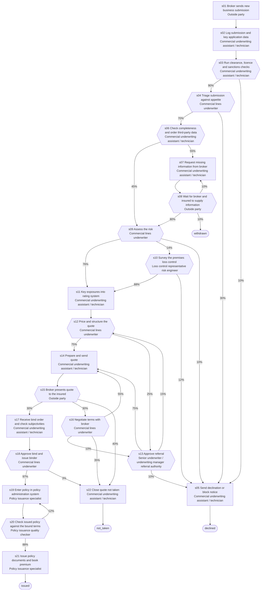

# Commercial property and casualty new business underwriting

`ins-commercial-underwriting` · property and casualty insurance · commercial lines underwriting

This process takes one new business submission for a small or mid-size commercial property and casualty account from a broker through clearance, triage, data gathering, risk assessment, pricing, referral, quote, negotiation, bind and policy issuance. Underwriting assistants log and re-key emailed ACORD forms and order third-party data, underwriters assess and price the risk within their authority, senior underwriters approve referrals, and policy services build and check the policy after binding. Most submissions are declined or lost to other carriers, so much underwriting effort produces no policy; elapsed time goes to underwriter queues, waits for missing broker information and the broker's market comparison, and the post-bind issuance backlog.

| | |
|---|---|
| Unit of work | one new business submission (one commercial account, one or more lines) |
| Starts when | A broker submits a new commercial account to the carrier for a quote. |
| Done when | A policy is issued, or the submission is declined, withdrawn, or quoted but not taken. |
| Organisation | A US regional property and casualty insurer with about 2,500 employees writing small and middle market commercial package, general liability, property, auto and umbrella business through independent agents and brokers. (2,500 employees, 2019-2022) |
| Volume | 3,000 cases a month (range 2,200 to 4,000) |

## Where it sits

- Starts with **new business submission** from Independent agents and brokers (100% of cases)
- Sends **issued policy and invoice** to Broker and insured (outcome: issued)
- Sends **booked premium** to Premium billing and collections (outcome: issued)
- Sends **in-force policy data** to Risk control (post-bind surveys) and reinsurance accumulation reporting (outcome: issued)
- Sends **declination notice** to Broker (outcome: declined)
- Sends **lost business reasons** to Underwriting management and product pricing (outcome: not_taken)
- Sends **submission status** to Broker (outcome: any)

## Flow

## Roles

| Role | Department | Layer | FTE on this process | Loaded cost per hour | Evidence |
|---|---|---|---:|---:|---|
| Commercial underwriting assistant / technician | Commercial lines underwriting operations | individual contributor | 45 | 42 USD | A [bls_clerk], [bls_ecec] |
| Commercial lines underwriter | Commercial lines underwriting | individual contributor | 48 | 66 USD | A [bls_uw], [bls_ecec] |
| Senior underwriter / underwriting manager (referral authority) | Commercial lines underwriting | manager | 2.4 | 105 USD | A [bls_uw], [bls_ecec] |
| Loss control representative (risk engineer) | Risk control | senior specialist | 7.2 | 67 USD | A [bls_ohs], [bls_ecec] |
| Policy issuance specialist | Commercial policy services | individual contributor | 6 | 39 USD | A [bls_clerk], [bls_ecec] |
| Policy issuance quality checker | Commercial policy services | senior specialist | 2.1 | 42 USD | B [bls_clerk], [bls_ecec] |

## Steps

Hands-on time and the wait before each step show the most common value. Evidence tier A is a sourced number, B a sourced description, C the author's estimate.

| Step | Who | Kind | Hands-on | Wait before | Control | Evidence |
|---|---|---|---:|---:|---|---|
| **s01 Broker sends new business submission.** A retail broker emails the submission to the carrier's submissions mailbox or underwriter: ACORD commercial application and line sections, schedule of locations and values, vehicle and driver lists, five years of loss runs, prior policy, target premium and the effective date, usually 30 to 90 days ahead. | Outside party | intake | 0 min | 0 min |  | B [ooh_uw] |
| **s02 Log submission and key application data.** An underwriting assistant opens the email, saves the attachments, creates a submission record in the workbench and re-types the insured's name, address, FEIN, industry class codes, lines requested, effective date and broker from the ACORD forms. | Commercial underwriting assistant / technician | data entry | 20 min | 8.0 h |  | B [bls_clerk] |
| **s03 Run clearance, licence and sanctions checks.** The assistant searches the policy system for the same insured under another broker, existing policies and prior declines, confirms the broker is licensed and appointed in the state, and screens the insured against the OFAC list. An account already cleared for another broker is blocked. | Commercial underwriting assistant / technician | lookup | 10 min | 30 min | Producer licensing (NAIC Model 218: no business from or commission to unlicensed producers) and OFAC sanctions regulations | B [naic218], [ofac_block] |
| **s04 Triage submission against appetite.** An underwriter reads the submission summary, checks class of business, size, locations, catastrophe exposure and loss history against the appetite guide, and decides whether to pursue it and how urgently, given the effective date and broker relationship. | Commercial lines underwriter | judgment | 15 min | 1.0 d | Underwriting guidelines and appetite guide | B [ooh_uw] |
| **s05 Send declination or block notice.** The assistant emails the broker that the carrier is declining the submission, or that the account is blocked because another broker has it, records the reason code and closes the submission. | Commercial underwriting assistant / technician | communication | 5 min | 4.0 h |  | C |
| **s06 Check completeness and order third-party data.** The assistant compares the package with the checklist for the lines requested, and orders business credit, property characteristics and catastrophe model results for property locations, and motor vehicle records for fleet drivers. Missing loss runs, unsigned applications or incomplete location schedules are listed. | Commercial underwriting assistant / technician | lookup | 25 min | 8.0 h |  | C |
| **s07 Request missing information from broker.** The assistant or underwriter emails the broker a list of what is still needed (current loss runs, building updates, driver lists, supplemental questionnaires) and diaries a follow-up. | Commercial underwriting assistant / technician | communication | 10 min | 1.0 h |  | C |
| **s08 Wait for broker and insured to supply information.** The broker asks the insured and prior carriers for the missing items; loss runs from prior carriers and supplemental applications often take days. Some brokers place the account elsewhere instead. | Outside party | external wait | 0 min | 3.0 d |  | C |
| **s09 Assess the risk.** The underwriter reviews the operations, exposures, building construction and protection, catastrophe model output, loss runs (frequency, severity, loss ratio, open claims), financial strength and driver records, and decides whether to quote, order a loss control survey first, or decline. | Commercial lines underwriter | analysis | 1.0 h | 2.0 d |  | B [ooh_uw] |
| **s10 Survey the premises (loss control).** A loss control representative schedules a visit with the insured, inspects buildings, fire protection, housekeeping, fleet and safety programmes, and writes a survey report with recommendations and a risk grade for the underwriter. | Loss control representative (risk engineer) | physical | 3.0 h | 5.0 d |  | C |
| **s11 Key exposures into rating system.** The assistant enters locations, values, class codes, payroll or sales, vehicles and limits from the submission into the rating system or the mid-market rating spreadsheet, re-typing figures already captured in the workbench. | Commercial underwriting assistant / technician | data entry | 30 min | 8.0 h |  | C |
| **s12 Price and structure the quote.** The underwriter runs the rating with the filed base rates, applies schedule rating credits or debits and experience modification within the filed rating plan, compares with the technical price, and sets limits, deductibles, exclusions and endorsements; risks beyond the letter of authority go to referral. | Commercial lines underwriter | judgment | 1.0 h | 4.0 h | State property and casualty rating laws: premiums must follow the insurer's filed rates and rating plans | C [ooh_uw] |
| **s13 Approve referral.** A senior underwriter or underwriting manager reviews the referral memo for risks that exceed the underwriter's letter of authority (size, class, catastrophe accumulation, schedule credits beyond limit) and approves, approves with changed terms, or declines. | Senior underwriter / underwriting manager (referral authority) | approval | 30 min | 2.0 d | Underwriting letters of authority and referral rules | C |
| **s14 Prepare and send quote.** The assistant generates the quote proposal with premium by line, terms, subjectivities and the terrorism coverage offer and premium disclosure, checks it against the underwriter's notes and emails it to the broker. | Commercial underwriting assistant / technician | drafting | 25 min | 4.0 h | Terrorism Risk Insurance Program disclosure, 31 CFR 50.10: terrorism premium and federal share disclosed at the time of offer | A [tria_disc] |
| **s15 Broker presents quote to the insured.** The broker compares the quote with other carriers' quotes and the incumbent's renewal, presents options to the insured and comes back to accept, ask for changes, or say the account went elsewhere. | Outside party | external wait | 0 min | 7.0 d |  | C |
| **s16 Negotiate terms with broker.** The underwriter reviews the broker's counter-request (lower premium, higher limits, removed exclusion), re-prices within authority or refers it, and replies with revised terms or holds firm. | Commercial lines underwriter | judgment | 30 min | 1.0 d |  | C |
| **s17 Receive bind order and check subjectivities.** The assistant logs the broker's bind request, checks that subjectivities are met (signed application, no-known-loss letter, inspection access, payment plan) and that the effective date and terms match the quote. | Commercial underwriting assistant / technician | validation | 20 min | 4.0 h |  | C |
| **s18 Approve bind and issue binder.** The underwriter confirms nothing material has changed since the quote, approves the bind and issues the binder to the broker as temporary evidence of coverage until the policy is issued. | Commercial lines underwriter | approval | 15 min | 4.0 h | Underwriting authority: only an authorised underwriter may bind coverage | B [irmi_binder] |
| **s19 Enter policy in policy administration system.** A policy issuance specialist builds the policy in the policy administration system from the binder and rating worksheet, re-keying locations, vehicles, limits, premiums and endorsements and attaching the forms. | Policy issuance specialist | data entry | 45 min | 3.0 d |  | C |
| **s20 Check issued policy against the bound terms.** A quality checker compares the declarations, forms, endorsements and premium with the binder and quote line by line and sends errors back to the issuance specialist. | Policy issuance quality checker | review | 20 min | 1.0 d | Maker-checker review of policy issuance | C |
| **s21 Issue policy documents and book premium.** The policy system finalises the policy, generates the documents and invoice, and the specialist sends the policy to the broker; the premium is booked for billing. | Policy issuance specialist | communication | 10 min | 4.0 h |  | C |
| **s22 Close quote not taken.** When the broker reports the account went elsewhere, or the effective date passes without a bind, the assistant records the lost reason (price, terms, incumbent retained) and the winning premium if known, and closes the submission. | Commercial underwriting assistant / technician | data entry | 5 min | 5.0 d |  | C |

## Exceptions

| Exception | Share of cases | What happens |
|---|---:|---|
| Clearance block | 10% | Another broker has already cleared the account, the broker is not licensed or appointed, or the insured is a sanctions match. |
| Incomplete submission | 34% | Loss runs, location values, driver lists or supplemental applications are missing and the assistant must chase the broker. |
| Loss control survey before quote | 7% | The underwriter needs a site survey before pricing a larger or hazardous risk. |
| Referral | 11% | Size, class, catastrophe accumulation or credits exceed the underwriter's authority and a senior underwriter must approve. |
| Negotiation | 13% | The broker asks for a lower premium or broader terms and the underwriter re-prices. |
| Issuance error | 2% | The checker finds the issued policy does not match the bound terms. |

## Benchmarks

| Metric | Value | Unit | Population | Evidence |
|---|---|---|---|---|
| cycle_time_days | p50 14, p90 55 | calendar days from submission received to final outcome (issued, declined, withdrawn or not taken) | US small and mid-market commercial P&C new business submissions, 2019-2022 | C |
| terrorism_disclosure_timing | at time of offer and renewal | rule | Commercial P&C policies subject to the Terrorism Risk Insurance Program | A [tria_disc] |
| underwriter_hourly_wage_usd | p25 28.29, median 36.73, p75 47.25, p90 60.76 | USD per hour | US insurance underwriters, May 2021 | A [bls_uw] |

## Pain points

- Submission data arrives as emailed PDFs and is re-typed into the workbench, the rater and again into the policy system, causing errors that the issuance checker must catch. (steps s02, s11, s19, s20; C)
- Underwriters spend much of their time on submissions that are declined or lost, while good submissions wait days in their queues and miss broker deadlines. (steps s04, s09, s15; C)
- Incomplete submissions cause chase loops for loss runs and location data. (steps s06, s07, s08; C)
- Referrals wait for a small number of senior underwriters, and policies are issued weeks after binding, leaving brokers waiting for documents. (steps s13, s19; C)

## Assumptions

- External steps (broker, insured) carry zero touch time; their effort is inside the waits, so the staffing comparison reflects carrier labour only.
- Outcome shares (10% blocked, 30% of cleared submissions declined at triage, about 55% of submissions quoted, about 35-40% of quotes bound, about 18% of submissions issued) are author estimates; no published quote or hit-ratio source was opened.
- The web search budget ran out before this workflow was researched, so sources are limited to pages whose addresses were already known; most step times and the cycle-time benchmark are tier C.
- Rating against filed rates and plans is a legal requirement in most states for admitted business; it is recorded as fixed by law but no statute was opened.
- Loss control surveys before quoting are modelled for 15% of assessed risks; many carriers survey after binding instead, which is outside this workflow.
- Stated FTEs are about 15% above the hands-on time implied at 130 productive hours a month; underwriters' renewal and portfolio work is excluded.
- Loaded cost = BLS May 2021 hourly wage x 1.49 (benefits: wages are 67% of compensation in financial activities, which includes insurance, BLS ECEC Dec 2021) x 1.2 for overhead (author estimate), about 1.8 x wage.

## Sources

- [bls_uw] [Occupational Employment and Wages, May 2021: 13-2053 Insurance Underwriters](https://www.bls.gov/oes/2021/may/oes132053.htm) (U.S. Bureau of Labor Statistics, 2022). Hourly wages: 25th percentile $28.29, median $36.73, 75th percentile $47.25, 90th percentile $60.76; insurance carriers mean $38.87
- [ooh_uw] [Occupational Outlook Handbook: Insurance Underwriters](https://www.bls.gov/ooh/business-and-financial/insurance-underwriters.htm) (U.S. Bureau of Labor Statistics, 2023). Underwriters analyse application information, screen applicants against criteria, review underwriting software recommendations, request more information and decide whether and at what premium and coverage to offer; commercial and complex lines need more judgement; they are the main link between the insurer and the agent
- [bls_clerk] [Occupational Employment and Wages, May 2021: 43-9041 Insurance Claims and Policy Processing Clerks](https://www.bls.gov/oes/2021/may/oes439041.htm) (U.S. Bureau of Labor Statistics, 2022). Hourly wages: 25th percentile $17.89, median $21.89, 75th percentile $23.49; process new policies and check applications for accuracy and completeness
- [bls_ohs] [Occupational Employment and Wages, May 2021: 19-5011 Occupational Health and Safety Specialists](https://www.bls.gov/oes/2021/may/oes195011.htm) (U.S. Bureau of Labor Statistics, 2022). Hourly wages: 25th percentile $28.60, median $37.29, 75th percentile $47.43 (used for loss control representatives)
- [bls_ecec] [Employer Costs for Employee Compensation, December 2021](https://www.bls.gov/news.release/archives/ecec_03182022.htm) (U.S. Bureau of Labor Statistics, 2022). Financial activities industry (includes insurance): wages 67.0% of total compensation (benefits loading factor 1.49)
- [tria_disc] [31 CFR 50.10 General disclosure requirements (Terrorism Risk Insurance Program)](https://www.law.cornell.edu/cfr/text/31/50.10) (Legal Information Institute, Cornell Law School, 2023). Insurers must disclose the premium for terrorism losses covered by the Program and the federal share, as a separate line item at the time of offer and renewal
- [naic218] [Producer Licensing Model Act (Model 218)](https://content.naic.org/sites/default/files/model-law-218.pdf) (National Association of Insurance Commissioners, 2005). Insurers may not pay commission to an unlicensed person; knowingly accepting business from an unlicensed individual is grounds for action; appointment notices
- [irmi_binder] [Binder (insurance definition)](https://www.irmi.com/term/insurance-definitions/binder) (International Risk Management Institute, 2024). A binder is a legal agreement issued by an agent or insurer giving temporary evidence of insurance until the policy can be issued
- [ofac_block] [31 CFR 501.603 Reports of blocked property](https://www.law.cornell.edu/cfr/text/31/501.603) (Legal Information Institute, Cornell Law School, 2023). Blocked property, including insurance contracts with sanctioned parties, must be reported to OFAC within 10 business days

Written by claude-opus on 2026-11-17.
