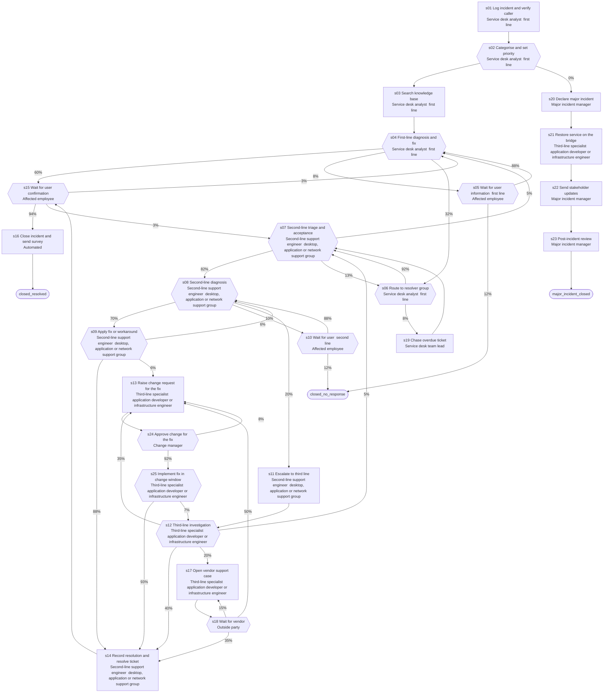

# IT incident management: one incident through an ITIL-style service desk

`it-incident-management` · cross-industry · information technology

This process restores normal service for one IT incident reported by an employee or raised by monitoring. The service desk logs, categorises and tries to fix it; about a third of incidents are routed to second-line resolver groups, and a smaller share to third-line engineers or a vendor, sometimes needing an approved change. A rare major incident follows a separate path with a bridge, updates and a review. Elapsed time is dominated by group queues, waits for users and vendors, change windows and the confirmation period before closure, and it grows with misrouting and reassignment between groups.

| | |
|---|---|
| Unit of work | one incident record |
| Starts when | An employee reports a fault by phone, portal, email or chat, or monitoring raises an alert that the service desk logs. |
| Done when | The incident is closed after confirmation or automatic closure, closed after the user stops responding, or the major incident review is complete. |
| Organisation | The internal IT function of a 5,000-employee organisation with an in-house service desk, second-line support groups, third-line engineering teams and outside vendors, all working in one ITSM tool. (5,000 employees, 2019-2022) |
| Volume | 2,000 cases a month (range 1,500 to 2,800) |

## Where it sits

- Starts with **fault report** from Employees using IT services (85% of cases)
- Starts with **alert** from Infrastructure and application monitoring (12% of cases)
- Starts with **change-related fault** from Change and release management (failed change) (3% of cases)
- Sends **restored service and resolution note** to Employees using IT services (outcome: closed_resolved)
- Sends **incident data for recurring faults and problem records** to Problem management (outcome: any)
- Sends **SLA measurements and survey results** to Service level reporting (outcome: any)
- Sends **new or updated knowledge article** to Knowledge management (outcome: closed_resolved)
- Sends **change requests for fixes** to Change and release management (outcome: any)
- Sends **vendor support cases** to Technology vendors (outcome: any)
- Sends **post-incident report** to IT leadership and business owners (outcome: major_incident_closed)

## Flow

## Roles

| Role | Department | Layer | FTE on this process | Loaded cost per hour | Evidence |
|---|---|---|---:|---:|---|
| Service desk analyst (first line) | IT service desk | individual contributor | 5.8 | 39 USD | B [bls_oews2021], [bls_ecec2021] |
| Service desk team lead | IT service desk | supervisor | 0.3 | 49 USD | B [bls_oews2021], [bls_ecec2021] |
| Second-line support engineer (desktop, application or network support group) | IT operations and application support | individual contributor | 8.5 | 63 USD | B [bls_oews2021], [bls_ecec2021] |
| Third-line specialist (application developer or infrastructure engineer) | IT engineering | senior specialist | 4.5 | 95 USD | B [bls_oews2021], [bls_ecec2021] |
| Change manager | IT service management office | senior specialist | 0.25 | 75 USD | B [bls_oews2021], [bls_ecec2021] |
| Major incident manager | IT service management office | manager | 0.7 | 75 USD | B [bls_oews2021], [bls_ecec2021], [itpm_wiki] |
| Affected employee | Any business unit | individual contributor | 0.75 | 60 USD | B [bls_oews2021], [bls_ecec2021], [happysignals_h2_2021] |

## Steps

Hands-on time and the wait before each step show the most common value. Evidence tier A is a sourced number, B a sourced description, C the author's estimate.

| Step | Who | Kind | Hands-on | Wait before | Control | Evidence |
|---|---|---|---:|---:|---|---|
| **s01 Log incident and verify caller.** The service desk analyst answers the call, chat or portal ticket, verifies the caller's identity, links the affected device or service from the configuration database and types a description of the symptom and its business impact into a new incident record. | Service desk analyst (first line) | intake | 4 min | 10 min | Information security policy: verify identity before account or access changes | B [itpm_wiki], [bpic2014_case] |
| **s02 Categorise and set priority.** The analyst picks a category and subcategory, rates impact and urgency to derive the priority from the matrix, and checks the open major incidents to see whether this is part of a known outage. | Service desk analyst (first line) | judgment | 1 min | 0 min | ITSM policy and service level agreements: impact by urgency priority matrix sets response and resolution targets | A [emory_itsm], [itpm_wiki] |
| **s03 Search knowledge base.** The analyst searches the knowledge base and known error records using the symptom and error text, and opens any matching article or workaround. | Service desk analyst (first line) | lookup | 2 min | 0 min |  | B [itpm_wiki] |
| **s04 First-line diagnosis and fix.** The analyst works the issue with the user, often through remote control: resets passwords, clears caches, repairs configuration or applies a documented workaround, then records what was done. If the fix is outside first-line skills or access, the analyst prepares to escalate. | Service desk analyst (first line) | analysis | 8 min | 0 min |  | A [hdi_flr2017], [hdi_roi2019] |
| **s05 Wait for user information (first line).** The ticket is set to a wait-user status while the user supplies a screenshot, error code or a time for a remote session. The analyst sends up to three reminders before closing a silent ticket. | Affected employee | external wait | 5 min | 12.0 h |  | B [bpic2013_preface], [bpic2013_poznan], [bpic2013_data] |
| **s06 Route to resolver group.** The analyst chooses the second-line assignment group from the category and configuration item, writes handover notes on what was tried, and reassigns the incident. Re-routing after a wrong assignment also passes through here. | Service desk analyst (first line) | coordination | 3 min | 6 min |  | B [itpm_wiki], [bpic2013_preface] |
| **s07 Second-line triage and acceptance.** An engineer in the resolver group picks the incident from the group queue, reads the notes and history, and accepts it, passes it to another group or sends it back to the service desk as something first line should resolve. | Second-line support engineer (desktop, application or network support group) | review | 5 min | 6.0 h |  | A [hdi_l1capable2018], [bpic2013_preface], [happysignals_h2_2021] |
| **s08 Second-line diagnosis.** The engineer reviews logs, monitoring and recent changes for the configuration item, reproduces the fault or connects to the device, and decides on a fix, a wait for the user, or escalation to third line. | Second-line support engineer (desktop, application or network support group) | analysis | 25 min | 30 min |  | C |
| **s09 Apply fix or workaround.** The engineer applies the fix: reconfigures software, restores access, replaces a part or visits the desk, and tests with the user where possible. Fixes that alter production systems need a change record. | Second-line support engineer (desktop, application or network support group) | physical | 20 min | 2.0 h |  | C |
| **s10 Wait for user (second line).** The incident is parked in a wait-user status while the user is out, cannot be reached or must test at a later time. The SLA clock is usually paused, which hides part of the elapsed time from reports. | Affected employee | external wait | 5 min | 1.0 d |  | B [bpic2013_preface], [bpic2013_poznan] |
| **s11 Escalate to third line.** The second-line engineer writes an escalation note with the evidence gathered and assigns the incident to the application or infrastructure engineering team, sometimes after calling the team lead. | Second-line support engineer (desktop, application or network support group) | coordination | 10 min | 12 min |  | B [bpic2013_preface], [itpm_wiki] |
| **s12 Third-line investigation.** A specialist developer or infrastructure engineer takes the incident from the team queue between project work, investigates code, configuration or capacity, and fixes it directly, prepares a change, or opens a case with the vendor. Recurring faults are linked to a problem record. | Third-line specialist (application developer or infrastructure engineer) | analysis | 1.0 h | 1.0 d |  | B [bpic2013_poznan], [itpm_wiki] |
| **s13 Raise change request for the fix.** The specialist fills in a change request with the fix, test evidence, back-out plan, risk rating and proposed window, and links it to the incident. | Third-line specialist (application developer or infrastructure engineer) | drafting | 30 min | 4.0 h |  | B [bpic2014_case], [bpic2014_incidents] |
| **s14 Record resolution and resolve ticket.** The resolving engineer writes the resolution notes and closure code, links any problem or change record, and sets the incident to resolved, which notifies the user. | Second-line support engineer (desktop, application or network support group) | data entry | 5 min | 12 min |  | C |
| **s15 Wait for user confirmation.** The user receives the resolution email and can confirm or reject it. Most users do not reply, and the tool closes the ticket automatically after a set number of days; a rejection reopens it. | Affected employee | external wait | 1 min | 3.0 d | ITSM closure policy: user confirmation or automatic closure after the resolved period | B [snow_autoclose], [itpm_wiki] |
| **s16 Close incident and send survey.** The scheduled job closes the incident, freezes the SLA measurements and sends a satisfaction survey to a sample of users. Team leads review a sample of closed tickets for quality outside this flow. | Automated | system auto | 0 min | 0 min |  | B [snow_autoclose], [hdi_quartiles2017] |
| **s17 Open vendor support case.** The specialist opens a case on the vendor's support portal, uploads logs and configuration details, states the business impact and contract severity, and records the vendor case number in the incident. | Third-line specialist (application developer or infrastructure engineer) | communication | 30 min | 2.0 h |  | B [itpm_wiki], [bpic2013_preface] |
| **s18 Wait for vendor.** The incident sits in a wait-vendor status while the vendor analyses the case, asks questions or ships a patch. The specialist chases at intervals and relays updates to the user. | Outside party | external wait | 0 min | 3.0 d |  | C |
| **s19 Chase overdue ticket.** The SLA warning at 50% or 75% of the target alerts the service desk team lead, who checks why the ticket has not been picked up, calls the resolver group lead and pushes for an owner. | Service desk team lead | coordination | 10 min | 1.0 d |  | A [emory_itsm] |
| **s20 Declare major incident.** The major incident manager reviews the impact, confirms the major incident, opens the bridge, pages the on-call engineers and suppliers, and links the incoming user tickets to the parent record. | Major incident manager | judgment | 20 min | 15 min | Major incident procedure: incident manager declares and leads a temporary major incident team | B [itpm_wiki], [sre_incidents], [pagerduty_ir] |
| **s21 Restore service on the bridge.** Three to six engineers and vendor staff work the outage on the bridge, check recent changes, fail over or roll back, and apply a workaround to restore service; the touch time is their combined effort. | Third-line specialist (application developer or infrastructure engineer) | analysis | 10.0 h | 9 min |  | B [sre_incidents], [itpm_wiki] |
| **s22 Send stakeholder updates.** The major incident manager sends updates every 30 to 60 minutes to IT leadership, the business and the service desk, and posts the all-clear when service is restored. | Major incident manager | communication | 1.0 h | 0 min |  | B [sre_incidents], [pagerduty_ir] |
| **s23 Post-incident review.** Within about a week the major incident manager collects the timeline, holds a review with the teams involved, writes the report with causes and actions, and hands the root cause to problem management. | Major incident manager | analysis | 6.0 h | 4.0 d | Major incident procedure: a major incident review follows every major incident | B [itpm_wiki], [sre_incidents] |
| **s24 Approve change for the fix.** The change manager checks the change record for risk, testing and back-out, consults affected owners, and approves it at the weekly change advisory board or as an expedited change for urgent incidents. | Change manager | approval | 10 min | 2.0 d | IT general controls over change management (for example Sarbanes-Oxley section 404 at listed companies): production changes are authorised before implementation | C |
| **s25 Implement fix in change window.** The specialist deploys the fix in the approved window, often an evening or weekend slot, checks monitoring, and backs it out if the deployment fails. | Third-line specialist (application developer or infrastructure engineer) | physical | 30 min | 2.0 d |  | C |

## Exceptions

| Exception | Share of cases | What happens |
|---|---:|---|
| Major incident | 0% | A widespread outage or loss of a critical service is declared a major incident and handled on a bridge with regular updates and a post-incident review. |
| Third-line escalation | 7% | Second line cannot fix the fault and passes it to application or infrastructure engineers. |
| Fix needs an approved change | 4% | The fix alters production and waits for change approval and a maintenance window. |
| Vendor involvement | 2% | The fault is in a vendor product or vendor-run service and waits on the vendor's support case. |
| Reassignment ping-pong | 5% | The incident goes to the wrong group and is passed back or on, adding queue time each hop. |
| Reopened after resolution | 6% | The user rejects the resolution or the fault recurs within the confirmation period. |
| User stops responding | 2% | The ticket is closed after reminders go unanswered during a wait-user status. |

## Benchmarks

| Metric | Value | Unit | Population | Evidence |
|---|---|---|---|---|
| cycle_time_days | p50 3.5, p90 9 | calendar days from logging to closed status (includes the resolved-to-closed confirmation period) | Internal IT incidents at large organisations (composite estimate) | C [freshworks_kpis], [emory_itsm], [snow_autoclose] |
| first_level_resolution_rate | low 0.614, high 0.778 | share of tickets resolved by the service desk | MetricNet benchmark, service desks without and with remote control tools (2017) | A [hdi_flr2017] |
| cost_per_ticket_by_level | service_desk 22, desktop_support 69, level_3 104 | USD fully loaded per ticket | North America, MetricNet (about 2018) | A [hdi_roi2019] |
| level_1_capable_share_of_desktop_tickets | 0.178 | share | MetricNet desktop support benchmark (2018); range 2.7% to 35.1% | A [hdi_l1capable2018] |
| lost_user_time_per_reassignment_hours | 1.63 | hours of end-user work time per extra reassignment | HappySignals, 748,878 responses, July to December 2021 | A [happysignals_h2_2021] |
| resolution_target_hours | P1 8, P2 48, P3 96, P4 384 | hours (business hours for P3 and P4) | One university ITSM default service level | A [emory_itsm] |

## Pain points

- Incidents are pushed to second line that the service desk could have resolved, raising cost per ticket from about 22 to 91 USD. (steps s04, s06, s07; A [hdi_l1capable2018], [hdi_roi2019], [bpic2013_preface])
- Misrouting and reassignment between groups add queue time; each extra reassignment costs users over an hour and a half of work time. (steps s06, s07, s12; A [happysignals_h2_2021], [bpic2013_poznan])
- Wait-user and wait-vendor statuses pause SLA clocks, so reported resolution times understate what users experience. (steps s05, s10, s18; B [bpic2013_preface])
- Third-line engineers take incidents between project work, so escalated incidents wait a day or more in team queues. (steps s12; C)
- Fixes that need a production change wait for the weekly change board and a maintenance window. (steps s24, s25; C)

## Assumptions

- Touch time for the affected user covers only replies and tests with IT; the user's lost work time (about two to three hours per incident in end-user surveys) is not modelled as touch time.
- A major incident is modelled as one case; the many user tickets linked to it are separate cases resolved at s15 when service returns.
- Major incidents are 0.3% of incidents (about six a month at this volume), an author estimate.
- Waits are calendar time including nights and weekends; group queues for P3 and P4 incidents often span overnight.
- The confirmation period before automatic closure is about three days; organisations set anywhere from one to ten days.
- The BPI Challenge 2013 and 2014 logs were used for the flow variants (support lines, wait-user and wait-vendor statuses, links to changes) but not for timings, because their statistics could not be read from the published PDFs.
- Loaded hourly cost = BLS May 2021 median wage x 1.42 benefits factor (ECEC December 2021) x 1.15 overhead factor.
- The Freshservice resolution time comes from 2024 data outside the reference period and is used only as an order-of-magnitude check.
- Simulated labour cost (about 83 USD per incident, touch time only) is above a MetricNet-based blended figure of about 55 USD (22 USD at level 1, plus 69 USD desktop support and 104 USD level 3 for escalated tickets). The gap comes mainly from second- and third-line application and infrastructure time and major incidents, so those touch times should be read as upper-middle estimates.

## Sources

- [bpic2013_preface] [Preface to Business Process Intelligence Challenge 2013](https://ceur-ws.org/Vol-1052/preface.html) (CEUR Workshop Proceedings, Vol-1052, 2013). Volvo IT Belgium VINST incident log; process owner questions on push to front (cases pushed to 2nd and 3rd line too often or too soon), ping-pong between teams, abuse of the wait-user substatus, and differences between IT organisations.
- [bpic2013_data] [BPI Challenge 2013, incidents](https://data.4tu.nl/datasets/0fc5c579-e544-4fab-9143-fab1f5192432) (4TU.ResearchData (Ghent University), 2013). Public event log of the Volvo IT incident management system.
- [bpic2013_poznan] [Analysis of the Volvo IT incident and problem handling processes using process mining and social network analysis](https://www.kti.ue.poznan.pl/node/3633) (Poznan University of Economics, Department of Information Systems, 2013). Findings on the BPIC 2013 log: hidden support lines degrading incident handling performance; little localised ping-pong and wait-user misuse.
- [bpic2014_case] [BPI Challenge 2014 case description](https://ais.win.tue.nl/bpi/2014/challenge.html) (Eindhoven University of Technology, BPI workshop, 2014). Rabobank Group ICT ITIL service desk data from HP Service Manager: interactions, incidents, incident activities and changes; question of how changes drive service desk and IT operations workload.
- [bpic2014_incidents] [BPI Challenge 2014: incident details](https://data.4tu.nl/articles/_/12692378/1) (4TU.ResearchData, 2014). Public incident records extracted from an ITIL service management tool.
- [hdi_roi2019] [Metric of the month: the ROI of support, part 1](https://www.thinkhdi.com/library/supportworld/2019/metric-of-month-roi-support-part-1) (HDI SupportWorld (Jeff Rumburg, MetricNet), 2019). North American fully loaded cost per ticket: 22 USD service desk, 69 USD desktop support, 104 USD level 3; 21% of tickets resolved by desktop support could have been resolved by the level 1 service desk.
- [hdi_flr2017] [Metric of the month: first level resolution rate](https://www.thinkhdi.com/library/supportworld/2017/metric-of-month-first-level-resolution-rate) (HDI SupportWorld (Jeff Rumburg, MetricNet), 2017). Average first level resolution 77.8% for service desks with remote control tools and 61.4% without.
- [hdi_l1capable2018] [Metric of the month: percent resolved level 1 capable](https://www.thinkhdi.com/library/supportworld/2018/metric-of-month-percent-resolved-level-1-capable) (HDI SupportWorld (Jeff Rumburg, MetricNet), 2018). Share of desktop support tickets that level 1 could have resolved: 2.7% to 35.1%, average 17.8%; an escalated ticket costs 22 plus 69 USD.
- [hdi_tickets2018] [Metric of the month: tickets per user per month](https://www.thinkhdi.com/library/supportworld/2018/metric-of-month-tickets-per-user-per-month) (HDI SupportWorld (Jeff Rumburg, MetricNet), 2018). Desktop support volume from 0.54 to 1.38 tickets per seat per month; 3.9 to 11.2 desktop technicians per 1,000 seats; tickets are incidents plus service requests.
- [hdi_quartiles2017] [Turbocharge your metrics with benchmarking](https://www.thinkhdi.com/library/supportworld/2017/turbocharge-your-metrics-with-benchmarking) (HDI SupportWorld (Jeff Rumburg, MetricNet), 2017). Benchmark of 42 service desks: top-quartile customer satisfaction 89.1% to 96.6%; cost per ticket quartile ranges.
- [itpm_wiki] [Incident Management (ITIL)](https://wiki.en.it-processmaps.com/index.php/Incident_Management) (IT Process Maps wiki, n.d.). ITIL sub-processes: logging and categorisation, immediate resolution by 1st level, resolution by 2nd level with suppliers, major incident handling by a temporary team led by the incident manager, monitoring and escalation, closure with user satisfaction check and quality control, major incident review.
- [emory_itsm] [Incident process guidelines](https://it.emory.edu/smcc/itsm_process/incident/process-guidelines.html) (Emory University IT service management, n.d.). Impact by urgency priority matrix; default resolution targets P1 8 hours, P2 48 hours, P3 96 hours and P4 384 hours (business hours for P3 and P4); SLA notifications at 50%, 75% and breach to the assignment group manager.
- [snow_autoclose] [Incident auto close configuration](https://www.servicenow.com/community/itsm-articles/incident-auto-close-configuration/ta-p/2302132) (ServiceNow Community (ITSM articles), n.d.). Property sets the number of days after which resolved incidents are closed automatically by a scheduled job.
- [happysignals_h2_2021] [The global IT experience benchmark: H2/2021](https://www.happysignals.com/global-it-experience-benchmark-2021h2) (HappySignals, 2022). 748,878 end-user responses July to December 2021; each additional ticket reassignment costs end users 1 hour 38 minutes more lost work time; walk-in incidents lose 1 hour 41 minutes on average.
- [sre_incidents] [Managing incidents (Site Reliability Engineering, chapter 14)](https://sre.google/sre-book/managing-incidents/) (Google, 2016). Incident commander, operations, communications and planning roles; living incident document; declare an incident when a second team is needed, customers see it, or it is unsolved after an hour.
- [pagerduty_ir] [Incident response guide](https://docs.pagerduty.com/ops-guides/incident-response-guide) (PagerDuty, n.d.). Major incident roles: incident commander, deputy, scribe, subject matter experts, customer and internal liaisons; severity levels and postmortem process.
- [freshworks_kpis] [IT service management metrics and KPIs](https://www.freshworks.com/explore-it/it-service-management-metrics-kpis/) (Freshworks, 2024). Freshservice benchmark 2024: average resolution time 19.64 hours for media and internet industries; resolution SLA attainment 95.7%.
- [bls_oews2021] [May 2021 national occupational employment and wage estimates, United States](https://www.bls.gov/oes/2021/may/oes_nat.htm) (US Bureau of Labor Statistics, 2022). Median hourly wages: 15-1232 23.93, 15-1231 30.17, 15-1244 38.75, 15-1252 58.05, 15-1299 45.80, 13-0000 36.81 USD.
- [bls_ecec2021] [Employer costs for employee compensation, December 2021](https://www.bls.gov/news.release/archives/ecec_03182022.htm) (US Bureau of Labor Statistics, 2022). Private industry wages and salaries were 70.5% of employer compensation costs (December 2021).

Written by claude-opus on 2026-11-17.
