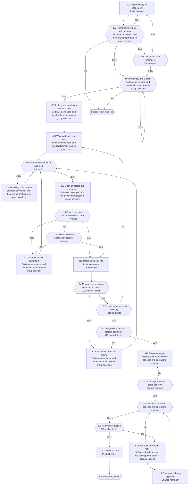

# Software change delivery: one user story from refinement to verified release

`it-software-change-delivery` · cross-industry · software engineering

This process takes one user story or small change in a product engineering team from backlog refinement to a verified production release. The product owner, developers, a code reviewer, a designer for some stories, a tester, a release engineer and a change manager each handle it, and some changes also need a security review. Hands-on work is a small share of the elapsed time: the story waits for refinement and sprint planning, for reviewers, for testers, for the release train and for the weekly change board. Rework loops come from failed builds, review comments, defects found in testing and the occasional failed deployment.

| | |
|---|---|
| Unit of work | one user story or small change |
| Starts when | A backlog item reaches the top of the product owner's list and is prepared for refinement. |
| Done when | The change is live in production, verified and the story is closed; or the story is dropped. |
| Organisation | A product engineering group of about 150 people in 18 Scrum teams inside a 1,500-employee company, with two-week sprints, pull request reviews, continuous integration, a shared QA function, a two-week release train and a weekly change advisory board. (1,500 employees, 2019-2022) |
| Volume | 350 cases a month (range 250 to 450) |

## Where it sits

- Starts with **feature request** from Product roadmap and planning (60% of cases)
- Starts with **defect report or improvement request** from Customer support and incident management (30% of cases)
- Starts with **technical or compliance change** from Security, compliance and platform teams (10% of cases)
- Sends **released feature** to Customers and internal users (outcome: released_and_verified)
- Sends **release notes** to Customer support (outcome: released_and_verified)
- Sends **change record with approvals and test evidence** to Change management and audit (outcome: any)
- Sends **closed backlog item** to Product roadmap and planning (outcome: dropped_from_backlog)
- Sends **production defects from failed changes** to Incident management (outcome: any)

## Flow

## Roles

| Role | Department | Layer | FTE on this process | Loaded cost per hour | Evidence |
|---|---|---|---:|---:|---|
| Product owner | Product management | senior specialist | 4.8 | 78 USD | B [bls_oews2021], [bls_ecec2021], [scrum_guide] |
| Software developer (and the development team in group sessions) | Product engineering | individual contributor | 46 | 95 USD | B [bls_oews2021], [bls_ecec2021] |
| Senior developer (code reviewer) | Product engineering | senior specialist | 4.2 | 109 USD | B [bls_oews2021], [bls_ecec2021] |
| UX designer | Product design | individual contributor | 4.8 | 75 USD | B [bls_oews2021], [bls_ecec2021] |
| QA analyst (tester) | Quality engineering | individual contributor | 11 | 77 USD | B [bls_oews2021], [bls_ecec2021] |
| Application security engineer | Information security | senior specialist | 0.6 | 80 USD | B [bls_oews2021], [bls_ecec2021] |
| Release and operations engineer | Platform operations | individual contributor | 2.2 | 75 USD | B [bls_oews2021], [bls_ecec2021] |
| Change manager | IT service management office | senior specialist | 0.45 | 75 USD | B [bls_oews2021], [bls_ecec2021], [itpm_change] |

## Steps

Hands-on time and the wait before each step show the most common value. Evidence tier A is a sourced number, B a sourced description, C the author's estimate.

| Step | Who | Kind | Hands-on | Wait before | Control | Evidence |
|---|---|---|---:|---:|---|---|
| **s01 Prepare story for refinement.** The product owner takes a request or roadmap item from the backlog, writes it as a user story with acceptance criteria, attaches screenshots or customer evidence, and flags open questions for the team. | Product owner | drafting | 45 min | 1.0 d |  | B [scrum_guide] |
| **s02 Refine and estimate with the team.** In the weekly refinement session the developers, tester and product owner discuss the story, split it if large, agree acceptance criteria and estimate it in story points. The touch time is the team's combined time on this story. | Software developer (and the development team in group sessions) | judgment | 45 min | 3.0 d |  | B [scrum_guide] |
| **s03 Design the user interface.** The UX designer sketches the flow, builds mock-ups or a clickable prototype, checks it with the product owner and sometimes with users, and attaches the final design to the story. | UX designer | drafting | 5.0 h | 3.0 d |  | C |
| **s04 Plan story into a sprint.** At sprint planning the team compares its capacity with the ordered backlog and commits to a set of stories; this story is either taken into the sprint or left for a later one. The touch time is the team's share of planning time. | Software developer (and the development team in group sessions) | coordination | 1.0 h | 5.0 d |  | B [scrum_guide] |
| **s05 Pick up story and plan the approach.** A developer moves the story to in progress, reads the design and code involved, and notes the technical approach and tasks, sometimes after a short discussion with a senior colleague. | Software developer (and the development team in group sessions) | analysis | 45 min | 2.0 d |  | C |
| **s06 Write code and unit tests.** The developer creates a branch, writes the change and its unit tests, runs them locally, and pushes commits. Larger stories take several days of interrupted work alongside meetings and support duties. | Software developer (and the development team in group sessions) | drafting | 7.0 h | 0 min |  | C |
| **s07 Run automated build and tests.** The continuous integration server builds the branch and runs unit, integration and static analysis checks, then reports pass or fail on the pull request. | Automated | system auto | 0 min | 30 min |  | B [fowler_ci] |
| **s08 Fix failing build or tests.** The developer reads the build log, reproduces the failure locally, fixes the code or reruns or repairs a flaky test, and pushes the corrected commits so the build runs again. | Software developer (and the development team in group sessions) | analysis | 30 min | 1.0 h |  | B [fowler_ci] |
| **s09 Open or update pull request.** The developer opens the pull request with a description, links the story, tags reviewers and posts in the team chat. After rework the same step updates the request and asks for another look. | Software developer (and the development team in group sessions) | communication | 10 min | 0 min |  | C |
| **s10 Peer code review.** A senior developer reads the diff, checks logic, tests, naming and security issues, runs it locally if needed, and approves or requests changes. Pull requests often wait hours for a reviewer who is busy with their own work. | Senior developer (code reviewer) | review | 30 min | 4.0 h | Peer review before merge: a second developer approves every change (branch protection), used to meet IT general control requirements for program changes | A [meta_review2022], [smartbear_review], [dora_change_approval] |
| **s11 Address review comments.** The developer replies to each comment, changes the code or explains the choice, and pushes new commits, which rerun the build. | Software developer (and the development team in group sessions) | drafting | 45 min | 2.0 h |  | C |
| **s12 Security review.** An application security engineer reviews changes to authentication, payment or personal data handling against the secure coding standard and threat model, and approves or asks for fixes. | Application security engineer | review | 1.5 h | 2.0 d | Secure development policy: security review of changes to sensitive functions | C |
| **s13 Merge and deploy to test environment.** The pull request is merged to the main branch and the pipeline deploys the build to the shared test environment, either at once or in a nightly job. | Automated | system auto | 0 min | 30 min |  | B [fowler_ci], [sre_release] |
| **s14 Manual testing against acceptance criteria.** The QA analyst writes or updates test cases, tests the story in the test environment on the supported browsers or devices, tries edge cases, and logs defects with steps to reproduce. | QA analyst (tester) | validation | 1.5 h | 1.0 d |  | C |
| **s15 Fix defects found in testing.** The developer reproduces each defect, fixes it, adds a test and pushes, which sends the change back through build, review and testing. | Software developer (and the development team in group sessions) | analysis | 1.0 h | 4.0 h |  | C |
| **s16 Product owner accepts the story.** The product owner tries the feature in the test environment or sees it at the sprint review, compares it with the acceptance criteria and accepts it or asks for changes. | Product owner | review | 20 min | 1.0 d |  | B [scrum_guide] |
| **s17 Regression test the release candidate.** When the release branch is cut, QA runs the automated regression suite and a manual regression checklist on staging for all stories in the release. The touch time is this story's share. | QA analyst (tester) | validation | 30 min | 4.0 d |  | B [sre_release] |
| **s18 Prepare change request and release notes.** The release engineer raises the production change record with the list of stories, test evidence, risk rating, deployment and back-out plan, and drafts the release notes. | Release and operations engineer | drafting | 15 min | 4.0 h |  | B [itpm_change] |
| **s19 Change advisory board approval.** The change manager reviews the change record and presents it at the weekly change advisory board, where operations, security and business representatives check risk, timing and conflicts before approving. | Change manager | approval | 5 min | 2.0 d | IT general controls over program change management (Sarbanes-Oxley section 404 for listed companies): production changes authorised before deployment | B [itpm_change], [wiki_itgc], [dora_change_approval] |
| **s20 Deploy to production.** In the approved window the release engineer runs the deployment pipeline, watches health checks and error rates, and rolls back if the release fails. Developers do not deploy to production themselves. | Release and operations engineer | coordination | 20 min | 1.0 d | IT general controls: separation between developers and those who move code to production | B [wiki_itgc], [sre_release] |
| **s21 Verify in production.** After the release the QA analyst runs smoke tests on the live system and checks monitoring dashboards and support channels for errors linked to the story. | QA analyst (tester) | validation | 20 min | 1.0 h |  | C |
| **s22 Roll back or prepare hotfix.** The developer, with the release engineer, decides whether to roll back or fix forward, writes and tests the hotfix on a branch, and gets a quick peer review. | Software developer (and the development team in group sessions) | analysis | 1.5 h | 1.0 h |  | C |
| **s23 Emergency change approval.** The change manager convenes the emergency change board or a delegated approver by phone or chat, reviews the hotfix risk and back-out plan, and approves an out-of-cycle deployment. | Change manager | approval | 15 min | 2.0 h | IT general controls: emergency changes approved by an emergency change board and reviewed after the fact | B [itpm_change] |
| **s24 Close the story.** The product owner or developer updates the story to done, links the release, and the change record is closed after the post-implementation check. | Product owner | data entry | 5 min | 12.0 h |  | B [itpm_change] |

## Exceptions

| Exception | Share of cases | What happens |
|---|---:|---|
| Story needs interface design | 22% | The story goes to the UX designer before it can be planned. |
| Deferred at sprint planning | 15% | The story does not fit the sprint's capacity and waits for the next planning session. |
| Defects found in testing | 30% | QA or regression testing finds defects; the fix goes back through build, review and test. |
| Security review | 5% | Changes to authentication, payments or personal data need application security sign-off. |
| Failed change in production | 11% | The deployment fails or a defect appears after release; the team rolls back or hotfixes under an emergency change. |
| Dropped | 6% | The story is dropped at refinement or planning as no longer worth building. |

## Benchmarks

| Metric | Value | Unit | Population | Evidence |
|---|---|---|---|---|
| cycle_time_days | p50 30, p90 60 | calendar days from refinement start to verified production release | Product teams with two-week sprints, a release train and a weekly change board (composite estimate) | C [scrum_guide], [dora2022] |
| code_review_time_in_review | p50 a few hours | hours a change waits on reviewer action | Meta, early 2021 (slowest quartile up to a day longer) | A [meta_review2022] |
| review_size_and_session | lines 200 to 400, minutes 60, defects_found 70% to 90% | lines of code per review, minutes per session, share of defects found | SmartBear study of a Cisco programming team | A [smartbear_review] |
| delivery_performance_mix | medium_share_2022 0.69, low_share_2022 0.19 | share of survey respondents | DORA Accelerate State of DevOps survey 2022 | A [dora2022] |
| elite_lead_time_for_changes | under one hour | commit to production | DORA 2021 elite performers (not typical practice) | A [dora2021] |

## Pain points

- Pull requests wait for reviewers busy with their own work; overdue reviews slow delivery. (steps s10; A [nudge2020], [meta_review2022])
- Stories wait for the next refinement session, sprint planning and release train, so batching adds weeks regardless of effort. (steps s02, s04, s17; C)
- The weekly change advisory board adds days without evidence of fewer failed changes. (steps s19; B [dora_change_approval])
- Manual testing in a shared test environment queues behind other teams and finds defects late, sending work back through build and review. (steps s14, s15, s17; C)
- Unclear acceptance criteria cause re-refinement and late product owner rejections. (steps s01, s02, s16; C)

## Assumptions

- Group sessions (refinement, sprint planning) are attributed to the developer role with the whole team's time on this story as touch time.
- Regression testing, change preparation and change board time are shared across all stories in a release; the touch time is one story's share.
- Time spent in the backlog before the story is selected for refinement is excluded; it can be months.
- Two-week sprints, a two-week release train and a weekly change board are author choices representing common practice in established companies; teams with continuous deployment skip s17 to s19.
- Combined failed-change share (failed deployments plus production defects) is about 11%, an author estimate.
- DORA cluster thresholds for lead time could not be extracted from the report PDFs, so the cycle time benchmark is a tier C composite.
- Loaded hourly cost = BLS May 2021 median wage x 1.42 benefits factor (ECEC December 2021) x 1.15 overhead factor.

## Sources

- [scrum_guide] [The Scrum Guide (2020)](https://scrumguides.org/scrum-guide.html) (Ken Schwaber and Jeff Sutherland, 2020). Sprints of one month or less; product backlog refinement breaks items down and adds detail and size; product owner orders the backlog; Definition of Done; sprint review and retrospective.
- [smartbear_review] [Best practices for peer code review](https://smartbear.com/learn/code-review/best-practices-for-peer-code-review/) (SmartBear, n.d.). From a study of a Cisco programming team: review 200 to 400 lines at a time, under 500 lines per hour, no more than 60 minutes per session; such reviews find 70% to 90% of defects.
- [meta_review2022] [Improving code review time at Meta](https://engineering.fb.com/2022/11/16/culture/meta-code-review-time-improving/) (Meta Engineering, 2022). Time in review is time a diff waits on reviewer action; median a few hours in early 2021, with the slowest quartile taking up to a day longer; a nudge bot cut average time in review by 7%.
- [nudge2020] [Nudge: accelerating overdue pull requests towards completion](https://arxiv.org/abs/2011.12468) (arXiv (Microsoft Research authors), 2020). Overdue pull requests slow development; in a randomised trial on 147 Microsoft repositories, reminders cut resolution time of overdue pull requests by 60% across 8,500 pull requests.
- [dora2021] [Announcing the 2021 Accelerate State of DevOps report](https://cloud.google.com/blog/products/devops-sre/announcing-dora-2021-accelerate-state-of-devops-report) (Google Cloud (DORA), 2021). Elite performers' lead time for changes fell from under one day to under one hour; high and elite performers were two thirds of respondents in 2021, while low and medium were 56% in 2019.
- [dora2022] [2022 Accelerate State of DevOps report now out](https://cloud.google.com/blog/products/devops-sre/dora-2022-accelerate-state-of-devops-report-now-out) (Google Cloud (DORA), 2022). In 2022 the medium cluster held 69% of respondents and low performers rose from 7% to 19%; no elite cluster emerged.
- [dora_change_approval] [Capabilities: streamlining change approval](https://dora.dev/capabilities/streamlining-change-approval/) (DORA, n.d.). Heavyweight external change approval slows delivery and no evidence links it to lower change fail rates; peer review recommended to meet segregation of duties.
- [itpm_change] [Change Management (ITIL)](https://wiki.en.it-processmaps.com/index.php/Change_Management) (IT Process Maps wiki, n.d.). RFC logging and pre-evaluation, assessment by the change manager or the change advisory board, emergency changes via an emergency CAB, pre-authorised standard changes, deployment authorisation, post implementation review.
- [wiki_itgc] [Information technology general controls](https://en.wikipedia.org/wiki/Information_technology_general_controls) (Wikipedia, n.d.). Program change management controls are among the most common IT general controls.
- [fowler_ci] [Continuous integration](https://martinfowler.com/articles/continuousIntegration.html) (Martin Fowler, 2024). Every push triggers an integration build and tests; a failed build is fixed right away; a ten minute commit build; slower test stages follow in a deployment pipeline; test environments mimic production.
- [sre_release] [Release engineering (Site Reliability Engineering, chapter 8)](https://sre.google/sre-book/release-engineering/) (Google, 2016). Automated builds and tests on each change, release branches, packaged artifacts, staged rollouts; frequent releases mean fewer changes between versions.
- [bls_oews2021] [May 2021 national occupational employment and wage estimates, United States](https://www.bls.gov/oes/2021/may/oes_nat.htm) (US Bureau of Labor Statistics, 2022). Median hourly wages: 15-1252 58.05, 15-1253 47.22, 15-1211 47.73, 15-1212 49.33, 15-1299 45.80 USD.
- [bls_ecec2021] [Employer costs for employee compensation, December 2021](https://www.bls.gov/news.release/archives/ecec_03182022.htm) (US Bureau of Labor Statistics, 2022). Private industry wages and salaries were 70.5% of employer compensation costs (December 2021).

Written by claude-opus on 2026-11-17.
