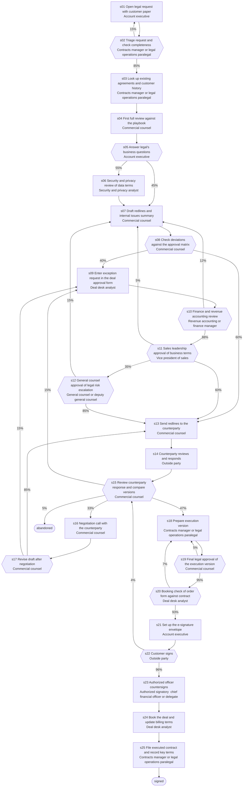

# In-house legal review of a sales contract on the customer's paper

`legal-commercial-contract-review` · software and IT services · legal

A customer sends its own form of agreement for a software or services purchase, and the company's in-house legal team has to turn it into terms the company can accept. The account executive opens a legal request, a contracts manager triages it, commercial counsel reviews the document against the playbook and sends redlines, and finance, sales leadership and sometimes the general counsel approve terms outside the standard positions. The draft then goes back and forth with the customer's lawyers for one to three rounds before a clean version is signed by both sides and filed. Most of the elapsed time is waiting: in the legal queue, for approvers, and above all for the customer's own legal and procurement staff.

| | |
|---|---|
| Unit of work | one sales contract on the customer's paper (master agreement or services agreement with its order form) |
| Starts when | The account executive receives the customer's form of agreement and opens a legal request on the CRM opportunity. |
| Done when | The agreement is signed by both parties, the deal is booked and the executed contract is filed with its key terms recorded, or the deal is abandoned during negotiation. |
| Organisation | A US software or IT services company selling to business customers, with a legal team of five to ten people and a contracts manager, using a CRM, email, Word and e-signature. (1,000 employees, 2019-2022) |
| Volume | 18 cases a month (range 8 to 35) |

## Where it sits

- Starts with **customer contract draft with order form** from Sales opportunity management (85% of cases)
- Starts with **customer contract draft sent directly to legal** from Customer procurement or legal department (15% of cases)
- Sends **fully executed agreement** to Customer (outcome: signed)
- Sends **booked order and billing schedule** to Order booking and billing (outcome: signed)
- Sends **filed contract with key terms** to Contract repository and obligation management (outcome: signed)
- Sends **stalled or lost deal with negotiation history** to Sales opportunity management (outcome: abandoned)

## Flow

## Roles

| Role | Department | Layer | FTE on this process | Loaded cost per hour | Evidence |
|---|---|---|---:|---:|---|
| Account executive | Sales | individual contributor | 0.25 | 85 USD | B [bls_salesrep], [bls_ecec], [gitlab] |
| Contracts manager or legal operations paralegal | Legal | individual contributor | 0.4 | 55 USD | B [bls_paralegal], [bls_ecec], [acc2019] |
| Commercial counsel | Legal | senior specialist | 1.6 | 150 USD | B [bls_lawyer], [bls_ecec], [acc2019] |
| General counsel or deputy general counsel | Legal | executive | 0.05 | 230 USD | C [bls_lawyer] |
| Security and privacy analyst | Information security | senior specialist | 0.12 | 93 USD | B [bls_infosec], [bls_ecec], [utsa] |
| Deal desk analyst | Sales operations and finance | individual contributor | 0.2 | 84 USD | C [bls_finanalyst], [bls_ecec] |
| Revenue accounting or finance manager | Finance | manager | 0.1 | 125 USD | B [bls_finmgr], [bls_ecec], [forvis] |
| Vice president of sales | Sales | director | 0.04 | 140 USD | C [bls_salesmgr], [bls_ecec] |
| Authorized signatory (chief financial officer or delegate) | Executive | executive | 0.03 | 175 USD | B [bls_ceo], [bls_ecec], [gitlab] |

## Steps

Hands-on time and the wait before each step show the most common value. Evidence tier A is a sourced number, B a sourced description, C the author's estimate.

| Step | Who | Kind | Hands-on | Wait before | Control | Evidence |
|---|---|---|---:|---:|---|---|
| **s01 Open legal request with customer paper.** The account executive receives the customer's master agreement or services agreement by email, opens a legal request on the CRM opportunity, attaches the customer document and any order form or statement of work, and fills in deal value, products, deadline and the customer contacts. | Account executive | intake | 20 min | 8.0 h |  | B [gitlab] |
| **s02 Triage request and check completeness.** The contracts manager reviews the new request in the legal queue, checks that the customer document, order form, deal value and deadline are present, logs the matter in the tracker, sets a priority based on deal size and quarter end, and either assigns a counsel or returns the request for missing information. | Contracts manager or legal operations paralegal | validation | 15 min | 12.0 h | Legal intake policy: requests only through the CRM legal case with required fields; negotiation thresholds by deal size | B [gitlab], [acc2019] |
| **s03 Look up existing agreements and customer history.** The contracts manager searches the repository and the CRM for an existing NDA, prior master agreement, earlier redlines or past concessions with this customer or its parent company, and attaches anything found to the request so counsel does not start from nothing. | Contracts manager or legal operations paralegal | lookup | 20 min | 30 min |  | B [docusign2019] |
| **s04 First full review against the playbook.** Commercial counsel reads the customer's agreement clause by clause and compares it with the company playbook: limitation of liability, indemnities, intellectual property, warranties, service levels, data protection, payment, termination, audit rights and governing law. Counsel notes each deviation, its risk and the fallback position allowed. | Commercial counsel | analysis | 2.5 h | 3.0 d |  | B [utsa], [lexion2024], [gcai], [docusign2019] |
| **s05 Answer legal's business questions.** The account executive answers counsel's questions about scope, service levels, pricing, implementation services and what was promised to the customer, often after checking with the customer or a solutions engineer, and replies in the CRM case or by email. | Account executive | communication | 30 min | 12.0 h |  | C |
| **s06 Security and privacy review of data terms.** The security and privacy analyst reviews the customer's security exhibit, data processing terms and any audit, breach notice or data location requirements against the company's actual controls and certifications, and marks what the company can and cannot commit to. | Security and privacy analyst | review | 1.2 h | 2.0 d | Information security policy: customer security and data processing commitments reviewed by security; data processing terms needed where the company processes personal data for the customer | B [utsa] |
| **s07 Draft redlines and internal issues summary.** Counsel marks up the customer's document in track changes with explanatory comments, inserts the company's positions on each issue, and writes a short internal summary of open points and of any terms that fall outside the playbook fallbacks. | Commercial counsel | drafting | 2.0 h | 4.0 h |  | B [gitlab], [docusign2019] |
| **s08 Check deviations against the approval matrix.** Counsel compares the proposed positions with the approval matrix to see which deviations need business, finance or general counsel approval, such as payment terms beyond 60 days, liability above the standard cap, termination for convenience or acceptance clauses. | Commercial counsel | judgment | 20 min | 0 min |  | C |
| **s09 Enter exception request in the deal approval form.** The deal desk analyst copies the non-standard terms from counsel's summary into the CRM deal approval form, adds deal value, margin and payment schedule, and routes it to the approvers the matrix names. | Deal desk analyst | data entry | 30 min | 12.0 h | Deal desk approval matrix for non-standard commercial terms | C |
| **s10 Finance and revenue accounting review.** The finance manager reviews payment terms, acceptance, termination rights, service credits and any penalties or price protections for their effect on cash flow and on revenue recognition, then approves, approves with conditions, or rejects with a counter-position. | Revenue accounting or finance manager | approval | 45 min | 2.0 d | Revenue recognition policy under ASC 606 and internal control over financial reporting: accounting review of non-standard terms before execution | B [forvis], [docusign2019] |
| **s11 Sales leadership approval of business terms.** The vice president of sales reviews the commercial concessions such as service credits, extended payment terms or price holds against the deal's value and approves or declines in the CRM, sometimes after a call with the account executive. | Vice president of sales | approval | 15 min | 4.0 h | Deal desk approval matrix: sales leadership approves commercial concessions above thresholds | C |
| **s12 General counsel approval of legal risk escalation.** The general counsel reviews the escalation memo for deviations such as uncapped liability, broad intellectual property indemnities or unusual audit rights, weighs them against deal value and strategic importance, and approves, sets a limit, or refuses. | General counsel or deputy general counsel | approval | 30 min | 2.0 d | Contract playbook escalation rules: deviations beyond fallback positions need general counsel approval | B [gitlab] |
| **s13 Send redlines to the counterparty.** Counsel sends the redlined draft with a cover note explaining the main changes to the customer's procurement or legal contact, copying the account executive, and records the version sent in the CRM case. | Commercial counsel | communication | 15 min | 1.0 h |  | B [docusign2019] |
| **s14 Counterparty reviews and responds.** The customer's procurement and legal staff review the redlines in their own queue, consult their business owner and return a revised draft, often with some changes not tracked, or ask for a call. | Outside party | external wait | 0 min | 5.0 d |  | B [utsa] |
| **s15 Review counterparty response and compare versions.** Counsel runs a document compare against the last version sent, reads every change including untracked ones, decides which customer positions fit within the playbook fallbacks, and decides whether terms are agreed, need another round, or need a new approval. | Commercial counsel | analysis | 1.2 h | 1.0 d |  | B [docusign2019] |
| **s16 Negotiation call with the counterparty.** Counsel and the account executive schedule and hold a call with the customer's counsel and procurement to work through the remaining issues, trading positions within the fallbacks and noting agreed wording. | Commercial counsel | communication | 1.0 h | 3.0 d |  | C |
| **s17 Revise draft after negotiation.** Counsel updates the draft to reflect what was agreed on the call, adjusts related clauses for consistency, and decides whether any concession now needs approval before the draft goes back to the customer. | Commercial counsel | drafting | 1.0 h | 4.0 h |  | C |
| **s18 Prepare execution version.** The contracts manager accepts all changes, removes comments, checks that the customer legal entity, addresses, dates, exhibits and order form match the agreed terms, and saves a clean execution version as a PDF. | Contracts manager or legal operations paralegal | drafting | 40 min | 12.0 h |  | C |
| **s19 Final legal approval of the execution version.** Counsel opens the execution version, spot-checks the agreed changes and the order form, and applies the legal approval in the CRM case so the document may be sent for signature. | Commercial counsel | approval | 10 min | 8.0 h | Legal sign-off policy: all agreements need legal approval on the document before signature | B [gitlab] |
| **s20 Booking check of order form against contract.** The deal desk analyst compares the order form, quote and approved exceptions with the final contract terms, checking price, payment terms, term length and billing dates, so the deal can be booked without later revenue or billing corrections. | Deal desk analyst | validation | 20 min | 12.0 h | Quote-to-cash booking control: signed terms must match approved pricing and exceptions (internal control over revenue) | C |
| **s21 Set up the e-signature envelope.** The account executive creates the e-signature envelope from the CRM, adds the customer signer first and the company's authorized signatory second, and copies counsel and the contracts manager. | Account executive | coordination | 15 min | 4.0 h |  | B [gitlab] |
| **s22 Customer signs.** The customer's authorized signer receives the envelope and signs, which may wait for the customer's own internal approvals, purchase order or supplier registration before the signature is applied. | Outside party | external wait | 0 min | 1.0 d |  | B [docusignblog] |
| **s23 Authorized officer countersigns.** The company's authorized signatory, usually the chief financial officer or a delegate named in the signature authority matrix, opens the envelope, checks the legal approval and deal value, and signs. | Authorized signatory (chief financial officer or delegate) | approval | 10 min | 12.0 h | Delegation of signature authority: sales staff may not sign; only officers in the authorization matrix sign customer agreements | B [gitlab] |
| **s24 Book the deal and update billing terms.** The deal desk analyst marks the opportunity closed-won, attaches the executed agreement, and re-keys the term dates, payment terms, billing schedule and any service credit obligations into the billing system so invoicing follows the contract. | Deal desk analyst | data entry | 25 min | 12.0 h | Revenue and billing controls: booked order must be supported by an executed contract | C |
| **s25 File executed contract and record key terms.** The contracts manager saves the executed agreement in the repository under the customer name, enters metadata such as term, renewal, liability cap, notice periods and non-standard obligations in the tracker, and closes the legal case. | Contracts manager or legal operations paralegal | data entry | 25 min | 1.0 d | Contract record retention policy; external auditors request executed contracts when testing revenue | B [docusign2019], [gitlab] |

## Exceptions

| Exception | Share of cases | What happens |
|---|---:|---|
| Missing intake information | 15% | The request lacks the order form, deal value or the customer's legal entity and goes back to the account executive before triage can finish. |
| Security and data processing terms | 55% | The customer's paper includes a security exhibit or data processing terms that the security and privacy analyst must review before counsel can finish the redlines. |
| Escalation to general counsel | 17% | The customer demands uncapped liability, broad indemnities or unusual audit rights, which need finance, sales and general counsel approval before counsel can respond. |
| Approver rejects proposed position | 8% | Finance, sales leadership or the general counsel refuses a concession, so counsel must redraft and the approval runs again on the next round. |
| Deal lost or abandoned in negotiation | 10% | The customer chooses another vendor or the deal stalls past the quarter, and the legal case is closed without signature. |
| Last-minute change at signature | 4% | The customer's signer or procurement asks for a change after the envelope is sent, which reopens review and voids the envelope. |
| Booking mismatch | 7% | The deal desk finds that the quote, approvals and contract disagree on price, term or payment terms and the execution version is corrected before signature. |

## Benchmarks

| Metric | Value | Unit | Population | Evidence |
|---|---|---|---|---|
| cycle_time_days | p50 35, p90 80 | calendar days from legal request to signed and filed | Customer-paper sales contracts at mid-size US software and services companies (author's synthesis) | C [acc2019], [ironclad], [utsa], [gcai] |
| contract_cycle_time_all_types_days | median_of_department_averages 15, mean 173.2 | days from initial request to completion or abandonment | 444 legal departments worldwide, 2018 data | A [acc2019] |
| legal_review_cycle_time_days | median_of_company_averages 15 | days from receipt by legal to turnaround or approval for signing | 69 companies in APQC Open Standards Benchmarking | A [gcai] |
| msa_cycle_time_days_technology | mean 50 | days to execute a complex master services agreement | Technology companies in the Ironclad 2025 Contracting Benchmark | A [ironclad] |
| first_full_review_business_days_non_standard | low_risk 6, moderate_risk 10, high_risk 14 | business days | One university business contracts office (buy side) | A [utsa] |
| share_contracts_three_to_four_versions | 0.52 | share of respondents saying contracts typically go through three to four versions before signing | 802 contracting staff at US companies over 250 employees, 2019 | A [docusign2019] |
| share_reviews_within_five_days | legal_view 0.82, sales_view 0.59 | share of respondents | Hundreds of in-house legal and sales staff, 2023 survey | A [lexion2024] |
| contracts_reviewed_per_inside_lawyer | mean 89.6 | contracts per lawyer per year | ACC 2019 respondents, 2018 data | A [acc2019] |
| share_agreements_signed_within_24_hours | 0.79 | share of e-signature envelopes | DocuSign users | A [docusignblog] |

## Pain points

- Requests wait days in the legal queue before counsel's first full review, and sales sees legal as the bottleneck. (steps s04; A [lexion2024], [utsa])
- Approvals for non-standard terms run through several busy approvers and stall deals, especially when run one after another. (steps s09, s10, s11, s12; A [docusign2019])
- Each round with the customer's lawyers adds one to three weeks of waiting, and customer paper needs more rounds than the company's own template. (steps s14, s15, s16; B [gitlab], [docusign2019], [utsa])
- Untracked changes and version confusion force full document compares and occasionally let an unreviewed change through. (steps s14, s15, s13; B [docusign2019])
- Contract terms are re-keyed by hand into approval forms, billing and a metadata tracker, and executed contracts are hard to find later. (steps s09, s24, s25, s03; A [docusign2019])

## Assumptions

- The company is a mid-size US software or services vendor of about 1,000 employees with five to ten in-house legal staff; the process is the customer-paper path only.
- Volume of 18 customer-paper contracts a month is an estimate; companies with strict negotiation thresholds see fewer, enterprise-focused vendors see more.
- Branch probabilities for approvals, negotiation rounds and abandonment are the author's estimates calibrated so the average number of versions matches the DocuSign 2019 finding that half of contracts go through three to four versions.
- The cycle-time benchmark is a synthesis: published medians of 15 days (ACC 2019, APQC) cover all contract types including simple templates, and the 50-day Ironclad figure is a mean for complex technology master agreements; the simulated median of about 40 days sits between them, which fits the customer-paper case.
- Approvals by finance and sales leadership are modelled as running in parallel (short wait on the second approver); companies that route them one after another will see longer cycles.
- The process ends when the executed contract is filed; filing can lag signature by days, so cycle time to signature is a few days shorter than the simulated figure.
- Hands-on times for counsel (about 12 hours per contract including rounds) are estimates; DocuSign 2019 reports a third of respondents say a typical contract takes more than 30 hours to negotiate across all parties.
- Loaded costs use BLS May 2021 wages times about 1.7 (benefits factor 1.44 from BLS ECEC plus about 20% overhead, the author's estimate).
- Several sources are vendor surveys or post-2022 publications (Lexion 2023, Ironclad 2025); they are used as indications of typical practice in the reference period.

## Sources

- [acc2019] [2019 Global Legal Department Benchmarking Report](https://www.acc.com/sites/default/files/2019-07/ACC_Benchmark_071919_Full.pdf) (Association of Corporate Counsel with Major, Lindsey & Africa, 2019). Contract cycle time from initial request to completion or abandonment: median 15 days, mean 173.2, n=444 departments (2018 data). Contracts reviewed per department median 300 a year; contracts reviewed per inside lawyer mean 89.6. Contract review and drafting work done in-house is 80.8% by lawyers and 10.9% by paralegals.
- [lexion2024] [Survey: Sales teams view legal departments as slow on contract review](https://www.legaldive.com/news/sales-teams-view-about-legal-departments-lexion-legal-tech-survey/704796/) (Legal Dive (reporting Lexion's 2023 State of Legal Tech survey), 2024). 82% of legal respondents and 59% of sales respondents say contract reviews and approvals take five days or less; 26% of sales say more than 10 days; 44% of sales say legal does not return documents quickly enough.
- [ironclad] [How to slash contract cycle time](https://ironcladapp.com/resources/articles/how-to-slash-contract-cycle-time) (Ironclad, 2025). Ironclad 2025 Contracting Benchmark: technology industry average 5 days for a simple NDA and 50 days for a complex master services agreement; an approval chain of three or four approvers adds about a week (illustrative).
- [gcai] [Contract cycle time: benchmarks and how to measure it](https://gc.ai/blog/contract-cycle-time) (GC AI, 2026). Reports the APQC Open Standards Benchmarking median of 15 days for legal contract review (receipt by legal to turnaround or approval for signing, 69 companies) and UTSA review times by risk tier. Secondary report of APQC; the APQC page itself was not accessible.
- [utsa] [Cycle Times and Contract Timeframes](https://www.utsa.edu/bco/resources/average-contract-cycle-time.html) (University of Texas at San Antonio, Business Contracts Office, 2023). First full review 6, 10 and 14 business days for non-standard low, moderate and high risk agreements; execution 10 to 14 business days, 1 to 2 months and 3 to 4 months; time after first review depends on the other party's response time, secondary reviews such as information security, and business approvals.
- [gitlab] [Sales Guide: Collaborating with GitLab Legal](https://handbook.gitlab.com/handbook/legal/customer-negotiations/) (GitLab Handbook, 2026). Practitioner description: sales opens a legal case on the CRM opportunity with documents and deadline; cases enter a queue and a lawyer self-assigns; all agreements need a legal approval stamp before signature; only individuals in the authorization matrix may sign; DocuSign sent from the CRM; escalation process for material non-standard terms; negotiation thresholds by deal size; customer paper means extensive modifications and a longer time frame.
- [docusign2019] [Inefficiency in contract management leaves money on the table, finds DocuSign report](https://www.docusign.com/company/news-center/inefficiency-in-contract-management-leaves-money-on-the-table-finds-docusign-report) (DocuSign, 2019). Survey of 802 contracting staff at companies over 250 employees: 52% say contracts go through three to four versions before signing; 33% say a typical contract takes 30+ hours to negotiate; 84% say approvals have stalled deals; 80% share contracts by email; 31% manage contracts in spreadsheets; 39% could not locate contracts.
- [docusignblog] [The bottom line on e-signature: 5 stats every CFO should know](https://docusign.com/blog/the-bottom-line-e-signature-5-stats-every-cfo-should-know) (DocuSign, 2020). Users sign 79% of agreements within 24 hours (vendor statistic; post date not shown, year approximate).
- [forvis] [When contract modifications impact revenue recognition](https://www.forvismazars.us/forsights/2023/09/when-contract-modifications-impact-revenue-recognition) (Forvis Mazars, 2023). Proposed changes to standard terms should be reviewed by both legal and accounting before execution; termination rights, pricing deviations, penalties and license rights change revenue recognition under ASC 606.
- [bls_lawyer] [Occupational Employment and Wages, May 2021: 23-1011 Lawyers](https://www.bls.gov/oes/2021/may/oes231011.htm) (US Bureau of Labor Statistics, 2022). Lawyers mean hourly wage $71.17, median $61.54, 25th percentile $39.24, 75th $93.55; mean $95.63 in management of companies and enterprises.
- [bls_paralegal] [Occupational Employment and Wages, May 2021: 23-2011 Paralegals and Legal Assistants](https://www.bls.gov/oes/2021/may/oes232011.htm) (US Bureau of Labor Statistics, 2022). Mean hourly wage $28.04, median $27.03, 25th percentile $21.82, 75th $34.98.
- [bls_finmgr] [Occupational Employment and Wages, May 2021: 11-3031 Financial Managers](https://www.bls.gov/oes/2021/may/oes113031.htm) (US Bureau of Labor Statistics, 2022). Mean hourly wage $73.78, median $63.32, 25th percentile $47.89, 75th $92.24.
- [bls_salesrep] [Occupational Employment and Wages, May 2021: 41-4011 Sales Representatives, Wholesale and Manufacturing, Technical and Scientific Products](https://www.bls.gov/oes/2021/may/oes414011.htm) (US Bureau of Labor Statistics, 2022). Mean hourly wage $49.40, median $45.60, 25th percentile $29.76, 75th $62.92.
- [bls_salesmgr] [Occupational Employment and Wages, May 2021: 11-2022 Sales Managers](https://www.bls.gov/oes/2021/may/oes112022.htm) (US Bureau of Labor Statistics, 2022). Mean hourly wage $68.46, median $61.30, 75th percentile $83.18.
- [bls_infosec] [Occupational Employment and Wages, May 2021: 15-1212 Information Security Analysts](https://www.bls.gov/oes/2021/may/oes151212.htm) (US Bureau of Labor Statistics, 2022). Mean hourly wage $54.46, median $49.33, 25th percentile $38.18, 75th $63.14.
- [bls_finanalyst] [Occupational Employment and Wages, May 2021: 13-2051 Financial and Investment Analysts](https://www.bls.gov/oes/2021/may/oes132051.htm) (US Bureau of Labor Statistics, 2022). Mean hourly wage $49.53, median $44.03, 25th percentile $31.75, 75th $59.91.
- [bls_ceo] [Occupational Employment and Wages, May 2021: 11-1011 Chief Executives](https://www.bls.gov/oes/2021/may/oes111011.htm) (US Bureau of Labor Statistics, 2022). Mean hourly wage $102.41, median $86.31.
- [bls_ecec] [Employer Costs for Employee Compensation, December 2020](https://www.bls.gov/news.release/archives/ecec_03182021.htm) (US Bureau of Labor Statistics, 2021). Private industry management, professional and related occupations: total compensation $61.72 per hour, wages $42.95, benefits 30.4% of compensation.

Written by claude-opus on 2026-11-17.
