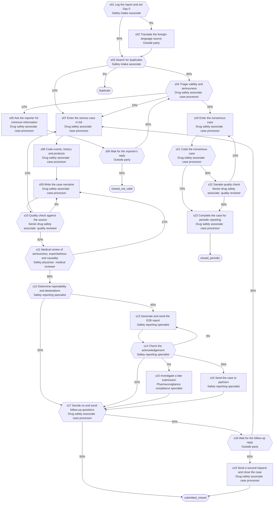

# Pharmacovigilance processing of one individual case safety report (postmarketing)

`ls-adverse-event-case` · life sciences (pharmaceuticals) · drug safety and pharmacovigilance

When a patient, doctor, pharmacist or partner tells a drug company about a side effect, the company must record it as an individual case safety report, judge whether it is valid and serious, enter and code it in a safety database, write a narrative, check its quality and have a physician review it. Serious unexpected cases must reach FDA electronically within 15 calendar days of first receipt, and the company must chase missing information. Most work is manual reading and re-keying of unstructured reports, with queues at data entry, quality review and medical review, and many reporters never answer follow-up requests.

| | |
|---|---|
| Unit of work | one individual case safety report (initial report or follow-up version) |
| Starts when | Any employee, vendor or partner of the company receives information about an adverse event with one of its products. |
| Done when | The case is submitted to FDA within the deadline and follow-up attempts are completed, or it is completed for periodic reporting, closed as not valid, or merged as a duplicate. |
| Organisation | A mid-size US pharmaceutical company with about ten marketed products, an in-house pharmacovigilance operations team (part of the data entry often outsourced) and a commercial safety database. (5,000 employees, 2019-2022) |
| Volume | 1,500 cases a month (range 1,200 to 2,000) |

## Where it sits

- Starts with **adverse event report** from Medical information and call center (40% of cases)
- Starts with **solicited adverse event report** from Patient support and market research programs (25% of cases)
- Starts with **partner case** from Affiliates and licensing partners (20% of cases)
- Starts with **spontaneous report** from Health professionals and patients writing directly (email, fax, web form) (15% of cases)
- Sends **15-day Alert or follow-up ICSR** to US Food and Drug Administration (FAERS) (outcome: submitted_closed)
- Sends **case under the safety data exchange agreement** to Licensing partners (outcome: submitted_closed)
- Sends **completed ICSR** to Periodic safety reporting (PADER or PSUR) (outcome: closed_periodic)
- Sends **coded case data** to Signal detection and safety surveillance (outcome: any)

## Flow

## Roles

| Role | Department | Layer | FTE on this process | Loaded cost per hour | Evidence |
|---|---|---|---:|---:|---|
| Safety intake associate | Pharmacovigilance operations | individual contributor | 4.2 | 42 USD | C [bls_oes2021], [bls_ecec2021] |
| Drug safety associate (case processor) | Pharmacovigilance operations | individual contributor | 20 | 70 USD | C [bls_oes2021], [bls_ecec2021] |
| Senior drug safety associate (quality reviewer) | Pharmacovigilance operations | senior specialist | 4.5 | 85 USD | C [bls_oes2021], [bls_ecec2021] |
| Safety physician (medical reviewer) | Drug safety and pharmacovigilance | senior specialist | 3 | 220 USD | C [bls_oes2021], [bls_ecec2021] |
| Safety reporting specialist | Pharmacovigilance regulatory reporting | individual contributor | 1.8 | 66 USD | C [bls_oes2021], [bls_ecec2021] |
| Pharmacovigilance compliance specialist | Pharmacovigilance quality and compliance | senior specialist | 0.3 | 72 USD | C [bls_oes2021], [bls_ecec2021] |

## Steps

Hands-on time and the wait before each step show the most common value. Evidence tier A is a sourced number, B a sourced description, C the author's estimate.

| Step | Who | Kind | Hands-on | Wait before | Control | Evidence |
|---|---|---|---:|---:|---|---|
| **s01 Log the report and set Day 0.** The intake associate opens the report from the safety mailbox, fax, call center or affiliate transfer, records the date the company first received it as Day 0, creates a case shell in the safety database and attaches the source documents. | Safety intake associate | intake | 10 min | 4.0 h | 21 CFR 314.80(c)(1): the 15 calendar day clock starts at initial receipt of the information by the applicant. | B [cfr314_80], [schmider2018] |
| **s02 Translate the foreign-language source.** A translation vendor receives the source document through a secure portal, translates it into English, and the translation is attached to the case before duplicate search and data entry. | Outside party | external wait | 0 min | 1.0 d |  | C |
| **s03 Search for duplicates.** The intake associate searches the safety database by patient initials, age or birth date, product, event and reporter to decide whether the report is new, follow-up to an existing case, or a duplicate of one already received from another channel. | Safety intake associate | lookup | 6 min | 30 min | EU GVP Module VI Addendum I on duplicate management, and company SOP. | B [ema_gvp] |
| **s04 Triage validity and seriousness.** A drug safety associate checks the four minimum criteria (identifiable patient, identifiable reporter, suspect product and adverse event), judges seriousness against the regulatory definitions, flags whether the event appears in the label, and sets the priority and due date. | Drug safety associate (case processor) | judgment | 10 min | 2.0 h | 21 CFR 314.80(a) definitions of serious and unexpected; ICH E2D minimum criteria for a valid case. | A [cfr314_80], [schmider2018], [ema_e2d] |
| **s05 Ask the reporter for minimum information.** The associate sends a letter, email or call to the reporter asking for the missing patient, product or event details, and diarizes the case for the response. | Drug safety associate (case processor) | communication | 10 min | 2.0 h |  | C |
| **s06 Wait for the reporter's reply.** The case is diarized while the consumer or health professional decides whether to answer the request for minimum information; many never reply, and the case is closed as not valid after the diary date. | Outside party | external wait | 0 min | 7.0 d |  | C |
| **s07 Enter the serious case in full.** The associate keys patient details, medical history, suspect and concomitant products with doses and dates, events with onset and outcome, lab results and reporter details from the source documents into the safety database fields. | Drug safety associate (case processor) | data entry | 50 min | 8.0 h |  | B [schmider2018] |
| **s08 Code events, history and products.** The associate codes each event, indication and history item to a MedDRA lowest level term and each product to WHODrug, checking the auto-suggested terms against the reporter's words. | Drug safety associate (case processor) | lookup | 12 min | 0 min | MedDRA coding and ICH E2B data structure required for electronic ICSRs to FDA (21 CFR 314.80(g)). | B [fda_aems], [whodrug] |
| **s09 Write the case narrative.** The associate writes a chronological narrative of the case from the source, following the company template: patient, history, product exposure, event course, treatment, outcome and reporter comments. | Drug safety associate (case processor) | drafting | 30 min | 1.0 h |  | C |
| **s10 Quality check against the source.** A senior associate compares every entered field, code and the narrative with the source documents, records findings in the quality log and returns the case for correction when errors are found. | Senior drug safety associate (quality reviewer) | review | 25 min | 12.0 h | Company PV quality system SOP requiring independent quality review of serious cases before submission. | C |
| **s11 Medical review of seriousness, expectedness and causality.** The safety physician reviews the case and narrative, confirms seriousness and whether the event is listed in the current label, assesses causality, adds a company comment and approves the case or sends it back. | Safety physician (medical reviewer) | judgment | 20 min | 1.0 d | Company PV SOP requiring physician medical review of serious cases; expectedness judged against current labeling per 21 CFR 314.80(a). | B [schmider2018], [cfr314_80] |
| **s12 Determine reportability and destinations.** The reporting specialist reviews the destinations the safety database rules propose (FDA 15-day report, partners, other authorities) against seriousness, expectedness and source, confirms due dates and schedules the reports. | Safety reporting specialist | validation | 5 min | 2.0 h |  | A [cfr314_80] |
| **s13 Generate and send the E2B report.** The specialist generates the E2B ICSR file from the safety database, checks it against the case, and transmits it to FDA through the Electronic Submissions Gateway. | Safety reporting specialist | data entry | 10 min | 4.0 h | 21 CFR 314.80(c)(1)(i) 15-day Alert report and 314.80(g) electronic submission format. | A [cfr314_80] |
| **s14 Check the acknowledgement.** The specialist checks the gateway and business-rule acknowledgements, records the submission date in the case and the compliance tracker, and re-sends any rejected file. | Safety reporting specialist | validation | 3 min | 4.0 h |  | C |
| **s15 Investigate a late submission.** The compliance specialist records the late case, finds the cause (late transfer from an affiliate, missed seriousness, backlog) and opens or links a corrective and preventive action. | Pharmacovigilance compliance specialist | analysis | 40 min | 3.0 d | PV quality system compliance monitoring of 15-day timeliness, reviewed in FDA inspections. | C |
| **s16 Send the case to partners.** Under safety data exchange agreements, the specialist sends the case to licensing or co-marketing partners by secure email or E2B within the agreed timelines and logs the transfer. | Safety reporting specialist | communication | 6 min | 4.0 h | Safety data exchange agreement with each partner. | C |
| **s17 Decide on and send follow-up questions.** The associate lists missing information that matters for assessment (lab values, dechallenge, outcome) and sends a targeted follow-up letter or questionnaire to the reporter. | Drug safety associate (case processor) | communication | 10 min | 4.0 h | 21 CFR 314.80(c)(1)(ii): promptly investigate 15-day reports and submit follow-up within 15 days of new information. | A [cfr314_80], [schmider2018] |
| **s18 Wait for the follow-up reply.** The case is diarized while the reporter decides whether to answer the follow-up questions; any reply is logged as a new version of the same case with its own Day 0 for the 15-day follow-up clock. | Outside party | external wait | 0 min | 14.0 d |  | C |
| **s19 Send a second request and close the case.** After the diary date the associate sends a second request; when there is still no answer the case is closed with the follow-up attempts documented. | Drug safety associate (case processor) | communication | 6 min | 10.0 d |  | C |
| **s20 Enter the nonserious case.** The associate keys the main fields for the nonserious case, with a shorter narrative, at lower priority than serious cases. | Drug safety associate (case processor) | data entry | 20 min | 5.0 d |  | C |
| **s21 Code the nonserious case.** The associate codes each event and indication to a MedDRA lowest level term and each product to WHODrug, checking the terms the safety database suggests against the reporter's verbatim text. | Drug safety associate (case processor) | lookup | 6 min | 0 min |  | B [fda_aems], [whodrug] |
| **s22 Sample quality check.** A senior associate checks a sample of nonserious cases field by field against the source documents, records findings in the quality log and returns cases with errors for correction. | Senior drug safety associate (quality reviewer) | review | 12 min | 1.0 d | Company PV quality system SOP for sample-based review of nonserious cases. | C |
| **s23 Complete the case for periodic reporting.** The associate marks the case complete so it is included as an ICSR in the next periodic report and is available for signal detection. | Drug safety associate (case processor) | data entry | 3 min | 1.0 h | 21 CFR 314.80(c)(2): nonserious and serious expected ICSRs are submitted with the periodic report, quarterly for three years after approval and annually after that. | A [cfr314_80] |

## Exceptions

| Exception | Share of cases | What happens |
|---|---:|---|
| Not valid, query for minimum information | 10% | A criterion is missing; the reporter is asked and most cases close as not valid after no reply. |
| Duplicate | 5% | The same event arrives from two channels and is merged. |
| Quality rework | 7% | The quality reviewer returns data entry or narrative errors before medical review. |
| Late 15-day report | 1% | The report reaches FDA after day 15 and a root cause and CAPA are recorded. |
| Follow-up information | 6% | The reporter answers and the new version is processed and resubmitted as a follow-up report. |
| Foreign-language source | 5% | The source is translated before data entry. |
| Seriousness upgraded at medical review | 1% | A case triaged as nonserious is upgraded, compressing the remaining time to the 15-day deadline. |

## Benchmarks

| Metric | Value | Unit | Population | Evidence |
|---|---|---|---|---|
| cycle_time_days | p50 8, p90 35 | calendar days from Day 0 to case closure, including follow-up attempts | Postmarketing ICSRs at a mid-size drug company | C [cfr314_80] |
| expedited_report_deadline | 15 | calendar days from initial receipt | Serious and unexpected postmarketing experiences, US | A [cfr314_80] |
| periodic_report_interval | years_1_to_3 quarterly, after annually | reporting frequency | US NDA holders | A [cfr314_80] |
| case_processing_share_of_internal_pv_resources | 0.67 | share (up to two-thirds) | PVNet benchmark cited by Pfizer authors | A [schmider2018] |
| ai_extraction_case_level_completeness | low 0.13, high 0.34 | share of cases with 8 or 9 of 9 entities correct | Vendor pilots on 5,000 test documents, 2018 | A [schmider2018] |
| record_retention | 10 | years | US NDA holders | A [cfr314_80] |

## Pain points

- Case processing is mostly manual reading and re-keying of unstructured reports, and takes most of the PV budget. (steps s07, s20, s08, s09; A [schmider2018])
- Serious cases wait in queues for quality review and physician review while the 15-day clock runs. (steps s10, s11; C [cfr314_80])
- The same event arrives through several channels and must be found and merged. (steps s03; B [ema_gvp])
- Many reporters never answer follow-up requests, so cases close incomplete after several attempts. (steps s05, s06, s17, s18, s19; C)
- Late transfers from affiliates and missed seriousness at triage cause late 15-day reports. (steps s01, s04, s15; C [cfr314_80])

## Assumptions

- Volume, branch shares (12 percent not valid, 33 percent serious, 55 percent nonserious, 45 percent of serious cases expedited) and follow-up response rates are estimates; no published company-level distribution was opened.
- Hands-on times per step are estimates; no time-and-motion study of PV case processing was opened.
- Follow-up versions re-enter the serious track and are counted as further visits within one case rather than as new cases.
- Occupation codes are wage proxies because pharmacovigilance roles have no dedicated SOC code.
- The cycle-time benchmark is anchored on the regulatory deadline rather than a measured distribution; the long tail comes from follow-up waits.
- Fte_on_process values come from hands-on time times volume at 130 productive hours a month with an allowance for reconciliation, training and audits; they include outsourced data entry staff.
- Web search was limited during research, so no industry benchmark of cost per case or cases per FTE was found.

## Sources

- [cfr314_80] [21 CFR 314.80 Postmarketing reporting of adverse drug experiences](https://www.law.cornell.edu/cfr/text/21/314.80) (Legal Information Institute, Cornell Law School, 2024). Serious and unexpected experiences reported as 15-day Alert reports no later than 15 calendar days from initial receipt; prompt investigation and follow-up reports within 15 days of new information; periodic reports quarterly for 3 years then annually, containing serious expected and nonserious ICSRs; electronic submission required; records kept 10 years; definitions of serious and unexpected.
- [schmider2018] [Innovation in Pharmacovigilance: Use of Artificial Intelligence in Adverse Event Case Processing](https://pmc.ncbi.nlm.nih.gov/articles/PMC6590385/) (Clinical Pharmacology & Therapeutics (PubMed Central), 2018). Case processing can take up to two-thirds of internal PV resources (PVNet benchmark) and most of the PV budget with outsourcing; activities are intake, evaluation, follow-up and distribution; a valid case needs an adverse event, suspect drug, patient and reporter; vendor AI extraction pilots reached composite F1 of 0.52 to 0.74 and 13 to 34 percent case-level completeness.
- [fda_aems] [FDA Adverse Event Monitoring System (AEMS), formerly FAERS](https://www.fda.gov/drugs/surveillance-post-drug-approval-activities/fda-adverse-event-monitoring-system-aems) (US Food and Drug Administration, 2025). FAERS holds adverse event, medication error and product quality reports for postmarketing surveillance; events are coded with MedDRA; the database structure follows ICH E2B.
- [ema_gvp] [Good pharmacovigilance practices (GVP)](https://www.ema.europa.eu/en/human-regulatory-overview/post-authorisation/pharmacovigilance-post-authorisation/good-pharmacovigilance-practices-gvp) (European Medicines Agency, 2025). GVP Module VI (Rev. 2, effective 22 November 2017) covers collection, management and submission of reports of suspected adverse reactions; Addendum I covers duplicate management.
- [ema_e2d] [ICH E2D Post-approval safety data management (scientific guideline page)](https://www.ema.europa.eu/en/ich-e2d-post-approval-safety-data-management-scientific-guideline) (European Medicines Agency, 2025). ICH E2D (Step 5 2003, effective 2004) governs management and reporting of post-approval safety information, including reporting timeframes and follow-up; sources include patient support programmes, market research, digital media and literature.
- [whodrug] [WHODrug Global](https://who-umc.org/whodrug/whodrug-global/) (Uppsala Monitoring Centre, 2025). WHODrug Global is the drug dictionary used as a reference for precise drug coding.
- [bls_oes2021] [Occupational Employment and Wage Statistics, May 2021 National Estimates](https://www.bls.gov/oes/2021/may/oes_nat.htm) (US Bureau of Labor Statistics, 2022). Mean hourly wages May 2021: medical records specialists $23.23, registered nurses $39.78, pharmacists $60.43, compliance officers $36.45, medical scientists $50.02, physicians all other $111.30.
- [bls_ecec2021] [Employer Costs for Employee Compensation, December 2021](https://www.bls.gov/news.release/archives/ecec_03182022.htm) (US Bureau of Labor Statistics, 2022). Private industry: wages 70.5% of compensation, benefits 29.5%.

Written by claude-opus on 2026-11-17.
