# Engineering change to a released product (request to implementation)

`mfg-engineering-change-order` · manufacturing · engineering

An engineering change alters a part, drawing, bill of materials or process for a product that is already in production, for example to fix a manufacturing problem, replace an obsolete component, cut cost or meet a customer request. A request is logged and triaged, a design engineer works out the change, manufacturing, purchasing, quality and planning each assess its impact, and a change control board approves it before the drawings, bill of materials and routings are updated, suppliers are told and the change is cut in at an agreed effectivity point. Each change touches six or more people, so most of its elapsed time is spent in engineering backlogs, waiting for reviewers, the weekly board, signatures, supplier quotes and the next production run. Errors come from incomplete requests, missed affected items, hand re-keying between the PDM and the ERP, and old-revision stock being used after the change.

| | |
|---|---|
| Unit of work | one engineering change request and the resulting change order |
| Starts when | A change request is submitted for a part, drawing, bill of materials or process of a released product. |
| Done when | The change is released, the bill of materials, routing and documents are updated, the change is cut in at its effectivity point with first units inspected and the record is closed; or the request is rejected. |
| Organisation | A discrete manufacturer of engineered industrial equipment with about 800 employees, one main plant, ISO 9001 certification, a PDM system with a change workflow that is not linked to the ERP, and some customers in regulated supply chains who require change notification. (800 employees, 2019-2022) |
| Volume | 45 cases a month (range 30 to 70) |

## Where it sits

- Starts with **engineering change request** from Production and manufacturing engineering (manufacturability problems) (30% of cases)
- Starts with **engineering change request** from Nonconformance and corrective action process (20% of cases)
- Starts with **customer change request** from Customers (through sales or service) (15% of cases)
- Starts with **supplier change or end-of-life notice** from Suppliers and component obsolescence notices (15% of cases)
- Starts with **engineering change request** from Engineering cost reduction and product improvement (20% of cases)
- Sends **released drawings, bill of materials, routing and work instructions** to Production and shop floor (outcome: implemented)
- Sends **new drawing revision and revised purchase orders** to Suppliers (through procurement) (outcome: implemented)
- Sends **effectivity and stock disposition** to Materials planning and inventory (outcome: implemented)
- Sends **revised released document** to Production and document control (outcome: released minor change)
- Sends **rejection notice with reason** to Change requester (outcome: rejected)
- Sends **change record with review and authorization** to Quality management system records (outcome: any)

## Flow

```mermaid
flowchart TD
    s01["s01 Raise engineering change request<br/>Change requester  engineer, quality, service or sales staff"]
    s02{{"s02 Log request and check completeness<br/>Engineering change analyst  document control"}}
    s03{{"s03 Triage, classify and assign<br/>Engineering manager  chairs the change board"}}
    s04["s04 Develop the design solution<br/>Design engineer"]
    s05{{"s05 Look up where-used, stock and open orders<br/>Design engineer"}}
    s06["s06 Prepare minor change package<br/>Design engineer"]
    s07{{"s07 Approve minor change<br/>Engineering manager  chairs the change board"}}
    s08["s08 Release minor change and update records<br/>Engineering change analyst  document control"]
    s09["s09 Assess manufacturing impact<br/>Manufacturing engineer"]
    s10["s10 Assess purchasing impact and ask for quotes<br/>Buyer"]
    s11["s11 Wait for supplier quote and lead time<br/>Outside party"]
    s12["s12 Assess quality and customer impact<br/>Quality engineer"]
    s13["s13 Assess stock and propose effectivity<br/>Materials planner"]
    s14{{"s14 Compile impact assessment<br/>Engineering change analyst  document control"}}
    s15["s15 Chase overdue impact reviews<br/>Engineering change analyst  document control"]
    s16["s16 Finalise drawings and BOM redline<br/>Design engineer"]
    s17["s17 Build change order package and schedule board review<br/>Engineering change analyst  document control"]
    s18{{"s18 Change board review<br/>Engineering manager  chairs the change board"}}
    s19["s19 Send change notice to customer<br/>Quality engineer"]
    s20{{"s20 Wait for customer approval<br/>Outside party"}}
    s21{{"s21 Collect change order signatures<br/>Engineering manager  chairs the change board"}}
    s22["s22 Release change and update BOM in ERP<br/>Engineering change analyst  document control"]
    s23["s23 Update routing and work instructions<br/>Manufacturing engineer"]
    s24{{"s24 Notify suppliers and revise purchase orders<br/>Buyer"}}
    s25["s25 Wait for new-revision parts<br/>Outside party"]
    s26["s26 Set effectivity and disposition stock<br/>Materials planner"]
    s27["s27 Cut in the change on the line<br/>Production supervisor"]
    s28{{"s28 Inspect first units<br/>Quality engineer"}}
    s29["s29 Close the change order<br/>Engineering change analyst  document control"]
    s01 --> s02
    s02 -->|"85%"| s03
    s02 -->|"15%"| s01
    s03 -->|"92%"| s04
    s03 -->|"8%"| end0
    s04 --> s05
    s05 -->|"50%"| s06
    s05 -->|"50%"| s09
    s06 --> s07
    s07 -->|"90%"| s08
    s07 -->|"10%"| s06
    s08 --> end1
    s09 --> s10
    s10 --> s11
    s11 --> s12
    s12 --> s13
    s13 --> s14
    s14 -->|"70%"| s16
    s14 -->|"30%"| s15
    s15 --> s16
    s16 --> s17
    s17 --> s18
    s18 -->|"72%"| s21
    s18 -->|"15%"| s16
    s18 -->|"8%"| s19
    s18 -->|"5%"| end0
    s19 --> s20
    s20 -->|"90%"| s21
    s20 -->|"10%"| s16
    s21 -->|"92%"| s22
    s21 -->|"8%"| s16
    s22 --> s23
    s23 --> s24
    s24 -->|"40%"| s25
    s24 -->|"60%"| s26
    s25 --> s26
    s26 --> s27
    s27 --> s28
    s28 -->|"92%"| s29
    s28 -->|"8%"| s23
    s29 --> end2
    end0(["rejected"])
    end1(["released minor change"])
    end2(["implemented"])
```

## Roles

| Role | Department | Layer | FTE on this process | Loaded cost per hour | Evidence |
|---|---|---|---:|---:|---|
| Change requester (engineer, quality, service or sales staff) | Various | individual contributor | 0.6 | 72 USD | B [src10], [src11] |
| Engineering change analyst (document control) | Engineering services | individual contributor | 1.8 | 49 USD | B [src10], [src11], [src2] |
| Engineering manager (chairs the change board) | Engineering | manager | 0.8 | 125 USD | B [src10], [src11], [src6] |
| Design engineer | Engineering | individual contributor | 6.5 | 78 USD | B [src10], [src11], [src1] |
| Manufacturing engineer | Manufacturing engineering | individual contributor | 2 | 78 USD | B [src10], [src11], [src9] |
| Quality engineer | Quality | individual contributor | 1.5 | 78 USD | B [src10], [src11], [src8] |
| Buyer | Procurement | individual contributor | 0.8 | 52 USD | B [src10], [src11], [src3] |
| Materials planner | Supply chain | individual contributor | 0.7 | 40 USD | B [src10], [src11], [src3] |
| Production supervisor | Manufacturing | supervisor | 0.5 | 51 USD | B [src10], [src11] |

## Steps

Hands-on time and the wait before each step show the most common value. Evidence tier A is a sourced number, B a sourced description, C the author's estimate.

| Step | Who | Kind | Hands-on | Wait before | Control | Evidence |
|---|---|---|---:|---:|---|---|
| **s01 Raise engineering change request.** Someone who has found a problem or an opportunity, such as a manufacturing engineer, quality engineer, service technician or salesperson relaying a customer request, fills in the change request form in the PDM workflow or on a paper or spreadsheet form, describing the part, the problem, the proposed change and its urgency. | Change requester (engineer, quality, service or sales staff) | intake | 1.0 h | 0 min |  | B [src6], [src9] |
| **s02 Log request and check completeness.** The change analyst opens the new request, checks that part numbers, revision, reason and supporting evidence are present, gives it a number in the change log and returns it to the requester if information is missing. | Engineering change analyst (document control) | validation | 30 min | 1.0 d |  | B [src2], [src6] |
| **s03 Triage, classify and assign.** At the weekly triage review the engineering manager reads the request, decides whether it is worth doing, classifies it as minor or major by its effect on form, fit, function, cost and customers, sets a priority and assigns a design engineer. | Engineering manager (chairs the change board) | judgment | 30 min | 2.0 d | Company engineering change procedure (ISO 9001:2015 clause 8.5.6): changes are reviewed before work starts | B [src7], [src9], [src2] |
| **s04 Develop the design solution.** The design engineer reviews the problem, works out a solution, usually just one, and changes the CAD model, drawing or specification, checking tolerances and the parts it mates with. Small changes take an hour or two; a redesigned part can take several days of work. | Design engineer | analysis | 8.0 h | 3.0 d |  | B [src6], [src1] |
| **s05 Look up where-used, stock and open orders.** The design engineer runs a where-used report in the PDM and ERP to list every assembly and product that uses the part, and pulls stock on hand, work in progress and open purchase orders so the impact reviewers can see what is affected. | Design engineer | lookup | 1.5 h | 1.0 h |  | B [src3], [src6], [src1] |
| **s06 Prepare minor change package.** For a minor change the design engineer marks up the drawing or document, fills in the short change order with reason and affected items, sets the disposition of existing stock to use as is and submits it for electronic approval. | Design engineer | drafting | 1.5 h | 12.0 h |  | B [src1], [src3] |
| **s07 Approve minor change.** The engineering manager, and in many companies a quality engineer as second signer, opens the change order in the PDM workflow, checks the markup and the classification and signs it or sends it back with a comment. | Engineering manager (chairs the change board) | approval | 20 min | 1.5 d | ISO 9001:2015 clause 8.3.6 (retain records of design changes, review results and who authorised them), required by the company's certified quality system | B [src8], [src2] |
| **s08 Release minor change and update records.** The change analyst releases the new drawing or document revision in the PDM, withdraws the old revision from the shop document folders, updates the item revision in the ERP and notifies the affected departments by email. | Engineering change analyst (document control) | data entry | 45 min | 12.0 h | ISO 9001:2015 clause 7.5.3 control of documented information (version control, only current revisions at the point of use) | B [src8], [src6] |
| **s09 Assess manufacturing impact.** The manufacturing engineer reviews the proposed change against the routing, fixtures, tooling, machine programs and work instructions, estimates the cost and time to change them, and notes whether the change can be made on the current line. | Manufacturing engineer | analysis | 4.0 h | 1.0 d |  | B [src6], [src9] |
| **s10 Assess purchasing impact and ask for quotes.** The buyer checks which purchased parts are affected, looks at open purchase orders and supplier stock, and emails the supplier the proposed drawing to ask for price, lead time and any tooling charge for the new revision. | Buyer | communication | 2.0 h | 2.0 h |  | B [src3], [src6] |
| **s11 Wait for supplier quote and lead time.** The supplier reviews the drawing and replies with price, lead time, tooling cost and sometimes a capability concern. Buyers often follow up by phone when the reply is slow. | Outside party | external wait | 0 min | 2.0 d |  | C |
| **s12 Assess quality and customer impact.** The quality engineer reviews the change against the inspection plan, risk analysis and control plan, decides whether first article inspection or testing is needed, and checks customer agreements to see whether the customer must be notified or must approve. | Quality engineer | analysis | 2.5 h | 2.0 h | ISO 9001:2015 clause 8.5.6: changes are reviewed to the extent needed to ensure continuing conformity | B [src8], [src9] |
| **s13 Assess stock and propose effectivity.** The materials planner checks stock, work in progress and open orders of the old revision, works out the cost of scrapping, reworking or using it up, and proposes an effectivity date or serial number and a disposition code for each item. | Materials planner | analysis | 2.0 h | 12.0 h |  | B [src3], [src6] |
| **s14 Compile impact assessment.** The change analyst collects the manufacturing, purchasing, quality and stock notes into the change record, totals the one-time and unit cost effects and checks which reviewers have not yet responded. | Engineering change analyst (document control) | coordination | 1.5 h | 12.0 h |  | B [src2], [src6] |
| **s15 Chase overdue impact reviews.** The change analyst emails and phones the reviewers who have not responded, escalating to their managers when the change is urgent, and records the replies when they arrive. | Engineering change analyst (document control) | coordination | 40 min | 2.0 d |  | B [src2] |
| **s16 Finalise drawings and BOM redline.** The design engineer updates the model and drawings to reflect review comments, prepares the bill of materials redline showing added, removed and changed lines, and attaches the final documents to the change order. | Design engineer | drafting | 5.0 h | 12.0 h |  | B [src3] |
| **s17 Build change order package and schedule board review.** The change analyst assembles the change order: reason, affected items, redlines, impact assessment, cost, effectivity and disposition proposal, checks it for completeness and adds it to the next change board agenda. | Engineering change analyst (document control) | data entry | 1.5 h | 6.0 h |  | B [src2], [src3] |
| **s18 Change board review.** At the weekly change control board, chaired by the engineering manager with members from design, manufacturing, quality, purchasing, planning and service, the engineer presents the change and the board approves it, sends it back for more work or rejects it. The time shown is total attendee time for this one change. | Engineering manager (chairs the change board) | approval | 1.2 h | 3.0 d | Configuration control board approval under the company change procedure, giving the review and authorization records ISO 9001:2015 clauses 8.3.6 and 8.5.6 require | B [src2], [src6], [src7] |
| **s19 Send change notice to customer.** The quality engineer prepares the customer change notice with the reason, the old and new drawings, the validation plan and proposed effectivity, and submits it through the customer's portal or by email as the quality agreement requires. | Quality engineer | communication | 4.0 h | 1.0 d | Customer contract or quality agreement requiring notice and approval of changes to form, fit, function or process (for example PPAP resubmission in automotive supply) | C |
| **s20 Wait for customer approval.** The customer's engineering or quality team reviews the notice and may ask for samples or test data before approving. The change cannot be released until approval arrives. | Outside party | external wait | 0 min | 15.0 d |  | C |
| **s21 Collect change order signatures.** The change order is routed in the PDM workflow to the required signers, typically the design engineer's manager, manufacturing engineering, quality and purchasing, each of whom opens it and signs or rejects it. The time shown is the total for all signers. | Engineering manager (chairs the change board) | approval | 40 min | 1.5 d | Company change procedure: the author of a change cannot approve it; independent signatures give the authorization record required by ISO 9001:2015 clause 8.3.6 | B [src2], [src8] |
| **s22 Release change and update BOM in ERP.** The change analyst releases the new revisions in the PDM, then keys the bill of materials changes, new item numbers and revision levels into the ERP by hand because the two systems are not linked, and withdraws superseded drawings from the shop. | Engineering change analyst (document control) | data entry | 2.0 h | 12.0 h | ISO 9001:2015 clause 7.5.3 control of documented information (only current revisions at the point of use) | B [src8], [src6] |
| **s23 Update routing and work instructions.** The manufacturing engineer changes the routing operations and standard times in the ERP, edits the work instructions and inspection sheets, and asks for machine program or fixture changes where needed. | Manufacturing engineer | data entry | 4.0 h | 12.0 h |  | B [src9], [src6] |
| **s24 Notify suppliers and revise purchase orders.** The buyer sends the new drawing revision to the supplier, changes or cancels open purchase orders for the old revision, places orders for the new one and asks the supplier to confirm the delivery date. | Buyer | communication | 1.5 h | 12.0 h |  | B [src3] |
| **s25 Wait for new-revision parts.** The supplier makes or modifies tooling and ships the first lot of the new revision. Receiving checks the revision on arrival. | Outside party | external wait | 0 min | 7.0 d |  | C |
| **s26 Set effectivity and disposition stock.** The materials planner enters the effectivity date or serial number in the ERP, flags old-revision stock as use as is, rework, return to supplier or scrap according to the approved disposition, and adjusts planned orders so the switch happens on time. | Materials planner | data entry | 1.5 h | 12.0 h | Company change procedure: disposition of superseded stock as approved in the change order; nonconforming stock handled under ISO 9001:2015 clause 8.7 | B [src3], [src8] |
| **s27 Cut in the change on the line.** When the effectivity point arrives, the production supervisor briefs the operators, makes sure old-revision parts are segregated, checks the new work instructions are at the station and runs the first units with the change. | Production supervisor | physical | 2.0 h | 3.0 d |  | C |
| **s28 Inspect first units.** The quality engineer measures the first units or parts against the new drawing using gauges and fixtures, records the results on a first article report and either accepts the cut-in or raises a problem that sends the change back to manufacturing engineering. | Quality engineer | validation | 3.0 h | 1.0 d | Company procedure and customer requirements for first article inspection after a design change (AS9102 in aerospace supply chains) | B [src9], [src6] |
| **s29 Close the change order.** The change analyst checks that every action on the change order is done, attaches the first article report and supplier acknowledgements, closes the record in the PDM and change log and files it as a quality record. | Engineering change analyst (document control) | validation | 40 min | 2.0 d | ISO 9001:2015 clauses 8.3.6 and 8.5.6: retain documented information on the change, its review, authorization and resulting actions | B [src8], [src6] |

## Exceptions

| Exception | Share of cases | What happens |
|---|---:|---|
| Incomplete request returned | 15% | The change analyst returns the request for missing part numbers, reason or evidence. |
| Request rejected at triage or by the board | 11% | The change is judged not worth doing, a duplicate, or too risky. |
| Overdue impact reviews chased | 14% | One or more reviewers have not responded and the analyst chases them, adding days. |
| Board sends change back | 7% | The board asks for more analysis or corrections, so the package goes round again and waits for the next meeting. |
| Customer approval required | 4% | A form, fit, function or process change needs the customer's written approval before release. |
| Signer rejects the package | 4% | A signer finds an error in the redline or documents after the board has approved it. |
| Waiting for new-revision parts | 17% | Cut-in waits until the supplier delivers parts to the new drawing. |
| First article problem | 3% | First units show a routing, instruction or part problem that manufacturing engineering must fix before acceptance. |

## Benchmarks

| Metric | Value | Unit | Population | Evidence |
|---|---|---|---|---|
| cycle_time_days | p50 17, p90 109 | calendar days to process an ECO | MAPI member manufacturers, as reported by src1: medium ECOs average 17 days; minor ECOs 4 days; major ECOs 109 to 142 days | A [src1] |
| eco_cycle_time_median_apqc | 7.0 | days | More than 4,000 organisations in APQC benchmarking, as quoted by src5 | A [src5] |
| eco_cycle_time_case_before_after_plm | before 90, after 14 | days | One electronics equipment manufacturer (Teradyne) | A [src4] |
| eco_volume_per_month | minor 34, medium 24 | change orders per month | MAPI member manufacturers via src1 | A [src1] |
| admin_cost_per_change_request | 1400 | USD per change request (early-1990s dollars) | One automotive firm (Boznak 1993) cited in src6 | A [src6] |
| eco_cost_share_of_npd | 0.1 | share of new product development cost (median) | 325 organisations in APQC benchmarking, as quoted by src5 | A [src5] |
| target_review_time | eco_days 5, ecr_days 10 | days in change board review | Practitioner targets from a PLM vendor | B [src2] |

## Pain points

- Changes wait in the engineering backlog because the same engineers also work on new products; the ECO process is said to take one-third to one-half of engineering capacity. (steps s04, s16; B [src1])
- Impact reviewers and signers respond late or not at all, and changes stall without escalation. (steps s14, s15, s21; B [src2])
- Poorly documented changes re-enter the board, each time waiting for the next weekly meeting. (steps s17, s18; B [src2])
- The bill of materials is re-keyed from the PDM into the ERP, and errors surface only when the line builds. (steps s22, s27; C)
- Old-revision stock or documents are used after the change because effectivity and segregation are not tight. (steps s26, s27; B [src6])

## Assumptions

- One case is one change request of any size. Branch probabilities give about 46% minor fast-track changes, 43% full changes and 11% rejected, roughly following the minor to medium mix in src1.
- The cycle_time_days benchmark measures ECO processing. The simulated overall median (about 17 days) falls between the two main paths: minor fast-track changes have a simulated median of about 13 days and full changes about 44 days. Minor changes run slower than the 4-day MAPI figure because this workflow starts at the request and includes triage and the engineering backlog; full changes run longer than the 17-day medium figure because this workflow continues past release through supplier parts, cut-in and first article inspection.
- Impact reviews by manufacturing, purchasing, quality and planning run at the same time in practice; they are listed in sequence with short waits and named in concurrent_with.
- Board and signature steps record total attendee or signer minutes under the engineering manager's role, so their labour cost is priced at the manager's rate.
- The FTE stated for design engineers includes only time on changes to released products, not new product work.
- Loaded hourly cost is the BLS May 2021 national median wage for the nearest SOC code times 1.7 (1.50 benefits from BLS ECEC December 2021 for manufacturing, about 1.13 overhead by author estimate).
- Most hours, waits and rework rates are tier C estimates; sources give processing times and process descriptions but rarely hands-on effort.

## Sources

- [src1] [7 Symptoms of an Engineering Change Order Bottleneck](https://start.docuware.com/blog/document-management/7-symptoms-of-an-engineering-change-order-bottleneck) (DocuWare (Thomas Schneck), 2016). Reports a MAPI member survey: minor ECOs take 4 days on average (34 a month), medium ECOs 17 days (24 a month), major ECOs 109 to 142 days; says many organisations report the ECO process takes one-third to one-half of engineering capacity and that 73% do not know the cost of ECOs (both without a named source).
- [src2] [What's Killing Your Change Review Cycle Times?](https://www.arenasolutions.com/blog/whats-killing-your-change-review-cycle-times/) (Arena Solutions (Tina Murray), 2019). Change review flow from creation through manager and change analyst vetting to CCB entry and approval; common targets of five days for ECOs and ten days for ECRs; causes of delay such as repeated CCB entries, poor documentation, slow or unavailable approvers and too many approvers.
- [src3] [Engineering Change Order (ECO) Definition](https://www.arenasolutions.com/resources/glossary/engineering-change-order/) (Arena Solutions, None). ECO lists affected parts and assemblies, reason, drawings, manufacturing disposition codes, revision and cost information; ECOs are reviewed and approved by internal teams and supply chain partners through a change control board.
- [src4] [How a top manufacturer reduced cycle times by 84% with PLM](https://blogs.sw.siemens.com/electronics-semiconductors/?p=149) (Siemens Digital Industries Software (Katie Tormala), 2021). Case of Teradyne: change order cycle times cut from 90 days to 14 days after centralising engineering change management in PLM.
- [src5] [Engineering KPIs That Actually Predict Delivery (and the Ones That Do Not)](https://www.getleo.ai/blog/engineering-kpis-that-predict-delivery) (Leo AI blog, 2026). States that APQC cross-industry benchmarking puts the median ECO cycle time at 7.0 days across more than 4,000 companies and ECO cost at a median 10.0% of new product development cost across 325 companies (secondary report of APQC data).
- [src6] [The Impact of Engineering Change Request (ECR) on Accuracy of Project CEAC (master's thesis, J. Razi)](https://webthesis.biblio.polito.it/13519/1/tesi.pdf) (Politecnico di Torino, 2020). Literature review: an automotive firm (Boznak 1993) spent $41 million a year on administrative processing of change requests, about $1,400 per request; about 95% of UK design-and-make firms had a formal engineering change procedure (Huang and Mak 1999); Jarratt's six-phase change process (request, solutions, impact assessment, change board approval, implementation, review) with iterations back to earlier phases.
- [src7] [Engineering Change Proposal (ECP)](https://acqnotes.com/?p=3586) (AcqNotes, None). Configuration management practice: Class 1 and Class 2 change classification, change impact analysis and risk assessment, configuration control board decision, no implementation until the change is authorised.
- [src8] ["Documented Information" in ISO 9001:2015 (handout with clause excerpts)](https://www.aviationsuppliers.org/ASA/files/ccLibraryFiles/Filename/000000001626/ASA-ISO-AS-Changes-For-Distributors-Handouts-part-2.pdf) (Aviation Suppliers Association, None). ISO 9001:2015 text: 7.5.3 control of changes (version control); 8.3.6 retain documented information on design changes, results of reviews, authorization of changes and actions to prevent adverse impacts; 8.5.6 retain the results of review of changes, the persons authorizing and necessary actions; 8.7 nonconforming outputs.
- [src9] [Clause 8.5.6 ISO 9001 2015 Explained](https://www.thecoresolution.com/clause-8-5-6-iso-9001-2015-explained) (Core Business Solutions, None). Common implementation of change control: documented procedure covering initiation, review, approval, implementation and verification; impact assessment; approval authority by significance; communication and training of affected staff; records of request, rationale, approval and actions.
- [src10] [May 2021 National Occupational Employment and Wage Estimates, United States](https://www.bls.gov/oes/2021/may/oes_nat.htm) (U.S. Bureau of Labor Statistics, 2022). Median hourly wages: Mechanical Engineers 17-2141 $45.82; Industrial Engineers 17-2112 $45.82; Architectural and Engineering Managers 11-9041 $73.25; Industrial Engineering Technologists and Technicians 17-3026 $28.95; Buyers and Purchasing Agents 13-1020 $30.51; Production, Planning and Expediting Clerks 43-5061 $23.10; First-Line Supervisors of Production and Operating Workers 51-1011 $29.71.
- [src11] [Employer Costs for Employee Compensation - December 2021 (news release)](https://www.bls.gov/news.release/archives/ecec_03182022.htm) (U.S. Bureau of Labor Statistics, 2022). Manufacturing: total compensation $41.13 per hour, wages and salaries $27.38 (66.6%), benefits $13.76 (33.4%).

Written by claude-opus on 2026-11-17.
