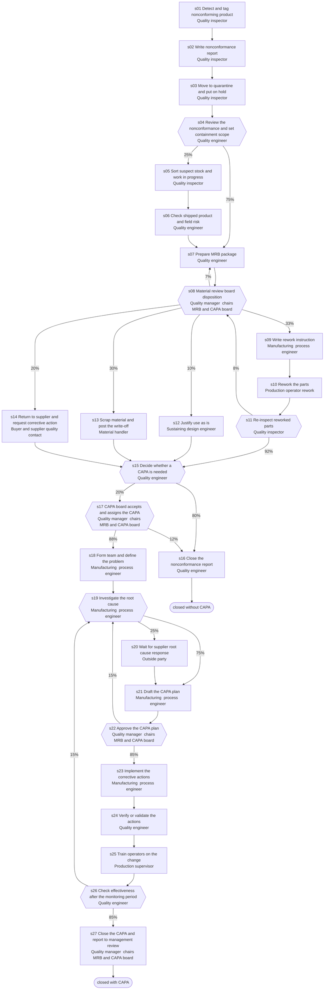

# Nonconformance through corrective and preventive action in regulated manufacturing

`mfg-nonconformance-capa` · medical device manufacturing · quality

When an inspector finds parts or devices that do not meet their specification, the plant must tag and segregate them, record what is wrong, check whether other stock is affected, and have a material review board decide whether to rework, scrap, use as is or return the material. The quality engineer then decides whether the problem needs a formal corrective and preventive action (CAPA), in which an engineer finds the root cause, changes the process and later checks over months that the problem has not come back. In a medical device plant every step is required by FDA's Quality System Regulation and ISO 13485, so each decision needs a named authority and a signed record. Much of the work is physical inspection, sorting, rework and shop-floor investigation, and most elapsed time is waiting for review boards, rework slots, suppliers, engineering changes and the effectiveness monitoring window.

| | |
|---|---|
| Unit of work | one nonconformance report and, where escalated, its CAPA |
| Starts when | An inspector or operator finds product that does not conform to its specification during receiving, in-process or final inspection, or returned product is found nonconforming. |
| Done when | The material is dispositioned and the report closed with cause recorded; or, where a CAPA was opened, the actions are implemented, verified, shown to be effective and the CAPA is closed. |
| Organisation | A medical device manufacturer of about 600 people with one plant making machined, molded and assembled Class II devices, registered with FDA and certified to ISO 13485, using an ERP and either a basic eQMS or controlled paper forms for NCRs and CAPAs. (600 employees, 2019-2022) |
| Volume | 50 cases a month (range 30 to 80) |

## Where it sits

- Starts with **nonconforming purchased material** from Receiving inspection of purchased material (30% of cases)
- Starts with **nonconforming work in progress or finished devices** from In-process and final inspection in production (55% of cases)
- Starts with **nonconforming returned product** from Complaint handling and returned product evaluation (10% of cases)
- Starts with **nonconformity finding** from Internal audits and process monitoring (5% of cases)
- Sends **released, reworked or scrapped material with ERP status** to Production and inventory (outcome: any)
- Sends **returned material and supplier corrective action request** to Suppliers (through procurement) (outcome: any)
- Sends **field risk assessment for shipped suspect lots** to Complaint handling and field action process (outcome: any)
- Sends **scrap and rework cost** to Finance (cost accounting) (outcome: any)
- Sends **engineering change requests from corrective actions** to Engineering change process (outcome: closed with CAPA)
- Sends **CAPA status and quality metrics** to Management review (outcome: closed with CAPA)
- Sends **nonconformance and CAPA records** to FDA inspections and certification audits (outcome: any)

## Flow

## Roles

| Role | Department | Layer | FTE on this process | Loaded cost per hour | Evidence |
|---|---|---|---:|---:|---|
| Quality inspector | Quality | individual contributor | 1.6 | 32 USD | B [src9], [src10], [src1] |
| Quality engineer | Quality | individual contributor | 3 | 78 USD | B [src9], [src10], [src1] |
| Quality manager (chairs MRB and CAPA board) | Quality | manager | 0.7 | 85 USD | B [src9], [src10], [src1] |
| Manufacturing (process) engineer | Manufacturing engineering | individual contributor | 3.5 | 78 USD | B [src9], [src10], [src5] |
| Sustaining design engineer | Engineering | individual contributor | 0.2 | 78 USD | B [src9], [src10], [src1] |
| Production operator (rework) | Manufacturing | individual contributor | 0.6 | 30 USD | B [src9], [src10] |
| Production supervisor | Manufacturing | supervisor | 0.4 | 51 USD | B [src9], [src10] |
| Material handler | Warehouse | individual contributor | 0.1 | 26 USD | B [src9], [src10] |
| Buyer and supplier quality contact | Procurement | individual contributor | 0.25 | 52 USD | B [src9], [src10] |

## Steps

Hands-on time and the wait before each step show the most common value. Evidence tier A is a sourced number, B a sourced description, C the author's estimate.

| Step | Who | Kind | Hands-on | Wait before | Control | Evidence |
|---|---|---|---:|---:|---|---|
| **s01 Detect and tag nonconforming product.** During receiving, in-process or final inspection the quality inspector measures parts against the drawing or test limits, finds one or more out of tolerance or failing, stops the lot, attaches a red hold tag and notes what was found. | Quality inspector | physical | 20 min | 0 min | 21 CFR 820.90(a): identification, documentation, evaluation, segregation and disposition of nonconforming product (also ISO 13485:2016 clause 8.3) | B [src1], [src8] |
| **s02 Write nonconformance report.** The inspector opens a new nonconformance report in the quality system or on the paper form and records part number, lot, quantity, where found, the requirement, the measured value and photos, and links it to the traveler or device history record. | Quality inspector | data entry | 25 min | 1.0 h | 21 CFR 820.90(a): identification, documentation, evaluation, segregation and disposition of nonconforming product (also ISO 13485:2016 clause 8.3) | B [src1], [src2] |
| **s03 Move to quarantine and put on hold.** The inspector moves the tagged material to the locked MRB area and changes its status in the ERP to hold or nonconforming so it cannot be picked or shipped, recording the location on the report. | Quality inspector | physical | 20 min | 30 min | 21 CFR 820.90(a): identification, documentation, evaluation, segregation and disposition of nonconforming product (also ISO 13485:2016 clause 8.3) | B [src1] |
| **s04 Review the nonconformance and set containment scope.** The quality engineer reads the report, looks at the parts in the MRB area, classifies severity, and decides whether other lots, work in progress or finished stock made the same way could be affected and need to be held and checked. | Quality engineer | judgment | 45 min | 6.0 h | 21 CFR 820.90(a): identification, documentation, evaluation, segregation and disposition of nonconforming product (also ISO 13485:2016 clause 8.3) | B [src1], [src4], [src5] |
| **s05 Sort suspect stock and work in progress.** Inspectors pull every suspect lot from stock, work in progress and the finished goods area, inspect or test the affected characteristic, tag and quarantine the failures and record the counts on the report. | Quality inspector | physical | 5.0 h | 2.0 h |  | B [src4], [src5] |
| **s06 Check shipped product and field risk.** The quality engineer uses the device history records and ERP shipment history to see whether suspect lots have shipped, and if they have, records a risk assessment and refers the case to the complaint and field action process. | Quality engineer | analysis | 2.0 h | 4.0 h |  | C |
| **s07 Prepare MRB package.** The quality engineer gathers the measurements, drawing, the history of similar nonconformances from the log and, where useful, re-measures parts, then writes a proposed disposition for the material review board. | Quality engineer | drafting | 1.0 h | 1.0 d |  | B [src1] |
| **s08 Material review board disposition.** At the twice-weekly material review board in the MRB area, the quality manager, quality engineer, manufacturing engineer and, when needed, design engineering and purchasing look at the parts and data and decide rework, scrap, use as is or return to supplier, signing the report. The time shown is total attendee time for this report. | Quality manager (chairs MRB and CAPA board) | approval | 50 min | 2.0 d | 21 CFR 820.90(b)(1): defined responsibility for review and authority for disposition, documented disposition (ISO 9001:2015 clause 8.7 and ISO 13485 clause 8.3) | B [src1], [src2] |
| **s09 Write rework instruction.** The manufacturing engineer writes a rework instruction that says how the parts are to be reworked, what must be retested and how results are recorded, and gets it approved by quality. | Manufacturing (process) engineer | drafting | 1.0 h | 1.0 d | 21 CFR 820.90(b)(2): rework procedures including retesting and reevaluation | B [src1] |
| **s10 Rework the parts.** A production operator takes the material from the MRB area, reworks each part on the line or a rework bench following the instruction, and logs quantities and time on the traveler. | Production operator (rework) | physical | 2.0 h | 3.0 d |  | C |
| **s11 Re-inspect reworked parts.** The quality inspector re-measures or retests every reworked part against current specifications, records the results in the device history record and either releases them from hold in the ERP or sends failures back to the review board. | Quality inspector | validation | 45 min | 12.0 h | 21 CFR 820.90(b)(2): retest and reevaluate reworked product and document it in the device history record | B [src1] |
| **s12 Justify use as is.** The sustaining design engineer analyses whether the deviation affects fit, function, safety or performance, using tolerance stack-ups, test data or risk files, and writes the technical justification that the regulation requires before nonconforming product can be used. | Sustaining design engineer | drafting | 3.0 h | 3.0 d | 21 CFR 820.90(b)(1): justification for use of nonconforming product and signature of the individuals authorising the use | B [src1] |
| **s13 Scrap material and post the write-off.** The material handler takes the material to the scrap area, destroys or marks it so it cannot be reused, and posts the scrap transaction in the ERP against the report number so the cost is recorded. | Material handler | physical | 30 min | 1.0 d | Internal control over financial reporting: inventory write-offs posted against an approved disposition | C |
| **s14 Return to supplier and request corrective action.** The buyer gets a return authorisation from the supplier, arranges shipment of the material back, issues a debit or replacement order, and sends the supplier a corrective action request with the report attached. | Buyer and supplier quality contact | communication | 1.5 h | 2.0 d |  | C |
| **s15 Decide whether a CAPA is needed.** The quality engineer checks the nonconformance log for repeats of the same defect, weighs severity and risk, and decides whether the cause can be recorded with a simple correction or needs a formal corrective and preventive action. | Quality engineer | judgment | 30 min | 2.0 d | 21 CFR 820.90(a): evaluation includes a determination of the need for an investigation; 820.100(a)(1) analysis of quality data to find recurring problems | B [src1], [src3], [src6] |
| **s16 Close the nonconformance report.** The quality engineer checks that the disposition is complete, ERP transactions are posted and records are attached, enters the cause code for trending and closes the report. | Quality engineer | validation | 30 min | 3.0 d | 21 CFR 820.90(a): the evaluation and any investigation shall be documented (ISO 9001:2015 clause 8.7 records) | B [src1], [src2] |
| **s17 CAPA board accepts and assigns the CAPA.** The quality manager reviews the request at the weekly CAPA review board with engineering and operations leads, accepts or rejects it, assigns an owner and due dates and gives it a CAPA number. The time shown is total attendee time for this request. | Quality manager (chairs MRB and CAPA board) | approval | 40 min | 4.0 d | 21 CFR 820.100(a): procedures for implementing corrective and preventive action (ISO 13485:2016 clauses 8.5.2 and 8.5.3) | B [src5], [src1] |
| **s18 Form team and define the problem.** The CAPA owner, usually the process engineer for the area, pulls together a small team, writes a measurable problem statement using what, where, when and how many, and lists the data needed. | Manufacturing (process) engineer | analysis | 4.0 h | 4.0 d |  | B [src4], [src5] |
| **s19 Investigate the root cause.** The CAPA owner observes the process on the shop floor, interviews operators, reviews travelers, maintenance and calibration records, measures samples and runs trials, then works through cause and effect diagrams and repeated why questions until a cause is supported by evidence. | Manufacturing (process) engineer | analysis | 12.0 h | 7.0 d | 21 CFR 820.100(a)(2): investigate the cause of nonconformities | B [src1], [src3], [src4] |
| **s20 Wait for supplier root cause response.** The supplier investigates its own process under the corrective action request and replies with containment, root cause and corrective actions, often after reminders from the buyer. | Outside party | external wait | 0 min | 21.0 d |  | C |
| **s21 Draft the CAPA plan.** The CAPA owner writes the actions that remove the cause, actions to prevent the same problem on similar products or lines, owners and due dates, and the criteria and timing for checking effectiveness. | Manufacturing (process) engineer | drafting | 4.0 h | 2.0 d |  | B [src5], [src3] |
| **s22 Approve the CAPA plan.** The quality manager reviews the root cause evidence and the plan, checks that actions address the cause and that effectiveness can be measured, and approves it or sends it back for more investigation. | Quality manager (chairs MRB and CAPA board) | approval | 45 min | 3.0 d | 21 CFR 820.100(a)(3) and (b): identify actions needed to correct and prevent recurrence; activities and results documented | B [src1], [src5] |
| **s23 Implement the corrective actions.** The CAPA owner makes the changes: fixture or tooling modifications, mistake-proofing, process parameter or inspection plan changes and revised work instructions, raising engineering changes where documents or designs must change and waiting for parts and approvals. | Manufacturing (process) engineer | coordination | 12.0 h | 15.0 d | 21 CFR 820.100(a)(5): implement and record changes in methods and procedures | B [src1], [src4] |
| **s24 Verify or validate the actions.** The quality engineer runs verification builds or, for process changes, protocol-based validation, measures the output against acceptance criteria and documents that the change works and does not harm the finished device. | Quality engineer | validation | 8.0 h | 7.0 d | 21 CFR 820.100(a)(4): verify or validate the corrective and preventive action and confirm no adverse effect on the finished device | B [src1], [src4] |
| **s25 Train operators on the change.** The production supervisor walks operators through the revised instructions at the workstation, has them sign the training record and checks the first runs under the new method. | Production supervisor | communication | 3.0 h | 1.0 d | 21 CFR 820.100(a)(6): disseminate information on quality problems to those responsible | B [src1] |
| **s26 Check effectiveness after the monitoring period.** After the agreed period, often two to three months or a set number of lots, the quality engineer pulls nonconformance, yield and complaint data for the affected process, compares it with the effectiveness criteria and records whether the problem has recurred. | Quality engineer | analysis | 4.0 h | 60.0 d | 21 CFR 820.100(a)(4): ensure the action is effective (ISO 13485:2016 clause 8.5.2 verification of effectiveness) | B [src1], [src5], [src7] |
| **s27 Close the CAPA and report to management review.** The quality manager reviews the complete record, signs the closure, and the CAPA is counted in the monthly quality metrics and the management review summary. | Quality manager (chairs MRB and CAPA board) | approval | 30 min | 5.0 d | 21 CFR 820.100(a)(7): submit information on quality problems and CAPA for management review | B [src1], [src5] |

## Exceptions

| Exception | Share of cases | What happens |
|---|---:|---|
| Containment sweep of other stock | 25% | Other lots, work in progress or finished goods may be affected, so inspectors sort them and the engineer checks whether any shipped. |
| MRB asks for more data | 7% | The board cannot decide and sends the package back for more measurements or analysis. |
| Rework fails re-inspection | 3% | Reworked parts still fail and return to the board for another disposition. |
| Use-as-is disposition | 10% | Material is accepted with a deviation, which needs a documented engineering justification and signature. |
| Supplier root cause | 4% | The cause lies at a supplier, so the CAPA waits for the supplier's 8D response. |
| Root cause rejected at plan approval | 3% | The quality manager finds the root cause unsupported and sends the CAPA back to investigation. |
| CAPA not effective | 3% | The problem recurs during the monitoring period and the investigation is reopened. |

## Benchmarks

| Metric | Value | Unit | Population | Evidence |
|---|---|---|---|---|
| cycle_time_days | p50 25, p90 180 | calendar days from detection to closure of the nonconformance report or, if escalated, the CAPA | Author's estimate for a mid-size device plant | C [src5] |
| capa_closure_target_common | 90 | days | Common practice in device companies, as described by a QMS software vendor | B [src5] |
| capa_system_issues_found | 450 | issues with CAPA systems at medical device companies in 2015 | Medical device companies, as reported by src3 (the source does not say how the issues were counted) | A [src3] |

## Pain points

- Root cause analysis stops at a restated problem or operator error, so CAPAs fail the plan approval or the effectiveness check and are reopened. (steps s19, s22, s26; B [src5])
- Material waits in the MRB area for the next board, for rework slots and for supplier return authorisations, tying up inventory and sometimes stopping the line. (steps s08, s10, s14; C)
- CAPA implementation waits on engineering changes, tooling and validation, so many CAPAs exceed internal due dates. (steps s23, s24; B [src5])
- Nonconformance data sits in paper forms or a spreadsheet log, so repeat problems are spotted late and escalation to CAPA is inconsistent. (steps s02, s15; C)
- Every disposition and action needs a signature from a small number of authorised people, who become a bottleneck. (steps s08, s17, s22, s27; B [src1])

## Assumptions

- One case is one nonconformance report. About 20% of reports are escalated and about 88% of those are accepted as CAPAs, so roughly 18% of cases (about nine CAPAs a month) run the full CAPA path; the rest close after disposition.
- The cycle_time_days benchmark is the author's estimate because no source opened measured closure times. The simulated median is driven by reports closed without CAPA; the 90th percentile is driven by CAPAs and their effectiveness window.
- Desk work share is low for detection, segregation, sorting, rework and re-inspection, and partial for MRB, investigation, implementation and verification, which mix shop-floor and desk work.
- The MRB and CAPA board steps record total attendee minutes under the quality manager's role.
- Regulatory controls cite the Quality System Regulation 21 CFR 820 as in force in 2019 to 2022 (since February 2026 FDA's Quality Management System Regulation incorporates ISO 13485 instead); ISO 13485 and ISO 9001 clauses are named where they set the same rule.
- Loaded hourly cost is the BLS May 2021 national median wage for the nearest SOC code times 1.7 (1.50 benefits from BLS ECEC December 2021 for manufacturing, about 1.13 overhead by author estimate).
- Disposition mix, escalation rate, rework rates and most times are tier C estimates.

## Sources

- [src1] [21 CFR Part 820 Quality System Regulation (Code of Federal Regulations, 2021 edition, Title 21 Volume 8)](https://www.govinfo.gov/content/pkg/CFR-2021-title21-vol8/xml/CFR-2021-title21-vol8-part820.xml) (U.S. Government Publishing Office (govinfo), 2021). 820.90(a): procedures for identification, documentation, evaluation, segregation and disposition of nonconforming product; evaluation includes determining the need for an investigation. 820.90(b): defined responsibility for review and authority for disposition; disposition documented with justification and signature for use of nonconforming product; rework procedures with retesting and reevaluation documented in the DHR. 820.100(a)(1)-(7) and (b): CAPA procedures covering analysis of quality data, investigation of cause, actions, verification or validation of effectiveness, implementation, dissemination and management review; all documented. 820.80(d): finished devices held until release is authorised.
- [src2] ["Documented Information" in ISO 9001:2015 (handout with clause excerpts)](https://www.aviationsuppliers.org/ASA/files/ccLibraryFiles/Filename/000000001626/ASA-ISO-AS-Changes-For-Distributors-Handouts-part-2.pdf) (Aviation Suppliers Association, None). ISO 9001:2015 8.7: retain information describing the nonconformity, actions taken, concessions obtained and the authority deciding the action; 10.2.2: retain evidence of the nature of nonconformities, subsequent actions and results of corrective action.
- [src3] [Corrective and preventive action](https://en.wikipedia.org/wiki/Corrective_and_preventive_action) (Wikipedia, None). CAPA stages: identify problems from quality data, investigate root cause (5 Whys, Ishikawa, 8D), decide corrective and preventive actions, implement, review effectiveness; required for device makers by 21 CFR 820.100; over 450 CAPA system issues found at device companies in 2015.
- [src4] [Eight disciplines problem solving](https://en.wikipedia.org/wiki/Eight_disciplines_problem_solving) (Wikipedia, None). 8D steps: team, problem description (5W2H, is/is not), interim containment, root cause and escape point, verify permanent corrections, implement and validate corrective actions, prevent recurrence; developed at Ford in 1987 and standard in automotive supply chains.
- [src5] [The CAPA Process: 15 Steps From Request to Effectiveness Verification](https://www.greenlight.guru/blog/capa-process) (Greenlight Guru (Jon Speer), None). CAPA request, review board acceptance or rejection, tracking number, cross-functional team, containment, investigation, root cause, action plan with deadlines, implementation, review and sign-off, effectiveness verification plan and evidence; a fixed 90-day closure target is common but there is no regulatory timeline and thorough investigations may take longer.
- [src6] [Case for Quality](https://www.fda.gov/medical-devices/quality-and-compliance-medical-devices/case-quality) (U.S. Food and Drug Administration, 2020). FDA review of device quality data found common manufacturing risks; manufacturers that managed them had fewer complaints, opened fewer CAPAs and investigations and had lower quality-related costs.
- [src7] [ISO 13485](https://en.wikipedia.org/wiki/ISO_13485) (Wikipedia, None). ISO 13485:2016 quality management system for medical device design and manufacture; certification voluntary; 21 CFR 820 is the U.S. requirement; emphasises verifying the effectiveness of corrective and preventive actions.
- [src8] [Nonconformity (quality)](https://en.wikipedia.org/wiki/Nonconformity_(quality)) (Wikipedia, None). Nonconformities are graded by severity (for example critical, major, minor); common causes include poor documentation, training, materials, tools and environment.
- [src9] [May 2021 National Occupational Employment and Wage Estimates, United States](https://www.bls.gov/oes/2021/may/oes_nat.htm) (U.S. Bureau of Labor Statistics, 2022). Median hourly wages: Inspectors, Testers, Sorters, Samplers and Weighers 51-9061 $18.55; Industrial Engineers 17-2112 $45.82; Mechanical Engineers 17-2141 $45.82; Industrial Production Managers 11-3051 $49.59; First-Line Supervisors of Production 51-1011 $29.71; Miscellaneous Assemblers and Fabricators 51-2090 $17.59; Laborers and Freight, Stock and Material Movers 53-7062 $15.02; Buyers and Purchasing Agents 13-1020 $30.51.
- [src10] [Employer Costs for Employee Compensation - December 2021 (news release)](https://www.bls.gov/news.release/archives/ecec_03182022.htm) (U.S. Bureau of Labor Statistics, 2022). Manufacturing: total compensation $41.13 per hour, wages and salaries $27.38 (66.6%), benefits $13.76 (33.4%).

Written by claude-opus on 2026-11-17.
