# Monthly sales and operations planning cycle for one business unit of a manufacturer

`mfg-sales-and-operations-planning` · manufacturing · supply chain planning

Sales and operations planning (S&OP) is the monthly cycle in which a manufacturer agrees one plan for what it expects to sell and what it will make, buy and hold in stock over the next 12 to 18 months. Demand planners start from last month's sales and a statistical forecast, sales and marketing adjust it, supply planners test it against plant and supplier capacity, finance prices the gaps and a pre-meeting of managers prepares decisions for an executive meeting chaired by the business unit head. The work is spread across six or more departments and moves on a fixed meeting calendar, so most elapsed time is waiting for the next meeting. It is slowed by spreadsheet consolidation, late or biased sales inputs, master data errors and decisions deferred by busy executives.

| | |
|---|---|
| Unit of work | one monthly S&OP cycle for one business unit |
| Starts when | The calendar month closes and the sales and shipment cut-off is reached (Day 0). |
| Done when | The executive-approved operating plan is loaded into the master production schedule and the financial latest estimate, and minutes with owners and deadlines are sent out. |
| Organisation | A business unit of about 1,200 people with two plants and annual revenue of roughly $400 million, part of a multi-division manufacturer, planning 15 to 25 product families with an ERP, a statistical forecasting module and spreadsheets. (3,000 employees, 2019-2022) |
| Volume | 1 cases a month (range 1 to 1) |

## Where it sits

- Starts with **actual orders, shipments and inventory for the month** from Month-end sales and shipment close (order to cash) (100% of cases)
- Sends **approved production plan by family** to Master production scheduling and material requirements planning (outcome: plan released)
- Sends **updated financial latest estimate** to Financial planning and forecasting (outcome: plan released)
- Sends **material and supplier capacity forecast** to Procurement and supplier management (outcome: plan released)
- Sends **approved demand plan and allocation rules** to Sales and customer service (outcome: plan released)
- Sends **S&OP minutes, KPI scorecard and decision log** to Executive leadership and corporate office (outcome: plan released)

## Flow

```mermaid
flowchart TD
    s01["s01 Extract month-end history<br/>Automated"]
    s02["s02 Score last month's forecast<br/>Demand planner"]
    s03["s03 Cleanse history and planning master data<br/>Demand planner"]
    s04["s04 Run statistical forecast<br/>Automated"]
    s05{{"s05 Review forecast exceptions and tune models<br/>Demand planner"}}
    s06["s06 Enter launch, promotion and phase-out assumptions<br/>Product manager"]
    s07{{"s07 Submit customer forecast adjustments<br/>Key account manager"}}
    s08["s08 Chase late sales inputs<br/>Demand planner"]
    s09["s09 Send late forecast inputs<br/>Key account manager"]
    s10["s10 Consolidate inputs into draft consensus forecast<br/>Demand planner"]
    s11["s11 Prepare demand review pack<br/>Demand planner"]
    s12{{"s12 Hold demand review and sign off consensus demand<br/>Director of sales"}}
    s13["s13 Publish consensus demand to supply planning<br/>Demand planner"]
    s14["s14 Price the demand plan against budget<br/>Financial planning analyst"]
    s15["s15 Run rough-cut capacity and supply plan<br/>Automated"]
    s16["s16 Analyse capacity loads and inventory projections<br/>Supply planner and master scheduler"]
    s17["s17 Ask key suppliers to confirm capacity<br/>Buyer"]
    s18["s18 Wait for supplier confirmations<br/>Outside party"]
    s19["s19 Review labour, shift and overtime options<br/>Plant operations manager"]
    s20["s20 Draft constrained supply plan and scenarios<br/>Supply planner and master scheduler"]
    s21{{"s21 Hold supply review<br/>Director of supply chain and operations"}}
    s22["s22 Reconcile demand, supply and finance<br/>S&OP manager"]
    s23["s23 Price the scenarios<br/>Financial planning analyst"]
    s24{{"s24 Hold pre-S&OP meeting<br/>S&OP manager"}}
    s25["s25 Prepare executive pack<br/>S&OP manager"]
    s26{{"s26 Executive S&OP meeting approves the plan<br/>Business unit president"}}
    s27["s27 Close deferred decisions by email<br/>S&OP manager"]
    s28["s28 Publish minutes and decision log<br/>S&OP manager"]
    s29["s29 Load approved plan into master schedule<br/>Supply planner and master scheduler"]
    s30["s30 Update the financial forecast<br/>Financial planning analyst"]
    s01 --> s02
    s02 --> s03
    s03 --> s04
    s04 --> s05
    s05 -->|"90%"| s06
    s05 -->|"10%"| s03
    s06 --> s07
    s07 -->|"60%"| s10
    s07 -->|"40%"| s08
    s08 --> s09
    s09 --> s10
    s10 --> s11
    s11 --> s12
    s12 -->|"85%"| s13
    s12 -->|"15%"| s10
    s13 --> s14
    s14 --> s15
    s15 --> s16
    s16 --> s17
    s17 --> s18
    s18 --> s19
    s19 --> s20
    s20 --> s21
    s21 -->|"85%"| s22
    s21 -->|"15%"| s20
    s22 --> s23
    s23 --> s24
    s24 -->|"80%"| s25
    s24 -->|"20%"| s22
    s25 --> s26
    s26 -->|"85%"| s28
    s26 -->|"15%"| s27
    s27 --> s28
    s28 --> s29
    s29 --> s30
    s30 --> end0
    end0(["plan released"])
```

## Roles

| Role | Department | Layer | FTE on this process | Loaded cost per hour | Evidence |
|---|---|---|---:|---:|---|
| Demand planner | Supply chain planning | individual contributor | 0.3 | 63 USD | B [src11], [src12], [src5] |
| Key account manager | Sales | individual contributor | 0.1 | 50 USD | B [src11], [src12] |
| Product manager | Marketing and product management | individual contributor | 0.04 | 95 USD | B [src11], [src12], [src4] |
| Director of sales | Sales | director | 0.03 | 104 USD | B [src11], [src12], [src5] |
| Financial planning analyst | Finance | individual contributor | 0.12 | 75 USD | B [src11], [src12], [src4] |
| Supply planner and master scheduler | Supply chain planning | individual contributor | 0.3 | 63 USD | B [src11], [src12], [src5] |
| Buyer | Procurement | individual contributor | 0.04 | 52 USD | B [src11], [src12] |
| Plant operations manager | Manufacturing | manager | 0.03 | 84 USD | B [src11], [src12], [src5] |
| Director of supply chain and operations | Operations | director | 0.03 | 80 USD | B [src11], [src12], [src5] |
| S&OP manager | Supply chain planning | manager | 0.3 | 80 USD | B [src11], [src12], [src3], [src5] |
| Business unit president | Executive | executive | 0.01 | 147 USD | B [src11], [src12], [src5] |

## Steps

Hands-on time and the wait before each step show the most common value. Evidence tier A is a sourced number, B a sourced description, C the author's estimate.

| Step | Who | Kind | Hands-on | Wait before | Control | Evidence |
|---|---|---|---:|---:|---|---|
| **s01 Extract month-end history.** After the sales and shipment cut-off for the month, scheduled jobs pull orders, shipments, returns and inventory by item, customer and location from the ERP into the forecasting module and a staging spreadsheet. Nobody touches it unless the job fails. | Automated | system auto | 0 min | 1.0 d |  | B [src5], [src3] |
| **s02 Score last month's forecast.** The demand planner compares last month's shipments with the forecast made one to three months earlier, calculates forecast error and bias by product family and customer group, and updates the KPI scorecard used in the reviews. Large misses are flagged for discussion. | Demand planner | analysis | 4.0 h | 2.0 h |  | B [src5], [src3] |
| **s03 Cleanse history and planning master data.** The demand planner corrects outliers such as one-off orders or stock-outs, links new items to the items they replace, retires discontinued items and fixes customer and family mappings. Most of this is done by exporting to a spreadsheet, editing and loading back. | Demand planner | validation | 6.0 h | 1.0 h |  | B [src5], [src10] |
| **s04 Run statistical forecast.** The forecasting module refits its time-series models overnight on the cleansed history and produces a baseline forecast by item, customer group and month for the next 18 months, plus an exception list of items whose forecast moved sharply. | Automated | system auto | 0 min | 12.0 h |  | B [src5], [src6] |
| **s05 Review forecast exceptions and tune models.** The demand planner works through the exception list, checks the largest families against the scorecard and market notes, overrides models that picked the wrong pattern and decides whether a data problem needs another cleansing pass and rerun. | Demand planner | analysis | 8.0 h | 2.0 h |  | C |
| **s06 Enter launch, promotion and phase-out assumptions.** The product manager opens the input template and adds volumes for new product launches, planned promotions or price changes, and the run-down of products being phased out, with a short note on each assumption. | Product manager | judgment | 4.0 h | 12.0 h |  | B [src4], [src7], [src6] |
| **s07 Submit customer forecast adjustments.** Each key account manager downloads the template for their customers, compares the baseline with order books, customer forecasts and pipeline, and types adjusted volumes by family and month. The time shown is the total for all account managers in the business unit. | Key account manager | data entry | 12.0 h | 6.0 h |  | B [src5], [src6] |
| **s08 Chase late sales inputs.** The demand planner checks which account managers have not returned their templates, sends reminders and copies the sales director when the deadline has passed. If a reply does not come, the planner prepares to carry the previous month's numbers forward. | Demand planner | coordination | 1.0 h | 12.0 h |  | C |
| **s09 Send late forecast inputs.** Account managers who missed the deadline fill in their templates, often quickly and with less checking, and email them to the planner. For any who still do not reply, the planner keeps last month's values. | Key account manager | data entry | 2.0 h | 1.5 d |  | C |
| **s10 Consolidate inputs into draft consensus forecast.** The demand planner copies the sales and marketing spreadsheets into the forecasting module or a master workbook, reconciles units and families, checks that totals still tie to the baseline plus adjustments and lists the largest changes from last month. | Demand planner | data entry | 8.0 h | 4.0 h |  | B [src10], [src5] |
| **s11 Prepare demand review pack.** The demand planner builds the slides for the demand review: consensus versus statistical forecast, versus last month and versus budget by family, the scorecard, the assumptions behind large changes and the open questions for sales. | Demand planner | drafting | 5.0 h | 1.0 h |  | B [src3], [src5] |
| **s12 Hold demand review and sign off consensus demand.** The director of sales chairs a meeting of sales, marketing, product management, demand planning and finance that walks through the families with the largest changes, challenges assumptions and agrees one unconstrained demand plan. The time shown is total attendee time, about eight people for 90 minutes plus preparation. | Director of sales | judgment | 12.0 h | 1.5 d | Company S&OP policy: sales leadership signs off the consensus demand plan before supply planning starts | B [src3], [src5], [src6] |
| **s13 Publish consensus demand to supply planning.** The demand planner applies the changes agreed in the meeting, locks the consensus version in the forecasting module and releases it to the supply planning module, then emails the minutes and the list of changes. | Demand planner | data entry | 3.0 h | 4.0 h |  | B [src5] |
| **s14 Price the demand plan against budget.** The financial planning analyst converts the consensus units into revenue and margin using standard prices and costs, compares the result with the annual budget and the last forecast, and notes the gaps that the reconciliation will need to explain. | Financial planning analyst | analysis | 6.0 h | 4.0 h |  | B [src5], [src6] |
| **s15 Run rough-cut capacity and supply plan.** The supply planning module, or an MRP run in the ERP, nets the released demand against inventory and open orders and loads the resulting production by family onto key work centres and critical materials for the next 18 months, producing load reports. | Automated | system auto | 0 min | 6.0 h |  | B [src5], [src6] |
| **s16 Analyse capacity loads and inventory projections.** The supply planner compares loads with available capacity by work centre and month, checks projected inventory against safety stock and targets, and lists the months and families where demand cannot be met on straight time or where inventory will build. | Supply planner and master scheduler | analysis | 14.0 h | 4.0 h |  | B [src5], [src6] |
| **s17 Ask key suppliers to confirm capacity.** The buyer emails the suppliers of the few constrained materials with the volumes for the coming months and asks them to confirm capacity and lead times, attaching the relevant part of the forecast. | Buyer | communication | 4.0 h | 2.0 h |  | B [src4] |
| **s18 Wait for supplier confirmations.** Suppliers reply by email or phone with what they can supply, sometimes only after a follow-up call. Unanswered requests are treated as unconfirmed and carried as risks into the supply review. | Outside party | external wait | 0 min | 1.5 d |  | C |
| **s19 Review labour, shift and overtime options.** The plant operations manager looks at the load report for the plant, works out what extra shifts, overtime, temporary labour or moving work between lines would cost and what it would deliver, and sends the options to the supply planner. | Plant operations manager | judgment | 4.0 h | 1.0 h |  | B [src4], [src6] |
| **s20 Draft constrained supply plan and scenarios.** The supply planner turns the gaps, supplier replies and plant options into a constrained supply plan and one or two alternatives, for example build ahead in spring or add a weekend shift, with their effect on service and inventory. | Supply planner and master scheduler | drafting | 8.0 h | 4.0 h |  | B [src5], [src4] |
| **s21 Hold supply review.** The director of supply chain and operations chairs a meeting with plant managers, supply planning and procurement that agrees the feasible supply plan, ranks the constraints and decides which options need finance pricing or executive decision. The time shown is total attendee time. | Director of supply chain and operations | judgment | 9.0 h | 1.0 d | Company S&OP policy: operations signs off a feasible supply plan before reconciliation | B [src3], [src5] |
| **s22 Reconcile demand, supply and finance.** The S&OP manager lines up the consensus demand, the agreed supply plan and the budget, works out where revenue, service or inventory targets will be missed, and frames each gap as a decision with two or three options and an owner. | S&OP manager | analysis | 10.0 h | 12.0 h |  | B [src3], [src4], [src6] |
| **s23 Price the scenarios.** The financial planning analyst calculates revenue, margin, inventory value, overtime and freight cost for each option and compares them with the budget and the latest estimate, so the meeting sees the money behind each choice. | Financial planning analyst | analysis | 8.0 h | 4.0 h |  | B [src3], [src4] |
| **s24 Hold pre-S&OP meeting.** The S&OP manager runs a meeting of the functional managers from sales, marketing, operations, procurement and finance that settles the issues within their authority, agrees the recommended plan and decides what goes to the executives. The time shown is total attendee time, about eight managers for two hours. | S&OP manager | judgment | 14.0 h | 1.5 d |  | B [src3], [src5], [src6] |
| **s25 Prepare executive pack.** The S&OP manager condenses the reconciliation into a short executive pack: KPIs, the recommended plan in units and dollars, the decisions needed with options and the risks, and emails it as a pre-read a day or two before the meeting. | S&OP manager | drafting | 6.0 h | 4.0 h |  | B [src5] |
| **s26 Executive S&OP meeting approves the plan.** The business unit president chairs a meeting of the functional heads that reviews performance, decides the escalated trade-offs such as overtime, build-ahead inventory or customer allocation, and approves one operating plan. The time shown is total attendee time. | Business unit president | approval | 10.0 h | 2.0 d | S&OP charter and delegation of authority: the business unit president approves the operating plan and spending on overtime, build-ahead inventory and capacity | B [src3], [src5] |
| **s27 Close deferred decisions by email.** The S&OP manager gathers the extra analysis the executives asked for, sends a short note with a recommendation and chases each executive until the decision is confirmed by email or in a short call. | S&OP manager | approval | 3.0 h | 3.0 d | Delegation of authority for spending decisions | C |
| **s28 Publish minutes and decision log.** The S&OP manager writes up the decisions, owners and deadlines, updates the action log and sends the minutes and the approved plan to all participants and to the teams who execute it. | S&OP manager | communication | 2.0 h | 4.0 h |  | B [src5] |
| **s29 Load approved plan into master schedule.** The supply planner updates the master production schedule in the ERP to match the approved family volumes, breaking families into items for the near months and respecting the frozen period, then reruns MRP so purchasing and the plants see the new plan. | Supply planner and master scheduler | data entry | 4.0 h | 12.0 h | Master scheduling policy: changes inside the frozen time fence need master scheduler and plant approval | B [src5], [src6] |
| **s30 Update the financial forecast.** The financial planning analyst copies the approved volumes, prices and costs into the finance forecast model so the monthly latest estimate sent to the corporate office matches the operating plan. | Financial planning analyst | data entry | 3.0 h | 12.0 h |  | B [src6] |

## Exceptions

| Exception | Share of cases | What happens |
|---|---:|---|
| Late sales inputs | 40% | Some account managers miss the deadline; the planner chases them and either receives rushed inputs or carries last month's values forward. |
| Data problem in the statistical forecast | 10% | A mapping or history error is found during exception review, so history is cleansed again and the model rerun. |
| Demand numbers sent back | 15% | The demand review does not accept the draft and the planner revises it before sign-off. |
| Supply scenario rerun | 15% | The supply review asks for another scenario, for example a different build-ahead profile, before agreeing the plan. |
| Extra analysis before the executives | 20% | The pre-meeting cannot agree a recommendation and asks for more analysis and a second short call. |
| Executive decision deferred | 15% | The executive meeting defers a trade-off, for example a capacity investment, and it is closed by email days later. |
| Executive meeting moved | 10% | Travel or a board meeting pushes the executive meeting back several days, delaying plan release. |

## Benchmarks

| Metric | Value | Unit | Population | Evidence |
|---|---|---|---|---|
| cycle_time_days | p50 22, p90 28 | calendar days from the month-end data cut to executive sign-off; the simulated cycle also includes one to two days of release work after sign-off | Typical monthly S&OP calendar described by a consulting playbook | B [src3] |
| demand_and_supply_planning_cost_median | 1.36 | USD per 1,000 USD revenue | APQC Open Standards Benchmarking participants, all industries | A [src2] |
| planning_fte_gap_bottom_vs_top | 78 | extra planning FTEs per 1 billion USD revenue for bottom versus top performers | APQC Open Standards Benchmarking participants | A [src1] |
| average_forecast_error | consumer_goods 0.39, chemicals 0.36 | share (error measure mostly volume-weighted MAPE) | 2012 practitioner survey of demand planners; older than the reference period | A [src8] |
| forecast_error_case_study | before 0.17, after 0.1 | forecast error | One make-to-stock consumer packaged goods company, MIT thesis | A [src9] |
| share_using_spreadsheets_for_sop | 0.811 | share of respondents | 164 S&OP and IBP professionals in 54 countries, self-selected online survey (published 2025) | A [src10] |
| review_meeting_length | demand_review_min 90, supply_review_min 90, reconciliation_min 120, executive_min 60 | minutes | Recommended cadence in a consulting playbook | B [src3] |

## Pain points

- Planners spend much of the first week exporting, cleansing and pasting data between the ERP, the forecasting module and spreadsheets, leaving little time for analysis. (steps s03, s10, s11; B [src10], [src5])
- Sales inputs arrive late and carry bias from quotas or fear of shortages, so the consensus forecast is often less accurate than the statistical baseline for some families. (steps s07, s08, s09, s12; C)
- The supply review and reconciliation get compressed into the second half of the month, so scenarios are few and finance pricing is rushed. (steps s16, s20, s22, s23; C [src3])
- Executive meetings slip or defer decisions, which delays the plan reaching the master schedule by days. (steps s26, s27; C)
- The approved plan is re-keyed into the ERP and the finance model by hand, so execution and finance can drift from what was agreed. (steps s29, s30; C)

## Assumptions

- One case is one monthly cycle for one business unit, so cases_per_month is 1 and the staffing check compares stated FTEs with the hands-on hours of a single cycle.
- Meeting steps record total attendee minutes under the chair's role, so labour cost for those steps is priced at the chair's rate and slightly overstates cost. The validator adds those attendee minutes to elapsed time, which overstates elapsed time by a few hours per meeting; in the other direction, long analysis steps take several working days of elapsed time that the waits only partly capture.
- Meeting dates are fixed in an annual calendar. In reality rework loops are often absorbed before the fixed next meeting, so the simulated rework adds more elapsed time than it does in practice.
- The validator adds hands-on minutes to elapsed time, so wait_before_min holds only the idle gap between steps; the two together reproduce a calendar in which the demand review falls around Day 7, the supply review around Day 13, the pre-meeting around Day 19 and the executive meeting around Day 22 to 25.
- Parallel work (sales and marketing inputs, supplier confirmations and plant options, finance pricing and capacity runs) is listed in sequence with short waits and named in concurrent_with.
- Loaded hourly cost is the BLS May 2021 national median wage for the closest SOC code times 1.7 (1.50 benefits from BLS ECEC December 2021 for manufacturing, about 1.13 overhead by author estimate).
- Error probabilities, rework rates and most hours are tier C estimates for a mid-size business unit; the sources describe the steps and calendar but rarely measure effort.

## Sources

- [src1] [4 Key Measures and Tips to Improve your Supply Chain Planning](https://www.apqc.org/blog/4-key-measures-and-tips-improve-your-supply-chain-planning) (APQC (Marisa Brown), 2018). Bottom performers need 78 more planning FTEs per $1 billion revenue than top performers; planning cost of bottom performers is more than 4 times top performers; S&OP team staffing depends on functional productivity.
- [src2] [Performance Measures for Supply Chain Planning Optimization](https://www.apqc.org/blog/performance-measures-supply-chain-planning-optimization) (APQC (Andrea Stroud), 2013). Median demand and supply planning cost of $1.36 per $1,000 revenue in APQC Open Standards Benchmarking.
- [src3] [Sales & Operations Planning (S&OP/S&OE) Discipline](https://umbrex.com/resources/strategic-cost-cutting-playbook/sales-operations-planning-sop-soe-discipline/) (Umbrex, None). Typical monthly cadence: data cut Day 0, demand review complete Day 5, supply review Day 12, financial reconciliation draft Day 18, executive sign-off Day 22; demand and supply gates 90 minutes, reconciliation two hours, executive meeting capped at one hour; data freeze 24 hours before each gate.
- [src4] [Sales & Operations Planning (S&OP)](https://umbrex.com/?p=244642) (Umbrex, None). Monthly sequence of product, demand, supply, pre-S&OP reconciliation and executive review, with participants, inputs and outputs of each review.
- [src5] [5 Steps of S&OP to Achieve an Integrated Business Plan](https://sapinsider.org/five-essential-steps-of-sales-and-operations-planning-to-achieve-an-integrated-business-plan/) (SAPinsider (Venkata Ramana Nethi), None). Five steps: data gathering (history cleansing, master data, statistical models), demand planning with sales sign-off, supply planning with rough-cut capacity, pre-S&OP meeting, executive meeting chaired by the president; approved plan drives master scheduling and MRP; minutes published after each meeting.
- [src6] [4.1 S&OP Purpose and Process (CPIM study guide)](https://open-exam-prep.com/study-guides/cpim/sop/sop-purpose-process) (Open Exam Prep, None). APICS CPIM description: monthly cycle on a rolling 12 to 18 month horizon by product family; demand review, supply review, pre-S&OP decision packages, executive approval; output authorises master scheduling and financial forecasting.
- [src7] [The S&OP Process: A Practical Guide for Modern Retail and Brand Supply Chains](https://www.tradebeyond.com/industry-hub/s-op-process) (TradeBeyond, None). Monthly cycle with product review, demand review, supply review, finance review, pre-S&OP and executive meeting on a rolling 12 to 24 month horizon.
- [src8] [Forecast Error Benchmarking Across Various Industry - Survey Results](https://forecastingblog.com/forecast-error-benchmark/) (Forecasting Blog (Rohan Asardohkar), 2012). Average forecast error of 39% in consumer goods and 36% in chemicals from a 2012 practitioner survey; 52% of respondents use volume-weighted MAPE.
- [src9] [Developing a framework for dependable demand forecasts in the consumer packaged goods industry (MIT thesis, D. A. Uriarte)](https://dspace.mit.edu/handle/1721.1/59172) (MIT DSpace, 2010). Case study in which data treatment, model and S&OP process changes cut forecast error from 17% to 10%.
- [src10] [Why 81% of Companies Still Run Their S&OP Process in Excel](https://abcsupplychain.com/?p=72980) (ABC Supply Chain, 2025). Survey of 164 S&OP and IBP professionals: 81.1% use Excel or Google Sheets to run S&OP; data compilation reported as a main challenge.
- [src11] [May 2021 National Occupational Employment and Wage Estimates, United States](https://www.bls.gov/oes/2021/may/oes_nat.htm) (U.S. Bureau of Labor Statistics, 2022). Median hourly wages: Logisticians 13-1081 $37.03; Sales Managers 11-2022 $61.30; Marketing Managers 11-2021 $64.92; Sales Representatives Wholesale and Manufacturing 41-4012 $29.61; Financial and Investment Analysts 13-2051 $44.03; Buyers and Purchasing Agents 13-1020 $30.51; Industrial Production Managers 11-3051 $49.59; Transportation, Storage and Distribution Managers 11-3071 $47.22; General and Operations Managers 11-1021 $47.10; Chief Executives 11-1011 $86.31.
- [src12] [Employer Costs for Employee Compensation - December 2021 (news release)](https://www.bls.gov/news.release/archives/ecec_03182022.htm) (U.S. Bureau of Labor Statistics, 2022). Manufacturing: total compensation $41.13 per hour, of which wages and salaries $27.38 (66.6%) and benefits $13.76 (33.4%); used for the benefits loading factor of 1.50.

Written by claude-opus on 2026-11-17.
