# Annual budget and guidance (single-mine gold producer)

`mine-corp-budget` · metal mining (gold) · finance and planning · part of `mining-operator-co`

Each autumn the company turns the mine's annual production plan into an operating, capital and exploration budget for the next year, gets it approved by the board in December and publishes production, cost and capital guidance in mid-January. Mine, mill and maintenance superintendents build department budgets in spreadsheets, the site controller and GM consolidate and negotiate them, and head office adds exploration, corporate costs, tax and gold price scenarios. It is slow because superintendents work on rotation and fit the budget around production, because the budget goes back and forth several times between site and head office, and because the board meeting and the January release are fixed dates.

| | |
|---|---|
| Unit of work | one annual budget and its public guidance |
| Starts when | Technical services delivers the life-of-mine and annual production plan for the next year. |
| Done when | The board has approved the budget, it is loaded in the ERP and issued to the site and exploration, and guidance is published by news release. |
| Organisation | A TSX-listed single-mine gold producer with one underground mine and mill in northern Ontario, an exploration property in Quebec and a small Toronto head office, budgeting in spreadsheets. (300 employees, 2019-2022) |
| Volume | 0.083 cases a month (range 0.083 to 0.083) |

## Where it sits

- Starts with **lom_plan** from ts-lom-planning (100% of cases)
- Relies on **site_forecast** from site-cost-reporting (a standing input; it does not start a case)
- Relies on **exploration_program** from expl-planning (a standing input; it does not start a case)
- Relies on **board_approval** from corp-governance (a standing input; it does not start a case)
- Sends **annual_budget** to ts-short-range-plan (outcome: guidance_published)
- Sends **headcount_plan** to site-recruitment (outcome: guidance_published)
- Sends **annual_budget** to expl-planning (outcome: guidance_published)
- Sends **board_package** to corp-governance (outcome: guidance_published)
- Sends **news_release** to shareholders (outcome: guidance_published)
- Sends **news_release** to osc-tsx (outcome: guidance_published)

## Flow

```mermaid
flowchart TD
    s01["s01 Set budget calendar and price assumptions<br/>Chief financial officer"]
    s02["s02 Issue budget templates<br/>Corporate controller"]
    s03["s03 Load production plan and launch site budget<br/>Site controller"]
    s04["s04 Build underground mining budget<br/>Mine superintendent"]
    s05["s05 Build processing and laboratory budget<br/>Mill superintendent"]
    s06["s06 Build maintenance budget and sustaining capital list<br/>Maintenance superintendent"]
    s07["s07 Price exploration program<br/>Vice-president, exploration"]
    s08["s08 Prepare headcount and wage plan<br/>Director, human resources"]
    s09["s09 Consolidate site budget<br/>Site controller"]
    s10{{"s10 GM reviews site budget<br/>Mine general manager"}}
    s11["s11 COO travels to site<br/>Chief operating officer"]
    s12{{"s12 Challenge site budget with the COO<br/>Chief operating officer"}}
    s13["s13 Build consolidated corporate model<br/>Corporate controller"]
    s14["s14 Add tax, royalty and cash flow schedules<br/>Treasury and tax manager"]
    s15["s15 Run price and cost scenarios<br/>Chief financial officer"]
    s16{{"s16 Executive review of budget and guidance<br/>President and chief executive officer"}}
    s17["s17 Draft board budget package<br/>Corporate controller"]
    s18["s18 Sign off and circulate package to the board<br/>Chief financial officer"]
    s19{{"s19 Board reviews and approves budget<br/>Outside party"}}
    s20["s20 Load approved budget and issue plans<br/>Site controller"]
    s21["s21 Draft guidance news release<br/>Vice-president, investor relations and corporate development"]
    s22["s22 Legal and disclosure committee review<br/>General counsel and corporate secretary"]
    s23["s23 Approve and issue guidance release<br/>President and chief executive officer"]
    s01 --> s02
    s02 --> s03
    s03 --> s04
    s04 --> s05
    s05 --> s06
    s06 --> s07
    s07 --> s08
    s08 --> s09
    s09 --> s10
    s10 -->|"20%"| s04
    s10 -->|"42%"| s11
    s10 -->|"38%"| s12
    s11 --> s12
    s12 -->|"20%"| s09
    s12 -->|"80%"| s13
    s13 --> s14
    s14 --> s15
    s15 --> s16
    s16 -->|"10%"| s09
    s16 -->|"15%"| s13
    s16 -->|"75%"| s17
    s17 --> s18
    s18 --> s19
    s19 -->|"10%"| s17
    s19 -->|"90%"| s20
    s20 --> s21
    s21 --> s22
    s22 --> s23
    s23 --> end0
    end0(["guidance_published"])
```

## Roles

| Role | Department | Layer | FTE on this process | Loaded cost per hour | Evidence |
|---|---|---|---:|---:|---|
| Chief financial officer | Executive and governance | executive | 0.04 | 230 CAD | C |
| Chief operating officer | Executive and governance | executive | 0.03 | 230 CAD | C |
| President and chief executive officer | Executive and governance | executive | 0.01 | 330 CAD | C |
| Corporate controller | Corporate finance and reporting | manager | 0.08 | 115 CAD | C |
| Treasury and tax manager | Corporate finance and reporting | manager | 0.01 | 105 CAD | C |
| Mine general manager | Site management and administration | director | 0.02 | 150 CAD | C |
| Site controller | Site finance and payroll | manager | 0.08 | 95 CAD | C |
| Mine superintendent | Mine operations | manager | 0.03 | 115 CAD | C |
| Mill superintendent | Processing | manager | 0.02 | 112 CAD | C |
| Maintenance superintendent | Maintenance | manager | 0.025 | 108 CAD | C |
| Vice-president, exploration | Executive and governance | executive | 0.015 | 190 CAD | C |
| Director, human resources | Executive and governance | director | 0.006 | 125 CAD | C |
| Vice-president, investor relations and corporate development | Executive and governance | director | 0.005 | 165 CAD | C |
| General counsel and corporate secretary | Executive and governance | director | 0.003 | 185 CAD | C |

## Steps

Hands-on time and the wait before each step show the most common value. Evidence tier A is a sourced number, B a sourced description, C the author's estimate.

| Step | Who | Kind | Hands-on | Wait before | Control | Evidence |
|---|---|---|---:|---:|---|---|
| **s01 Set budget calendar and price assumptions.** Once technical services delivers the annual production plan, the CFO issues the budget memo: timetable to the December board meeting, gold price and US dollar exchange rate deck (usually a discount to consensus), diesel and power prices and wage escalation. The memo goes to the GM, the corporate controller and the vice-president of exploration. | Chief financial officer | judgment | 6.0 h | 5.0 d |  | C |
| **s02 Issue budget templates.** The corporate controller rolls forward last year's budget workbooks by department and cost centre, updates the assumption tab from the CFO's deck and links the production physicals (tonnes, grade, ounces, development metres) that each department budget must use. | Corporate controller | drafting | 12.0 h | 1.0 d |  | C |
| **s03 Load production plan and launch site budget.** The site controller loads the monthly production plan from the mine planning output into the templates, adds the current headcount roster and runs a kickoff meeting with the superintendents to explain the deadline, the cost-per-tonne target and what has changed since last year. | Site controller | coordination | 12.0 h | 2.0 d |  | C |
| **s04 Build underground mining budget.** The mine superintendent, with the mine captains and a mine engineer, prices each crew and heading: labour by rotation crew, explosives, bolts and drill steel per metre, diamond drilling and raise contractors, equipment operating hours and capitalised development. He works on it during his 14-day rotation on site alongside his normal duties. | Mine superintendent | analysis | 1.7 d | 9.0 d |  | C |
| **s05 Build processing and laboratory budget.** The mill superintendent prices reagents per tonne milled (cyanide, lime, carbon), grinding media, power, mill and laboratory labour, assay consumables and the planned shutdowns, using the throughput and grade in the plan. | Mill superintendent | analysis | 1.0 d | 0 min |  | C |
| **s06 Build maintenance budget and sustaining capital list.** The maintenance superintendent builds labour, parts and contractor costs from the component rebuild schedule and fleet hours, and lists sustaining capital items such as replacement scooptrams, haul trucks and pumps with quotes or last prices. | Maintenance superintendent | analysis | 1.2 d | 0 min |  | C |
| **s07 Price exploration program.** The vice-president of exploration turns the proposed exploration program into a budget: metres by target and drilling type at the mine and on the Quebec property, contractor rates, assays, geologists and the care-and-maintenance cost of the Quebec site. | Vice-president, exploration | drafting | 1.0 d | 0 min |  | B [wdo-guidance-2021] |
| **s08 Prepare headcount and wage plan.** The HR director sets the headcount plan by department, wage escalation, benefits loading and rotation travel cost per head, and sends it to the site controller and the corporate controller. | Director, human resources | analysis | 10.0 h | 0 min |  | C |
| **s09 Consolidate site budget.** The site controller, helped by a site accountant, collects the last department workbooks, pulls them into the site budget, removes double counts and compares cost per tonne, cost per ounce and capital with the current-year forecast. Departments that are late are chased by email and radio. | Site controller | analysis | 1.7 d | 3.0 d |  | C |
| **s10 GM reviews site budget.** The general manager goes through the site budget with each superintendent, pushes cost per tonne towards the target and decides which capital items go forward. Departments whose budgets do not fit are sent back to rework them. | Mine general manager | review | 12.0 h | 2.0 d | Delegation of authority: GM accountable for the site budget | B [apqc-budget] |
| **s11 COO travels to site.** The COO flies from Toronto to Sault Ste. Marie and drives about three hours to the mine, stays overnight in the camp and returns after the review. In 2020 and 2021 travel restrictions pushed most of these reviews to video. | Chief operating officer | travel | 14.0 h | 5.0 d |  | C |
| **s12 Challenge site budget with the COO.** The COO, with the GM, site controller and superintendents, walks through each department, development metres, mill throughput and the capital list, compares cost per tonne with peers and the prior year, and sets cuts or additions. | Chief operating officer | judgment | 8.0 h | 1.0 d | Delegation of authority: COO approval of the site operating and capital budget | C |
| **s13 Build consolidated corporate model.** The corporate controller loads the site budget, the exploration budget, corporate G&A and the Quebec care-and-maintenance costs into the corporate model and calculates ounces sold, cash cost and all-in sustaining cost per ounce, capital, cash flow and the year-end cash balance by month. | Corporate controller | analysis | 1.2 d | 2.0 d |  | B [wdo-guidance-2021], [wgc-aisc] |
| **s14 Add tax, royalty and cash flow schedules.** The treasury and tax manager adds income tax, Ontario mining tax and royalty schedules, the timing of tax instalments and any financing costs, and checks the year-end cash balance against the treasury minimum. | Treasury and tax manager | analysis | 12.0 h | 0 min |  | C |
| **s15 Run price and cost scenarios.** The CFO runs sensitivities on gold price, exchange rate, head grade and mill throughput, checks liquidity under the low case and proposes the production, cost and capital ranges to be published as guidance. | Chief financial officer | analysis | 12.0 h | 1.0 d |  | B [wdo-guidance-2021] |
| **s16 Executive review of budget and guidance.** The CEO meets the CFO, COO and vice-president of exploration to settle guidance ranges, capital priorities and the size of the exploration program. They either accept the model or send it back for site cuts or corporate changes. | President and chief executive officer | judgment | 4.0 h | 2.0 d | Executive approval before board submission | B [apqc-budget] |
| **s17 Draft board budget package.** The corporate controller writes the board budget book and slides: production and cost summary, capital list, exploration program, headcount, scenarios, risks and the proposed guidance, with reconciliation to the current-year forecast. | Corporate controller | drafting | 18.0 h | 12.0 h |  | C |
| **s18 Sign off and circulate package to the board.** The CFO reviews the package with the CEO, makes final edits and sends it to the directors through the board secretary about a week before the meeting. | Chief financial officer | review | 3.0 h | 12.0 h |  | C |
| **s19 Board reviews and approves budget.** At its scheduled December meeting the board questions the price assumptions, unit costs, capital and exploration spending and approves the budget and guidance, or asks for changes to be brought back at a follow-up call. | Outside party | approval | 3.0 h | 14.0 d | Board mandate: approval of the annual operating and capital budget | C |
| **s20 Load approved budget and issue plans.** The site controller loads the monthly budget by cost centre into the ERP for variance reporting, and the approved budget goes to technical services for the short-range plan, to HR as the headcount plan and to exploration as the approved program. | Site controller | data entry | 10.0 h | 4.0 d |  | C |
| **s21 Draft guidance news release.** After the year-end production numbers are in, the vice-president of investor relations drafts the release that combines fourth-quarter and annual production with next year's guidance by mine: production, head grade, unit costs, capital, exploration metres and dollars, and corporate G&A. | Vice-president, investor relations and corporate development | drafting | 8.0 h | 16.0 d |  | A [wdo-guidance-2021] |
| **s22 Legal and disclosure committee review.** The general counsel checks that the guidance is labelled as forward-looking, that the material assumptions (gold price, exchange rate, grades) and risk factors are stated and that production figures agree with the qualified person's numbers, and the disclosure committee approves the wording. | General counsel and corporate secretary | review | 3.0 h | 1.0 d | NI 51-102 Part 4A forward-looking information | A [ni51102] |
| **s23 Approve and issue guidance release.** The CEO approves the final release, which goes out on the newswire after market close and is filed on SEDAR and posted on the website. | President and chief executive officer | approval | 1.5 h | 12.0 h | Disclosure policy: CEO approval of material news releases | B [wdo-guidance-2021] |

## Exceptions

| Exception | Share of cases | What happens |
|---|---:|---|
| Departments rework after GM review | 20% | The GM finds cost per tonne above target or capital too high and sends department budgets back. |
| Site revision after COO challenge | 20% | The COO's review sets cuts that the site has to work back into the budget. |
| Executive sends budget back | 25% | The executive review asks for site cuts or corporate model changes before the board package. |
| Board asks for changes | 10% | The board asks for a revised price deck or capital list and approves at a follow-up call. |
| Site visit cancelled | 38% | Travel restrictions or weather on the regional flight move the COO review to video. |

## Benchmarks

| Metric | Value | Unit | Population | Evidence |
|---|---|---|---|---|
| cycle_time_days | p50 100, p90 115 | calendar days from annual production plan to published guidance | Single-mine Canadian gold producer; guidance published January 14, 2021 | C [wdo-guidance-2021] |
| annual_budget_cycle_top_performer_days | 25 | calendar days from budget objectives to ready-to-use budget (25th percentile or better) | APQC Open Standards Benchmarking, more than 3,900 organisations, cross-industry | A [apqc-budget] |
| budget_versions_median | 5 | versions of the budget | APQC Open Standards Benchmarking, cross-industry | A [apqc-budget] |

## Pain points

- Superintendents on a 14/14 rotation build their budgets around production and can only work on them while on site, so department submissions arrive late and unevenly. (steps s04, s05, s06, s09; C)
- Several rounds of negotiation between departments, the GM, the COO and the executive team each re-open the spreadsheets, with version control by file name. (steps s10, s12, s16; A [apqc-budget])
- Sustaining versus growth capital classification decides the published AISC guidance and is argued late in the cycle. (steps s06, s13, s16; B [wgc-aisc], [wdo-guidance-2021])
- The December board date and the January release are fixed, so slippage in the site build compresses the head-office model and scenario work rather than moving the dates. (steps s15, s17, s19; C)

## Assumptions

- The cycle runs from delivery of the annual production plan by technical services (about early October) to the guidance release (mid-January). The production plan itself belongs to ts-lom-planning.
- Exploration planning (expl-planning) supplies the program; this file covers only pricing it for the budget (s07).
- Loaded costs are taken from the organisation file. The COO site visit uses one camp room for one or two nights; flights and drive are counted as travel time in touch_min.
- Probabilities for the rework loops (GM 20%, COO 20%, executive 25%, board 10%) are the author's estimate. Each review round (GM, COO, executive, board) already produces a revised version, so a budget with no loops has four or five versions and one with loops six or more, close to the APQC median of five.
- The board is an external party; its meeting carries no labour cost here and the wait before it is slack until the scheduled December date.
- Roles state about 0.37 FTE in total; the implied FTE from hands-on time is lower because the stated figures include preparation and meeting time outside the itemised steps.
- The organisation file lists only cfo, coo, ceo, corp-controller and gm for this process; this file adds site-controller, mine-superintendent, mill-superintendent, maint-superintendent, vp-exploration, hr-director, treasury-tax-manager, vp-ir and general-counsel, all present in the organisation file.
- cases_per_month is 0.083 (one a year), not the organisation file's 0.1 mode and 0.17 high, which would imply a second full budget each year.
- The organisation file's produces list has no public guidance output; this file adds news_release to shareholders and osc-tsx.
- The simulated median of about 94 days is close to the 100-day benchmark, but the simulated p90 of about 130 days exceeds the 115-day estimate. In practice the December board date and the mid-January release are fixed, so extra negotiation rounds squeeze review time instead of pushing the dates; the simulation cannot pin dates, so its tail is longer than reality.
- Organisation file corrected on 2026-11-24 to match this workflow's sources: ids were renamed (mill-elution-refining to mill-gold-room-refining, loaded_carbon to gold_concentrate, tailings_slurry to filtered_tailings, elution-circuit to refinery), and roles and resources this workflow added are now in the organisation file. Notes above that describe a mismatch refer to the file before the correction.

## Sources

- [wdo-guidance-2021] [Wesdome Announces 2020 Fourth Quarter and Full Year Production Results; Provides 2021 Guidance](https://finance.yahoo.com/news/wesdome-announces-2020-fourth-quarter-213000875.html) (Wesdome Gold Mines Ltd. (news release, via Yahoo Finance), 2021). Released January 14, 2021 with fourth-quarter production: 2021 guidance for production by mine, head grade, cash operating cost and AISC per ounce, sustaining and growth capital by mine, exploration budget (C$32M) and metres by mine and drilling type, and corporate G&A (C$8-9M); Kiena figures contingent on a restart decision.
- [apqc-budget] [Cycle Time to Complete the Annual Budget: Metric of the Month](https://www.cfo.com/news/cycle-time-to-complete-the-annual-budget-metric-of-the-month/655292/) (CFO.com (APQC Open Standards Benchmarking column), 2021). APQC data from more than 3,900 organisations: top performers complete the annual budget in 25 calendar days or less, about half the time of the 75th percentile; the measure runs from setting budget objectives to a ready-to-use budget; the median organisation produces five versions of the budget; much of the cycle time is waiting for inputs or responses and back-and-forth negotiation.
- [wgc-aisc] [World Gold Council publishes update to its Guidance Note on Non-GAAP Metrics](https://www.gold.org/news-and-events/press-releases/world-gold-council-publishes-update-its-guidance-note-non-gaap) (World Gold Council, 2018). Updated guidance on all-in sustaining cost and all-in cost published 14 November 2018, first issued June 2013, usable from 1 January 2019; companies are responsible for their own reporting and all gold miners are encouraged to use the metrics.
- [ni51102] [National Instrument 51-102 Continuous Disclosure Obligations (consolidated text)](https://www.bcsc.bc.ca/Securities_Law/Policies/Policy5/PDF/51-102NI) (British Columbia Securities Commission (Canadian Securities Administrators instrument), None). s.4.1(2) annual statements must be audited; s.4.2 non-venture issuers file audited annual statements within 90 days of year end; s.4.3(3) interim statements not reviewed by an auditor must carry a notice saying so; s.4.4 interim statements within 45 days of period end; s.4.5 board approves annual and interim statements before filing and may delegate interim approval to the audit committee; s.5.5 the same for MD&A; s.6.2 AIF within 90 days; Part 4A forward-looking information needs a reasonable basis, cautionary language and the material assumptions; Part 4B FOFI and financial outlooks. The consolidation opened shows no version date; it uses pre-IFRS wording ('interim financial statements') and already contains Parts 4A and 4B. The 45-day and 90-day deadlines and the approval rules were unchanged in 2019-2022.

Written by claude-opus on 2026-11-24.
