# Quarterly and annual financial reporting (single-mine gold producer)

`mine-corp-financial-reporting` · metal mining (gold) · finance · part of `mining-operator-co`

Each quarter the Toronto finance team turns the mine's month-end close and the head-office ledger into IFRS financial statements, an MD&A with non-IFRS cost measures such as all-in sustaining cost per ounce, and a results news release. The auditor reviews the quarterly statements and audits the annual ones, the audit committee approves them, and the CEO and CFO certify the filings before they go on SEDAR within 45 days of a quarter end or 90 days of the year end. The work is slow because head office waits one to two weeks for the remote site to close, the consolidation and MD&A are rolled forward in linked spreadsheets and Word files, and auditor and committee calendars set fixed dates.

| | |
|---|---|
| Unit of work | one quarterly report (statements, MD&A, news release and certificates for one quarter or the year) |
| Starts when | The quarter ends; the case becomes active when the site's quarter-end cost report and close package arrive about one to two weeks later. |
| Done when | Statements, MD&A and certificates are filed on SEDAR, the news release is out and the conference call is held. |
| Organisation | A TSX-listed single-mine gold producer with an 11-person corporate finance team in Toronto, a site finance group at the mine and a mid-market ERP with spreadsheet consolidation. (300 employees, 2019-2022) |
| Volume | 0.33 cases a month (range 0.33 to 0.33) |

## Where it sits

- Starts with **cost_report** from site-cost-reporting (100% of cases)
- Relies on **sales_record** from corp-gold-sales (a standing input; it does not start a case)
- Relies on **care_report** from expl-care-maintenance (a standing input; it does not start a case)
- Relies on **audit_opinion** from external-auditor (a standing input; it does not start a case)
- Relies on **production_report** from mill-met-accounting (a standing input; it does not start a case)
- Relies on **reserve_statement** from ts-reserve-estimate (a standing input; it does not start a case)
- Sends **financial_statements** to corp-governance (outcome: filed_and_released)
- Sends **financial_statements** to osc-tsx (outcome: filed_and_released)
- Sends **financial_statements** to shareholders (outcome: filed_and_released)
- Sends **financial_statements** to corp-disclosure (outcome: filed_and_released)
- Sends **news_release** to shareholders (outcome: filed_and_released)
- Sends **news_release** to osc-tsx (outcome: filed_and_released)

## Flow

```mermaid
flowchart TD
    s01["s01 Close head-office ledger<br/>Corporate accountant"]
    s02["s02 Receive site quarter-end close package<br/>Site controller"]
    s03{{"s03 Review site results and inventory valuation<br/>Financial reporting accountant"}}
    s04{{"s04 Correct site entries and answer queries<br/>Site controller"}}
    s05["s05 Reconcile gold sales and prepare tax provision<br/>Treasury and tax manager"]
    s06["s06 Consolidate results<br/>Financial reporting accountant"]
    s07{{"s07 Review consolidated results and variances<br/>Corporate controller"}}
    s08["s08 Prepare year-end audit support<br/>Financial reporting accountant"]
    s09["s09 External auditor year-end fieldwork<br/>Outside party"]
    s10["s10 Draft financial statements and notes<br/>Financial reporting accountant"]
    s11["s11 Calculate non-IFRS cost measures<br/>Financial reporting accountant"]
    s12["s12 Draft MD&A<br/>Corporate controller"]
    s13["s13 Write operations commentary<br/>Mine general manager"]
    s14["s14 Auditor reviews draft statements and MD&A<br/>Outside party"]
    s15{{"s15 Clear auditor comments<br/>Financial reporting accountant"}}
    s16{{"s16 CFO reviews full package<br/>Chief financial officer"}}
    s17["s17 Draft results news release<br/>Vice-president, investor relations and corporate development"]
    s18["s18 Disclosure committee and legal review<br/>General counsel and corporate secretary"]
    s19["s19 Send audit committee package<br/>Corporate controller"]
    s20{{"s20 Audit committee reviews and approves<br/>Outside party"}}
    s21["s21 CEO and CFO sign certificates<br/>President and chief executive officer"]
    s22["s22 File on SEDAR<br/>Corporate accountant"]
    s23["s23 Disseminate news release<br/>Vice-president, investor relations and corporate development"]
    s24["s24 Hold results conference call<br/>President and chief executive officer"]
    s01 --> s02
    s02 --> s03
    s03 -->|"30%"| s04
    s03 -->|"70%"| s05
    s04 -->|"35%"| s03
    s04 -->|"65%"| s05
    s05 --> s06
    s06 --> s07
    s07 -->|"15%"| s06
    s07 -->|"21%"| s08
    s07 -->|"64%"| s10
    s08 --> s09
    s09 --> s10
    s10 --> s11
    s11 --> s12
    s12 --> s13
    s13 --> s14
    s14 --> s15
    s15 -->|"5%"| s10
    s15 -->|"95%"| s16
    s16 -->|"20%"| s12
    s16 -->|"80%"| s17
    s17 --> s18
    s18 --> s19
    s19 --> s20
    s20 -->|"5%"| s12
    s20 -->|"95%"| s21
    s21 --> s22
    s22 --> s23
    s23 --> s24
    s24 --> end0
    end0(["filed_and_released"])
```

## Roles

| Role | Department | Layer | FTE on this process | Loaded cost per hour | Evidence |
|---|---|---|---:|---:|---|
| Site controller | Site finance and payroll | manager | 0.05 | 95 CAD | C |
| Corporate accountant | Corporate finance and reporting | individual contributor | 0.25 | 55 CAD | C |
| Financial reporting accountant | Corporate finance and reporting | senior specialist | 0.9 | 75 CAD | C |
| Treasury and tax manager | Corporate finance and reporting | manager | 0.15 | 105 CAD | C |
| Corporate controller | Corporate finance and reporting | manager | 0.3 | 115 CAD | C |
| Chief financial officer | Executive and governance | executive | 0.08 | 230 CAD | C |
| Mine general manager | Site management and administration | director | 0.02 | 150 CAD | C |
| Vice-president, investor relations and corporate development | Executive and governance | director | 0.04 | 165 CAD | C |
| General counsel and corporate secretary | Executive and governance | director | 0.03 | 185 CAD | C |
| President and chief executive officer | Executive and governance | executive | 0.03 | 330 CAD | C |

## Steps

Hands-on time and the wait before each step show the most common value. Evidence tier A is a sourced number, B a sourced description, C the author's estimate.

| Step | Who | Kind | Hands-on | Wait before | Control | Evidence |
|---|---|---|---:|---:|---|---|
| **s01 Close head-office ledger.** Two corporate accountants post the head-office quarter-end entries in the ERP: accrued corporate G&A and legal fees, share-based compensation expense, interest on cash, bank reconciliations from the bank portals and FX revaluation of the US dollar gold proceeds account. The clock for the report starts at quarter end; they begin on the first business day. | Corporate accountant | data entry | 12.0 h | 2.0 d |  | C |
| **s02 Receive site quarter-end close package.** The site controller sends the quarter-end package once the site month-end close is complete: site trial balance, monthly cost report by department, inventory valuation (ore stockpile, gold in circuit, doré in transit, supplies), capital spending by project and the accrual list. Head office waits for the site close, which takes about one to two weeks. | Site controller | communication | 2.0 h | 7.0 d |  | C |
| **s03 Review site results and inventory valuation.** A reporting accountant opens the site package beside the prior quarter and the site forecast, ties ounces and tonnes to the production report, checks the inventory against net realisable value at the current gold price and checks the split between capitalised and expensed development and exploration. Anything unexplained goes back to the site controller as a query list. | Financial reporting accountant | validation | 10.0 h | 12.0 h | Internal control over financial reporting certified by the CEO and CFO under NI 52-109: management review of subsidiary results | C |
| **s04 Correct site entries and answer queries.** The site controller and a site accountant look up the queried items, post correcting journal entries in the ERP and email back a revised trial balance and explanations. Typical items are missed contractor accruals, stockpile tonnage after the survey and capital projects booked to operating cost centres. | Site controller | data entry | 4.0 h | 1.0 d |  | C |
| **s05 Reconcile gold sales and prepare tax provision.** The treasury and tax manager reconciles ounces and revenue to refinery outturn statements and bullion bank sale confirmations, then calculates current and deferred income tax, Ontario mining tax and royalty accruals and revalues US dollar balances. Results go into the consolidation as journal entries with a support workbook. | Treasury and tax manager | analysis | 15.0 h | 0 min |  | C |
| **s06 Consolidate results.** A reporting accountant loads the site and head-office trial balances into the consolidation workbook, adds the Quebec care-and-maintenance property costs, eliminates intercompany balances, maps accounts to statement lines and ties cash and equity to the subledgers. The workbook is a chain of linked spreadsheets rolled forward from the prior quarter. | Financial reporting accountant | data entry | 15.0 h | 6.0 h |  | C |
| **s07 Review consolidated results and variances.** The corporate controller compares every statement line with the prior quarter, the same quarter last year and budget, asks for explanations above the variance threshold and challenges the judgments on inventory value, capitalisation and provisions. Errors found go back for correction; for the fourth quarter the year-end audit work starts here. | Corporate controller | review | 6.0 h | 1.0 d | ICFR management review control (NI 52-109 certification) | C |
| **s08 Prepare year-end audit support.** Two reporting accountants build the auditor's requested schedules: lead sheets, PP&E and mineral property roll-forward, depletion recalculated on the new reserve statement, update of the closure cost provision, impairment indicator assessment and inventory count support. They answer the auditor's request list as items come in. | Financial reporting accountant | drafting | 2.5 d | 4.0 d | NI 51-102 s.4.1(2): annual financial statements must be audited | B [ni51102] |
| **s09 External auditor year-end fieldwork.** The audit team tests balances at head office, follows up the inventory observation done at the mine, sends confirmations to banks and the refinery and raises queries and proposed adjustments. The finance team answers queries between its other work; the elapsed time is set by the audit plan. | Outside party | external wait | 8.0 h | 17.0 d | NI 51-102 s.4.1(2): annual audit | B [ni51102], [wdo-fy2020-notice] |
| **s10 Draft financial statements and notes.** Two reporting accountants roll forward last quarter's statements in Word and Excel, update the primary statements from the consolidation and rewrite the notes for inventory, mineral properties, provisions, share capital, tax and commitments, then cross-reference every number to the workbook. | Financial reporting accountant | drafting | 1.2 d | 12.0 h |  | B [wdo-q3-2020], [wdo-q2-2022] |
| **s11 Calculate non-IFRS cost measures.** A third reporting accountant calculates cash cost and all-in sustaining cost per ounce sold, mine operating profit, EBITDA and free cash flow, and builds the reconciliations to the IFRS statement lines. Sustaining and growth capital are split project by project following the World Gold Council guidance. | Financial reporting accountant | analysis | 8.0 h | 0 min |  | B [wdo-q2-2022], [wgc-aisc] |
| **s12 Draft MD&A.** The corporate controller rolls forward the prior MD&A: highlights, operating results by mine, financial results, liquidity and capital, performance against guidance, risks, controls and the forward-looking statements caution. Numbers are typed in from the consolidation and the non-IFRS tables. | Corporate controller | drafting | 1.5 d | 12.0 h |  | B [wdo-q3-2020], [ni51102] |
| **s13 Write operations commentary.** The mine general manager writes the paragraphs on underground development, stoping, mill throughput, recovery and safety for the quarter, and checks the production numbers quoted in the MD&A against site records. | Mine general manager | drafting | 4.0 h | 0 min |  | C |
| **s14 Auditor reviews draft statements and MD&A.** For the first three quarters the auditor performs a review (inquiry and analytical procedures) of the interim statements; for the fourth quarter it completes the audit. The audit team reads the MD&A for consistency and sends a list of comments and proposed adjustments. | Outside party | external wait | 4.0 h | 5.0 d | Auditor interim review (CPA Canada Handbook review engagement standard); NI 51-102 s.4.3(3) notice if not reviewed | B [ni51102] |
| **s15 Clear auditor comments.** A reporting accountant posts agreed adjustments in the consolidation, updates the statement drafts and answers each point on the auditor's list in writing. A material adjustment means the statements and MD&A must be redrafted. | Financial reporting accountant | data entry | 8.0 h | 6.0 h |  | C |
| **s16 CFO reviews full package.** The CFO reads the statements, MD&A and non-IFRS reconciliations together, checks the messaging against guidance and the market's expectations and collects sub-certifications from the controllers and the GM. MD&A sections that do not explain the quarter go back for rewriting. | Chief financial officer | review | 7.0 h | 1.0 d | Disclosure controls and procedures (NI 52-109): CFO review and sub-certification | C |
| **s17 Draft results news release.** The vice-president of investor relations builds the news release from the MD&A: headline numbers, tables, non-IFRS cautions, outlook against guidance and the conference call details, and drafts the call script. | Vice-president, investor relations and corporate development | drafting | 6.0 h | 0 min |  | B [wdo-q3-2020], [wdo-q2-2022] |
| **s18 Disclosure committee and legal review.** The general counsel reviews the MD&A and release for forward-looking statements, cautionary language and the stated assumptions, and the disclosure committee (CEO, CFO, general counsel, investor relations, controller) meets to walk through the package and agree the wording. | General counsel and corporate secretary | review | 4.0 h | 1.0 d | NI 51-102 Part 4A forward-looking information requirements | B [ni51102] |
| **s19 Send audit committee package.** The corporate controller assembles the statements, MD&A, news release, auditor's review or audit report draft and certificates into the audit committee package and sends it to the committee members about a week before the meeting. | Corporate controller | communication | 1.5 h | 6.0 h |  | C |
| **s20 Audit committee reviews and approves.** The audit committee meets on its scheduled date with the CFO, controller and auditor, hears the auditor's report, questions judgments and approves the interim statements and MD&A under delegated authority; for the year end it recommends the statements and the full board approves them the same day. | Outside party | approval | 2.0 h | 6.0 d | NI 51-102 ss.4.5 and 5.5: board (or audit committee for interim) approval before filing | A [ni51102] |
| **s21 CEO and CFO sign certificates.** The CEO and CFO sign the NI 52-109 certificates for the interim or annual filings, relying on the sub-certifications and the controller's control testing summary. | President and chief executive officer | approval | 45 min | 2.0 h | NI 52-109 Certification of Disclosure in Issuers' Annual and Interim Filings | C |
| **s22 File on SEDAR.** A corporate accountant converts the approved statements, MD&A and certificates to PDF and files them on SEDAR before the news release goes out, checking the filing types and the issuer profile. | Corporate accountant | data entry | 3.0 h | 1.0 h | NI 51-102 ss.4.2 and 4.4 filing deadlines | A [ni51102] |
| **s23 Disseminate news release.** Investor relations releases the results through the newswire after market close, posts the release, statements and MD&A on the company website and emails the analyst list. | Vice-president, investor relations and corporate development | communication | 1.0 h | 0 min |  | B [wdo-q3-2020], [wdo-fy2020-notice] |
| **s24 Hold results conference call.** The next morning at 10:00 the CEO, CFO and COO present the quarter on a call and webcast and take analysts' questions; investor relations logs follow-up questions. | President and chief executive officer | communication | 1.5 h | 15.0 h |  | A [wdo-q3-2020], [wdo-fy2020-notice] |

## Exceptions

| Exception | Share of cases | What happens |
|---|---:|---|
| Site corrections after head-office review | 30% | The reporting accountant's review finds missed accruals, stale inventory values or miscoded capital; the site posts corrections and resends. |
| Year-end audit | 25% | The fourth-quarter report carries the annual audit: audit support schedules, depletion on the new reserve, closure provision update, impairment indicators and two to three weeks of auditor fieldwork. |
| MD&A rewrite after CFO review | 20% | The CFO finds the MD&A does not explain the quarter's cost or grade story and sends it back for rewriting. |
| Material audit adjustment | 5% | The auditor proposes an adjustment large enough that statements, non-IFRS tables and MD&A are redrafted. |
| Audit committee asks for changes | 5% | The committee asks for wording or disclosure changes in the MD&A before approving. |

## Benchmarks

| Metric | Value | Unit | Population | Evidence |
|---|---|---|---|---|
| cycle_time_days | p50 38, p90 69 | calendar days from period end to results release | Wesdome Gold Mines: Q3 2020 (34 days), Q2 2022 (41 days), FY2020 (69 days) | B [wdo-q3-2020], [wdo-q2-2022], [wdo-fy2020-notice] |
| filing_deadline_interim_days | 45 | calendar days after interim period end | Non-venture reporting issuers in Canada | A [ni51102] |
| filing_deadline_annual_days | 90 | calendar days after financial year end | Non-venture reporting issuers in Canada | A [ni51102] |
| non_ifrs_measures_reported | 10 | measures in one quarterly release | Wesdome Q2 2022 results release | A [wdo-q2-2022] |

## Pain points

- Head office waits one to two weeks for the remote site to close before consolidation can start, which uses a quarter of the 45-day window. (steps s02; C)
- Consolidation, non-IFRS tables and MD&A are linked spreadsheets and Word files rolled forward each quarter; a late change has to be retyped in several places and figures drift between documents. (steps s06, s10, s11, s12, s17; C)
- Sustaining versus growth capital classification drives AISC, the measure analysts watch most, and is decided project by project late in the cycle. (steps s11, s16; B [wgc-aisc], [wdo-q2-2022])
- Auditor review slots and the audit committee date are fixed in advance; any slippage in drafting compresses the time for review rather than moving the date. (steps s14, s20; C)

## Assumptions

- The cycle is measured from quarter end to the conference call; the site month-end close itself belongs to site-cost-reporting and appears here only as the wait in s02.
- One report in four is annual: the 21% branch at s07 (25% of cases that pass the review) adds audit support and auditor fieldwork. The annual information form, filed on the same 90-day deadline, is in corp-disclosure and not modelled.
- Loaded costs are taken from the organisation file (wage times 1.30 for office and staff roles; executive cash compensation only).
- The auditor and the audit committee are external parties; their time carries no labour cost in this file, and their elapsed time is mostly in wait_before_min.
- Steps with people = 2 (s01, s08, s10) are two people in the same role working in parallel; touch_min is elapsed working time.
- The simulated median of about 39 days and p90 of about 65 days sit close to the Wesdome release dates opened (34 and 41 days for quarters, 69 days for the 2020 year end); the simulated p90 is a few days short because the year-end branch is drawn for about a quarter of cases and the slowest year ends are not modelled.
- Roles state about 1.9 FTE against about 0.8 FTE implied by step hands-on time. The gap is deliberate: the stated FTE includes time the steps do not itemise, such as answering auditor queries between steps, the monthly analysis that feeds the quarter, internal control testing for the certificates and preparation for audit committee questions.
- The organisation file lists only five roles for this process; this file adds treasury-tax-manager (tax provision and gold sales reconciliation), gm (operations commentary), vp-ir (news release), general-counsel (disclosure review) and ceo (certificate and call), all of which exist in the organisation file.
- Interfaces add two inputs not in the organisation file entry (production_report from mill-met-accounting for ounces sold, reserve_statement from ts-reserve-estimate for year-end depletion) and the news_release output to shareholders and osc-tsx.
- Organisation file corrected on 2026-11-24 to match this workflow's sources: ids were renamed (mill-elution-refining to mill-gold-room-refining, loaded_carbon to gold_concentrate, tailings_slurry to filtered_tailings, elution-circuit to refinery), and roles and resources this workflow added are now in the organisation file. Notes above that describe a mismatch refer to the file before the correction.

## Sources

- [ni51102] [National Instrument 51-102 Continuous Disclosure Obligations (consolidated text)](https://www.bcsc.bc.ca/Securities_Law/Policies/Policy5/PDF/51-102NI) (British Columbia Securities Commission (Canadian Securities Administrators instrument), None). s.4.1(2) annual statements must be audited; s.4.2 non-venture issuers file audited annual statements within 90 days of year end; s.4.3(3) interim statements not reviewed by an auditor must carry a notice saying so; s.4.4 interim statements within 45 days of period end; s.4.5 board approves annual and interim statements before filing and may delegate interim approval to the audit committee; s.5.5 the same for MD&A; s.6.2 AIF within 90 days; Part 4A forward-looking information needs a reasonable basis, cautionary language and the material assumptions; Part 4B FOFI and financial outlooks. The consolidation opened shows no version date; it uses pre-IFRS wording ('interim financial statements') and already contains Parts 4A and 4B. The 45-day and 90-day deadlines and the approval rules were unchanged in 2019-2022.
- [wdo-q3-2020] [Wesdome Announces 2020 Third Quarter Financial Results](https://www.miningstockeducation.com/2020/11/wesdome-announces-2020-third-quarter-financial-results/) (Wesdome Gold Mines Ltd. (GlobeNewswire release, copy on Mining Stock Education), 2020). Results for the quarter ended September 30, 2020 released November 3, 2020 (34 days after quarter end) with a conference call at 10:00 am ET on November 4; unaudited condensed interim statements; non-IFRS cash cost per ounce, AISC and mine operating profit reconciled in the Q3 MD&A; comments on full-year guidance.
- [wdo-fy2020-notice] [Wesdome to Announce 2020 Fourth Quarter and Full Year Financial Results March 10, 2021](https://www.einpresswire.com/article/535439788/wesdome-to-announce-2020-fourth-quarter-and-full-year-financial-results-march-10-2021) (Wesdome Gold Mines Ltd. (GlobeNewswire release, copy on EIN Presswire), 2021). Notice dated February 11, 2021: annual results for the year ended December 31, 2020 to be released after market close on March 10, 2021 (69 days after year end) with a conference call at 10:00 am ET on March 11.
- [wdo-q2-2022] [Wesdome Announces 2022 Second Quarter Financial Results](https://ca.finance.yahoo.com/news/wesdome-announces-2022-second-quarter-204500094.html) (Wesdome Gold Mines Ltd. (GlobeNewswire release, via Yahoo Finance Canada), 2022). Results for the quarter ended June 30, 2022 released August 10, 2022 (41 days after quarter end); unaudited condensed interim statements; ten non-IFRS measures (mine operating profit, mining and processing costs, cash costs, cash margin, AISC, cost per tonne milled, adjusted net income, EBITDA, operating cash flow per share, free cash flow); full-year production and cost guidance revised in the same release.
- [wgc-aisc] [World Gold Council publishes update to its Guidance Note on Non-GAAP Metrics](https://www.gold.org/news-and-events/press-releases/world-gold-council-publishes-update-its-guidance-note-non-gaap) (World Gold Council, 2018). Updated guidance on all-in sustaining cost and all-in cost published 14 November 2018, first issued June 2013, usable from 1 January 2019; companies are responsible for their own reporting and all gold miners are encouraged to use the metrics.

Written by claude-opus on 2026-11-24.
