# Gold sales and settlement

`mine-corp-gold-sales` · gold mining · corporate finance · part of `mining-operator-co`

Gold sales are the company's only revenue. When the refinery finishes refining a doré shipment it credits the fine gold and silver to the company's metal account and sends an outturn statement. The treasury and tax manager in Toronto checks the outturn against the mine's shipment advice, proposes how many ounces to sell, gets the chief financial officer's approval, asks bullion banks for bids and sells at spot; the metal moves to the bank and US dollars arrive two business days later. A corporate accountant matches the trade confirmation and the cash, records revenue and refining charges, and the sales record feeds royalties, financial reporting and the cash forecast. Delays come from outturn variances that need the mine's or an umpire's input, the CFO's availability and market hours, and the manual matching of trades, metal transfers and cash across portals.

| | |
|---|---|
| Unit of work | one gold sale (the refined ounces from one refinery outturn, sold in one or more spot trades) |
| Starts when | The refinery issues an outturn statement crediting refined gold and silver from a doré shipment to the company's metal account. |
| Done when | The ounces are sold, the US dollar proceeds are received and matched, revenue and refining charges are booked, and the sales record and cash forecast are updated. |
| Organisation | A 300-person single-mine Ontario gold producer listed on the TSX that sells all refined gold at spot to Canadian bullion banks, with no gold or currency hedges in 2020-2021. (300 employees, 2019-2022) |
| Volume | 5 cases a month (range 3 to 8) |

## Where it sits

- Starts with **refinery_settlement** from refinery (100% of cases)
- Relies on **shipment_advice** from mill-dore-shipment (a standing input; it does not start a case)
- Sends **gold_sale** to bullion-bank (outcome: sold and settled)
- Sends **sales_record** to corp-financial-reporting (outcome: sold and settled)
- Sends **sales_record** to corp-tax-royalties (outcome: sold and settled)
- Sends **sales_proceeds** to corp-treasury (outcome: sold and settled)
- Sends **refinery_settlement** to mill-met-accounting (outcome: sold and settled)

## Flow

```mermaid
flowchart TD
    s01["s01 Refinery issues outturn statement<br/>Outside party"]
    s02["s02 Confirm ounces credited to the metal account<br/>Treasury and tax manager"]
    s03{{"s03 Check outturn against the shipment advice<br/>Treasury and tax manager"}}
    s04["s04 Query variance with the mill<br/>Treasury and tax manager"]
    s05{{"s05 Mill explains or disputes the variance<br/>Mill superintendent"}}
    s06["s06 Wait for umpire assay<br/>Outside party"]
    s07["s07 Propose ounces and timing to sell<br/>Treasury and tax manager"]
    s08{{"s08 CFO approves the sale<br/>Chief financial officer"}}
    s09["s09 Request bids from bullion banks<br/>Treasury and tax manager"]
    s10["s10 Execute spot sale<br/>Treasury and tax manager"]
    s11["s11 Instruct metal transfer to the bank<br/>Treasury and tax manager"]
    s12{{"s12 Match the bank's trade confirmation<br/>Corporate accountant"}}
    s13["s13 Wait for settlement<br/>Outside party"]
    s14{{"s14 Confirm cash received<br/>Corporate accountant"}}
    s15["s15 Chase late or short settlement<br/>Corporate accountant"]
    s16["s16 Convert US dollars as needed<br/>Treasury and tax manager"]
    s17["s17 Record the sale in the ledger<br/>Corporate accountant"]
    s18{{"s18 Review and approve the revenue journal<br/>Corporate controller"}}
    s19["s19 Update the sales record and royalty base<br/>Corporate accountant"]
    s20["s20 Update cash forecast and send outturn to the mill<br/>Treasury and tax manager"]
    s01 --> s02
    s02 --> s03
    s03 -->|"93%"| s07
    s03 -->|"7%"| s04
    s04 --> s05
    s05 -->|"85%"| s07
    s05 -->|"15%"| s06
    s06 --> s07
    s07 --> s08
    s08 -->|"90%"| s09
    s08 -->|"10%"| s07
    s09 --> s10
    s10 --> s11
    s11 --> s12
    s12 -->|"97%"| s13
    s12 -->|"3%"| s10
    s13 --> s14
    s14 -->|"97%"| s16
    s14 -->|"3%"| s15
    s15 --> s16
    s16 --> s17
    s17 --> s18
    s18 -->|"96%"| s19
    s18 -->|"4%"| s17
    s19 --> s20
    s20 --> end0
    end0(["sold and settled"])
```

## Roles

| Role | Department | Layer | FTE on this process | Loaded cost per hour | Evidence |
|---|---|---|---:|---:|---|
| Treasury and tax manager | Corporate finance and reporting | manager | 0.1 | 105 CAD | C |
| Chief financial officer | Executive and governance | executive | 0.01 | 230 CAD | B [wdofs2021] |
| Corporate accountant | Corporate finance and reporting | individual contributor | 0.06 | 55 CAD | C |
| Corporate controller | Corporate finance and reporting | manager | 0.01 | 115 CAD | C |
| Mill superintendent | Processing | manager | 0.005 | 112 CAD | C |

## Steps

Hands-on time and the wait before each step show the most common value. Evidence tier A is a sourced number, B a sourced description, C the author's estimate.

| Step | Who | Kind | Hands-on | Wait before | Control | Evidence |
|---|---|---|---:|---:|---|---|
| **s01 Refinery issues outturn statement.** The refinery finishes melting, sampling and assaying the shipment and emails its outturn statement with each bar's received weight, gold and silver assays, payable ounces, refining charges, and the date the fine ounces were credited to the company's metal account. | Outside party | external wait | 0 min | 0 min |  | B [lbmavar2017] |
| **s02 Confirm ounces credited to the metal account.** The treasury and tax manager logs into the refinery or bank metal-account portal and checks that the fine gold and silver ounces on the outturn have been credited and are free to sell. | Treasury and tax manager | lookup | 10 min | 4.0 h |  | C |
| **s03 Check outturn against the shipment advice.** The manager compares bar by bar the refinery's received weights, assays and payable ounces with the mine's shipment advice, checks the payable percentage and refining charge against the refining contract, and flags any shortfall beyond the agreed tolerance. | Treasury and tax manager | validation | 40 min | 1.0 h | Refining agreement terms: payable gold percentage, charges and splitting limits checked on every outturn | B [island2020], [lbmavar2017] |
| **s04 Query variance with the mill.** The manager emails the mill superintendent the bar-by-bar differences and asks for the gold room weights, bar sample assays and any re-assay, and asks the refinery for its sample results. | Treasury and tax manager | communication | 20 min | 1.0 h |  | C |
| **s05 Mill explains or disputes the variance.** The mill superintendent checks the gold room scale record and the lab's bar assays, asks for a re-assay of retained bar samples if needed, and replies whether to accept the refinery figures or request an umpire assay. | Mill superintendent | analysis | 1.0 h | 2.0 d |  | C |
| **s06 Wait for umpire assay.** A split of the refinery's sample goes to an independent umpire laboratory agreed in the contract; the ounces not in dispute can be sold meanwhile, and the final figure is set by the umpire result. | Outside party | external wait | 0 min | 14.0 d |  | B [lbmavar2017] |
| **s07 Propose ounces and timing to sell.** The manager checks the spot price, the cash forecast and the metal held, and writes a short email to the CFO proposing how many ounces to sell now and whether to hold some for a better price or for quarter-end cash. | Treasury and tax manager | analysis | 20 min | 1.0 h |  | B [wdofs2021] |
| **s08 CFO approves the sale.** The CFO reads the proposal, may ask for part of the metal to be held, and approves the ounces and price limits by email. | Chief financial officer | approval | 5 min | 2.0 h | Treasury policy and delegation of authority: CFO approval of metal sales before the trader executes | C |
| **s09 Request bids from bullion banks.** During London or New York trading hours the manager phones or messages the dealing desks of two or three Canadian banks with the ounces and settlement location and asks for spot bids in US dollars per ounce. | Treasury and tax manager | communication | 15 min | 2.0 h |  | B [wdofs2021], [lbmaotc] |
| **s10 Execute spot sale.** The manager accepts the best bid, confirms ounces, price and value date with the dealer and writes a trade ticket with the counterparty, ounces, price and settlement instructions. | Treasury and tax manager | judgment | 10 min | 5 min |  | B [lbmaotc] |
| **s11 Instruct metal transfer to the bank.** The manager instructs the refinery or the custodian holding the metal account to transfer the sold fine ounces to the buying bank's account for the value date, through the portal or a signed instruction. | Treasury and tax manager | data entry | 10 min | 30 min |  | C |
| **s12 Match the bank's trade confirmation.** The corporate accountant, who did not trade, matches the bank's written confirmation to the trade ticket and the CFO's approval for counterparty, ounces, price, value date and settlement instructions, and raises any break with the manager. | Corporate accountant | validation | 15 min | 4.0 h | Internal control over financial reporting: independent confirmation matching for treasury trades | C |
| **s13 Wait for settlement.** On the value date the metal leaves the company's account and the bank pays the US dollar proceeds into the company's account. | Outside party | external wait | 0 min | 2.0 d |  | A [lbmaotc] |
| **s14 Confirm cash received.** The corporate accountant checks the US dollar account in the bank portal, matches the receipt to the confirmation, and chases the bank or the refinery when cash or metal movement is short or late. | Corporate accountant | validation | 10 min | 4.0 h |  | C |
| **s15 Chase late or short settlement.** The accountant and the manager email and phone the bank's settlements team and the refinery to trace the metal transfer and the payment, and book any late interest or charges. | Corporate accountant | communication | 30 min | 1.0 d |  | C |
| **s16 Convert US dollars as needed.** The manager decides with the cash forecast how much of the US dollar proceeds to convert to Canadian dollars at spot with the bank for site payments, and books the conversion; with no forward contracts, the rest stays in US dollars. | Treasury and tax manager | judgment | 10 min | 2.0 h |  | B [wdofs2021] |
| **s17 Record the sale in the ledger.** The corporate accountant books revenue at the transaction price when control passes to the bank, the refining charges, the silver by-product revenue and the relief of gold inventory, and the foreign exchange on the conversion. | Corporate accountant | data entry | 25 min | 4.0 h |  | B [wdofs2021] |
| **s18 Review and approve the revenue journal.** The corporate controller reviews the journal against the confirmation, the outturn and the bank statement and approves it, checking the period cut-off. | Corporate controller | review | 10 min | 8.0 h | Internal control over financial reporting (NI 52-109): independent review of revenue journals and period cut-off | B [wdofs2021] |
| **s19 Update the sales record and royalty base.** The accountant adds the sale to the sales register with ounces, price, proceeds in both currencies, refining charges and the net smelter return base by property, which the royalty and mining tax calculations use. | Corporate accountant | data entry | 15 min | 1.0 h |  | B [wdofs2021] |
| **s20 Update cash forecast and send outturn to the mill.** The manager updates the cash forecast and treasury report with the proceeds and the metal still held, and forwards the final outturn to the mill metallurgist for the month-end true-up. | Treasury and tax manager | data entry | 10 min | 2.0 h |  | C |

## Exceptions

| Exception | Share of cases | What happens |
|---|---:|---|
| Outturn variance queried with the mill | 7% | The refinery's weights or assays differ from the shipment advice beyond tolerance and the manager asks the mill to check its figures before selling. |
| Umpire assay | 1% | The mill disputes the refinery assay and a split goes to an umpire laboratory, delaying the final figure by weeks. |
| Sale held or resized by the CFO | 10% | The CFO asks for part of the metal to be held for a better price or quarter-end cash, and the manager re-proposes. |
| Settlement break | 3% | Cash arrives short or late or the metal transfer is missed, and the accountant traces it with the bank and the refinery. |

## Benchmarks

| Metric | Value | Unit | Population | Evidence |
|---|---|---|---|---|
| cycle_time_days | p50 5, p90 9 | calendar days from refinery outturn to sale booked and cash forecast updated | Small listed Canadian gold producer selling at spot | C |
| average_realized_gold_price_2020 | 2360 | CAD per ounce | Wesdome, full year 2020 (91,229 oz sold) | A [wdomda2021], [wdofs2021] |
| gold_hedge_contracts | 0 | contracts outstanding | Wesdome, 2020 and 2021 | A [wdofs2021] |

## Pain points

- Outturn checks are done by hand against a spreadsheet of the mine's bar figures, and variances need emails to the mill and sometimes an umpire assay that holds the final figure for weeks. (steps s03, s04, s05, s06; B [lbmavar2017])
- One treasury manager runs proposal, dealing and metal transfers, so sales wait when that person or the CFO is away. (steps s07, s08, s09; C)
- Trades, metal transfers and cash are matched across separate bank and refinery portals and email, with re-keying into the ERP and the sales register. (steps s12, s14, s17, s19; C)

## Assumptions

- Simulated median cycle time is about 6.8 days against a tier C estimate of 5 days: queue waits at eight desk steps add up in series, while in practice the manager often checks, proposes and sells on the same day. The gap is within the range of the estimate's uncertainty and the waits were left as they are.
- The organisation file says gold is sold 'on spot or against forward contracts'. The company's 2021 statements say it had no gold hedge or forward exchange contracts in 2020 or 2021 (wdofs2021), so this workflow models spot sales only.
- The 2022 technical report says gold is sold to 'various banks and refineries'; the statements say financial institutions only. Banks are modelled; a refinery purchase would follow the same steps with the refinery as buyer.
- One case is the ounces from one refinery outturn, sold in one decision; where an outturn is split into several trades the trade steps repeat but are not modelled separately.
- The corporate accountant, corporate controller and mill superintendent take part although the organisation file lists only the treasury and tax manager and the CFO for this process; segregation of duties needs someone other than the trader to match confirmations and cash.
- Staffing check: hands-on time times five sales a month implies about 0.2 FTE, and the roles state about 0.19 FTE, mostly the treasury and tax manager and the corporate accountant.
- Loaded costs come from the organisation file (wage times 1.30 for staff; executive rates are cash compensation only).

## Sources

- [wdofs2021] [Wesdome Gold Mines Ltd. consolidated financial statements for the years ended December 31, 2021 and 2020](https://s203.q4cdn.com/643390454/files/doc_financials/2021/q4/Wesdome-Q4-2021-Financial-Statements.pdf) (Wesdome Gold Mines Ltd., 2022). Revenue recognised when control of metal transfers to the customer; no gold price hedges or forward FX contracts in 2020-2021; gold sold exclusively to financial institutions; gold priced in US dollars; gold in process awaits final refining within a month; Eagle River 2% NSR royalty; 2020 gold revenue 215.3 million.
- [wdomda2021] [Wesdome Gold Mines Ltd. 2021 annual management's discussion and analysis](https://s203.q4cdn.com/643390454/files/doc_financials/2021/q4/WDO-MDA-2021-Annual-Final.pdf) (Wesdome Gold Mines Ltd., 2022). Gold sold 88,423 oz (2019), 91,229 oz (2020) and 118,501 oz (2021).
- [lbmaotc] [A Guide to the Loco London Precious Metals Market: 4. The Price](https://www.lbma.org.uk/publications/the-otc-guide/the-price) (London Bullion Market Association, 2023). Spot precious metals are quoted in US dollars per troy ounce and metal and currency are delivered two business days after the trade.
- [lbmavar2017] [Variances in metal accounting (P. Gaylard), Alchemist issue 85](https://www.lbma.org.uk/alchemist/issue-85/variances-in-metal-accounting) (London Bullion Market Association, 2017). Toll settlement uses the receiver's weights and split-sample assays, with negotiation or umpire analysis when results differ beyond agreed limits.
- [island2020] [NI 43-101 Technical Report for the Island Gold Mine, Dubreuilville, Ontario, Canada (effective 14 July 2020), exhibit 99.1](https://www.sec.gov/Archives/edgar/data/1178819/000117881920000070/ex991technicalreportfo.htm) (Alamos Gold Inc. (filed with the US SEC), 2020). Neighbouring mine's doré terms: gold payable 99.96%, refining and transport 3.25 per oz.

Written by claude-opus on 2026-11-24.
