# Surface exploration drilling

`mine-expl-drilling` · gold mining (exploration) · exploration · part of `mining-operator-co`

To find the next ounces near the mine, exploration geologists drill diamond core holes from surface into targets picked in the annual program. For each hole a project geologist plans the collar and direction, checks claims and permits, lays out access, supervises the contract rig that drills around the clock, decides when to stop, checks the downhole survey and certifies the metres for payment. Holes are slowed by waiting for a free rig, by freeze-up and break-up that decide when swampy ground can be reached, by permits for new areas, and by lost or deviated holes that must be redrilled.

| | |
|---|---|
| Unit of work | one surface exploration hole |
| Starts when | The exploration program releases the next target for drilling. |
| Done when | The hole is drilled, surveyed, closed and recorded, the core is at the core shack and the contractor's metres are certified for payment. |
| Organisation | A single-mine northern Ontario gold producer running near-mine and Quebec surface programs of tens of thousands of metres a year with contract diamond drills. (300 employees, 2019-2022) |
| Volume | 15 cases a month (range 10 to 25) |

## Where it sits

- Starts with **exploration_program** from expl-planning (100% of cases)
- Relies on **exploration_permit** from expl-claims (a standing input; it does not start a case)
- Relies on **exploration_permit** from ontario-endm (a standing input; it does not start a case)
- Sends **drill_core** to expl-core-logging (outcome: any)
- Sends **contractor_certificate** to site-ap (outcome: hole_completed)
- Sends **survey_data** to expl-data (outcome: hole_completed)
- Sends **consultation_record** to hse-community (outcome: any)

## Flow

```mermaid
flowchart TD
    s01["s01 Plan the hole<br/>Exploration project geologist"]
    s02{{"s02 Exploration manager approves the hole<br/>Exploration manager"}}
    s03{{"s03 Check claim and permit coverage<br/>GIS and database geologist"}}
    s04["s04 Prepare the exploration permit application<br/>GIS and database geologist"]
    s05["s05 Wait for the ministry's permit decision<br/>Outside party"]
    s06["s06 Notify communities and landholders<br/>Indigenous and community relations coordinator"]
    s07["s07 Travel to the collar site<br/>Exploration project geologist"]
    s08["s08 Spot the collar and lay out access<br/>Exploration project geologist"]
    s09["s09 Contractor builds the trail and drill pad<br/>Outside party"]
    s10["s10 Wait for a rig to come free<br/>Outside party"]
    s11["s11 Contractor moves and sets up the rig<br/>Outside party"]
    s12{{"s12 Pre-start rig and site safety inspection<br/>Exploration project geologist"}}
    s13["s13 Contractor drills the hole<br/>Outside party"]
    s14["s14 Pick up core and deliver it to the core shack<br/>Core technician"]
    s15{{"s15 Review drill reports and decide when to stop<br/>Exploration project geologist"}}
    s16["s16 Run the end-of-hole survey<br/>Outside party"]
    s17{{"s17 Check the survey and approve hole closure<br/>Exploration project geologist"}}
    s18["s18 Contractor closes the hole<br/>Outside party"]
    s19["s19 Inspect and rehabilitate the drill site<br/>Exploration project geologist"]
    s20["s20 Enter collar and hole data in the database<br/>GIS and database geologist"]
    s21["s21 Reconcile drill reports and prepare the contractor certificate<br/>Exploration project geologist"]
    s22{{"s22 Exploration manager approves the certificate<br/>Exploration manager"}}
    s01 --> s02
    s02 -->|"90%"| s03
    s02 -->|"10%"| s01
    s03 -->|"88%"| s06
    s03 -->|"12%"| s04
    s04 --> s05
    s05 --> s06
    s06 --> s07
    s07 --> s08
    s08 --> s09
    s09 --> s10
    s10 --> s11
    s11 --> s12
    s12 -->|"95%"| s13
    s12 -->|"5%"| s11
    s13 --> s14
    s14 --> s15
    s15 -->|"82%"| s16
    s15 -->|"12%"| s13
    s15 -->|"6%"| s11
    s16 --> s17
    s17 -->|"95%"| s18
    s17 -->|"5%"| s16
    s18 --> s19
    s19 --> s20
    s20 --> s21
    s21 --> s22
    s22 -->|"92%"| end0
    s22 -->|"8%"| s21
    end0(["hole_completed"])
```

## Roles

| Role | Department | Layer | FTE on this process | Loaded cost per hour | Evidence |
|---|---|---|---:|---:|---|
| Exploration project geologist | Exploration | senior specialist | 2.1 | 64 CAD | C |
| Core technician | Exploration | individual contributor | 0.6 | 38 CAD | C |
| GIS and database geologist | Exploration | individual contributor | 0.3 | 55 CAD | C |
| Exploration manager | Exploration | manager | 0.2 | 108 CAD | C |
| Indigenous and community relations coordinator | Health, safety, environment and community | senior specialist | 0.08 | 60 CAD | C |

## Steps

Hands-on time and the wait before each step show the most common value. Evidence tier A is a sourced number, B a sourced description, C the author's estimate.

| Step | Who | Kind | Hands-on | Wait before | Control | Evidence |
|---|---|---|---:|---:|---|---|
| **s01 Plan the hole.** The project geologist picks the next target from the approved program, opens the 3D model of the drill holes and geology, and sets the collar, azimuth, dip and target depth so the hole cuts the zone at the planned spacing. He writes a one-page hole plan with the expected depth and cost. | Exploration project geologist | analysis | 3.0 h | 1.0 d |  | B [src2] |
| **s02 Exploration manager approves the hole.** The exploration manager reviews the hole plan against the program budget, the metres left in the contract and the priority of other targets, and approves it or asks for a change of target or depth. | Exploration manager | approval | 45 min | 4.0 h | Exploration budget authority: manager approval of each hole | C |
| **s03 Check claim and permit coverage.** The database geologist checks in the claims portal and the permit files that the collar and the hole trace sit on claims in good standing and inside an approved exploration permit area. Holes outside existing permits need an application before any rig moves. | GIS and database geologist | lookup | 30 min | 4.0 h |  | B [src4] |
| **s04 Prepare the exploration permit application.** The database geologist fills in the exploration permit or plan application in the online system with the claims, activities, maps and rehabilitation plan, and submits it. He copies the community relations coordinator so communities hear about it from the company too. | GIS and database geologist | data entry | 6.0 h | 2.0 d | Ontario Mining Act and Regulation 308/12: exploration plans and permits for early exploration | B [src4] |
| **s05 Wait for the ministry's permit decision.** The ministry posts the application, Indigenous communities and the public have 30 days to comment, and the ministry then issues or refuses the permit. Questions from the ministry or a community can extend the wait. | Outside party | external wait | 0 min | 35.0 d | Ontario Mining Act: Crown consultation with Indigenous communities before an exploration permit decision | B [src4] |
| **s06 Notify communities and landholders.** The community relations coordinator tells the First Nations under the company's agreements, and any surface rights holders or trappers, where and when drilling will start and how to raise concerns. He records the notice in the consultation log. | Indigenous and community relations coordinator | communication | 30 min | 4.0 h | Community agreement commitments on notice of exploration activity | C |
| **s07 Travel to the collar site.** The project geologist drives a pickup from the camp or core shack and finishes by ATV or snowmobile, or on foot through bush, to the planned collar. Spring break-up and road restrictions can close access for days. | Exploration project geologist | travel | 2.0 h | 2.0 h |  | C |
| **s08 Spot the collar and lay out access.** The geologist locates the collar with a handheld GPS, flags it and the front and back sights for the azimuth, checks distances from water and trails against the permit conditions, and flags a route for the access trail and pad. | Exploration project geologist | physical | 1.5 h | 0 min |  | B [src2] |
| **s09 Contractor builds the trail and drill pad.** A local contractor cuts and levels the access trail and drill pad, or floods and packs an ice road and pad on swampy ground once the ground has frozen. In fall and spring the work waits for freeze-up or for the ground to firm. | Outside party | external wait | 0 min | 1.0 d |  | C |
| **s10 Wait for a rig to come free.** The hole waits until one of the contract rigs finishes its current hole. With three rigs on a program of this size the queue is usually one to two holes per rig. | Outside party | external wait | 0 min | 2.0 d |  | B [src1] |
| **s11 Contractor moves and sets up the rig.** The drilling crew tears down at the last hole, moves the rig, water pump, lines and drill shack by skidder or truck, and sets up and aligns the rig on the sights. Winter moves on ice roads are faster than summer moves through bush. | Outside party | external wait | 0 min | 16.0 h |  | B [src3] |
| **s12 Pre-start rig and site safety inspection.** The project geologist checks the rig alignment with a compass or alignment tool, walks the site with the drill foreman to check guarding, spill kits, fuel containment and the emergency plan, and signs the pre-start inspection before drilling starts. | Exploration project geologist | review | 1.5 h | 2.0 h | Company contractor safety program and drilling contract: pre-start inspection of rig and site | C |
| **s13 Contractor drills the hole.** The drill crew drills NQ core around the clock on two 12-hour shifts, takes single-shot downhole surveys at intervals, and fills out a daily drill report with metres, hours and consumables. Ground problems, water loss or a breakdown slow it. | Outside party | external wait | 0 min | 5.0 d |  | B [src3], [src2] |
| **s14 Pick up core and deliver it to the core shack.** Each day a core technician drives to the rig, checks the core boxes are labelled and the depth blocks are in place, loads them and brings them to the core shack for logging. Over a hole this adds up to several trips. | Core technician | travel | 4.0 h | 0 min |  | C |
| **s15 Review drill reports and decide when to stop.** The project geologist reads the daily drill reports, checks metres and core recovery, visits the rig to look at core near the target, and decides whether to stop at planned depth, extend the hole, or re-collar a hole that was lost or deviated badly. | Exploration project geologist | review | 3.0 h | 0 min |  | C |
| **s16 Run the end-of-hole survey.** The driller or a survey contractor runs a gyro survey down the full hole to record its path. The rig stays on the hole until the survey is done. | Outside party | external wait | 0 min | 4.0 h |  | B [src2], [src3] |
| **s17 Check the survey and approve hole closure.** The geologist loads the survey into the database software, checks for jumps or magnetic interference and that the hole reached the target, and tells the foreman to close the hole. A bad survey is rerun before the rods are pulled. | Exploration project geologist | validation | 1.0 h | 1.0 h |  | B [src2] |
| **s18 Contractor closes the hole.** The crew pulls the rods, grouts or plugs the hole, leaves the casing capped and labelled with the hole number, and tears down. The rig is then free for the next hole. | Outside party | external wait | 0 min | 10.0 h | Ontario Provincial Standards for Early Exploration: drill hole and site rehabilitation | B [src2], [src4] |
| **s19 Inspect and rehabilitate the drill site.** The geologist inspects the site after the rig leaves, checks the sump, spills and garbage, photographs the capped casing and site, and has the contractor fix anything left. In winter final cleanup may wait for snowmelt. | Exploration project geologist | physical | 1.5 h | 1.0 d | Ontario Mining Act exploration permit conditions and Provincial Standards for Early Exploration | B [src4] |
| **s20 Enter collar and hole data in the database.** The database geologist enters the collar coordinates, final depth, survey and dates into the drillhole database and flags the collar for a later GPS survey. The hole is then ready for logs and assays. | GIS and database geologist | data entry | 1.0 h | 1.0 d |  | B [src3] |
| **s21 Reconcile drill reports and prepare the contractor certificate.** At month end the project geologist adds up metres by size, hours for moves, standby and surveys, and consumables from the daily reports, compares them with the contract rates and the contractor's statement, and prepares the work certificate. | Exploration project geologist | validation | 2.0 h | 10.0 d |  | C |
| **s22 Exploration manager approves the certificate.** The exploration manager reviews the certificate against the program budget and the drill reports and approves it for payment, or queries unexplained standby or extra charges with the contractor. | Exploration manager | approval | 40 min | 1.0 d | Company approval matrix: certificate prepared by the geologist and approved by the manager before payment | C |

## Exceptions

| Exception | Share of cases | What happens |
|---|---:|---|
| New exploration permit needed | 12% | The hole is outside existing permit areas and waits for a ministry decision after a 30-day comment period. |
| Hole lost or badly deviated | 6% | Rods are stuck or the hole wanders off target and the rig re-collars or wedges a new hole. |
| Hole extended | 12% | Mineralisation continues past the planned depth and the geologist extends the hole. |
| Waiting for freeze-up | 20% | Targets on swampy ground cannot be reached until ice roads and pads can be built. |

## Benchmarks

| Metric | Value | Unit | Population | Evidence |
|---|---|---|---|---|
| cycle_time_days | p50 40, p90 70 | calendar days from hole plan to approved contractor certificate | Surface exploration holes at a northern Ontario mine | C |
| surface_metres_per_year | 54000 | metres (2021 guidance, mine property) | Reference mine | A [src1] |
| surface_rigs | 3 | rigs at the mine property (2021) | Reference mine | A [src1] |
| metres_per_surface_hole | 866 | metres (47,608 m in 55 directional holes, 2019) | Comparable Wawa-area mine | A [src2] |

## Pain points

- Holes queue for one of three rigs, and rig moves and standby are paid whether or not the rig drills. (steps s10, s11; B [src1])
- Access to swampy targets depends on freeze-up and break-up, so the program is crowded into winter. (steps s07, s09; C)
- Metres, hours and consumables are added up by hand from paper daily drill reports at month end, and errors lead to queries with the contractor. (steps s21, s22; C)
- Holes outside permitted areas wait at least a month for a permit decision. (steps s04, s05; B [src4])

## Assumptions

- Loaded costs come from the organisation file. Drill contractor time is a contract cost: it is shown as elapsed wait (cause external_party, transit or weather) on external steps and as rig hours in the step resources, not as hands-on labour.
- Rig capacity: in this file each hole holds a rig for about 190 hours (move, drilling including extensions, survey and closing). At the organisation file's 450 available hours a month per rig, three rigs complete about 7 holes a month, and 15 holes a month would need about six. The reference company drilled 54,000 m at the mine with three surface rigs in 2021 (about 1,500 m per rig a month, which needs about 600 rig hours a month at the drilling rates used here) and drilled another 42,000 m in Quebec with separate rigs. The organisation file's rig count of 3 and 450 available hours are therefore reported as too low for 15 holes a month; the simulated resource queue at step s10 assumes the practical rig count is closer to five.
- Hole depth of 300-600 m for near-mine holes is the author's assumption; a comparable mine's directional surface holes averaged about 870 m.
- The exploration permit wait and community notice apply to the Ontario property; Quebec work follows a similar but separate regime not modelled here.
- Community relations coordinator takes part but is not listed for this process in the organisation file.

## Sources

- [src1] [Wesdome Announces 2020 Fourth Quarter and Full Year Production Results; Provides 2021 Guidance](https://finance.yahoo.com/news/wesdome-announces-2020-fourth-quarter-213000875.html) (Wesdome Gold Mines Ltd. (news release, via Yahoo Finance), 2021). Reference company 2021 guidance: 54,000 m of surface exploration drilling at Eagle River from three surface rigs (with five underground rigs for underground drilling) and 42,000 m of surface drilling at Kiena in Quebec; C$16M exploration budget at each property
- [src2] [Island Gold Mine NI 43-101 Technical Report (Phase III expansion), exhibit 99.1](https://www.sec.gov/Archives/edgar/data/1178819/000117881920000070/ex991technicalreportfo.htm) (Alamos Gold Inc. (filed on SEC EDGAR), 2020). Comparable Wawa-area mine: 55 surface holes for 47,608 m in 2019 (directional drilling); downhole surveys with a single-shot Reflex tool starting 15 m from the collar and every 30 m after, surface holes surveyed with Reflex or gyro every 30 m; surface collars surveyed by GPS; holes grouted when completed or abandoned; first-phase exploration spacing 50-100 m; certified standards and blanks each at 1 in 25 samples
- [src3] [Macassa Mine NI 43-101 Technical Report (April 2019), exhibit 99.20](https://www.sec.gov/Archives/edgar/data/1713443/000162828019003767/a2019macassani4310101apr.htm) (Kirkland Lake Gold Ltd. (filed on SEC EDGAR), 2019). Comparable Ontario mine: all surface and underground diamond drilling contracted out; NQ core for surface drilling; holes surveyed near the collar and at 30 m increments with north-seeking gyros; collars digitally surveyed; 2019 budget of 4,000 m of surface drilling with one drill
- [src4] [2294167 Ontario Inc. - Mineral exploration permit (ERO notice)](https://ero.ontario.ca/node/14724) (Ontario Environmental Registry, 2025). Ontario early exploration permit notice: mechanized drilling with a drill over 150 kg and stripping or trenching need an exploration permit under the Mining Act; proposal posted for a 30-day comment period (26 September to 26 October 2025) with the permit issued 28 October; permit term up to three years with renewal; Indigenous communities and the public may comment; activities must follow Ontario Regulation 308/12 and the Provincial Standards for Early Exploration

Written by claude-opus on 2026-11-24.
