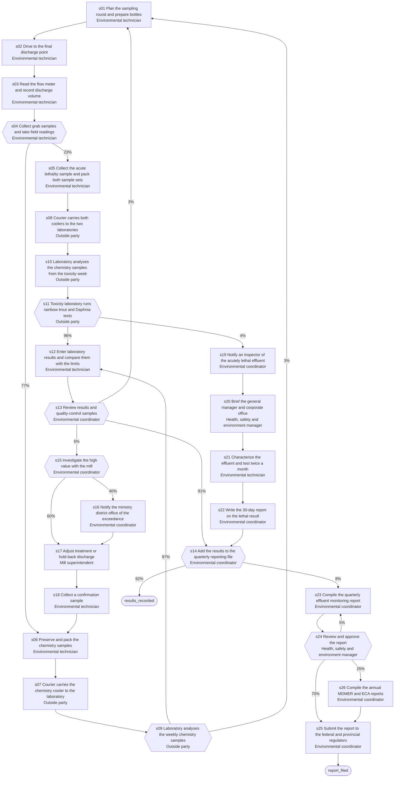

# Environmental monitoring and effluent reporting

`mine-hse-env-monitoring` · mining (underground gold) · health, safety and environment · part of `mining-operator-co`

Every week an environmental technician samples each point where treated water leaves the site (the Mill polishing pond to Miron Creek and the mine settling ponds to Lake C7), records the flow and couriers the samples to an accredited laboratory in Thunder Bay; once a month a further sample goes to a toxicity laboratory in Oakville for fish and water-flea tests. The environmental coordinator checks the results against federal effluent limits and the provincial approvals, investigates high values with the mill, and files quarterly and annual reports. Most of the elapsed time is courier transit and laboratory turnaround; re-keying laboratory certificates into spreadsheets and the rare failed toxicity test, which triggers immediate notice and twice-monthly testing, are where errors and effort concentrate.

| | |
|---|---|
| Unit of work | one weekly effluent sampling event at one final discharge point, from bottle preparation to results recorded (and, for the last event of a quarter, the quarterly report filed) |
| Starts when | The weekly sampling day for a final discharge point comes up on the monitoring schedule. |
| Done when | The laboratory results are reviewed and stored for regulatory reporting, any exceedance or lethal result has been notified and followed up, and at quarter end the report is filed. |
| Organisation | A single-mine Canadian gold producer running a 500-650 tpd underground mine and its own mill near Wawa in northern Ontario, with 12-hour shifts on 14-on/14-off rotations and a camp. (300 employees, 2019-2022) |
| Volume | 9 cases a month (range 8 to 13) |

## Where it sits

- Starts with **treated_discharge** from mill-water-treatment (52% of cases)
- Starts with **dewatering_water** from mine-dewatering (48% of cases)
- Relies on **permit_approval** from hse-permits (a standing input; it does not start a case)
- Relies on **lab_results** from commercial-lab (a standing input; it does not start a case)
- Sends **effluent_sample** to commercial-lab (outcome: any)
- Sends **env_results** to hse-permits (outcome: results_recorded)
- Sends **regulatory_report** to eccc (outcome: report_filed)
- Sends **regulatory_report** to ontario-mecp (outcome: report_filed)
- Sends **env_results** to mill-water-treatment (outcome: any)

## Flow

## Roles

| Role | Department | Layer | FTE on this process | Loaded cost per hour | Evidence |
|---|---|---|---:|---:|---|
| Environmental technician | Health, safety, environment and community | individual contributor | 0.5 | 40 CAD | C |
| Environmental coordinator | Health, safety, environment and community | senior specialist | 0.3 | 58 CAD | C |
| Health, safety and environment manager | Health, safety, environment and community | manager | 0.04 | 102 CAD | C |
| Mill superintendent | Processing | manager | 0.02 | 112 CAD | C |

## Steps

Hands-on time and the wait before each step show the most common value. Evidence tier A is a sourced number, B a sourced description, C the author's estimate.

| Step | Who | Kind | Hands-on | Wait before | Control | Evidence |
|---|---|---|---:|---:|---|---|
| **s01 Plan the sampling round and prepare bottles.** The environmental technician checks the monitoring schedule in the environmental data workbook to see which final discharge point is due, whether this is the monthly toxicity week, and which receiving-water stations ride along. They take pre-labelled, pre-preserved bottles from the laboratory's kit, fill out field sheets and chain-of-custody forms, and calibrate the field pH and temperature meter. | Environmental technician | coordination | 45 min | 1.0 d |  | B [mdmer] |
| **s02 Drive to the final discharge point.** The technician drives the site pickup to the discharge point, either the Mill polishing pond outlet to Miron Creek or the mine water settling ponds at Lake C7, a few kilometres apart on site roads. In winter the last stretch may need a snowmobile, and a storm or road plowing can hold the trip for a day. | Environmental technician | travel | 25 min | 0 min |  | B [er-tr2022] |
| **s03 Read the flow meter and record discharge volume.** The technician reads the totalizer and instantaneous flow on the effluent flow meter or weir, writes them on the field sheet with the time, and notes anything unusual such as a frozen weir or a pump not running. The readings feed the monthly volume that the quarterly report needs. | Environmental technician | physical | 15 min | 0 min | MDMER s. 19: record the monthly volume of effluent from each final discharge point with a flow monitoring system accurate to 15% and calibrated yearly | A [mdmer] |
| **s04 Collect grab samples and take field readings.** The technician fills the bottles for metals, total cyanide, total suspended solids and ammonia at the outlet, adds or checks preservatives, measures pH and temperature in the field, and takes a duplicate or field blank on the scheduled weeks. Each bottle gets the date, time and station on its label. | Environmental technician | physical | 30 min | 0 min | MDMER s. 12(1): grab or composite sample of each final discharge point at least once a week for pH and the prescribed deleterious substances | A [mdmer] |
| **s05 Collect the acute lethality sample and pack both sample sets.** In the monthly toxicity week the technician also fills clean containers with effluent for the rainbow trout and Daphnia magna tests, then packs the toxicity containers and the chemistry bottles in separate coolers with ice packs and fills in a chain-of-custody form for each laboratory. | Environmental technician | physical | 45 min | 0 min | MDMER s. 14(1): monthly grab sample from each final discharge point for acute lethality tests on rainbow trout (s. 14.1) and Daphnia magna (s. 14.3) | A [mdmer] |
| **s06 Preserve and pack the chemistry samples.** Back at the environmental office the technician checks every bottle against the chain-of-custody form, keeps cyanide and ammonia bottles cold, packs them in a cooler with ice packs and books the courier pickup at the gatehouse. | Environmental technician | data entry | 25 min | 30 min |  | C |
| **s07 Courier carries the chemistry cooler to the laboratory.** The courier picks up the cooler at the site gate and takes it by road from near Wawa to the accredited water laboratory in Thunder Bay. Samples taken late in the week miss the pickup and wait at site, kept cold, until the next run. | Outside party | external wait | 0 min | 1.0 d |  | B [er-tr2022] |
| **s08 Courier carries both coolers to the two laboratories.** In the toxicity week the courier takes the chemistry cooler to Thunder Bay and the toxicity cooler to the toxicity laboratory in Oakville in southern Ontario. Toxicity samples must arrive cold and within the holding time, so the technician times sampling to the courier run. | Outside party | external wait | 0 min | 1.0 d |  | B [er-tr2022] |
| **s09 Laboratory analyses the weekly chemistry samples.** The laboratory logs the samples, checks temperature and holding times, runs metals by ICP, cyanide, suspended solids and ammonia, and emails a certificate of analysis as a PDF and spreadsheet. A sample that arrives warm or past its holding time is rejected and the mine must resample. | Outside party | external wait | 0 min | 5.0 d |  | C |
| **s10 Laboratory analyses the chemistry samples from the toxicity week.** The water laboratory runs the same weekly chemistry on the samples from the toxicity week and emails the certificate. The work runs at the same time as the toxicity tests in Oakville. | Outside party | external wait | 0 min | 5.0 d |  | C |
| **s11 Toxicity laboratory runs rainbow trout and Daphnia tests.** The toxicity laboratory sets up the 96-hour rainbow trout test and the 48-hour Daphnia magna test on the undiluted effluent, records mortality, and issues a report stating whether the sample was acutely lethal. A lethal result is phoned or emailed to the environmental coordinator the day it is read. | Outside party | external wait | 0 min | 6.0 d | MDMER ss. 14.1 and 14.3: acute lethality tests on rainbow trout and Daphnia magna by the reference methods | C |
| **s12 Enter laboratory results and compare them with the limits.** The technician copies the certificate values into the environmental data workbook, flags any value above the MDMER Schedule 4 limits or the ECA effluent limits and objectives, and files the PDF certificate with the field sheet. | Environmental technician | data entry | 35 min | 1.0 d |  | C |
| **s13 Review results and quality-control samples.** The environmental coordinator reviews the week's results against the limits and against previous weeks, checks duplicates and blanks, and decides whether a high value is real or a sampling or laboratory error that needs a resample. | Environmental coordinator | review | 30 min | 1.0 d |  | B [er-tr2022] |
| **s14 Add the results to the quarterly reporting file.** The coordinator moves the reviewed results and flow into the quarterly MDMER tables and the ECA annual summary in the workbook so that the reports can be assembled at quarter end. | Environmental coordinator | data entry | 15 min | 1.0 h | MDMER s. 27: monitoring records kept at the mine for at least five years | A [mdmer] |
| **s15 Investigate the high value with the mill.** The coordinator phones the mill superintendent or metallurgist, looks at pond levels, hydrogen peroxide dosing in the reclaim pond and recent process upsets, and decides whether the result breaches a compliance limit that must be reported or only an objective. | Environmental coordinator | analysis | 2.0 h | 2.0 h |  | B [er-tr2022] |
| **s16 Notify the ministry district office of the exceedance.** The coordinator phones and emails the Ministry of the Environment, Conservation and Parks district office as the ECA requires, giving the parameter, value, likely cause and the action under way, after the HSE manager has seen the draft. | Environmental coordinator | communication | 1.0 h | 1.0 h | Environmental Compliance Approval conditions for the Mill and mine sewage works: notice to the ministry district office of an effluent limit exceedance | C |
| **s17 Adjust treatment or hold back discharge.** The mill superintendent has the shift raise peroxide dosing, slow the discharge pump or recirculate water to the tailings area until levels fall, and tells the coordinator when the change is in place. | Mill superintendent | judgment | 1.0 h | 8.0 h |  | B [er-tr2022] |
| **s18 Collect a confirmation sample.** The technician returns to the discharge point, takes a confirmation sample for the parameter that was high plus the routine set, and sends it for rush analysis. | Environmental technician | physical | 1.5 h | 2.0 d |  | C |
| **s19 Notify an inspector of the acutely lethal effluent.** As soon as the laboratory reports a lethal result the coordinator phones and emails the federal enforcement officer or inspector, and tells the mill to review the discharge. The call is made the same day. | Environmental coordinator | communication | 45 min | 1.0 h | MDMER s. 24(1): notify an inspector without delay when an effluent is acutely lethal | A [mdmer] |
| **s20 Brief the general manager and corporate office.** The HSE manager briefs the general manager and the chief operating officer on the failed test, the likely cause and whether discharge should be stopped, and agrees who will speak to the ministry and local First Nations if asked. | Health, safety and environment manager | communication | 1.0 h | 4.0 h |  | C |
| **s21 Characterize the effluent and test twice a month.** The technician takes effluent characterization samples at once, then lethality samples twice a month at least seven days apart until three in a row pass. Each round repeats the sampling, packing and courier steps; the elapsed time is mostly waiting for test results. | Environmental technician | physical | 6.0 h | 21.0 d | MDMER s. 15: effluent characterization and lethality tests twice a month until three consecutive non-lethal results | A [mdmer] |
| **s22 Write the 30-day report on the lethal result.** The coordinator writes the follow-up report with the test results, characterization data, the cause found and the corrective action, has the HSE manager sign it and sends it to the inspector. | Environmental coordinator | drafting | 8.0 h | 3.0 d | MDMER s. 24(2): written report within 30 days after the lethality testing is completed | A [mdmer] |
| **s23 Compile the quarterly effluent monitoring report.** After the quarter ends the coordinator totals monthly volumes, calculates monthly mean concentrations and loadings for each final discharge point, lists the lethality test results and enters everything into the federal online reporting system, with a matching summary for the provincial ECA file. | Environmental coordinator | drafting | 10.0 h | 20.0 d | MDMER s. 21(1): effluent monitoring report for each calendar quarter within 45 days after the quarter ends | A [mdmer] |
| **s24 Review and approve the report.** The HSE manager reads the draft, checks any exceedance against the notices already sent and the corrective actions, and approves it for submission or returns it with corrections. | Health, safety and environment manager | approval | 1.0 h | 1.0 d | Company sign-off of regulatory submissions by the HSE manager | C |
| **s25 Submit the report to the federal and provincial regulators.** The coordinator submits the quarterly report in the federal online system, emails the ECA summary to the ministry district office where required, and saves the confirmation in the permit file. | Environmental coordinator | communication | 30 min | 2.0 h |  | A [mdmer] |
| **s26 Compile the annual MDMER and ECA reports.** For the fourth quarter the coordinator also writes the annual MDMER report and the annual ECA monitoring reports for the Mill and the mine, with the year's results, flow totals, exceedances, groundwater results and corrective actions, due by March 31. | Environmental coordinator | drafting | 1.2 d | 5.0 d | MDMER s. 22: annual report by March 31 for the previous calendar year; ECA annual reporting conditions | A [mdmer], [er-tr2022] |

## Exceptions

| Exception | Share of cases | What happens |
|---|---:|---|
| Acutely lethal toxicity result | 1% | About 4% of monthly toxicity samples (one event in 4.3) fail; the inspector is notified the same day, the effluent is characterized and tested twice a month until three tests pass, and a written report follows within 30 days. |
| Effluent value above an ECA objective or limit | 6% | A copper, cyanide or ammonia value is above an objective or limit; the coordinator investigates with the mill, notifies the ministry if a limit is breached, and confirms with a resample. |
| Sample rejected or quality-control failure | 6% | The laboratory rejects a warm or late sample, or a duplicate or blank fails, and the round is repeated. |

## Benchmarks

| Metric | Value | Unit | Population | Evidence |
|---|---|---|---|---|
| cycle_time_days | p50 12, p90 30 | calendar days from sampling day to results reviewed and stored (quarter-end events include the report) | Weekly effluent sampling at an Ontario gold mine using a commercial laboratory about 500 km away by road | C |
| quarterly_report_deadline | 45 | days after the end of the quarter | Mines subject to the MDMER | A [mdmer] |
| acute_lethality_tests_per_point | 12 | tests per year per final discharge point (before any reduction) | Mines subject to the MDMER | A [mdmer] |

## Pain points

- Laboratory certificates are re-keyed into spreadsheets and then re-keyed again into the federal reporting system, so transcription errors surface only at quarter-end review. (steps s12, s14, s23; C)
- Samples travel about 500 km to Thunder Bay and further to Oakville; a missed courier run or a warm cooler costs a week and a repeat trip. (steps s07, s08, s09; B [er-tr2022])
- With one technician on site per rotation, sampling competes with groundwater, receiving-water and tailings inspections, and winter access to the discharge points can slip a day. (steps s01, s02; C)

## Assumptions

- The unit of work is one weekly sampling event at one final discharge point; monthly toxicity tests ride on one event in about 4.3, and the quarterly report is attached to the last event of each quarter (share 0.08), so the cycle-time median describes ordinary weekly events.
- The organisation file describes 'batch releases'; the Eagle River technical report says Mill effluent is discharged at controlled rates through most of the year and the mine settling ponds discharge continuously, so batch-release approval is not modelled as a step.
- The second final discharge point (mine settling ponds to Lake C7) is fed by mine dewatering, so triggered_by names mine-dewatering beside mill-water-treatment. Laboratory results are treated as an input returned within the case rather than a trigger.
- Toxicity sampling is modelled on its own path (s05, s08, s10, s11) so that only toxicity-week events wait for toxicity results; s11 runs alongside s10.
- The simulated median of about 14 days is close to the 12-day estimate; the extra days come from the long tail of laboratory turnaround (s09, s10) and review queues.
- Receiving-water, groundwater and EEM biological sampling (every three years) are outside this unit of work and not modelled.
- Loaded costs are the organisation file's rates: base wage times 1.30 for office and staff roles and 1.35 for hourly site roles.
- The ECA notification step (s16) rests on common ECA conditions; the ECA texts were not opened.

## Sources

- [mdmer] [Metal and Diamond Mining Effluent Regulations (SOR/2002-222), full text](https://laws-lois.justice.gc.ca/eng/regulations/SOR-2002-222/FullText.html) (Government of Canada, Justice Laws Website, 2002). s. 12(1): sample each final discharge point at least once a week, at least 24 hours apart, for pH and the prescribed deleterious substances; s. 13: reduction to quarterly for some substances after 12 months below 10% of the limit; s. 14(1): monthly acute lethality grab sample, at least 15 days apart, tested on rainbow trout (s. 14.1) and Daphnia magna (s. 14.3); s. 15(1): after a lethal result, effluent characterization without delay and lethality tests twice a month at least seven days apart, back to monthly after three consecutive non-lethal tests (s. 15(2)); s. 19: monthly effluent volume, flow monitoring accurate to 15% and calibrated yearly; s. 21(1): quarterly report within 45 days after the quarter; s. 22: annual report by March 31; s. 24: notify an inspector without delay of an acutely lethal effluent and give a written report within 30 days after testing; s. 27: records kept at the mine for five years.
- [er-tr2022] [Technical Report for the Eagle River Gold Mining Complex, Ontario, Canada (NI 43-101)](https://s203.q4cdn.com/643390454/files/doc_downloads/2022/11/ERtechnicalReport.pdf) (SRK Consulting (Canada) Inc. for Wesdome Gold Mines Ltd., 2022). Section 20.4: monitoring under the ECAs, the PTTW and the MDMER covers effluent flow and quality during discharge, effluent toxicity tests, groundwater and receiving water; treated effluent from the Mill polishing pond to Miron Creek is discharged at controlled rates through most of the year, with little or none in February-March and August-September; the Eagle River Mine settling ponds discharge continuously to Lake C7; the Mishi pit ponds discharged to Macassa Creek as needed, mainly in spring and fall, during pit operations; 2020 annual reports met MDMER and ECA limits, with copper, free cyanide and un-ionized ammonia above ECA objectives at the Mill and one monthly dissolved aluminum exceedance at Mishi; EEM biological studies every three years. Section 11.2: water and effluent analyses by Testmark Laboratories (Thunder Bay, ISO 17025 accredited through CALA) and toxicity tests by Nautilus Environmental (Oakville). Section 17: cyanide in reclaim pond water treated with hydrogen peroxide. Table 20-1: Mill ECA peak flow 4,750 m3/day. Section 18 lists a warehouse among site buildings.

Written by claude-opus on 2026-11-24.
