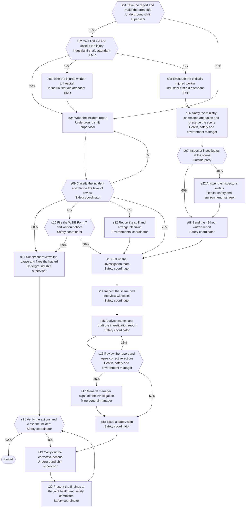

# Incident reporting and investigation

`mine-hse-incident-mgmt` · mining (underground gold) · health, safety and environment · part of `mining-operator-co`

Workers report injuries, near misses, equipment damage and spills to their supervisor, who makes the area safe and writes the incident report before the end of shift; the first aid attendant treats injuries and drives serious cases an hour to hospital. A safety coordinator classifies each report, files WSIB and ministry notices when due, and leads formal investigations of serious or high-potential events with a committee worker member, after which managers approve corrective actions and a safety alert goes out. A critical injury requires immediate notice to the ministry, an untouched scene and a written report within 48 hours. Investigations stall on 14-on/14-off rotations, on managers' review queues, and on corrective actions that wait for parts or shutdowns.

| | |
|---|---|
| Unit of work | one incident (injury, near miss, equipment damage or spill) |
| Starts when | A worker or supervisor reports an incident. |
| Done when | The incident is classified, required notices are filed, causes are recorded and the corrective actions are verified as done. |
| Organisation | A single-mine Canadian gold producer running a 500-650 tpd underground mine and its own mill near Wawa in northern Ontario, with 12-hour shifts on 14-on/14-off rotations and a camp. (300 employees, 2019-2022) |
| Volume | 25 cases a month (range 15 to 40) |

## Where it sits

- Starts with **incident_report** from mine-shift-control (60% of cases)
- Starts with **incident_report** from mnt-breakdown-repair (20% of cases)
- Starts with **incident_report** from mill-grind-leach (12% of cases)
- Starts with **incident_report** from site-contractors (8% of cases)
- Sends **regulatory_report** to ontario-mltsd (outcome: any)
- Sends **injury_claim** to wsib (outcome: any)
- Sends **safety_alert** to hse-training (outcome: closed)
- Sends **investigation_report** to corp-governance (outcome: closed)
- Sends **work_request** to mnt-work-planning (outcome: any)
- Sends **regulatory_report** to ontario-mecp (outcome: any)

## Flow

## Roles

| Role | Department | Layer | FTE on this process | Loaded cost per hour | Evidence |
|---|---|---|---:|---:|---|
| Underground shift supervisor | Underground production and development | supervisor | 0.8 | 82 CAD | C |
| Industrial first aid attendant (EMR) | Health, safety, environment and community | individual contributor | 0.2 | 42 CAD | C |
| Safety coordinator | Health, safety, environment and community | senior specialist | 1.5 | 57 CAD | C |
| Health, safety and environment manager | Health, safety, environment and community | manager | 0.15 | 102 CAD | C |
| Environmental coordinator | Health, safety, environment and community | senior specialist | 0.03 | 58 CAD | C |
| Mine general manager | Site management and administration | director | 0.03 | 150 CAD | C |

## Steps

Hands-on time and the wait before each step show the most common value. Evidence tier A is a sourced number, B a sourced description, C the author's estimate.

| Step | Who | Kind | Hands-on | Wait before | Control | Evidence |
|---|---|---|---:|---:|---|---|
| **s01 Take the report and make the area safe.** A worker reports an injury, near miss, equipment damage or spill to the shift supervisor by radio or in person. The supervisor goes to the scene, stops work nearby, barricades or isolates the hazard, and decides whether first aid or the emergency response is needed. | Underground shift supervisor | intake | 30 min | 15 min | Mine health and safety program: stop work and isolate the hazard after an incident (OHSA duty of the supervisor to protect workers) | C |
| **s02 Give first aid and assess the injury.** The industrial first aid attendant, called by radio, reaches the worker, treats the injury, records the treatment in the first aid log and decides whether the worker can return to work, needs a doctor, or is seriously hurt. | Industrial first aid attendant (EMR) | physical | 40 min | 20 min | Ontario Regulation 1101 (first aid requirements) under the Workplace Safety and Insurance Act: first aid treatment recorded | C |
| **s03 Take the injured worker to hospital.** The first aid attendant drives the worker in the site emergency vehicle to the hospital in Wawa, about an hour away, hands over to the emergency department and returns. If the worker is underground the trip starts with the cage or a ramp vehicle. | Industrial first aid attendant (EMR) | travel | 3.0 h | 15 min |  | B [er-tr2022] |
| **s04 Write the incident report.** Before the end of shift the supervisor writes the incident report in the incident system, or on the paper form when the system is not reachable underground: what happened, who was involved, the immediate cause and what was done to make the area safe. | Underground shift supervisor | data entry | 30 min | 5.0 h | Company incident reporting standard: every incident reported before the end of shift | C |
| **s05 Evacuate the critically injured worker.** The first aid attendant and mine rescue members stabilize the worker, bring them to surface by cage or ramp and hand over to the ambulance or air ambulance at the site landing area. | Industrial first aid attendant (EMR) | travel | 2.0 h | 10 min |  | B [er-tr2022] |
| **s06 Notify the ministry, committee and union and preserve the scene.** The HSE manager phones the ministry's health and safety contact centre and tells the joint health and safety committee, has security guard the scene so nothing is moved, and informs the general manager and the chief operating officer. | Health, safety and environment manager | communication | 1.0 h | 15 min | Occupational Health and Safety Act s. 51: immediate notice of a critical injury or death and the scene left undisturbed until released by an inspector | A [mltsd-report] |
| **s07 Inspector investigates at the scene.** A mining inspector travels to site, examines the scene, interviews witnesses and the supervisor, and releases the scene; the inspector may write orders on the spot. The wait covers the drive from the district office and the investigation days. | Outside party | external wait | 0 min | 1.0 d |  | C |
| **s08 Send the 48-hour written report.** The safety coordinator writes the formal report to the ministry with the circumstances, the injured worker's details, witnesses and the steps taken, has the HSE manager sign it and sends it within 48 hours. | Safety coordinator | drafting | 4.0 h | 8.0 h | Occupational Health and Safety Act s. 51(1) and O. Reg. 420/21: written report to a Director within 48 hours of a critical injury or death | A [mltsd-report] |
| **s09 Classify the incident and decide the level of review.** The next day on site the safety coordinator reads the report in the incident system, phones the supervisor for missing facts, classifies the incident (first aid, medical aid, lost time, near miss, damage, spill) and its potential severity, and decides whether a supervisor review is enough or a formal investigation is needed. They also check whether a WSIB report, a two-day mine notice or a spill report is due. | Safety coordinator | judgment | 30 min | 16.0 h |  | C |
| **s10 File the WSIB Form 7 and written notices.** The safety coordinator, with the site HR coordinator, completes the WSIB Form 7 online within three business days and gives the four-day written notice to the joint health and safety committee; for a reportable mine accident the two-day notice also goes to the ministry. Modified work is arranged with the supervisor. | Safety coordinator | data entry | 1.5 h | 1.0 d | Workplace Safety and Insurance Act: Form 7 within three business days; OHSA s. 52 and Regulation 854: written notice within four days (two days for listed mine accidents) | A [wsib-report], [mltsd-report] |
| **s11 Supervisor reviews the cause and fixes the hazard.** For a low-potential incident the supervisor talks to the people involved, records the cause and a simple corrective action in the incident system (fix a guard, re-scale, replace a hose, re-instruct a worker), and does it on the next shift where possible. | Underground shift supervisor | analysis | 40 min | 3.0 d |  | C |
| **s12 Report the spill and arrange clean-up.** The environmental coordinator decides whether the spill (diesel, hydraulic oil, process solution) must be reported to the provincial Spills Action Centre, phones it in if so, and arranges clean-up and soil sampling with the mill or surface crew. | Environmental coordinator | communication | 2.0 h | 2.0 h | Ontario Environmental Protection Act, Part X: report spills of pollutants to the ministry Spills Action Centre | C |
| **s13 Set up the investigation team.** The safety coordinator names the investigation team (the area supervisor, a joint committee worker member and a technical person such as a mechanic or engineer), books a time that fits the crews' rotation, and gathers photos, equipment records and training records. | Safety coordinator | coordination | 1.0 h | 1.0 d |  | C |
| **s14 Inspect the scene and interview witnesses.** The team visits the scene, takes measurements and photos, and interviews the people involved and witnesses one at a time, writing statements on the investigation form. | Safety coordinator | physical | 5.0 h | 2.0 h |  | C |
| **s15 Analyse causes and draft the investigation report.** The safety coordinator works through the sequence of events with a root-cause method (five whys or a causal tree), lists immediate and underlying causes, and proposes corrective actions with owners and dates in the incident system. | Safety coordinator | drafting | 6.0 h | 3.0 d |  | C |
| **s16 Review the report and agree corrective actions.** The HSE manager and the superintendent of the department involved read the draft, challenge weak causes, and agree corrective actions, owners and due dates. | Health, safety and environment manager | review | 1.0 h | 3.0 d | Company incident investigation standard: HSE manager approves formal investigations | C |
| **s17 General manager signs off the investigation.** The general manager reads the serious investigations, confirms the corrective actions and resources, and forwards the report to the chief operating officer for the board's health and safety committee. | Mine general manager | approval | 30 min | 3.0 d | Company governance: general manager sign-off of serious incident investigations and board reporting | C |
| **s18 Issue a safety alert.** The safety coordinator writes a one-page safety alert with what happened, why, and what changes, posts it on the boards and sends it to supervisors and the trainers for line-up talks and refresher training. | Safety coordinator | drafting | 1.0 h | 1.0 d |  | C |
| **s19 Carry out the corrective actions.** The department supervisor or the planner carries out the agreed actions: a procedure change, a guard or engineering fix through a maintenance work order, retraining, or a change to the line-up. Larger actions wait for parts or the next shutdown. | Underground shift supervisor | physical | 4.0 h | 10.0 d |  | C |
| **s20 Present the findings to the joint health and safety committee.** At its monthly meeting the joint health and safety committee reviews the investigation and the safety alert, and its worker members can ask for further actions. This runs while the actions are being carried out. | Safety coordinator | communication | 20 min | 0 min | Occupational Health and Safety Act s. 9: the joint health and safety committee receives information on incidents and makes recommendations | C |
| **s21 Verify the actions and close the incident.** The safety coordinator checks each action in the field or against evidence (a closed work order, a signed training record), closes the incident in the system, or reopens actions that did not fix the hazard. | Safety coordinator | validation | 30 min | 7.0 d |  | C |
| **s22 Answer the inspector's orders.** The HSE manager writes the compliance plan for each order (what will be done and by when), gets the general manager's agreement, and sends the notice of compliance to the ministry when the work is done. | Health, safety and environment manager | drafting | 4.0 h | 2.0 d | Occupational Health and Safety Act: compliance with inspector's orders and notice of compliance | C |

## Exceptions

| Exception | Share of cases | What happens |
|---|---:|---|
| Critical injury | 0% | Immediate phone notice to the ministry, committee and union, the scene held for the inspector, a 48-hour written report and a full investigation; orders may follow. |
| Lost-time or medical-aid injury | 6% | WSIB Form 7 within three business days and the four-day written notice, then a supervisor review or formal investigation. |
| Corrective action not effective | 8% | The coordinator finds the action not done or not working and sends it back. |

## Benchmarks

| Metric | Value | Unit | Population | Evidence |
|---|---|---|---|---|
| cycle_time_days | p50 21, p90 60 | calendar days from report to incident closed | Incidents at an Ontario underground mine with a 14/14 rotation | C |
| critical_injury_written_report | 48 | hours after the event | Ontario workplaces | A [mltsd-report] |
| wsib_form7_deadline | 3 | business days after learning of the injury | Ontario employers | A [wsib-report] |

## Pain points

- Investigation teams wait for people to come back on rotation, so a formal investigation can lose one or two weeks before the scene interviews. (steps s13; C)
- Supervisors write reports at the end of a 12-hour shift; vague reports come back from triage. (steps s04, s09; C)
- Corrective actions that need parts, engineering or a shutdown stay open for weeks and need repeated chasing. (steps s19, s21; C)

## Assumptions

- Branch shares (30% injuries, 6% needing WSIB reporting, 25% formal investigations, 0.3% critical) are the author's estimates; no incident statistics for the site were opened.
- The WSIB step is reached from triage with its overall share rather than only from the injury path, because the simulator does not carry memory of earlier branches.
- The organisation file lists only mine-shift-control and mnt-breakdown-repair as triggers; incidents also come from the mill and from contractors, so mill-grind-leach and site-contractors were added as triggers. Corrective actions produce maintenance work requests and spills produce reports to the ministry of the environment.
- The simulated median of about 16 days is below the 21-day estimate because most incidents take the supervisor-review path; formal investigations drive the 45-day 90th percentile.
- The site emergency vehicle is not in the organisation file and was added as a resource.
- Loaded costs are the organisation file's rates: base wage times 1.30 for office and staff roles and 1.35 for hourly site roles.
- Organisation file corrected on 2026-11-24 to match this workflow's sources: ids were renamed (mill-elution-refining to mill-gold-room-refining, loaded_carbon to gold_concentrate, tailings_slurry to filtered_tailings, elution-circuit to refinery), and roles and resources this workflow added are now in the organisation file. Notes above that describe a mismatch refer to the file before the correction.

## Sources

- [mltsd-report] [Reporting workplace incidents and illnesses](https://bac-lac.wayback.archive-it.org/web/2022/https://www.ontario.ca/page/reporting-workplace-incidents-and-illnesses) (Ontario Ministry of Labour, Training and Skills Development (archived copy in the Library and Archives Canada web archive), 2022). Fatality or critical injury: notify the ministry, the joint health and safety committee or representative, and the union immediately; do not disturb the scene except to save life, relieve suffering, keep essential services or prevent property damage, or with an inspector's permission; written report to the ministry within 48 hours. At a mine or mining plant, written notice within two days of an accident, explosion, fire, inrush of water, cave-in or certain equipment failures even if no one is hurt. Written notice within four days to the committee and union when a worker is disabled from work or needs medical attention because of an accident. Copies kept three years. Page published 29 August 2018, updated 7 July 2022; capture of 4 January 2023.
- [wsib-report] [Report an injury or illness (businesses)](https://www.wsib.ca/en/businesses/claims/report-injury-or-illness) (Workplace Safety and Insurance Board (Ontario), 2026). Employers report to the WSIB on Form 7 within three business days of learning of an injury that needs health care beyond first aid, causes absence, lost earnings or modified work at less than regular pay, or modified work at regular pay for more than seven days; first-aid-only injuries are not reported; penalties and prosecution for late or missing reports. Page updated 2 September 2026.
- [er-tr2022] [Technical Report for the Eagle River Gold Mining Complex, Ontario, Canada (NI 43-101)](https://s203.q4cdn.com/643390454/files/doc_downloads/2022/11/ERtechnicalReport.pdf) (SRK Consulting (Canada) Inc. for Wesdome Gold Mines Ltd., 2022). Section 20.4: monitoring under the ECAs, the PTTW and the MDMER covers effluent flow and quality during discharge, effluent toxicity tests, groundwater and receiving water; treated effluent from the Mill polishing pond to Miron Creek is discharged at controlled rates through most of the year, with little or none in February-March and August-September; the Eagle River Mine settling ponds discharge continuously to Lake C7; the Mishi pit ponds discharged to Macassa Creek as needed, mainly in spring and fall, during pit operations; 2020 annual reports met MDMER and ECA limits, with copper, free cyanide and un-ionized ammonia above ECA objectives at the Mill and one monthly dissolved aluminum exceedance at Mishi; EEM biological studies every three years. Section 11.2: water and effluent analyses by Testmark Laboratories (Thunder Bay, ISO 17025 accredited through CALA) and toxicity tests by Nautilus Environmental (Oakville). Section 17: cyanide in reclaim pond water treated with hydrogen peroxide. Table 20-1: Mill ECA peak flow 4,750 m3/day. Section 18 lists a warehouse among site buildings.

Written by claude-opus on 2026-11-24.
