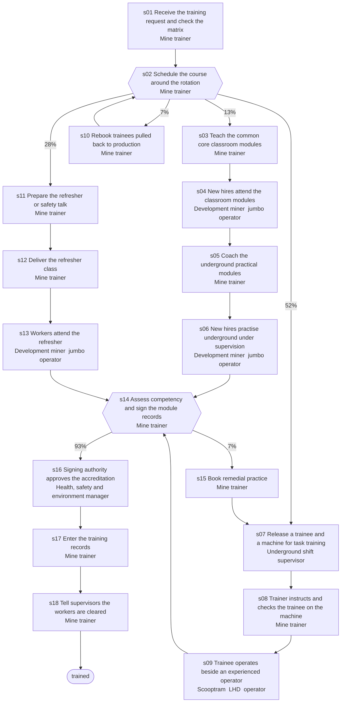

# Mandatory and task training

`mine-hse-training` · mining (underground gold) · health, safety and environment · part of `mining-operator-co`

Ontario law requires every new underground miner to complete the four common core modules before working, and every worker to hold the specialty modules and equipment training for each task. Two site trainers run the common core classes and refreshers, while task training on machines happens on production shifts with an experienced operator coaching and the trainer signing off. The HSE manager, as the site's designated signing authority, approves accreditations, and the trainer keeps the records that supervisors check at line-up. The process is slow because trainees, machines and coaches must be released from production on a 14-on/14-off rotation, and training is the first thing cut when crews are short.

| | |
|---|---|
| Unit of work | one training course (a common core class, a task training sign-off on one machine, or a refresher class) |
| Starts when | HR sends a new-hire list, a supervisor asks for task training, a refresher falls due, or a safety alert needs to be taught. |
| Done when | The trainees are assessed competent, the records are signed and entered, and supervisors know the workers can be assigned. |
| Organisation | A single-mine Canadian gold producer running a 500-650 tpd underground mine and its own mill near Wawa in northern Ontario, with 12-hour shifts on 14-on/14-off rotations and a camp. (300 employees, 2019-2022) |
| Volume | 30 cases a month (range 20 to 45) |

## Where it sits

- Starts with **new_hire** from site-recruitment (15% of cases)
- Starts with **training_record** from mine-shift-control (45% of cases)
- Starts with **training_record** from mill-grind-leach (12% of cases)
- Starts with **training_record** from mnt-work-planning (13% of cases)
- Starts with **safety_alert** from hse-incident-mgmt (15% of cases)
- Sends **training_record** to mine-shift-control (outcome: trained)
- Sends **training_record** to mill-grind-leach (outcome: trained)
- Sends **training_record** to mnt-work-planning (outcome: trained)

## Flow

## Roles

| Role | Department | Layer | FTE on this process | Loaded cost per hour | Evidence |
|---|---|---|---:|---:|---|
| Mine trainer | Health, safety, environment and community | individual contributor | 2 | 53 CAD | C |
| Development miner (jumbo operator) | Underground production and development | individual contributor | 7 | 56 CAD | C |
| Scooptram (LHD) operator | Underground production and development | individual contributor | 1.5 | 51 CAD | C |
| Underground shift supervisor | Underground production and development | supervisor | 0.1 | 82 CAD | C |
| Health, safety and environment manager | Health, safety, environment and community | manager | 0.05 | 102 CAD | C |

## Steps

Hands-on time and the wait before each step show the most common value. Evidence tier A is a sourced number, B a sourced description, C the author's estimate.

| Step | Who | Kind | Hands-on | Wait before | Control | Evidence |
|---|---|---|---:|---:|---|---|
| **s01 Receive the training request and check the matrix.** The trainer gets a request: a new-hire list from HR, a supervisor asking for a worker to be trained on a machine, an expiring refresher flagged in the training records system, or a safety alert that needs a talk. They check the training matrix for which modules each worker already holds and which are required for the job. | Mine trainer | intake | 20 min | 8.0 h |  | B [mhspr-training] |
| **s02 Schedule the course around the rotation.** The trainer finds dates when the trainees, a trainer and the training room or machine are all available, which on a 14-on/14-off rotation usually means the start of the trainees' next hitch, and asks the supervisors to release the workers from the line-up. | Mine trainer | coordination | 40 min | 5.0 d |  | C |
| **s03 Teach the common core classroom modules.** The trainer delivers the surface and underground induction and the theory of the general inspection, scaling and lockout modules in the training room, with videos, the site's procedures and written checks. | Mine trainer | communication | 20.0 h | 1.0 h | Regulation 854 s. 11: basic common core program (Underground Hard Rock Miner 770010) completed before the work is assigned | B [mhspr-training] |
| **s04 New hires attend the classroom modules.** A group of new miners sits the classroom part of the common core, reading the procedures and completing the written checks for each module. They are paid but not on the line-up. | Development miner (jumbo operator) | communication | 20.0 h | 0 min |  | C |
| **s05 Coach the underground practical modules.** The trainer takes the group underground to practise workplace inspection, scaling with a bar and lockout on a real machine, and observes each person doing each task to the module's performance standard. | Mine trainer | physical | 10.0 h | 12.0 h | Regulation 854 s. 11 and the program guideline: competency in each common core module demonstrated before accreditation | B [mhspr-training] |
| **s06 New hires practise underground under supervision.** The new miners scale loose rock, inspect their workplace and lock out a machine under the trainer's eye, repeating each task until it meets the module's performance standard. | Development miner (jumbo operator) | physical | 10.0 h | 0 min |  | C |
| **s07 Release a trainee and a machine for task training.** The shift supervisor picks a shift when a machine (a scooptram, bolter or jumbo) and an experienced operator can be spared from production, and puts the trainee with them on the line-up. | Underground shift supervisor | coordination | 15 min | 2.0 d |  | C |
| **s08 Trainer instructs and checks the trainee on the machine.** The trainer gives the pre-operation instruction on the machine (walk-around, controls, emergency stops, the site's traffic rules), comes back at the end of the coaching shifts, and watches the trainee operate before the sign-off. | Mine trainer | physical | 3.0 h | 1.0 h | Regulation 854 s. 11: specialty modules required for the task completed by the worker | B [mhspr-training] |
| **s09 Trainee operates beside an experienced operator.** Over one to three shifts the trainee runs the machine with an experienced operator beside them, who coaches and corrects; production from the heading is lower while this happens. | Scooptram (LHD) operator | physical | 15.0 h | 0 min |  | C |
| **s10 Rebook trainees pulled back to production.** When a supervisor keeps the trainees on the line-up because of absences or a production push, the trainer cancels the booking and looks for the next slot, usually on the following rotation. | Mine trainer | coordination | 20 min | 4.0 h |  | C |
| **s11 Prepare the refresher or safety talk.** The trainer updates the slides and test for the refresher (WHMIS, lockout, ground control awareness, a recent safety alert), prints the attendance sheet and books the training room. | Mine trainer | drafting | 2.0 h | 1.0 d |  | C |
| **s12 Deliver the refresher class.** The trainer runs the class in the training room, works through the site examples and recent incidents, takes questions, gives the short written test and collects the signed attendance sheets. | Mine trainer | communication | 4.0 h | 1.0 h | Company refresher training program (no provincial refresher requirement for mining modules in 2019-2022) | B [mhspr-training] |
| **s13 Workers attend the refresher.** A group of miners, mill or maintenance workers sits the class at the start of their shift or hitch and writes the test. | Development miner (jumbo operator) | communication | 4.0 h | 0 min |  | C |
| **s14 Assess competency and sign the module records.** The trainer marks the tests, completes the module performance checklists and signs each trainee's record; a trainee who does not meet the standard is booked for more practice. | Mine trainer | validation | 30 min | 1.0 h | Ontario modular training program guidelines: competency in each module assessed and recorded before accreditation | B [mhspr-training] |
| **s15 Book remedial practice.** The trainer tells the supervisor what the trainee still needs to practise and books another session, usually on the next shifts the trainee works. | Mine trainer | coordination | 20 min | 2.0 h |  | C |
| **s16 Signing authority approves the accreditation.** The site's designated signing authority, the HSE manager, reviews the signed module records and signs off the accreditation for common core and specialty modules; for refreshers this is a check of the attendance sheet. | Health, safety and environment manager | approval | 10 min | 3.0 d | Designated signing authority under the Ontario modular training program, accountable for training quality, records and competency decisions | B [mhspr-training] |
| **s17 Enter the training records.** The trainer types each completion into the training records system with dates and module numbers, scans the signed forms to the employee's file, and sends common core and specialty module completions to the provincial training registry. | Mine trainer | data entry | 20 min | 1.0 d | Ontario modular training program: training records kept by the designated signing authority | B [mhspr-training] |
| **s18 Tell supervisors the workers are cleared.** The trainer emails the supervisors and updates the training board in the line-up room so the workers can be assigned to the new task or machine from their next shift. | Mine trainer | communication | 10 min | 1.0 h |  | C |

## Exceptions

| Exception | Share of cases | What happens |
|---|---:|---|
| Trainees pulled back to production | 7% | A supervisor short of crew keeps the trainees on the line-up and the course moves to the next rotation. |
| Not yet competent | 7% | The trainee needs more practice and is booked for another session before sign-off. |

## Benchmarks

| Metric | Value | Unit | Population | Evidence |
|---|---|---|---|---|
| cycle_time_days | p50 12, p90 30 | calendar days from training request to workers cleared | Training courses at an Ontario underground mine on a 14/14 rotation | C |
| common_core_modules | 4 | mandatory modules (Underground Hard Rock Miner program 770010) | New underground miners in Ontario | A [mhspr-training] |

## Pain points

- Trainees, coaches and machines are released only when production allows, so task training slips from rotation to rotation and limits who can be lined up. (steps s02, s07, s10; C)
- Paper checklists are signed, scanned and re-typed into the training records system, and the line-up board is updated by hand. (steps s14, s17, s18; C)
- Approvals wait for the signing authority's days on site. (steps s16; C)

## Assumptions

- One case is one course. Common core classes are about 13% of courses (about four classes of three new hires a month), task training sign-offs about 52% and refresher classes about 28%.
- Trainees of all trades are entered as dev-miner (and lhd-operator for task training) because the organisation file has no generic trainee role; their fte_on_process is time in training, not a headcount.
- The organisation file lists only site-recruitment as a trigger; most courses are requested by supervisors when the line-up check finds a missing or expiring module, so mine-shift-control, mill-grind-leach and mnt-work-planning were added as triggers. Safety alerts are treated as a trigger for refresher talks rather than a standing input.
- The scooptram held during task training (s08, s09) still does some production work, so the resource cost per case overstates the lost machine time.
- The simulated median of about 17 days is above the 12-day estimate mainly because of the wait for the trainees' next rotation (s02) and for the signing authority (s16); both waits are kept because rotation scheduling is the main constraint the organisation file describes.
- The HSE manager is assumed to be the site's designated signing authority.
- Common core length (two to three classroom shifts and one underground shift) is the author's estimate; the program page opened does not state hours.
- The trainers have no shift pattern in the organisation file (office hours); a rotation pattern would shorten s02 waits slightly.
- Loaded costs are the organisation file's rates: base wage times 1.30 for office and staff roles and 1.35 for hourly site roles.

## Sources

- [mhspr-training] [Mining health, safety and prevention review final report: training, skills and labour supply](https://bac-lac.wayback.archive-it.org/web/2022/https://www.ontario.ca/document/final-report-mining-health-safety-and-prevention-review/training-skills-and-labour-supply) (Government of Ontario (archived copy in the Library and Archives Canada web archive), 2022). Employers train workers in the common core and specialty modules required by Regulation 854 (specialty modules under s. 11) and on the specific equipment they use; the Underground Hard Rock Miner program 770010 has four mandatory common core modules (U0000 induction, U0001 general inspections, U0002 scaling, U0012 lockout and tagging) and 75 specialty modules taken as required; each employer has a designated signing authority accountable for training quality, records and competency decisions; no formal refresher requirement; supervisors can start before completing supervisory common core. Page dated 1 March 2022, capture of 4 December 2022.

Written by claude-opus on 2026-11-24.
