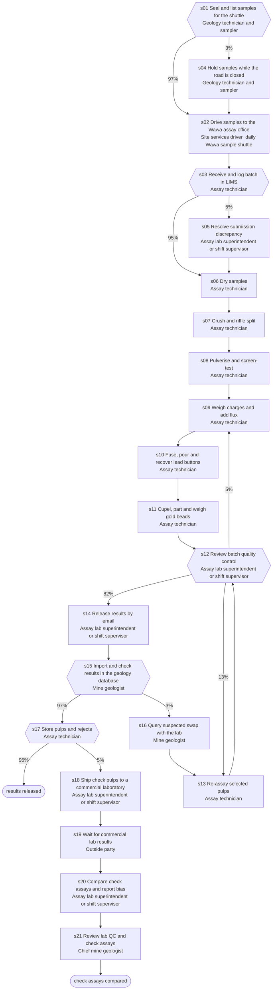

# Fire assay laboratory (one furnace batch of production samples)

`mine-mill-assay-lab` · gold mining · processing · part of `mining-operator-co`

The company's own assay office fire-assays the mine's underground chip, muck and test-hole samples, the mill's shift composites and the doré bar samples so that geologists can mark ore and waste and the metallurgist can balance the mill. For this mine the laboratory sits in the town of Wawa, about an hour and a half by road from the mine, so sealed samples travel on a daily company shuttle. Technicians log, dry, crush, split and pulverise each sample, fuse a 30 g charge with litharge flux, cupel and part the bead and weigh the gold, in furnace batches of 28 positions that include a blank, a duplicate and a reference standard. Turnaround is set by the shuttle, the drying and furnace queues and re-assays of high-grade samples with visible gold, and the lab is not accredited, so it inserts less quality control than a commercial laboratory.

| | |
|---|---|
| Unit of work | one furnace batch of 28 positions (about 25 production samples plus a reagent blank, a duplicate and a reference standard) |
| Starts when | A geology technician or mill operator seals a set of sample bags with a submission sheet for the daily shuttle. |
| Done when | Gold results for the batch pass the laboratory's quality checks and are loaded into the geology database or the mill workbook; pulps and rejects are stored and a share of pulps is sent to an outside laboratory as a check. |
| Organisation | A 300-person single-mine Ontario gold producer that runs a non-accredited company fire assay office in the nearest town for production samples and sends exploration core to commercial laboratories. (300 employees, 2019-2022) |
| Volume | 300 cases a month (range 200 to 420) |

## Where it sits

- Starts with **face_sample** from ts-grade-control (78% of cases)
- Starts with **process_samples** from mill-grind-leach (17% of cases)
- Starts with **core_samples** from ts-definition-drilling (4% of cases)
- Starts with **dore_bar** from mill-gold-room-refining (1% of cases)
- Sends **assay_result** to ts-grade-control (outcome: results released)
- Sends **assay_result** to mill-met-accounting (outcome: results released)
- Sends **assay_result** to mill-grind-leach (outcome: results released)
- Sends **assay_result** to ts-definition-drilling (outcome: results released)
- Sends **assay_result** to mill-gold-room-refining (outcome: results released)
- Sends **check_pulps** to commercial-lab (outcome: check assays compared)

## Flow

## Roles

| Role | Department | Layer | FTE on this process | Loaded cost per hour | Evidence |
|---|---|---|---:|---:|---|
| Assay technician | Assay laboratory | individual contributor | 6 | 40 CAD | B [srk2022], [island2020] |
| Assay lab superintendent or shift supervisor | Assay laboratory | supervisor | 1 | 64 CAD | B [srk2022] |
| Geology technician and sampler | Mine geology | individual contributor | 0.4 | 43 CAD | B [srk2022] |
| Mine geologist | Mine geology | senior specialist | 0.4 | 68 CAD | B [srk2022] |
| Chief mine geologist | Mine geology | manager | 0.03 | 108 CAD | B [macassa2019] |
| Site services driver (daily Wawa sample shuttle) | Site services | individual contributor | 0.4 | 35 CAD | B [srk2022] |

## Steps

Hands-on time and the wait before each step show the most common value. Evidence tier A is a sourced number, B a sourced description, C the author's estimate.

| Step | Who | Kind | Hands-on | Wait before | Control | Evidence |
|---|---|---|---:|---:|---|---|
| **s01 Seal and list samples for the shuttle.** At the end of shift the geology technician collects the tied sample bags from the sample boxes beside the geology office, checks each tag against the sampling sheets, writes the submission list with sample numbers and sample types and seals the bags into shipping bins. | Geology technician and sampler | data entry | 15 min | 1.0 h |  | B [srk2022], [island2020] |
| **s02 Drive samples to the Wawa assay office.** The driver loads the bins, drives the gravel access road and the highway to the assay office in Wawa with the day's mine and mill samples, unloads them at the receiving bench and brings back returns. Touch time is this batch's share of a 3 to 4 hour round trip that carries about ten batches. | Site services driver (daily Wawa sample shuttle) | travel | 20 min | 7.0 h | Sample security: sealed bags and bins, chain-of-custody list signed at receipt | B [srk2022], [wdo2016] |
| **s03 Receive and log batch in LIMS.** A technician places the bags in numerical order by sample type, checks them against the submission list, prepares a list when none came, and enters the batch in the laboratory information system, which assigns furnace positions for the blank, duplicate and standard. | Assay technician | intake | 20 min | 1.0 h |  | B [srk2022] |
| **s04 Hold samples while the road is closed.** When snow, freezing rain or a washout closes the access road, the samples stay locked in the bins at the mine until the shuttle can run, and the geologists mark headings on visual estimates. | Geology technician and sampler | coordination | 10 min | 1.0 d |  | C |
| **s05 Resolve submission discrepancy.** The assay supervisor emails or phones the geology office or mill about the missing or extra bags, corrects the list in LIMS and notes the discrepancy on the receipt letter. | Assay lab superintendent or shift supervisor | communication | 15 min | 2.0 h |  | B [island2020] |
| **s06 Dry samples.** A technician transfers wet chip, muck and test-hole samples to drying pans, loads them into the drying oven and keeps the tags with each pan in assay order. Drying itself takes several hours and is counted as the wait before crushing. | Assay technician | physical | 12 min | 2.0 h |  | B [srk2022] |
| **s07 Crush and riffle split.** The technician crushes each dried sample in the jaw crusher to about a quarter inch, blows the crusher clean with compressed air between samples, runs barren rock after high-grade samples, and riffle-splits about 300 g for pulverising, bagging the reject for storage. | Assay technician | physical | 1.0 h | 4.0 h | Ontario Regulation 854 and laboratory procedure: hearing protection, dust extraction and guarding on crushers | B [srk2022] |
| **s08 Pulverise and screen-test.** The technician pulverises each split in ring pulverisers to minus 150 mesh, cleans the bowls with air and runs silica sand between batches, and screen-tests the first sample of the batch, recording the result in the logbook. | Assay technician | physical | 50 min | 30 min |  | B [srk2022], [island2020] |
| **s09 Weigh charges and add flux.** The fire assayer weighs a 30 g aliquot of each pulp into a crucible with premixed litharge flux, adds nitre or flour as the sample needs and a silver inquart, and places the reagent blank, duplicate and Rocklabs reference material in their positions. | Assay technician | physical | 35 min | 1.0 h | Ontario O. Reg. 490/09 (designated substances, lead) and laboratory fume extraction procedure for litharge fluxes and lead buttons | B [srk2022], [island2020] |
| **s10 Fuse, pour and recover lead buttons.** The fire assayer loads the crucibles into the fusion furnace at about 1,950 F for an hour, pours the melts into conical moulds, lets them cool, breaks off the slag and hammers each lead button clean. | Assay technician | physical | 30 min | 1.5 h | Ontario O. Reg. 490/09 (designated substances, lead) and laboratory fume extraction procedure for litharge fluxes and lead buttons | B [srk2022], [macassa2019] |
| **s11 Cupel, part and weigh gold beads.** The fire assayer cupels the buttons, flattens each dore bead, parts the silver in hot dilute nitric acid, washes, anneals and weighs the gold on the microbalance, and the weights are entered against each sample number in LIMS. | Assay technician | physical | 1.0 h | 1.0 h | Ontario O. Reg. 490/09 (designated substances, lead) and laboratory fume extraction procedure for litharge fluxes and lead buttons | B [srk2022] |
| **s12 Review batch quality control.** The shift supervisor checks the blank, duplicate and reference standard against their limits, looks at the high-grade results and any sample that does not fit its neighbours, and decides whether to release the batch, re-assay selected pulps or re-fuse the whole batch. | Assay lab superintendent or shift supervisor | review | 12 min | 30 min | Laboratory QA/QC procedure (lab not accredited): blank, duplicate and reference material in every furnace batch, supervisor review | B [srk2022], [island2020], [wdo2016] |
| **s13 Re-assay selected pulps.** A technician re-weighs and re-fires the high-grade or out-of-pattern pulps, or prepares a second split from the reject where the gold is coarse, and adds the repeat results beside the originals for the supervisor. | Assay technician | physical | 40 min | 6.0 h | Ontario O. Reg. 490/09 (designated substances, lead) and laboratory fume extraction procedure for litharge fluxes and lead buttons | B [wdo2016] |
| **s14 Release results by email.** The assay supervisor releases the batch in LIMS and emails the results file or certificate to the mine geology office or the mill metallurgist, flagging repeats and any sample still pending. | Assay lab superintendent or shift supervisor | communication | 5 min | 30 min |  | B [wdo2016] |
| **s15 Import and check results in the geology database.** The mine geologist imports the results into the geology database, checks that sample numbers match the face maps and muck tickets, compares grades with the mapped geology, and uses them to confirm or change the ore and waste marks for the next round. Mill results go to the metallurgist's workbook instead. | Mine geologist | validation | 15 min | 2.0 h |  | B [srk2022] |
| **s16 Query suspected swap with the lab.** The geologist emails the assay supervisor with the suspect sample numbers and the reason, and the lab checks its logbook and furnace sheet and re-assays the pulps or rejects. | Mine geologist | communication | 10 min | 1.0 h |  | C |
| **s17 Store pulps and rejects.** A technician boxes the pulps and coarse rejects in sample-number order, labels the box with the batch number and shelves it in the pulp store, and once a month pulls about one batch in twenty for outside check assays. | Assay technician | physical | 10 min | 30 min |  | B [island2020] |
| **s18 Ship check pulps to a commercial laboratory.** The assay supervisor selects about 5 percent of mineralised pulps from the month's batches, re-numbers them blind, adds certified standards and ships them by courier to an accredited commercial laboratory with a submission form. | Assay lab superintendent or shift supervisor | communication | 30 min | 5.0 d | QA/QC program: periodic check assays of mine-lab pulps at an accredited laboratory | B [island2020], [macassa2019] |
| **s19 Wait for commercial lab results.** The accredited commercial laboratory receives the courier box, logs the blind-numbered check pulps, fire-assays them in its own queue and emails a signed certificate to the assay supervisor. | Outside party | external wait | 0 min | 14.0 d |  | C |
| **s20 Compare check assays and report bias.** The assay supervisor pairs the check results with the originals, plots them and calculates the share of pairs within tolerance and any bias, and sends the summary to the chief geologist. | Assay lab superintendent or shift supervisor | analysis | 45 min | 1.0 d |  | B [macassa2019] |
| **s21 Review lab QC and check assays.** The chief geologist reviews the check-assay summary and the month's standard and blank charts, discusses turnaround and any drift with the assay supervisor, and records actions such as a pulveriser repair or a re-assay campaign. | Chief mine geologist | review | 30 min | 3.0 d | NI 43-101 data verification: qualified person reviews assay quality supporting reserves and grade control | B [macassa2019] |

## Exceptions

| Exception | Share of cases | What happens |
|---|---:|---|
| Re-assay of high-grade or odd samples | 13% | Coarse visible gold gives erratic results, so the supervisor has selected pulps re-fired before release. |
| Batch re-fused after QC failure | 5% | The reference standard or blank falls outside limits, and the whole furnace batch is re-weighed and re-fused. |
| Access road closed | 3% | Snow or a washout on the gravel access road stops the shuttle, and samples wait at the mine. |
| Outside check assays | 5% | About one batch in twenty has pulps sent blind to an accredited laboratory and compared. |

## Benchmarks

| Metric | Value | Unit | Population | Evidence |
|---|---|---|---|---|
| cycle_time_days | p50 1.5, p90 3 | calendar days from samples sealed at the mine to results in the geology database | Company fire assay office serving an Ontario underground gold mine with a daily shuttle | C |
| positions_per_furnace_batch | 28 | crucible positions including one reagent blank, one duplicate and one reference material | Wesdome assay office, Wawa | A [srk2022] |
| qc_insertion_rate | low 5, high 10 | percent of samples that are QC samples (reliance on duplicates) | Wesdome laboratory as assessed in 2019-2020 | A [island2020] |

## Pain points

- Samples ride 1.5 hours to Wawa once a day, so a round sampled after the shuttle leaves waits a day before it is even crushed and headings are marked without assays. (steps s01, s02; B [srk2022], [wdo2016])
- Coarse visible gold makes repeats common and slows release of high-grade batches. (steps s12, s13; B [wdo2016])
- The lab is not accredited and inserts no QC with muck and test-hole samples, so bias is caught late by outside checks. (steps s12, s18, s20; B [island2020], [srk2022])
- One preparation line and one fusion furnace set the pace; a worn pulveriser or furnace repair backs up every client. (steps s07, s08, s10; B [island2020])

## Assumptions

- Simulated median cycle time is about 1.8 days against a tier C estimate of 1.5 days; most of the elapsed time is the wait for the once-a-day shuttle and drying, not furnace work.
- The laboratory is the company's assay office in the town of Wawa, not a room at the mill as the organisation file implies; samples travel by daily shuttle, and the travel step and road-closure branch reflect this.
- The laboratory also assays the neighbouring Island Gold mine's production samples under contract (island2020). That outside work is not in the organisation file and is left out of the volume here, but it competes for the same furnaces and technicians.
- One case is one furnace batch of 28 positions. Preparation is done per sample but recorded here as minutes for the batch's 25 samples.
- The assay-lab resource is used for furnace time only; the preparation line is listed separately because it, not the furnace, is usually the constraint.
- Staffing check: simulated hands-on time of about 6.5 hours per batch at 300 batches a month implies about 15.6 FTE across all roles, of which about 11 are assay technicians; stated FTE is about 8.2 because the organisation file has only six technicians and one supervisor. The evidence (shift supervisors, an Assay Lab Superintendent, a second mine's samples) points to a larger lab.
- Loaded costs come from the organisation file (wage times 1.30 for staff, 1.35 for hourly site roles); the added driver role uses the same 1.35 loading.
- Organisation file corrected on 2026-11-24 to match this workflow's sources: ids were renamed (mill-elution-refining to mill-gold-room-refining, loaded_carbon to gold_concentrate, tailings_slurry to filtered_tailings, elution-circuit to refinery), and roles and resources this workflow added are now in the organisation file. Notes above that describe a mismatch refer to the file before the correction.

## Sources

- [srk2022] [Technical Report for the Eagle River Gold Mining Complex, Ontario, Canada (NI 43-101; effective date 31 December 2021, signed 22 April 2022)](https://s203.q4cdn.com/643390454/files/doc_downloads/2022/11/ERtechnicalReport.pdf) (SRK Consulting (Canada) Inc. for Wesdome Gold Mines Ltd., 2022). Since 1995 drill core, mill samples, underground samples and doré bars are assayed at the company-owned Mine Assay office in Wawa, which is not certified; company shuttle carries samples daily; appendix C gives receiving, drying, jaw crushing to 1/4 inch, riffle split to 300 g, pulverising to minus 150 mesh, fusion at 1,950 F for 60 minutes, cupellation, parting and microbalance weighing, 28-sample furnace batches with blank, duplicate and Rocklabs standard, QC reviewed by shift supervisors and the Assay Lab Superintendent.
- [wdo2016] [Technical Report for the Eagle River Mining Complex including the Eagle River Gold Mine, the Mishi Gold Mine and related infrastructure (NI 43-101), 17 March 2016](https://minedocs.com/12/EagleRiver_TechnicalReport_03172016.pdf) (Wesdome Gold Mines Ltd. (G. Mannard, P. Ng), 2016). Lab not certified; 25 g aliquot fire assay with gravimetric finish; sealed samples transported daily with results by email; visible gold common; access 70 km gravel road and 50 km highway from Wawa, about 1.5 hours.
- [island2020] [NI 43-101 Technical Report for the Island Gold Mine, Dubreuilville, Ontario, Canada (effective 14 July 2020), exhibit 99.1](https://www.sec.gov/Archives/edgar/data/1178819/000117881920000070/ex991technicalreportfo.htm) (Alamos Gold Inc. (filed with the US SEC), 2020). All Island Gold underground production samples are assayed at the Wesdome laboratory in Wawa, which also processes Eagle River samples; 30 g fire assay with gravimetric finish; internal QC 5-10%; no QC materials with muck and test-hole samples; June 2019 external audit and pulveriser replacement; samples delivered daily; receipt letters; check pulps to Actlabs.
- [macassa2019] [Macassa Property NI 43-101 Technical Report (April 2019), exhibit 99.20](https://www.sec.gov/Archives/edgar/data/1713443/000162828019003767/a2019macassani4310101apr.htm) (Kirkland Lake Gold Ltd. (filed with the US SEC), 2019). Comparable mine lab assays mill, bullion and mine samples; QA/QC tracked daily on a spreadsheet; fusion repeated for small or large buttons; LIMS introduced 2018; tight turnaround requirements; chief mine geologist's quarterly lab visits; about 5% of mineralised samples re-tested at a second lab; check-assay pairs within 25%.

Written by claude-opus on 2026-11-24.
