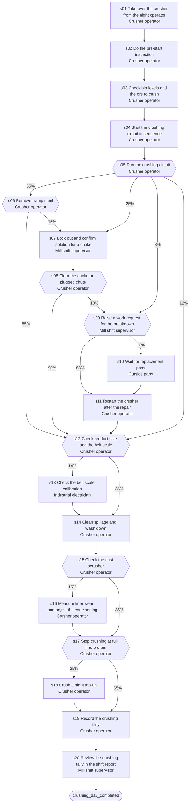

# Crushing (one crushing day)

`mine-mill-crushing` · metal mining (gold) · processing · part of `mining-operator-co`

Run-of-mine ore from the stockpile is broken in a jaw crusher and a cone crusher and screened so that the ball mills get rock of which 80% passes 14 mm (9/16 inch). One crusher operator per shift runs the plant, mostly on day shift, keeping the fine ore bin full enough to feed the mill around the clock. The work is interrupted by drill steel and rock bolts tripping the metal detector, by wet or oversize ore choking chutes, and by breakdowns; a major cone crusher failure can starve the mill for days, as happened at the reference mine in December 2020.

| | |
|---|---|
| Unit of work | one crushing day |
| Starts when | The day crusher operator takes over at 07:00 with ore on the stockpile and the mill drawing from the fine ore bin. |
| Done when | The fine ore bin holds enough crushed ore for the mill, the circuit is stopped empty or running, and the crushing tally is in the shift report. |
| Organisation | A single-mine Canadian underground gold producer with a two-stage jaw and cone crushing plant, permitted for 1,200 tpd, feeding a mill running at 650 to 780 tpd. (300 employees, 2019-2022) |
| Volume | 30 cases a month (range 29 to 31) |

## Where it sits

- Starts with **mill_feed** from mine-ore-stockpile (100% of cases)
- Sends **crushed_ore** to mill-grind-leach (outcome: crushing_day_completed)
- Sends **work_request** to mnt-breakdown-repair (outcome: any)

## Flow

## Roles

| Role | Department | Layer | FTE on this process | Loaded cost per hour | Evidence |
|---|---|---|---:|---:|---|
| Crusher operator | Mill operations | individual contributor | 3 | 43 CAD | C |
| Mill shift supervisor | Mill operations | supervisor | 0.3 | 72 CAD | C |
| Industrial electrician | Fixed plant and electrical | individual contributor | 0.05 | 55 CAD | C |

## Steps

Hands-on time and the wait before each step show the most common value. Evidence tier A is a sourced number, B a sourced description, C the author's estimate.

| Step | Who | Kind | Hands-on | Wait before | Control | Evidence |
|---|---|---|---:|---:|---|---|
| **s01 Take over the crusher from the night operator.** At shift change the day crusher operator meets the night operator at the crusher control panel, hears what was crushed, which chutes plugged, the fine ore bin level and any equipment locked out, and reads the crusher log. | Crusher operator | communication | 15 min | 0 min |  | C |
| **s02 Do the pre-start inspection.** Before starting, the operator walks the apron feeder, jaw, cone, screen and conveyors, checks guards, pull cords and belt tracking, the cone lube oil level and temperature, the tramp magnet and metal detector, and signs the pre-start checklist. | Crusher operator | physical | 30 min | 5 min | Pre-operational inspection of guards, pull cords and interlocks before starting conveyors and crushers (company procedure under the OHSA) | B [crush911] |
| **s03 Check bin levels and the ore to crush.** The operator reads the coarse ore bin and fine ore bin levels, radios the control room for the mill feed rate, and checks with the metallurgist's blend sheet which stockpile the loader should feed next. | Crusher operator | lookup | 10 min | 0 min |  | C |
| **s04 Start the crushing circuit in sequence.** Once the loader has tipped ore from the Eagle or Mishi stockpile pad into the jaw crusher feed bin, the operator starts the dust scrubber, the conveyors from the fine ore bin end backwards, the screen, the cone and the jaw, sounds the start-up horn, and finally starts the apron feeder at a low rate. | Crusher operator | physical | 20 min | 20 min |  | B [crush911], [er2022] |
| **s05 Run the crushing circuit.** The operator watches jaw and cone motor power, feeder speed, cone cavity level and screen overflow on the panel and cameras, raises or lowers the feeder rate to keep the cone choke-fed without overloading, and keeps an eye on the fine ore bin level. | Crusher operator | judgment | 6.0 h | 0 min |  | A [er2022], [crush911] |
| **s06 Remove tramp steel.** When the metal detector stops the belt or the magnet collects steel, the operator locks out the conveyor, finds and removes the drill steel, rock bolt or scoop tooth from the belt or magnet, notes it in the log and restarts the belt. | Crusher operator | physical | 30 min | 0 min | Lockout and tagging before entering or clearing a crusher, chute or conveyor (Ontario Regulation 854 under the OHSA; site lockout procedure) | B [crush911] |
| **s07 Lock out and confirm isolation for a choke.** The shift supervisor comes to the crusher, checks that the operator has locked out the feeder, crusher and conveyor at the motor control centre, tries the start buttons to confirm zero energy, and approves entry to the chute or crusher cavity. | Mill shift supervisor | review | 15 min | 15 min | Lockout and tagging before entering or clearing a crusher, chute or conveyor (Ontario Regulation 854 under the OHSA; site lockout procedure) | C |
| **s08 Clear the choke or plugged chute.** The operator, tied off where needed, bars out the wet or oversize rock or jammed steel from the jaw, cone feed or plugged chute, cleans up the spill, removes locks and restarts the circuit with the supervisor's agreement. | Crusher operator | physical | 1.0 h | 0 min | Lockout and tagging before entering or clearing a crusher, chute or conveyor (Ontario Regulation 854 under the OHSA; site lockout procedure) | B [crush911] |
| **s09 Raise a work request for the breakdown.** The shift supervisor radios the maintenance supervisor, enters a work request for the failed conveyor, screen, feeder or cone with its priority, and tells the control room how long the fine ore bin will last at the current mill feed rate. | Mill shift supervisor | data entry | 15 min | 10 min |  | B [wes2020] |
| **s10 Wait for replacement parts.** For a major failure such as a cone crusher head, bowl or bearing, the replacement is ordered from the OEM or a rebuild shop and trucked to site, and the mill runs on the fine ore bin and stockpile until it arrives. | Outside party | external wait | 0 min | 3.0 d |  | A [wes2020], [er2022] |
| **s11 Restart the crusher after the repair.** When the millwright or electrician finishes and removes their locks, the crusher operator removes the personal lock, runs the circuit empty to check the repair, then brings feed back up and refills the fine ore bin. | Crusher operator | physical | 30 min | 4.0 h |  | C |
| **s12 Check product size and the belt scale.** The operator looks at screen undersize for oversize pieces and torn screen panels, reads the weightometer totaliser on the second mill feed conveyor, and compares tonnes crushed with the drop in stockpile loads. | Crusher operator | validation | 15 min | 30 min |  | B [er2022] |
| **s13 Check the belt scale calibration.** Once a week an electrician runs the belt empty for a zero check, hangs test weights or runs a calibration chain, compares the totaliser with the reference and adjusts the span if it is out by more than the tolerance, logging the result. | Industrial electrician | validation | 1.0 h | 2.0 h | Metallurgical accounting procedure: mill feed tonnes from a calibrated belt scale | C |
| **s14 Clean spillage and wash down.** With the affected conveyor locked out, the operator shovels or hoses spillage from under tail pulleys, transfer points and the screen deck back to the sump, keeping walkways clear. | Crusher operator | physical | 1.0 h | 30 min | No cleaning near moving conveyors without lockout (company guarding and lockout procedure) | B [crush911] |
| **s15 Check the dust scrubber.** The operator checks the wet dust scrubber fan and bottoms pump are running, the water flow and pump box level are normal, and the pickup hoods at the feeder and transfer points are drawing. | Crusher operator | physical | 15 min | 0 min | Site air Environmental Compliance Approval covering particulate sources (Environmental Protection Act, Ontario) | B [crush911], [ero1400] |
| **s16 Measure liner wear and adjust the cone setting.** With the cone locked out, the operator measures the closed side setting with a lead slug, notes jaw and cone liner wear, and adjusts the cone bowl to restore the setting, telling the planner when liners near their change-out limit. | Crusher operator | physical | 45 min | 0 min | Lockout and tagging before entering or clearing a crusher, chute or conveyor (Ontario Regulation 854 under the OHSA; site lockout procedure) | C |
| **s17 Stop crushing at full fine ore bin.** When the fine ore bin reaches its high level the feeder stops on its interlock; the operator then lets conveyors run empty and stops the circuit in sequence, swinging the magnet clear before conveyor 1 stops. | Crusher operator | physical | 15 min | 0 min |  | B [crush911] |
| **s18 Crush a night top-up.** When the fine ore bin will not last until morning, for example after a breakdown or at high mill throughput, the night crusher operator restarts the circuit and crushes for a few hours to refill it. | Crusher operator | physical | 3.0 h | 3.0 h |  | C |
| **s19 Record the crushing tally.** The operator writes tonnes crushed from the belt scale, run hours, tramp steel removed, chokes and breakdowns with times, and liner readings on the crusher log sheet. | Crusher operator | data entry | 15 min | 0 min |  | C |
| **s20 Review the crushing tally in the shift report.** The shift supervisor checks the crusher log against the mill feed tonnes and downtime in the control room log, follows up any open work request, and copies the crushing figures into the mill shift report. | Mill shift supervisor | review | 15 min | 30 min |  | C |

## Exceptions

| Exception | Share of cases | What happens |
|---|---:|---|
| Tramp steel trip | 55% | The metal detector or magnet catches drill steel or a rock bolt and the operator removes it under lockout. |
| Choke or plugged chute | 33% | Wet or oversize ore or jammed steel blocks a chute or crusher; the supervisor confirms lockout and the operator clears it. |
| Breakdown with parts on site | 10% | A conveyor, screen or crusher fails and maintenance repairs it within hours. |
| Major crusher failure awaiting parts | 1% | A cone crusher head, bowl or bearing fails and the replacement must be shipped in, starving the mill for days. |

## Benchmarks

| Metric | Value | Unit | Population | Evidence |
|---|---|---|---|---|
| cycle_time_days | p50 1.0, p90 1.0 | calendar days per crushing day | One crushing day | C |
| crushing_hours_per_day | low 8, mode 12, high 16 | hours of crusher running per day | Small jaw and cone plants feeding a mill of about 500 to 700 tpd | B [crush911] |
| crushing_product_size | 0.5625 | inches, 80% passing | Reference mine crushing circuit | A [er2022] |
| milling_days_lost_to_crusher | 6 | days in December 2020 | Reference mine (Eagle River) | A [wes2020] |

## Pain points

- Drill steel, bolts and mesh from underground trip the metal detector many times a week, and each trip needs a lockout and a search of the belt. (steps s06; B [crush911])
- A major cone crusher failure needs parts from outside and can stop the mill for days once the fine ore bin is empty. (steps s09, s10, s11; A [wes2020])
- Clearing a choke needs a supervisor to confirm lockout, so the operator waits while the mill draws down the bin. (steps s07, s08; C)

## Assumptions

- Crushing runs mainly on day shift for 7 to 14 hours, with a night top-up on about a third of days; the mill draws from the fine ore bin around the clock.
- touch_min on the run step counts active control and attention; the operator is on the plant for the whole shift. The simulator adds steps in sequence and leaves out the hours the operator spends on stockpile reclaim and cleanup outside this process, so its median cycle time (about 0.7 days) is shorter than the calendar day it represents.
- Repair labour is counted in mnt-breakdown-repair; here a repair appears as the wait before s11, and a major failure as the external wait s10.
- Event probabilities (tramp steel on about half of days, chokes on about a third, breakdowns on about one day in ten) are the author's estimates for an underground ore with rock bolts and mesh.
- Ore reaches the mill stockpile pads by truck over 17 km of road from the mine at the reference operation (er2022), not from a shaft bin beside the mill as the organisation file describes; this does not change the crushing steps.
- Loaded costs come from the organisation file.

## Sources

- [er2022] [Technical Report for the Eagle River Gold Mining Complex, Ontario, Canada (NI 43-101, SRK Consulting, 22 April 2022)](https://s203.q4cdn.com/643390454/files/doc_downloads/2022/11/ERtechnicalReport.pdf) (Wesdome Gold Mines Ltd., 2022). Section 17: mill permitted to 1,200 t/d on a crushing basis; three stockpile pads; loader feeds the jaw crusher, cone in closed circuit with a double-deck screen, fine ore bin, weightometer on the second mill feed conveyor; crushing product 80% passing 9/16 inch; primary and secondary ball mills with cyclones, 75% passing 74 um; semi-batch centrifugal gravity concentrator on cyclone feed, shaking table daily and magnetic separation; trash screen, pre-leach thickener (permanganate, flocculant, cyanide); six leach tanks (one standby), air sparged, 36-38 h retention, pH 10.5-11.2; drum filters; three clarifiers precoated with Dicalite and Solka Floc; vacuum towers, zinc dust and lead nitrate, sock presses with socks removed bi-weekly; tailings filtered on drum filters and conveyed for dry stacking; refinery with CCTV, vault, sock burner oven and propane Wabi furnace smelting table concentrate and burned sock ash to doré of 80-94% gold; hydrogen peroxide cyanide destruction in the Reclaim Pond; 2021-22 mill availability basis 93.3% (86% in 2021), average 779 t/d; recovery gravity 43%, Merrill-Crowe 88%, overall 97%; reagent use (NaCN 0.52 kg/t, lime 0.79 kg/t, zinc 0.086 kg/t). Sections 18.7 and 20.3: filtered tailings conveyed to stockpiles and redistributed by trucks and a dozer; Reclaim Pond feeds the mill; excess water treated to the Polishing Pond or stored in the Mishi pit; dam raises 2019 (Stage 3), 2020 (Stage 4) and 2022-24 (Stage 5); annual Dam Safety Inspections by consultants (SNC-Lavalin 2020, EXP 2021) under CDA guidelines, the Lakes and Rivers Improvement Act and MAC guidance; dams classed High; mill 17 km by road from the mine
- [wes2020] [Wesdome Announces 2020 Fourth Quarter and Full Year Production Results; Provides 2021 Guidance](https://finance.yahoo.com/news/wesdome-announces-2020-fourth-quarter-213000875.html) (Wesdome Gold Mines Ltd. (news release, via Yahoo Finance), 2021). Ore milled 2019 (168,809 t) and 2020 (236,297 t) including Mishi open pit ore; Eagle River recovery 97.7% and Mishi recovery 77.8% in 2020; gold produced 91,688 oz (2019) and 90,278 oz (2020); six days of milling lost in December 2020 to mechanical downtime on the cone crusher; Mishi stockpile of over 40,000 t to be milled in 2021
- [crush911] [Small Crushing Plant Operating Guide](https://www.911metallurgist.com/small-crushing-plant-operating-guide) (911Metallurgist, 2016). Jaw and standard cone crusher plant of 500 tpd crushing 12 hours a day at 70% availability (60 t/h); 350 t coarse ore bin, 500 t live fine ore bin, double-deck screen; tramp iron magnet over conveyor 1 and metal detector on conveyor 2 that stops the belt; plugged chute tilt switches and pull cords; cone lube interlocks; shutdown on high fine ore bin level; wet dust scrubber
- [ero1400] [Wesdome Gold Mines Ltd. - Environmental Compliance Approval (air), Eagle River Mill (ERO 012-8749)](https://ero.ontario.ca/node/1400) (Ontario Environmental Registry, 2020). Amended air approval of 21 December 2020 for the Eagle River Mill, 50 km west of Wawa: replacement of the laboratory fume hood and bullion furnace, a dicalite vent bin collection system, hydrogen cyanide emissions from the tailings pond and leach tanks, cyanide building and cyanide mixing ventilation; contaminants include hydrogen cyanide and zinc

Written by claude-opus on 2026-11-24.
