# Doré shipment to the refinery

`mine-mill-dore-shipment` · gold mining · processing · part of `mining-operator-co`

Every week or two the mill ships the doré bars that have built up in the gold room vault to the refinery that will turn them into fine gold. The mill superintendent books an armoured carrier, the gold room operators take the bars out of the vault under the two-person rule, re-weigh them and pack them into sealed boxes, and the superintendent writes the manifest and the shipment advice that tells the refinery and head office what is coming. A security officer checks the carrier's crew at the gate, both sides count boxes and seal numbers and sign the custody receipt, and the shipment is done when the refinery confirms receipt weights that match. The carrier's route schedule, the insured value limit per trip and winter conditions on the gravel access road set the timing, and a weight or seal mismatch at the refinery starts an investigation.

| | |
|---|---|
| Unit of work | one doré shipment (typically four to eight bars in sealed boxes) |
| Starts when | Doré in the gold room vault reaches the planned shipment size or the date set with the carrier. |
| Done when | The refinery confirms receipt of the sealed boxes with gross weights that agree with the manifest, and the shipment is recorded as doré in transit to refining. |
| Organisation | A 300-person single-mine Ontario gold producer pouring about 7,500 oz a month as doré in a mill gold room 1.5 to 2 hours by road from Wawa, shipping to a Canadian refinery by armoured carrier. (300 employees, 2019-2022) |
| Volume | 3 cases a month (range 2 to 4) |

## Where it sits

- Starts with **dore_bar** from mill-gold-room-refining (100% of cases)
- Relies on **gold_room_record** from mill-gold-room-refining (a standing input; it does not start a case)
- Sends **dore_shipment** to secure-carrier (outcome: delivered)
- Sends **dore_shipment** to refinery (outcome: delivered)
- Sends **shipment_advice** to corp-gold-sales (outcome: delivered)
- Sends **shipment_advice** to mill-met-accounting (outcome: delivered)

## Flow

```mermaid
flowchart TD
    s01["s01 Decide shipment size and date<br/>Mill superintendent"]
    s02["s02 Book armoured carrier pickup<br/>Mill superintendent"]
    s03["s03 Carrier confirms pickup window<br/>Outside party"]
    s04{{"s04 Confirm value and insurance cover<br/>Treasury and tax manager"}}
    s05["s05 Open vault and re-weigh bars<br/>Gold room and refining operator"]
    s06["s06 Witness vault opening and log access<br/>Security officer"]
    s07["s07 Pack bars and seal boxes<br/>Gold room and refining operator"]
    s08["s08 Prepare manifest and shipment advice<br/>Mill superintendent"]
    s09{{"s09 Wait for carrier arrival<br/>Outside party"}}
    s10["s10 Reschedule pickup after road delay<br/>Mill superintendent"]
    s11["s11 Check carrier crew at the gate<br/>Security officer"]
    s12["s12 Hand over boxes and sign custody receipt<br/>Mill superintendent"]
    s13["s13 Send shipment advice<br/>Mill superintendent"]
    s14["s14 Carrier transports doré to the refinery<br/>Outside party"]
    s15{{"s15 Compare refinery receipt with the manifest<br/>Mill superintendent"}}
    s16["s16 Investigate weight or seal mismatch<br/>Mill superintendent"]
    s17["s17 Update gold inventory for the shipment<br/>Mill superintendent"]
    s18["s18 Record doré in transit in the ledger<br/>Site controller"]
    s01 --> s02
    s02 --> s03
    s03 --> s04
    s04 -->|"95%"| s05
    s04 -->|"5%"| s01
    s05 --> s06
    s06 --> s07
    s07 --> s08
    s08 --> s09
    s09 -->|"94%"| s11
    s09 -->|"6%"| s10
    s10 --> s11
    s11 --> s12
    s12 --> s13
    s13 --> s14
    s14 --> s15
    s15 -->|"96%"| s17
    s15 -->|"4%"| s16
    s16 --> s17
    s17 --> s18
    s18 --> end0
    end0(["delivered"])
```

## Roles

| Role | Department | Layer | FTE on this process | Loaded cost per hour | Evidence |
|---|---|---|---:|---:|---|
| Mill superintendent | Processing | manager | 0.02 | 112 CAD | C |
| Gold room and refining operator | Mill operations | individual contributor | 0.03 | 48 CAD | C |
| Security officer | Site services | individual contributor | 0.02 | 35 CAD | B [srk2022] |
| Treasury and tax manager | Corporate finance and reporting | manager | 0.01 | 105 CAD | C |
| Site controller | Site finance and payroll | manager | 0.005 | 95 CAD | C |

## Steps

Hands-on time and the wait before each step show the most common value. Evidence tier A is a sourced number, B a sourced description, C the author's estimate.

| Step | Who | Kind | Hands-on | Wait before | Control | Evidence |
|---|---|---|---:|---:|---|---|
| **s01 Decide shipment size and date.** The mill superintendent checks the vault log and the gold room record for bars poured since the last shipment, compares the estimated ounces and value with the per-trip insured limit, and picks a pickup date that fits the carrier's route days and the rotation. | Mill superintendent | judgment | 20 min | 4.0 h |  | B [srk2022] |
| **s02 Book armoured carrier pickup.** The superintendent emails the carrier's dispatch with the pickup site, requested date, number of boxes, gross weight and declared value, and asks for crew names and the vehicle number. | Mill superintendent | communication | 15 min | 1.0 h |  | B [macassa2019] |
| **s03 Carrier confirms pickup window.** The carrier fits the pickup into its northern Ontario route and replies with the date, time window, crew names and vehicle number, or offers another day. | Outside party | external wait | 0 min | 1.0 d |  | C |
| **s04 Confirm value and insurance cover.** The treasury and tax manager checks the declared value at the current gold price against the carrier's liability and the company's cargo insurance limit, confirms or asks for the shipment to be split, and tells the bullion bank how many ounces to expect. | Treasury and tax manager | validation | 20 min | 8.0 h | Corporate insurance policy and carrier contract: declared value per shipment within cover limits | C |
| **s05 Open vault and re-weigh bars.** On the morning of the pickup two gold room operators open the vault, take out each bar, re-weigh it on the gold room scale and check the bar number, stamped weight and sample record against the gold room record. | Gold room and refining operator | validation | 45 min | 2.0 h | Gold room security procedure: two-person rule, camera coverage and logged access for every vault opening | B [srk2022] |
| **s06 Witness vault opening and log access.** A security officer stands in the gold room while the vault is open, logs the names and times in the access log, watches the camera view and signs the bar check sheet as witness. | Security officer | physical | 45 min | 0 min | Gold room security procedure: two-person rule, camera coverage and logged access for every vault opening | B [srk2022] |
| **s07 Pack bars and seal boxes.** The operators pack the bars into the carrier's numbered shipping boxes with padding, close each box with numbered tamper-evident seals, weigh each sealed box and write the seal numbers and gross weights on the packing sheet. | Gold room and refining operator | physical | 30 min | 0 min | Gold room security procedure: two-person rule, camera coverage and logged access for every vault opening | C |
| **s08 Prepare manifest and shipment advice.** The superintendent fills in the carrier manifest with box and seal numbers and gross weights, and writes the shipment advice for the refinery and head office with bar numbers, weights, mine gold and silver assays and estimated fine ounces. | Mill superintendent | drafting | 30 min | 30 min |  | C |
| **s09 Wait for carrier arrival.** The sealed boxes go back into the vault until the armoured truck arrives on the access road; the crew radios the gate when it is close. | Outside party | external wait | 0 min | 3.0 h |  | B [wdo2016] |
| **s10 Reschedule pickup after road delay.** When snow, freezing rain or a washout stops the truck, the superintendent agrees a new time with the carrier, keeps the boxes in the vault and tells head office and the refinery the new date. | Mill superintendent | coordination | 20 min | 1.0 d |  | C |
| **s11 Check carrier crew at the gate.** The security officer meets the armoured truck at the gate, checks each crew member's identification and the vehicle number against the carrier's confirmation, logs the entry and escorts the truck to the mill. | Security officer | validation | 20 min | 15 min | Site security procedure: verify armoured carrier crew identity against the booking before access to the gold room | C |
| **s12 Hand over boxes and sign custody receipt.** The superintendent and a gold room operator bring the boxes out under camera, and with the carrier crew count boxes, read every seal number and compare gross weights with the manifest; both sides sign the manifest and the carrier's receipt. | Mill superintendent | physical | 30 min | 0 min | Chain of custody for precious metal: signed transfer of sealed boxes to the carrier | C |
| **s13 Send shipment advice.** The superintendent scans the signed manifest and emails it with the shipment advice to the refinery, the treasury and tax manager and the site controller, and files the originals. | Mill superintendent | communication | 10 min | 30 min |  | C |
| **s14 Carrier transports doré to the refinery.** The carrier drives the boxes to its depot, consolidates them with other mines' shipments and moves them by road or air under escort to the refinery, which in 2016 was the Royal Canadian Mint in Ottawa. | Outside party | external wait | 0 min | 2.0 d |  | B [wdo2016], [srk2022] |
| **s15 Compare refinery receipt with the manifest.** When the refinery emails its receipt with box seal numbers and gross weights, and later its melt weights, the superintendent compares them with the manifest and the mine's bar weights and flags any difference beyond the scale tolerance. | Mill superintendent | validation | 15 min | 1.0 d |  | B [lbmavar2017] |
| **s16 Investigate weight or seal mismatch.** The superintendent pulls the gold room scale calibration record, the camera footage and the packing sheet, asks the carrier and refinery for their seal photos and weights, and agrees with them which weight stands; a broken seal goes to the carrier's claims process. | Mill superintendent | judgment | 2.0 h | 1.0 d |  | C |
| **s17 Update gold inventory for the shipment.** The superintendent marks the bars as shipped in the gold room record and the met workbook, so the month's balance shows doré in transit rather than in the vault, and files the refinery receipt. | Mill superintendent | data entry | 10 min | 1.0 h |  | C |
| **s18 Record doré in transit in the ledger.** The site controller moves the shipment's cost from gold in process at the mill to doré in transit to the refinery in the ERP, using the shipment advice ounces, so the inventory balance is right at month end. | Site controller | data entry | 15 min | 12.0 h | IFRS inventory measurement (IAS 2) and year-end audit of gold in process and doré inventory | B [wdofs2021] |

## Exceptions

| Exception | Share of cases | What happens |
|---|---:|---|
| Shipment split for insurance limit | 5% | A high gold price pushes the declared value over the per-trip limit, so the shipment is replanned as two pickups. |
| Pickup delayed by road conditions | 6% | Snow, freezing rain or a washout on the gravel access road stops the armoured truck and the pickup moves by a day or more. |
| Weight or seal mismatch at the refinery | 4% | The refinery's receipt weights or seal numbers disagree with the manifest and the shipment is investigated with the carrier and refinery. |

## Benchmarks

| Metric | Value | Unit | Population | Evidence |
|---|---|---|---|---|
| cycle_time_days | p50 7, p90 12 | calendar days from deciding to ship to confirmed refinery receipt and the in-transit journal | Remote Canadian gold mine shipping doré by armoured carrier to a domestic refinery | C |
| refining_and_transport_charge | 3.25 | dollars per ounce of gold | Neighbouring Island Gold mine, 2020 terms | A [island2020] |

## Pain points

- Pickup dates depend on the carrier's northern route and on the gravel access road, so doré can sit in the vault for days beyond the plan. (steps s03, s09, s10; B [wdo2016])
- Every bar is weighed and recorded by hand in several places (gold room record, packing sheet, manifest, advice), so a typing slip shows up only when the refinery receipt arrives. (steps s05, s07, s08, s15; C)

## Assumptions

- Simulated median cycle time is about 8.2 days against a tier C estimate of 7 days; the difference is the carrier booking wait and the receipt confirmation, both of which vary with the carrier's route.
- The refinery is assumed to be a Canadian refiner reached by armoured road and air transport; the 2016 technical report names the Royal Canadian Mint in Ottawa, and the 2022 report says only 'external refiners'.
- The organisation file's mill-elution-refining process describes carbon elution and electrowinning; the Eagle River mill uses gravity and Merrill-Crowe zinc precipitation (srk2022). The elution-circuit resource id is used here for the gold room and its vault, which are tied up while bars are handled.
- Insurance and carrier-liability checks are done by the treasury and tax manager in Toronto, as the organisation file implies; some mines leave this to the site controller.
- Cycle time ends at confirmed refinery receipt; the refinery outturn and sale follow in the gold sales and settlement workflow.
- Staffing is tiny (about 0.1 FTE in total) because the process runs only two to four times a month; hands-on time times volume implies less than 0.1 FTE.
- Loaded costs come from the organisation file (wage times 1.30 for staff, 1.35 for hourly site roles).
- Organisation file corrected on 2026-11-24 to match this workflow's sources: ids were renamed (mill-elution-refining to mill-gold-room-refining, loaded_carbon to gold_concentrate, tailings_slurry to filtered_tailings, elution-circuit to refinery), and roles and resources this workflow added are now in the organisation file. Notes above that describe a mismatch refer to the file before the correction.

## Sources

- [srk2022] [Technical Report for the Eagle River Gold Mining Complex, Ontario, Canada (NI 43-101; effective date 31 December 2021, signed 22 April 2022)](https://s203.q4cdn.com/643390454/files/doc_downloads/2022/11/ERtechnicalReport.pdf) (SRK Consulting (Canada) Inc. for Wesdome Gold Mines Ltd., 2022). Refinery at the mill is a restricted-entry facility with CCTV and a concrete vault with a safe; gold is refined to market standards by external refiners; gravity concentrate daily and press socks bi-weekly are smelted to doré.
- [wdo2016] [Technical Report for the Eagle River Mining Complex including the Eagle River Gold Mine, the Mishi Gold Mine and related infrastructure (NI 43-101), 17 March 2016](https://minedocs.com/12/EagleRiver_TechnicalReport_03172016.pdf) (Wesdome Gold Mines Ltd. (G. Mannard, P. Ng), 2016). Doré bars containing about 80-92% gold are shipped to the Royal Canadian Mint in Ottawa for refining; access by 50 km of highway and 70 km of secondary gravel road, about 1.5 hours from Wawa.
- [macassa2019] [Macassa Property NI 43-101 Technical Report (April 2019), exhibit 99.20](https://www.sec.gov/Archives/edgar/data/1713443/000162828019003767/a2019macassani4310101apr.htm) (Kirkland Lake Gold Ltd. (filed with the US SEC), 2019). Gold delivery to the refiners is a material contract with Brinks at the comparable Macassa mine.
- [wdomda2021] [Wesdome Gold Mines Ltd. 2021 annual management's discussion and analysis](https://s203.q4cdn.com/643390454/files/doc_financials/2021/q4/WDO-MDA-2021-Annual-Final.pdf) (Wesdome Gold Mines Ltd., 2022). Wesdome sold 91,229 oz of gold in 2020 and 88,423 oz in 2019.
- [wdofs2021] [Wesdome Gold Mines Ltd. consolidated financial statements for the years ended December 31, 2021 and 2020](https://s203.q4cdn.com/643390454/files/doc_financials/2021/q4/Wesdome-Q4-2021-Financial-Statements.pdf) (Wesdome Gold Mines Ltd., 2022). Gold in process inventory consists of gold doré and gold in process awaiting final refining, expected within one month, carried at cost.
- [lbmavar2017] [Variances in metal accounting (P. Gaylard), Alchemist issue 85](https://www.lbma.org.uk/alchemist/issue-85/variances-in-metal-accounting) (London Bullion Market Association, 2017). Settlement on standard toll terms uses the receiver's mass measurement; mass, sampling and analysis each add variance.
- [island2020] [NI 43-101 Technical Report for the Island Gold Mine, Dubreuilville, Ontario, Canada (effective 14 July 2020), exhibit 99.1](https://www.sec.gov/Archives/edgar/data/1178819/000117881920000070/ex991technicalreportfo.htm) (Alamos Gold Inc. (filed with the US SEC), 2020). Au refining and transportation charge 3.25 per oz and 99.96% payable at the neighbouring Island Gold mine.

Written by claude-opus on 2026-11-24.
