# Sock press change, refining and doré pour (one smelt batch)

`mine-mill-gold-room-refining` · metal mining (gold) · processing · part of `mining-operator-co`

The mill's gold ends up in two places: zinc precipitate caught in the sock presses of the Merrill-Crowe circuit, and gravity concentrate from the shaking table. This process takes each batch into the restricted refinery, burns the press socks to ash or dries and cleans the concentrate, smelts it with flux and pours numbered doré bars into the vault. One gold room operator on day shift does most of the work, with a security officer and the mill superintendent witnessing entries, pours and weights. Batches wait for refinery days and overnight burns, and every handling step is a theft risk that needs two people and camera coverage.

| | |
|---|---|
| Unit of work | one smelt and pour batch (precipitate or table concentrate) |
| Starts when | A sock press is due for change, or a week of shaking table concentrate is in the refinery vault. |
| Done when | The precipitate or concentrate has been smelted into numbered, weighed and sampled doré bars locked in the vault with a signed register, and the standby press is ready. |
| Organisation | A single-mine Canadian underground gold producer whose gravity and Merrill-Crowe mill produces about 7,500 to 8,500 oz a month, with a small on-site refinery run by one operator per rotation. (300 employees, 2019-2022) |
| Volume | 6 cases a month (range 4 to 8) |

## Where it sits

- Starts with **gold_concentrate** from mill-grind-leach (100% of cases)
- Relies on **reagent_stock** from mill-reagents (a standing input; it does not start a case)
- Relies on **security_log** from site-security (a standing input; it does not start a case)
- Sends **dore_bar** to mill-dore-shipment (outcome: any)
- Sends **gold_room_record** to mill-met-accounting (outcome: any)
- Sends **process_samples** to mill-assay-lab (outcome: any)

## Flow

```mermaid
flowchart TD
    s01{{"s01 Open the refinery under two-person entry<br/>Security officer"}}
    s02["s02 Take the loaded sock press off line<br/>Mill process and control room operator"]
    s03["s03 Strip the loaded socks under escort<br/>Gold room and refining operator"]
    s04["s04 Re-sock and precoat the press<br/>Mill process and control room operator"]
    s05["s05 Burn the socks in the sock burner oven<br/>Gold room and refining operator"]
    s06["s06 Dry the table concentrate<br/>Gold room and refining operator"]
    s07["s07 Remove magnetics from the table concentrate<br/>Gold room and refining operator"]
    s08["s08 Weigh the concentrate and mix the flux<br/>Gold room and refining operator"]
    s09["s09 Smelt the charge in the furnace<br/>Gold room and refining operator"]
    s10["s10 Pour the doré into moulds<br/>Gold room and refining operator"]
    s11["s11 Clean, weigh and stamp the bars<br/>Gold room and refining operator"]
    s12["s12 Take drill samples from each bar<br/>Gold room and refining operator"]
    s13["s13 Witness weights and sign the bar register<br/>Mill superintendent"]
    s14{{"s14 Lock the bars in the vault and close the refinery<br/>Security officer"}}
    s15["s15 Crush the slag and return it to the mill<br/>Gold room and refining operator"]
    s16["s16 Record the pour in the gold room and met records<br/>Gold room and refining operator"]
    s17{{"s17 Reconcile the pour with expected gold<br/>Mill metallurgist"}}
    s18["s18 Investigate the gold difference<br/>Mill superintendent"]
    s19["s19 Review the refinery camera records<br/>Security officer"]
    s01 -->|"33%"| s02
    s01 -->|"67%"| s06
    s02 --> s03
    s03 --> s04
    s04 --> s05
    s05 --> s08
    s06 --> s07
    s07 --> s08
    s08 --> s09
    s09 --> s10
    s10 --> s11
    s11 --> s12
    s12 --> s13
    s13 --> s14
    s14 -->|"30%"| s15
    s14 -->|"70%"| s16
    s15 --> s16
    s16 --> s17
    s17 -->|"95%"| end0
    s17 -->|"5%"| s18
    s18 --> s19
    s19 --> end1
    end0(["dore_in_vault"])
    end1(["dore_in_vault_after_investigation"])
```

## Roles

| Role | Department | Layer | FTE on this process | Loaded cost per hour | Evidence |
|---|---|---|---:|---:|---|
| Gold room and refining operator | Mill operations | individual contributor | 0.8 | 48 CAD | C |
| Mill process and control room operator | Mill operations | individual contributor | 0.12 | 46 CAD | B [er2022] |
| Security officer | Site services | individual contributor | 0.15 | 35 CAD | C |
| Mill metallurgist | Mill operations | senior specialist | 0.05 | 70 CAD | C |
| Mill superintendent | Processing | manager | 0.05 | 112 CAD | C |

## Steps

Hands-on time and the wait before each step show the most common value. Evidence tier A is a sourced number, B a sourced description, C the author's estimate.

| Step | Who | Kind | Hands-on | Wait before | Control | Evidence |
|---|---|---|---:|---:|---|---|
| **s01 Open the refinery under two-person entry.** On a scheduled refinery day the security officer and the gold room operator open the restricted refinery together with their own keys or cards, check the alarm panel and CCTV, and record the entry time and names in the access log. | Security officer | validation | 10 min | 8.0 h | Gold room security procedure: restricted two-person entry, CCTV recording, gold-bearing material never left unattended | A [er2022], [goldroom911] |
| **s02 Take the loaded sock press off line.** When the press is due, the Merrill-Crowe operator switches the precipitate flow to the standby sock press, drains and air-blows the loaded press, locks out its feed pump and valves and checks the press is depressurised before it is opened. | Mill process and control room operator | physical | 40 min | 30 min | Lockout and tagging before opening a pressure filter (Ontario Regulation 854 under the OHSA; site lockout procedure) | A [er2022] |
| **s03 Strip the loaded socks under escort.** The gold room operator opens the press, pulls each precipitate-laden sock off its frame, bags it and loads the bags into a locked cart while the security officer stands by and the camera records, then both escort the cart to the refinery. | Gold room and refining operator | physical | 1.5 h | 15 min | Gold room security procedure: restricted two-person entry, CCTV recording, gold-bearing material never left unattended | B [er2022], [goldroom911] |
| **s04 Re-sock and precoat the press.** The Merrill-Crowe operator fits clean socks to the frames, closes the press, precoats it with Dicalite slurry, pressure-tests it, removes the lockout and leaves it as the standby press. | Mill process and control room operator | physical | 1.5 h | 0 min | Lockout and tagging before opening a pressure filter (Ontario Regulation 854 under the OHSA; site lockout procedure) | A [er2022] |
| **s05 Burn the socks in the sock burner oven.** In the refinery the gold room operator loads the bagged socks into trays, puts them in the sock burner oven and starts the burn cycle that removes the cloth and filter aid, leaving gold and silver precipitate ash; the oven is locked and runs overnight. | Gold room and refining operator | physical | 45 min | 15 min | Refinery emission sources operated under the mill's air Environmental Compliance Approval (Environmental Protection Act, Ontario) | A [er2022], [ero1400] |
| **s06 Dry the table concentrate.** The gold room operator takes the week's locked canisters of shaking table concentrate from the vault, checks each canister seal and weight against the transfer sheets, and dries the concentrate in trays in the refinery oven. | Gold room and refining operator | physical | 30 min | 15 min |  | A [er2022] |
| **s07 Remove magnetics from the table concentrate.** The operator passes the dry concentrate under a hand or drum magnet to pull out steel from grinding media and liners, re-weighs the cleaned concentrate and the magnetics, and keeps the magnetics for re-treatment in the mill. | Gold room and refining operator | physical | 30 min | 0 min |  | A [er2022] |
| **s08 Weigh the concentrate and mix the flux.** The operator weighs the cooled precipitate ash or cleaned table concentrate on the refinery scale, calculates a flux charge of borax, sodium nitrate, silica sand, soda ash and manganese dioxide from the refinery recipe, mixes it in, and writes the weights in the gold room book. | Gold room and refining operator | physical | 30 min | 10.0 h |  | A [er2022], [goldroom911] |
| **s09 Smelt the charge in the furnace.** The operator loads the charge into the crucible of the propane-fired Wabi furnace, brings it to temperature, stirs and skims as the flux melts, and watches the fume extraction, wearing aluminised PPE and a face shield. | Gold room and refining operator | physical | 2.0 h | 15 min | Furnace and molten metal procedure; bullion furnace operated under the mill's air Environmental Compliance Approval | A [er2022], [ero1400] |
| **s10 Pour the doré into moulds.** With the security officer watching, the operator tilts the furnace and pours the molten bullion into a cascade of preheated moulds, letting slag overflow into the last mould, and leaves the bars to cool. | Gold room and refining operator | physical | 30 min | 0 min | Gold room security procedure: restricted two-person entry, CCTV recording, gold-bearing material never left unattended; very few people told of pour times | B [goldroom911] |
| **s11 Clean, weigh and stamp the bars.** When the bars are cool the operator knocks off the slag, quenches and wire-brushes each bar, weighs it on the certified scale, stamps a bar number and the date, and records the gross weight in the gold room book. | Gold room and refining operator | physical | 45 min | 1.0 h |  | A [er2022] |
| **s12 Take drill samples from each bar.** The operator drills a top and bottom sample from each bar, bags the turnings with the bar number and puts them in the locked sample box for the site assay of gold and silver, which estimates content before the refiner's outturn. | Gold room and refining operator | physical | 20 min | 0 min |  | C |
| **s13 Witness weights and sign the bar register.** The mill superintendent re-weighs a sample of the bars, checks the numbers and weights in the gold room book against the scale and signs the bar register with the gold room operator. | Mill superintendent | approval | 20 min | 30 min | Gold control procedure: a manager independent of the refinery witnesses and signs bar weights | C |
| **s14 Lock the bars in the vault and close the refinery.** The security officer and operator place the bars in the vault safe, lock it with both keys, set the alarm, sign out of the refinery and note the vault count in the security log. | Security officer | physical | 15 min | 0 min | Gold room security procedure: restricted two-person entry, CCTV recording, gold-bearing material never left unattended; dual-key vault and logged exit | A [er2022] |
| **s15 Crush the slag and return it to the mill.** The operator breaks up the stored slag and the magnetic reject, crushes them in the refinery jaw crusher, and returns them under escort to the ball mill feed so the gold prills are recovered. | Gold room and refining operator | physical | 45 min | 1.0 h |  | C |
| **s16 Record the pour in the gold room and met records.** The operator types the batch type, sock press or table concentrate dates, ash or concentrate weight, flux, bar numbers and weights into the refinery spreadsheet and sends it to the metallurgist for the month's gold production. | Gold room and refining operator | data entry | 20 min | 1.0 h |  | C |
| **s17 Reconcile the pour with expected gold.** The metallurgist compares the poured bullion weight and estimated content with the gold expected from the period's pregnant and barren solution assays and flows, or from the table concentrate tonnage and grade, and flags any gap larger than the usual tolerance. | Mill metallurgist | review | 30 min | 4.0 h | Metallurgical accounting reconciliation of gold produced (internal control over reported production) | B [goldroom911] |
| **s18 Investigate the gold difference.** The mill superintendent goes through the press change and burn logs, solution assays, gold room book, transfer sheets and scale records with the metallurgist, re-weighs bars if needed, and decides whether the gap is a sampling or recording error or a possible loss. | Mill superintendent | judgment | 2.0 h | 8.0 h |  | C |
| **s19 Review the refinery camera records.** The security officer pulls the CCTV recordings and access log for the press change, transfer and pour, checks each entry and handling step against the gold room book, and writes a short note for the mill superintendent. | Security officer | lookup | 1.0 h | 4.0 h |  | B [er2022], [goldroom911] |

## Exceptions

| Exception | Share of cases | What happens |
|---|---:|---|
| Sock press change | 33% | The loaded press is isolated, the socks are stripped under escort, burned overnight and the ash smelted. |
| Unexplained gold difference | 5% | The pour does not match expected gold; the superintendent investigates and security reviews camera records. |
| Slag reprocessing | 30% | Stored slag and magnetics are crushed and returned to the mill to recover gold prills. |

## Benchmarks

| Metric | Value | Unit | Population | Evidence |
|---|---|---|---|---|
| cycle_time_days | p50 2.0, p90 3.5 | calendar days from batch ready to bars in the vault | Small on-site refinery with one day-shift operator | C |
| dore_gold_content | low 80, high 94 | percent gold in doré | Reference mine refinery | A [er2022], [er2016] |
| sock_change_interval_days | 14 | days | Reference mine Merrill-Crowe circuit | A [er2022] |

## Pain points

- Gold-bearing material waits in the vault for a refinery day and an overnight burn, which delays shipment and raises security exposure. (steps s01, s05, s08; C)
- Every entry, press change, pour and weighing needs a second person, and the gold room operator waits for a security officer or the superintendent. (steps s01, s03, s13; B [goldroom911], [er2022])
- Opening a sock press exposes operators to cyanide solution and precipitate dust, so it needs lockout, draining and full PPE. (steps s02, s03, s04; C)
- Bar and ash weights are written by hand and re-typed into the refinery spreadsheet, and mismatches are found at reconciliation. (steps s11, s16, s17; B [goldroom911])

## Assumptions

- The reference mill has no carbon elution or electrowinning: gold is recovered by gravity and by Merrill-Crowe zinc precipitation in sock presses, and the refinery smelts burned sock ash and shaking table concentrate (er2022, er2016). The organisation file's process name ('Carbon elution, electrowinning and doré pour'), its 'elution-circuit' resource and its 'loaded_carbon' object do not match this; the file keeps the process id and object id and adds a 'refinery' resource marked not_in_org_file.
- A case is one smelt batch: one in three is a sock press change (about every two weeks) and two in three are weekly table concentrate smelts, about 6 batches a month against the organisation file's 6 to 10 strip and pour cycles.
- Daily Merrill-Crowe operation (clarifiers, vacuum towers, zinc feed) is counted in mill-grind-leach; only the press change is here.
- Bar samples go to the site assay lab; the organisation file has no link from this process to mill-assay-lab, so one is listed in interfaces.
- Refinery running cost of C$20 to C$70 an hour (propane, crucibles, refractory and power) is the author's estimate; refractory liner use is 0.028 kg/t milled (er2022).
- The gold room operator's stated 0.8 FTE is about twice the hands-on time in these steps; the rest is daily custody of table concentrate, vault counts, refinery housekeeping and standby while burns and drying run.
- Loaded costs come from the organisation file.
- Organisation file corrected on 2026-11-24 to match this workflow's sources: ids were renamed (mill-elution-refining to mill-gold-room-refining, loaded_carbon to gold_concentrate, tailings_slurry to filtered_tailings, elution-circuit to refinery), and roles and resources this workflow added are now in the organisation file. Notes above that describe a mismatch refer to the file before the correction.

## Sources

- [er2022] [Technical Report for the Eagle River Gold Mining Complex, Ontario, Canada (NI 43-101, SRK Consulting, 22 April 2022)](https://s203.q4cdn.com/643390454/files/doc_downloads/2022/11/ERtechnicalReport.pdf) (Wesdome Gold Mines Ltd., 2022). Section 17: mill permitted to 1,200 t/d on a crushing basis; three stockpile pads; loader feeds the jaw crusher, cone in closed circuit with a double-deck screen, fine ore bin, weightometer on the second mill feed conveyor; crushing product 80% passing 9/16 inch; primary and secondary ball mills with cyclones, 75% passing 74 um; semi-batch centrifugal gravity concentrator on cyclone feed, shaking table daily and magnetic separation; trash screen, pre-leach thickener (permanganate, flocculant, cyanide); six leach tanks (one standby), air sparged, 36-38 h retention, pH 10.5-11.2; drum filters; three clarifiers precoated with Dicalite and Solka Floc; vacuum towers, zinc dust and lead nitrate, sock presses with socks removed bi-weekly; tailings filtered on drum filters and conveyed for dry stacking; refinery with CCTV, vault, sock burner oven and propane Wabi furnace smelting table concentrate and burned sock ash to doré of 80-94% gold; hydrogen peroxide cyanide destruction in the Reclaim Pond; 2021-22 mill availability basis 93.3% (86% in 2021), average 779 t/d; recovery gravity 43%, Merrill-Crowe 88%, overall 97%; reagent use (NaCN 0.52 kg/t, lime 0.79 kg/t, zinc 0.086 kg/t). Sections 18.7 and 20.3: filtered tailings conveyed to stockpiles and redistributed by trucks and a dozer; Reclaim Pond feeds the mill; excess water treated to the Polishing Pond or stored in the Mishi pit; dam raises 2019 (Stage 3), 2020 (Stage 4) and 2022-24 (Stage 5); annual Dam Safety Inspections by consultants (SNC-Lavalin 2020, EXP 2021) under CDA guidelines, the Lakes and Rivers Improvement Act and MAC guidance; dams classed High; mill 17 km by road from the mine
- [er2016] [Technical Report for the Eagle River Mining Complex (NI 43-101, G. Mannard and P. Ng, 17 March 2016)](https://minedocs.com/12/EagleRiver_TechnicalReport_03172016.pdf) (Wesdome Gold Mines Ltd., 2016). Section 17: mill 17 km by road from the mine; Merrill-Crowe zinc precipitation with about 40% of gold to a Knelson gravity concentrate; precipitate refined on site to doré of 80-92% gold shipped to the Royal Canadian Mint; recovery about 95%; reclaim water reused; the mill runs 24 hours a day, seven days a week with crews on 12-hour shifts on a seven days in, seven days out rotation; practical limit about 1,050 t/d because of maintenance time
- [ero1400] [Wesdome Gold Mines Ltd. - Environmental Compliance Approval (air), Eagle River Mill (ERO 012-8749)](https://ero.ontario.ca/node/1400) (Ontario Environmental Registry, 2020). Amended air approval of 21 December 2020 for the Eagle River Mill, 50 km west of Wawa: replacement of the laboratory fume hood and bullion furnace, a dicalite vent bin collection system, hydrogen cyanide emissions from the tailings pond and leach tanks, cyanide building and cyanide mixing ventilation; contaminants include hydrogen cyanide and zinc
- [goldroom911] [Gold Room Security](https://www.911metallurgist.com/gold-room-security) (911Metallurgist, 2016). Double-locked single entry using card passes; CCTV with 90-day recorder and card access; permanent hardcover gold room book recording date, batch number, weights and conversions; very few people should know of pours or pickups; never leave cathode cake, gravity concentrate or smelted products unattended; insiders are historically the greatest threat; monthly metallurgical reconciliation highlights larger thefts

Written by claude-opus on 2026-11-24.
