# Grinding, gravity, leaching and Merrill-Crowe precipitation (one milling day)

`mine-mill-grind-leach` · metal mining (gold) · processing · part of `mining-operator-co`

Every day the mill grinds 600 to 800 tonnes of crushed ore in two ball mills, catches coarse gold in a gravity concentrator and shaking table, and dissolves the rest with cyanide over a day and a half in six leach tanks. The gold-bearing solution is filtered off, clarified, stripped of oxygen and precipitated on zinc dust in sock presses, while the washed solids go to the tailings filters. Four crews on 12-hour shifts run the plant from a control room, and the metallurgist sets daily targets from assays that arrive a day late. Recovery suffers when grind, cyanide, pH or clarity drift, when open pit ore replaces underground ore, or when pumps, filters or power fail, and availability was only 80 to 87% in 2020-2021.

| | |
|---|---|
| Unit of work | one milling day |
| Starts when | The day shift takes over the mill at shift change with crushed ore in the fine ore bin. |
| Done when | The day's ore has been ground, leached and filtered, the solution has passed through the Merrill-Crowe circuit with gold collecting in the sock press, washed solids have gone to the tailings filters, and the daily report has been sent. |
| Organisation | A single-mine Canadian underground gold producer with a 1,000 to 1,200 tpd gravity and Merrill-Crowe mill running at 460 to 780 tpd, four rotating mill crews and a two-person metallurgy group. (300 employees, 2019-2022) |
| Volume | 30 cases a month (range 29 to 31) |

## Where it sits

- Starts with **crushed_ore** from mill-crushing (100% of cases)
- Relies on **mine_plan** from ts-short-range-plan (a standing input; it does not start a case)
- Relies on **reclaim_water** from mill-water-treatment (a standing input; it does not start a case)
- Relies on **assay_result** from mill-assay-lab (a standing input; it does not start a case)
- Relies on **reagent_stock** from mill-reagents (a standing input; it does not start a case)
- Relies on **process_change** from mill-process-improvement (a standing input; it does not start a case)
- Relies on **repaired_equipment** from mnt-fixed-plant (a standing input; it does not start a case)
- Relies on **repaired_equipment** from mnt-shutdown (a standing input; it does not start a case)
- Relies on **training_record** from hse-training (a standing input; it does not start a case)
- Sends **gold_concentrate** to mill-gold-room-refining (outcome: any)
- Sends **filtered_tailings** to mill-tailings (outcome: any)
- Sends **process_samples** to mill-assay-lab (outcome: any)
- Sends **shift_log** to mill-met-accounting (outcome: milling_day_completed)
- Sends **work_request** to mnt-breakdown-repair (outcome: any)
- Sends **timesheet** to site-payroll (outcome: milling_day_completed)

## Flow

```mermaid
flowchart TD
    s01["s01 Hold the pre-shift line-up<br/>Mill shift supervisor"]
    s02["s02 Take over the control room<br/>Mill process and control room operator"]
    s03["s03 Walk down the wet plant<br/>Mill process and control room operator"]
    s04{{"s04 Review assays and set the day's targets<br/>Mill metallurgist"}}
    s05["s05 Chase late assays from the lab<br/>Mill metallurgist"]
    s06["s06 Enter setpoints in the DCS<br/>Mill process and control room operator"]
    s07["s07 Run grinding, thickening, leaching and precipitation from the DCS<br/>Mill process and control room operator"]
    s08["s08 Take shift samples and run on-shift titrations<br/>Mill process and control room operator"]
    s09["s09 Register and deliver samples to the assay lab<br/>Mill process and control room operator"]
    s10["s10 Dose reagents and check the reagent tanks<br/>Mill process and control room operator"]
    s11["s11 Run the gravity concentrator and shaking table<br/>Mill process and control room operator"]
    s12["s12 Precoat and change over the clarifiers<br/>Mill process and control room operator"]
    s13{{"s13 Check the vacuum tower and zinc feed<br/>Mill process and control room operator"}}
    s14["s14 Acid wash the leach drum filter cloths<br/>Mill process and control room operator"]
    s15{{"s15 Respond to alarms and process upsets<br/>Mill process and control room operator"}}
    s16["s16 Check the fault in the field and isolate the equipment<br/>Mill process and control room operator"]
    s17{{"s17 Make a controlled mill stop and notify the superintendent<br/>Mill shift supervisor"}}
    s18["s18 Raise a work request with maintenance<br/>Mill shift supervisor"]
    s19["s19 Restart the circuit after the repair<br/>Mill process and control room operator"]
    s20["s20 Inspect the mill as shift supervisor<br/>Mill shift supervisor"]
    s21["s21 Record the shift log<br/>Mill process and control room operator"]
    s22["s22 Review the shift report and timesheets<br/>Mill shift supervisor"]
    s23{{"s23 Review the milling day at the morning meeting<br/>Mill superintendent"}}
    s24["s24 Revise the blend, grind or reagent plan<br/>Mill metallurgist"]
    s25["s25 Send the daily mill report<br/>Mill metallurgist"]
    s01 --> s02
    s02 --> s03
    s03 --> s04
    s04 -->|"90%"| s06
    s04 -->|"10%"| s05
    s05 --> s06
    s06 --> s07
    s07 --> s08
    s08 --> s09
    s09 --> s10
    s10 --> s11
    s11 --> s12
    s12 --> s13
    s13 -->|"30%"| s14
    s13 -->|"70%"| s15
    s14 --> s15
    s15 -->|"70%"| s20
    s15 -->|"24%"| s16
    s15 -->|"6%"| s17
    s16 --> s18
    s17 -->|"65%"| s18
    s17 -->|"35%"| s19
    s18 --> s19
    s19 --> s20
    s20 --> s21
    s21 --> s22
    s22 --> s23
    s23 -->|"85%"| s25
    s23 -->|"15%"| s24
    s24 --> s25
    s25 --> end0
    end0(["milling_day_completed"])
```

## Roles

| Role | Department | Layer | FTE on this process | Loaded cost per hour | Evidence |
|---|---|---|---:|---:|---|
| Mill process and control room operator | Mill operations | individual contributor | 9 | 46 CAD | B [noc9231], [er2016] |
| Mill shift supervisor | Mill operations | supervisor | 2.4 | 72 CAD | C |
| Mill metallurgist | Mill operations | senior specialist | 0.8 | 70 CAD | C |
| Mill superintendent | Processing | manager | 0.25 | 112 CAD | C |

## Steps

Hands-on time and the wait before each step show the most common value. Evidence tier A is a sourced number, B a sourced description, C the author's estimate.

| Step | Who | Kind | Hands-on | Wait before | Control | Evidence |
|---|---|---|---:|---:|---|---|
| **s01 Hold the pre-shift line-up.** At each shift change the mill shift supervisor meets the incoming crew, reads the previous shift's report, assigns the control room, grinding-leach floor, Merrill-Crowe and tailings filter posts, and gives a short safety talk on lockouts and cyanide work planned. Touch time is the supervisor's time for both shifts of the day. | Mill shift supervisor | communication | 40 min | 0 min | Pre-shift safety talk and job assignment by a competent supervisor (OHSA supervisor duties; company mill safety procedure) | B [er2016] |
| **s02 Take over the control room.** The incoming control room operator sits with the outgoing operator at the DCS, goes through mill feed tonnage, cyclone pressure, thickener underflow density, leach pH and cyanide, clarifier and press pressures, open alarms and equipment out of service, and signs the handover page. Touch time covers both handovers. | Mill process and control room operator | communication | 50 min | 0 min |  | B [noc9231] |
| **s03 Walk down the wet plant.** The floor operator walks the two ball mills, cyclones, gravity concentrator, trash screen, thickener, six leach tanks, drum filters and pump floor, checking bearings, oil levels, pump glands, agitators, air sparging and spillage, and radios anything abnormal to the control room. Both shifts make this round. | Mill process and control room operator | physical | 2.5 h | 5 min |  | A [er2022] |
| **s04 Review assays and set the day's targets.** When the previous day's shift samples are assayed (head, leach feed and tail solution, tails solids, barren solution), the metallurgist opens the results, compares calculated gravity, leach and overall recovery with target, checks the ore blend and sets the day's feed rate, grind, cyanide, lime and zinc targets. | Mill metallurgist | analysis | 45 min | 2.0 h |  | A [er2022] |
| **s05 Chase late assays from the lab.** The metallurgist phones or walks to the assay lab supervisor to find out why process results are missing, agrees which samples to run first, and decides whether to keep yesterday's setpoints until the numbers arrive. | Mill metallurgist | communication | 10 min | 2.0 h |  | C |
| **s06 Enter setpoints in the DCS.** The control room operator types the new mill feed rate, cyclone pressure, cyanide and lime addition and zinc feeder rate into the DCS and notes each change and its reason on the shift log so the next crew knows why the plant moved. | Mill process and control room operator | data entry | 15 min | 10 min |  | C |
| **s07 Run grinding, thickening, leaching and precipitation from the DCS.** Across both shifts the control room operator watches mill power and feed tonnage, cyclone density, thickener underflow density and overflow clarity, leach pH and dissolved oxygen, drum filter vacuum, clarifier and sock press pressures and vacuum tower level, and adjusts feed, water and reagent pumps to hold targets. Touch time counts active control minutes; the operator is in the room all day. | Mill process and control room operator | judgment | 12.0 h | 0 min |  | A [er2022], [mda2021] |
| **s08 Take shift samples and run on-shift titrations.** Every two to four hours the floor operator cuts samples of cyclone overflow, leach feed and leach discharge, reads pulp density and screen size, titrates free cyanide with silver nitrate, reads pH and dissolved oxygen, and writes the values on the sample board for the control room. | Mill process and control room operator | physical | 2.0 h | 0 min | Cyanide handling procedure: leach pH held at 10.5 to 11.2, PPE and personal HCN monitor worn when sampling | A [er2022], [wikicyan] |
| **s09 Register and deliver samples to the assay lab.** The operator labels the composite shift sample bags, enters the sample numbers on the lab submission sheet and drives or carries them to the assay lab drop-off before the lab's morning batch cut-off. | Mill process and control room operator | data entry | 20 min | 15 min |  | C |
| **s10 Dose reagents and check the reagent tanks.** The utility operator checks the cyanide, lime slurry, flocculant and sodium permanganate day tanks, adjusts dosing pumps to the setpoints, logs tank levels and calls for a new cyanide or flocculant mix when a tank is low. Cyanide mixing needs two trained people and full PPE. | Mill process and control room operator | physical | 1.0 h | 0 min | Cyanide handling procedure and International Cyanide Management Code practice for mixing and dosing; two-person rule for cyanide mixing | A [er2022], [ero1400] |
| **s11 Run the gravity concentrator and shaking table.** After each semi-batch cycle of the centrifugal concentrator the operator flushes concentrate to the locked hopper; once a day, with a security officer present, the concentrate is upgraded on the shaking table and the table concentrate is locked in a canister and carried to the refinery vault, both signing the transfer sheet. | Mill process and control room operator | physical | 1.2 h | 30 min | Gold security procedure: two-person custody of gravity and table concentrate, never left unattended | A [er2022], [goldroom911] |
| **s12 Precoat and change over the clarifiers.** When a clarifier's pressure rises or the clear solution turns cloudy, the Merrill-Crowe operator takes it offline, washes the leaves, precoats them with Dicalite and Solka Floc slurry and brings it back on line, switching flow to the standby clarifier meanwhile. | Mill process and control room operator | physical | 1.0 h | 0 min |  | A [er2022], [ero1400] |
| **s13 Check the vacuum tower and zinc feed.** The operator checks the vacuum towers are pulling the dissolved oxygen out of the clear solution, refills the zinc dust feeder and lead nitrate tank, checks the feeder rate against the setpoint and reads the sock press pressure to judge how full the press is. | Mill process and control room operator | physical | 45 min | 0 min |  | A [er2022] |
| **s14 Acid wash the leach drum filter cloths.** When filter cake moisture rises or cloths scale up, the operator stops one drum filter, washes the cloth with dilute hydrochloric acid and water, checks the cloth for tears and restarts it, with the other filter carrying the flow. | Mill process and control room operator | physical | 1.0 h | 30 min | Lockout and tagging before work on machinery (Ontario Regulation 854 under the OHSA; site lockout procedure) | A [er2022] |
| **s15 Respond to alarms and process upsets.** The control room operator acknowledges alarms such as a high mill sump, cyclone roping, a pump trip, a thickener torque alarm or low pH, decides whether to cut feed, change water or start a standby pump, and calls the floor operator to look at the equipment. | Mill process and control room operator | judgment | 45 min | 0 min |  | A [mda2021] |
| **s16 Check the fault in the field and isolate the equipment.** The floor operator goes to the failed pump, screen, agitator or filter, confirms the fault, switches to the standby unit where there is one, and applies a personal lock and tag at the motor control centre so maintenance can work on it safely. | Mill process and control room operator | physical | 40 min | 5 min | Lockout and tagging before work on machinery (Ontario Regulation 854 under the OHSA; site lockout procedure) | C |
| **s17 Make a controlled mill stop and notify the superintendent.** After a power dip, a mill trip or a long crusher stoppage, the shift supervisor decides whether to stop the ball mills, keeps leach agitators, air and the thickener rake running, and phones the mill superintendent and the power utility or crusher operator to find out how long the stop will last. | Mill shift supervisor | judgment | 40 min | 0 min |  | A [wes2020], [er2016] |
| **s18 Raise a work request with maintenance.** The shift supervisor radios the maintenance supervisor, then types a work request in the maintenance system with the equipment number, fault and priority, so a millwright or electrician is sent and the job is recorded. | Mill shift supervisor | data entry | 15 min | 10 min |  | C |
| **s19 Restart the circuit after the repair.** Once the millwright or electrician signs off and removes their locks, the floor operator removes the personal lock, try-starts the equipment, and the control room brings feed back up in steps while watching mill power, sump levels and thickener torque. | Mill process and control room operator | physical | 30 min | 3.0 h |  | C |
| **s20 Inspect the mill as shift supervisor.** The shift supervisor walks the mill once a shift, checks housekeeping, guards, eyewash stations and fixed HCN monitors, talks to each operator, and records the inspection and any hazards in the inspection record. | Mill shift supervisor | review | 1.0 h | 1.0 h | Supervisor workplace inspections under the Occupational Health and Safety Act and Regulation 854 (mines and mining plants) | C |
| **s21 Record the shift log.** Near the end of each shift the control room operator fills in the shift log: tonnes from the mill feed weightometer, mill running hours, reagent and zinc use from tank dips, downtime with cause codes and sample times, partly copied from the DCS historian into the shift spreadsheet. | Mill process and control room operator | data entry | 40 min | 0 min |  | A [er2022], [noc9231] |
| **s22 Review the shift report and timesheets.** The shift supervisor checks the shift log against what happened, adds notes on safety, delays and work requests, approves crew hours in the timekeeping sheet and saves the report before handing over. | Mill shift supervisor | review | 40 min | 10 min |  | C |
| **s23 Review the milling day at the morning meeting.** At the morning production meeting the mill superintendent goes through tonnes milled, availability, estimated head grade and recovery, reagent use and open work orders with the metallurgist and shift supervisor, and decides on changes such as a lower feed rate for hard ore. | Mill superintendent | review | 30 min | 1.0 h |  | C |
| **s24 Revise the blend, grind or reagent plan.** The metallurgist works out new targets, for example more cyanide and a slower feed for Mishi open pit ore, which bypasses the gravity circuit and recovers less, writes them on the setpoint sheet and tells the crusher operator and shift supervisor. | Mill metallurgist | judgment | 1.0 h | 30 min |  | A [er2022], [wes2020] |
| **s25 Send the daily mill report.** The metallurgist copies the day's tonnes, availability, estimated grade, recovery and reagent use into the daily report workbook and emails it to the general manager, mine superintendent and the metallurgical accounting file. | Mill metallurgist | communication | 30 min | 30 min |  | C |

## Exceptions

| Exception | Share of cases | What happens |
|---|---:|---|
| Equipment fault needing maintenance | 24% | A pump, screen, agitator or filter fails; the operator isolates it, the supervisor raises a work request and the circuit restarts after the repair. |
| Mill stop after a power dip or loss of crusher feed | 6% | The supervisor makes a controlled stop and waits for power, crusher repair or maintenance before restarting. |
| Late assays | 10% | The lab has not released process results and the metallurgist chases them, holding yesterday's setpoints. |
| Drum filter acid wash | 30% | A leach drum filter is stopped for an acid wash and cloth check. |
| Ore change needs new targets | 15% | A new stope or open pit stockpile blend arrives and the metallurgist revises grind, feed and reagent targets. |

## Benchmarks

| Metric | Value | Unit | Population | Evidence |
|---|---|---|---|---|
| cycle_time_days | p50 1.1, p90 1.3 | calendar days from day-shift takeover to the daily report the next morning | One milling day at a single-line gold mill | C |
| gold_recovery | gravity 43, merrill_crowe 88, overall 97 | percent (Eagle underground ore, 2021-2022 average) | Reference mine (Eagle River) mill | A [er2022] |
| mill_availability | 2020 80.0, 2021 87.3 | percent of calendar time | Reference mine mill | A [mda2021] |
| ore_milled_per_day | low 462, mode 646, high 779 | tonnes per calendar day | Reference mine 2019-2022 | A [wes2020], [mda2021], [er2022] |
| leach_retention_hours | low 36, high 38 | hours | Reference mine leach circuit | A [er2022] |

## Pain points

- Assays come back the next morning, so the plant runs a full day on titrations and yesterday's numbers before a grade or recovery problem shows. (steps s04, s05, s08; C)
- Equipment faults force lockouts, a maintenance call and a stepwise restart; mill availability was 80% in 2020 and 87% in 2021 against a 93% plan. (steps s16, s18, s19; A [mda2021], [er2022])
- Clarifier precoats, zinc feed and drum filter washes need constant attention; a dirty or oxygenated solution leaves gold in the barren solution. (steps s12, s13, s14; B [er2022])
- Shift logs are copied by hand from the DCS into spreadsheets, and wrong downtime codes or totaliser readings surface only at month-end reconciliation. (steps s21, s25; C)
- Open pit ore bypasses the gravity circuit and recovers much less, so blend changes need new targets. (steps s23, s24; A [er2022], [wes2020])

## Assumptions

- The reference mill recovers gold by gravity concentration and Merrill-Crowe zinc precipitation, not by carbon in pulp (er2022, er2016). The organisation file's process name and its link object 'loaded_carbon' to mill-elution-refining assume carbon; this file keeps the object id because the organisation file has no business object for gold precipitate or table concentrate, and uses it to stand for both.
- This daily case covers the continuous wet plant, including the clarifiers, vacuum towers and zinc feed. The batch work of changing sock presses and smelting precipitate and table concentrate is in mill-elution-refining.
- touch_min on the long control step (s07) counts active control minutes, not the full 24 hours the operator is in the control room. The steps account for about 30 of roughly 110 crew person-hours a milling day; the rest is standby, housekeeping, breaks and training not tied to a step.
- The simulator adds every step in sequence, so its median cycle time (about 1.5 days) is longer than the real 24 hours plus a morning report, in which control, sampling, dosing and Merrill-Crowe work run at the same time (marked with concurrent_with).
- Repair labour for equipment faults is counted in mnt-breakdown-repair; here it appears only as the wait before s19.
- The mill-plant resource is held 1,100 to 1,440 minutes a day to match 80 to 87% availability in 2020-2021 (mda2021). The organisation file gives it 640 to 710 available hours a month (about 89 to 99%), which is higher than the reference mill achieved, and a running cost of C$900 to C$1,500 an hour (C$22,000 to C$36,000 a day), which is high against a total processing cost of about C$31 per tonne at the neighbouring Island Gold mill (igtr2020 in the organisation file).
- Mill crews at the reference mine worked 12-hour shifts on a seven-in, seven-out rotation (er2016), not the 14/14 rotation the organisation file gives the site; the shift_24x7 pattern on the mill roles still fits.
- Loaded costs come from the organisation file (wage times 1.35 for hourly site roles, 1.30 for staff).
- Organisation file corrected on 2026-11-24 to match this workflow's sources: ids were renamed (mill-elution-refining to mill-gold-room-refining, loaded_carbon to gold_concentrate, tailings_slurry to filtered_tailings, elution-circuit to refinery), and roles and resources this workflow added are now in the organisation file. Notes above that describe a mismatch refer to the file before the correction.

## Sources

- [er2022] [Technical Report for the Eagle River Gold Mining Complex, Ontario, Canada (NI 43-101, SRK Consulting, 22 April 2022)](https://s203.q4cdn.com/643390454/files/doc_downloads/2022/11/ERtechnicalReport.pdf) (Wesdome Gold Mines Ltd., 2022). Section 17: mill permitted to 1,200 t/d on a crushing basis; three stockpile pads; loader feeds the jaw crusher, cone in closed circuit with a double-deck screen, fine ore bin, weightometer on the second mill feed conveyor; crushing product 80% passing 9/16 inch; primary and secondary ball mills with cyclones, 75% passing 74 um; semi-batch centrifugal gravity concentrator on cyclone feed, shaking table daily and magnetic separation; trash screen, pre-leach thickener (permanganate, flocculant, cyanide); six leach tanks (one standby), air sparged, 36-38 h retention, pH 10.5-11.2; drum filters; three clarifiers precoated with Dicalite and Solka Floc; vacuum towers, zinc dust and lead nitrate, sock presses with socks removed bi-weekly; tailings filtered on drum filters and conveyed for dry stacking; refinery with CCTV, vault, sock burner oven and propane Wabi furnace smelting table concentrate and burned sock ash to doré of 80-94% gold; hydrogen peroxide cyanide destruction in the Reclaim Pond; 2021-22 mill availability basis 93.3% (86% in 2021), average 779 t/d; recovery gravity 43%, Merrill-Crowe 88%, overall 97%; reagent use (NaCN 0.52 kg/t, lime 0.79 kg/t, zinc 0.086 kg/t). Sections 18.7 and 20.3: filtered tailings conveyed to stockpiles and redistributed by trucks and a dozer; Reclaim Pond feeds the mill; excess water treated to the Polishing Pond or stored in the Mishi pit; dam raises 2019 (Stage 3), 2020 (Stage 4) and 2022-24 (Stage 5); annual Dam Safety Inspections by consultants (SNC-Lavalin 2020, EXP 2021) under CDA guidelines, the Lakes and Rivers Improvement Act and MAC guidance; dams classed High; mill 17 km by road from the mine
- [er2016] [Technical Report for the Eagle River Mining Complex (NI 43-101, G. Mannard and P. Ng, 17 March 2016)](https://minedocs.com/12/EagleRiver_TechnicalReport_03172016.pdf) (Wesdome Gold Mines Ltd., 2016). Section 17: mill 17 km by road from the mine; Merrill-Crowe zinc precipitation with about 40% of gold to a Knelson gravity concentrate; precipitate refined on site to doré of 80-92% gold shipped to the Royal Canadian Mint; recovery about 95%; reclaim water reused; the mill runs 24 hours a day, seven days a week with crews on 12-hour shifts on a seven days in, seven days out rotation; practical limit about 1,050 t/d because of maintenance time
- [mda2021] [Wesdome Gold Mines Ltd. 2021 annual management's discussion and analysis](https://s203.q4cdn.com/643390454/files/doc_financials/2021/q4/WDO-MDA-2021-Annual-Final.pdf) (Wesdome Gold Mines Ltd., 2022). Eagle River Complex mill availability 80.0% in 2020 and 87.3% in 2021; 265,267 t milled in 2021 (727 tpd) against 236,297 t (646 tpd) in 2020; recovery 97.0% (2021) and 96.7% (2020); Mishi pit used to store excess reclaim pond water; Stage 5 tailings lift construction began Q3 2021 (C$3.4M in 2021); new water treatment process under test
- [wes2020] [Wesdome Announces 2020 Fourth Quarter and Full Year Production Results; Provides 2021 Guidance](https://finance.yahoo.com/news/wesdome-announces-2020-fourth-quarter-213000875.html) (Wesdome Gold Mines Ltd. (news release, via Yahoo Finance), 2021). Ore milled 2019 (168,809 t) and 2020 (236,297 t) including Mishi open pit ore; Eagle River recovery 97.7% and Mishi recovery 77.8% in 2020; gold produced 91,688 oz (2019) and 90,278 oz (2020); six days of milling lost in December 2020 to mechanical downtime on the cone crusher; Mishi stockpile of over 40,000 t to be milled in 2021
- [ero1400] [Wesdome Gold Mines Ltd. - Environmental Compliance Approval (air), Eagle River Mill (ERO 012-8749)](https://ero.ontario.ca/node/1400) (Ontario Environmental Registry, 2020). Amended air approval of 21 December 2020 for the Eagle River Mill, 50 km west of Wawa: replacement of the laboratory fume hood and bullion furnace, a dicalite vent bin collection system, hydrogen cyanide emissions from the tailings pond and leach tanks, cyanide building and cyanide mixing ventilation; contaminants include hydrogen cyanide and zinc
- [goldroom911] [Gold Room Security](https://www.911metallurgist.com/gold-room-security) (911Metallurgist, 2016). Double-locked single entry using card passes; CCTV with 90-day recorder and card access; permanent hardcover gold room book recording date, batch number, weights and conversions; very few people should know of pours or pickups; never leave cathode cake, gravity concentrate or smelted products unattended; insiders are historically the greatest threat; monthly metallurgical reconciliation highlights larger thefts
- [wikicyan] [Gold cyanidation](https://en.wikipedia.org/wiki/Gold_cyanidation) (Wikipedia, 2026). Lime or soda keeps leach pH above 10.5 to prevent hydrogen cyanide; oxygen deficiency slows leaching; carbon in pulp is the most economical recovery method; SO2/air cyanide destruction adds sodium metabisulfite and air with lime near pH 8.5 and copper sulfate catalyst
- [noc9231] [Explore subgroup: 9231 Central control and process operators, mineral and metal processing](https://noc.esdc.gc.ca/CH/CHProfile?code=9231.0) (Employment and Social Development Canada, National Occupational Classification, 2016). Unit group operates and monitors multi-function process control machinery to control the processing of mineral ores; example titles include central control room operator and chief flotation operator

Written by claude-opus on 2026-11-24.
