# Metallurgical accounting (daily mill balance and month-end true-up)

`mine-mill-met-accounting` · gold mining · processing · part of `mining-operator-co`

Every day the mill metallurgist turns the shift logs, belt-scale and historian data and the assay results for the shift composite samples into a balance of tonnes milled, head grade, tailings grade, recovery and gold produced, and issues a daily production report to the mill superintendent and the general manager. Once a month the balance is closed: the mill samples gold held in tanks and solution, the gold room cleans up and pours, the metallurgist calculates gold in circuit and then trues up produced ounces to the refinery's outturn for the month's shipments before the numbers go to site finance, technical services and head office. The work is slow and error-prone because process assays come back a day or two later from the company laboratory in Wawa, the belt scale drifts, and everything is re-keyed by hand into a workbook.

| | |
|---|---|
| Unit of work | one daily balance (one production day, 07:00 to 07:00; about one in thirty also closes the month) |
| Starts when | The night shift supervisor closes the shift log at the end of the production day. |
| Done when | The daily production report is issued and accepted by the mill superintendent; on the last day of the month the monthly metallurgical balance, adjusted to refinery outturn, is signed off and sent to site finance, technical services and head office. |
| Organisation | A 300-person single-mine Ontario gold producer with a 1,000-1,200 t/d Merrill-Crowe mill 17 km from the mine, a company assay office in Wawa and one or two metallurgists on 14/14 rotation. (300 employees, 2019-2022) |
| Volume | 30 cases a month (range 29 to 31) |

## Where it sits

- Starts with **shift_log** from mill-grind-leach (100% of cases)
- Relies on **assay_result** from mill-assay-lab (a standing input; it does not start a case)
- Relies on **gold_room_record** from mill-gold-room-refining (a standing input; it does not start a case)
- Relies on **refinery_settlement** from refinery (a standing input; it does not start a case)
- Relies on **shipment_advice** from mill-dore-shipment (a standing input; it does not start a case)
- Relies on **stockpile_survey** from mine-ore-stockpile (a standing input; it does not start a case)
- Sends **met_balance** to mill-process-improvement (outcome: any)
- Sends **production_report** to site-cost-reporting (outcome: daily report issued)
- Sends **met_balance** to ts-reconciliation (outcome: month closed)
- Sends **production_report** to site-cost-reporting (outcome: month closed)
- Sends **production_report** to corp-investor-relations (outcome: month closed)

## Flow

```mermaid
flowchart TD
    s01["s01 Close shift log<br/>Mill shift supervisor"]
    s02["s02 Cut and bag shift composite samples<br/>Mill process and control room operator"]
    s03["s03 Receive process assays from the lab<br/>Assay lab superintendent or shift supervisor"]
    s04["s04 Pull historian and belt-scale data<br/>Mill metallurgist"]
    s05["s05 Key shift log and process data into the workbook<br/>Mill metallurgist"]
    s06{{"s06 Load and screen process assays<br/>Mill metallurgist"}}
    s07["s07 Calculate daily balance<br/>Mill metallurgist"]
    s08["s08 Check gold room production against the balance<br/>Mill metallurgist"]
    s09["s09 Issue daily production report<br/>Mill metallurgist"]
    s10{{"s10 Review daily report at morning meeting<br/>Mill superintendent"}}
    s11["s11 Plan month-end inventory and clean-up<br/>Mill metallurgist"]
    s12["s12 Sample circuit inventory<br/>Mill process and control room operator"]
    s13["s13 Clean up presses and pour month-end doré<br/>Gold room and refining operator"]
    s14["s14 Receive inventory and bar assays<br/>Assay lab superintendent or shift supervisor"]
    s15["s15 Calculate gold in circuit and monthly ounces<br/>Mill metallurgist"]
    s16["s16 Collect stockpile survey and mine tonnage<br/>Mill metallurgist"]
    s17["s17 Wait for refinery outturns<br/>Outside party"]
    s18{{"s18 True up to refinery outturn<br/>Mill metallurgist"}}
    s19["s19 Investigate refinery variance<br/>Mill metallurgist"]
    s20{{"s20 Review and sign monthly balance<br/>Mill superintendent"}}
    s21["s21 Approve production numbers for head office<br/>Mine general manager"]
    s22["s22 Distribute monthly production report<br/>Mill metallurgist"]
    s01 --> s02
    s02 --> s03
    s03 --> s04
    s04 --> s05
    s05 --> s06
    s06 -->|"92%"| s07
    s06 -->|"8%"| s03
    s07 --> s08
    s08 --> s09
    s09 --> s10
    s10 -->|"92%"| end0
    s10 -->|"5%"| s07
    s10 -->|"3%"| s11
    s11 --> s12
    s12 --> s13
    s13 --> s14
    s14 --> s15
    s15 --> s16
    s16 --> s17
    s17 --> s18
    s18 -->|"88%"| s20
    s18 -->|"12%"| s19
    s19 --> s20
    s20 -->|"93%"| s21
    s20 -->|"7%"| s18
    s21 --> s22
    s22 --> end1
    end0(["daily report issued"])
    end1(["month closed"])
```

## Roles

| Role | Department | Layer | FTE on this process | Loaded cost per hour | Evidence |
|---|---|---|---:|---:|---|
| Mill metallurgist | Mill operations | senior specialist | 0.55 | 70 CAD | B [wdometjob] |
| Mill superintendent | Processing | manager | 0.08 | 112 CAD | B [wdometjob] |
| Mill shift supervisor | Mill operations | supervisor | 0.2 | 72 CAD | B [wdo2016] |
| Mill process and control room operator | Mill operations | individual contributor | 0.15 | 46 CAD | C |
| Gold room and refining operator | Mill operations | individual contributor | 0.05 | 48 CAD | C |
| Assay lab superintendent or shift supervisor | Assay laboratory | supervisor | 0.03 | 64 CAD | C |
| Mine general manager | Site management and administration | director | 0.01 | 150 CAD | C |

## Steps

Hands-on time and the wait before each step show the most common value. Evidence tier A is a sourced number, B a sourced description, C the author's estimate.

| Step | Who | Kind | Hands-on | Wait before | Control | Evidence |
|---|---|---|---:|---:|---|---|
| **s01 Close shift log.** At the end of each 12-hour shift the mill shift supervisor completes the shift log: belt-scale tonnes, grind density readings, reagent additions, downtime with causes and the list of composite samples taken. The day and night logs for the production day are both counted here. | Mill shift supervisor | data entry | 25 min | 0 min |  | B [wdo2016] |
| **s02 Cut and bag shift composite samples.** A mill operator collects the shift composite samples of mill feed, leach discharge, barren solution and filtered tailings, dries or decants them as needed, labels each bag and writes the sample sheet for the daily shuttle to the assay office. | Mill process and control room operator | physical | 25 min | 30 min |  | B [wdo2016], [srk2022] |
| **s03 Receive process assays from the lab.** The assay office in Wawa fire-assays the process samples brought by the daily shuttle and the assay supervisor emails the results file to the mill. The metallurgist waits for this file before the balance can be finalised; laboratory work itself is in the fire assay laboratory workflow. | Assay lab superintendent or shift supervisor | communication | 5 min | 1.0 d |  | B [wdo2016], [srk2022] |
| **s04 Pull historian and belt-scale data.** The metallurgist opens the DCS historian and exports the day's belt-scale tonnage, mill feed rates, cyclone densities, solution flows and zinc and cyanide additions, and checks the belt-scale totaliser against the shift logs for drift or gaps when the scale was down. | Mill metallurgist | lookup | 20 min | 1.0 h |  | C |
| **s05 Key shift log and process data into the workbook.** The metallurgist types the tonnes, moisture, downtime, reagent use and solution volumes from the two shift logs and the historian export into the daily sheet of the metallurgical accounting workbook, fixing blanks by radio or email with the shift supervisor. | Mill metallurgist | data entry | 25 min | 0 min |  | C |
| **s06 Load and screen process assays.** The metallurgist pastes the assay file into the workbook and compares each feed, solution and tailings grade with recent values and with the grade expected from the mine's reported ore. A result that is far out of line, or a missing sample, is sent back to the lab for a re-assay. | Mill metallurgist | validation | 20 min | 30 min |  | C |
| **s07 Calculate daily balance.** The metallurgist calculates dry tonnes milled, assayed and back-calculated head grade, tailings losses in solids and solution, recovery and gold produced to gravity concentrate and to the sock presses, and compares head grade with the mine's estimate of the ore delivered. | Mill metallurgist | analysis | 30 min | 0 min |  | B [gaylard2006] |
| **s08 Check gold room production against the balance.** The metallurgist looks up the gold room record for the day's gravity table concentrate and any sock clean-up and compares recovered gold with the balance, carrying the difference as gold in circuit until the month-end clean-up. | Mill metallurgist | lookup | 15 min | 0 min |  | B [srk2022] |
| **s09 Issue daily production report.** The metallurgist updates the month-to-date sheet and emails the daily production report with tonnes, grades, recovery, ounces and downtime to the mill superintendent, the general manager, the mine superintendent and the chief geologist. | Mill metallurgist | drafting | 15 min | 0 min |  | B [wdometjob] |
| **s10 Review daily report at morning meeting.** The mill superintendent reads the report before or during the morning production meeting, questions any drop in recovery, odd head grade or belt-scale problem, and either accepts it or sends it back for correction. | Mill superintendent | review | 10 min | 4.0 h |  | C |
| **s11 Plan month-end inventory and clean-up.** The metallurgist agrees with the mill superintendent and shift supervisors the time of the month-end cut-off, which tanks, clarifiers and the zinc precipitate presses will be sampled or cleaned out, and books the gold room for a clean-up pour. | Mill metallurgist | coordination | 1.0 h | 2.0 h |  | B [gaylard2006] |
| **s12 Sample circuit inventory.** Mill operators take slurry and solution samples from each leach tank, thickener, clarifier and solution tank at the cut-off time, record levels and densities, and send the inventory samples to the assay office on the shuttle. | Mill process and control room operator | physical | 2.5 h | 1.0 h | Site cyanide handling procedure and Regulation 854 (mines and mining plants) protection when sampling cyanide tanks | C |
| **s13 Clean up presses and pour month-end doré.** Gold room operators strip the zinc precipitate socks, burn them in the sock oven, smelt the ash and table concentrate in the furnace, pour, weigh and sample the bars and record them under the two-person rule. | Gold room and refining operator | physical | 6.0 h | 0 min | Gold room security procedure: two-person rule and camera coverage for all handling of precious metal | B [srk2022] |
| **s14 Receive inventory and bar assays.** The assay supervisor emails the assays of the inventory samples and the bar samples after they have been through the Wawa laboratory; the metallurgist cannot close the month without them. | Assay lab superintendent or shift supervisor | communication | 10 min | 1.5 d |  | B [srk2022] |
| **s15 Calculate gold in circuit and monthly ounces.** The metallurgist multiplies each tank and solution volume by its assay, adds gold held in socks and in unpoured concentrate, and closes the month: ounces poured plus change in gold in circuit equals ounces produced, compared with ounces from the daily balances. | Mill metallurgist | analysis | 3.5 h | 1.0 h |  | B [gaylard2006] |
| **s16 Collect stockpile survey and mine tonnage.** The metallurgist gets the month-end survey of the ore pad and fine ore bin and the hoisted and trucked ore tonnes from technical services, and records opening and closing ore stocks so mined, stockpiled and milled tonnes tie together. | Mill metallurgist | lookup | 30 min | 12.0 h |  | C |
| **s17 Wait for refinery outturns.** Produced ounces are reported on the mine's own bar weights and assays until the refinery issues final outturns for the month's shipments. The metallurgist issues a preliminary month and holds the final close until outturns arrive, usually two to three weeks after the last shipment. | Outside party | external wait | 0 min | 7.0 d |  | B [wdofs2021], [lbmavar2017] |
| **s18 True up to refinery outturn.** The metallurgist compares, bar by bar, the mine's weights and gold assays with the refinery's outturn, calculates the variance, and adjusts produced ounces and gold in circuit so the month reflects refined ounces. A variance beyond the site's tolerance is investigated. | Mill metallurgist | analysis | 2.0 h | 4.0 h |  | B [lbmavar2017] |
| **s19 Investigate refinery variance.** The metallurgist reviews the bar sampling and assay records with the gold room operators and the assay supervisor, checks scale calibration certificates and, if needed, asks the refinery for its sample results or an umpire assay before deciding which figure to book. | Mill metallurgist | judgment | 3.0 h | 1.0 d |  | B [lbmavar2017] |
| **s20 Review and sign monthly balance.** The mill superintendent reviews the monthly metallurgical report, the gold in circuit, the outturn adjustment and the comparison with the mine's reported grade, asks for corrections where needed and signs it. | Mill superintendent | approval | 1.0 h | 1.0 d | Internal control over reported production and inventory: independent review of the monthly metal balance (NI 52-109 certification of disclosure controls) | B [gaylard2006] |
| **s21 Approve production numbers for head office.** The general manager reads the signed monthly report alongside the mine and cost reports and approves the produced ounces, tonnes and grade that site finance and head office will use in the monthly report and any production release. | Mine general manager | approval | 30 min | 12.0 h | Site delegation of authority: general manager approves reported production | C |
| **s22 Distribute monthly production report.** The metallurgist saves the closed workbook, sends the monthly balance to technical services for the mine-to-mill reconciliation and the production report to the site controller and to head office, and rolls the workbook forward to the new month. | Mill metallurgist | communication | 40 min | 1.0 h |  | B [wdometjob] |

## Exceptions

| Exception | Share of cases | What happens |
|---|---:|---|
| Re-assay of a process sample | 8% | A feed or tailings assay far from recent values or a missing sample is sent back to the Wawa lab and the balance waits another day. |
| Superintendent query on the daily report | 5% | A drop in recovery or a head grade out of line with the mine's estimate sends the balance back for checking. |
| Refinery variance beyond tolerance | 0% | At month end the refinery outturn differs from the mine's bar figures by more than tolerance and the metallurgist investigates sampling, weighing and assays before booking. |

## Benchmarks

| Metric | Value | Unit | Population | Evidence |
|---|---|---|---|---|
| cycle_time_days | p50 1.8, p90 3.5 | calendar days from end of production day to accepted daily report (month-end closes take 2 to 4 weeks) | Small Ontario gold mill with an off-site assay office | C |
| gold_payable_percent | 99.96 | percent of contained gold paid by the refiner | Neighbouring Island Gold mine doré, 2020 | A [island2020] |

## Pain points

- Process assays travel 1.5 hours by road to the company assay office in Wawa, so the daily balance is final only a day or two after the production day. (steps s03, s14; B [wdo2016], [srk2022])
- Shift log and historian figures are re-keyed by hand into the met workbook, and a broken formula or units slip carries into reported production. (steps s05, s07; C)
- The month cannot be finally closed until refinery outturns arrive two to three weeks later, so production is reported provisionally and adjusted later. (steps s17, s18; B [wdofs2021])

## Assumptions

- Simulated median cycle time is about 2.1 days against a tier C estimate of 1.8 days for the daily path; month-end closes add two to four weeks and fall beyond the 90th percentile because they are one case in thirty.
- The Eagle River mill recovers gold by gravity concentration and Merrill-Crowe zinc precipitation (srk2022), not carbon-in-pulp; the gold room smelts table concentrate and burned press socks. The organisation file's mill-elution-refining description (carbon elution, electrowinning) does not match this, but the elution-circuit resource id is used here for the gold room furnace.
- One case is one production day. About one day in thirty is the last day of the month and also runs the month-end close (s11-s22), so the simulated median reflects the daily path and the 90th percentile does not include month-end closes.
- The daily balance is final only when process assays return; a preliminary report on belt-scale tonnes is often issued the same morning and is not modelled separately.
- Laboratory hands-on time is counted in the fire assay laboratory workflow; s03 and s14 hold only the release of results and the waits.
- Staffing check: hands-on time times 30 balances a month implies about 1.0 FTE and the roles state about 1.1 FTE, so the two agree.
- Loaded costs come from the organisation file (wage times 1.30 for staff, 1.35 for hourly site roles).
- Organisation file corrected on 2026-11-24 to match this workflow's sources: ids were renamed (mill-elution-refining to mill-gold-room-refining, loaded_carbon to gold_concentrate, tailings_slurry to filtered_tailings, elution-circuit to refinery), and roles and resources this workflow added are now in the organisation file. Notes above that describe a mismatch refer to the file before the correction.

## Sources

- [srk2022] [Technical Report for the Eagle River Gold Mining Complex, Ontario, Canada (NI 43-101; effective date 31 December 2021, signed 22 April 2022)](https://s203.q4cdn.com/643390454/files/doc_downloads/2022/11/ERtechnicalReport.pdf) (SRK Consulting (Canada) Inc. for Wesdome Gold Mines Ltd., 2022). Eagle River mill is a 1,200 t/d Merrill-Crowe plant with gravity table concentrate upgraded daily, press socks removed bi-weekly to the on-site refinery, Wabi furnace producing doré of 80-94% gold; mill samples and doré bars are assayed at the company assay office in Wawa, with samples shuttled daily.
- [wdo2016] [Technical Report for the Eagle River Mining Complex including the Eagle River Gold Mine, the Mishi Gold Mine and related infrastructure (NI 43-101), 17 March 2016](https://minedocs.com/12/EagleRiver_TechnicalReport_03172016.pdf) (Wesdome Gold Mines Ltd. (G. Mannard, P. Ng), 2016). Mill runs 24 h a day, seven days a week with two crews on 12-hour shifts; mill 17 km by road from the mine; mine to Wawa about 1.5 hours; sealed samples go to the assay office daily and results are reported by email.
- [wdometjob] [Senior Mill Metallurgist, Eagle River Mine Site (job posting, April 2024)](https://s203.q4cdn.com/643390454/files/doc_downloads/careers/eagle-river/2024/05/01/WDO-Senior-Mill-Metallurgist-April-2024.pdf) (Wesdome Gold Mines Ltd., 2024). Site metallurgist reports to the mill superintendent, prepares daily and monthly metallurgical reports, manages mill month-end reporting and mass balances, works 14 in / 14 out with a cross-shift metallurgist (2024 posting, used as a description of the role).
- [gaylard2006] [Designing for metal accounting (P.G. Gaylard, N. Randolph, C.M.G. Wortley and I. Ralston), Journal of the SAIMM vol. 106](https://www.ausimm.com/globalassets/insights-and-resources/minerals-processing-toolbox/paper_gaylard.pdf) (Southern African Institute of Mining and Metallurgy (via AusIMM minerals processing toolbox), 2006). Metal accounting principles: check in-check out measurement, in-process stocks verified by physical stocktakes at prescribed intervals, outputs feed financial reports, audit trails and independent audits.
- [lbmavar2017] [Variances in metal accounting (P. Gaylard), Alchemist issue 85](https://www.lbma.org.uk/alchemist/issue-85/variances-in-metal-accounting) (London Bullion Market Association, 2017). Sources of variance between parties (mass, sampling, preparation, analysis); settlement on receiver's weights with split samples and umpire analysis when results differ.
- [wdofs2021] [Wesdome Gold Mines Ltd. consolidated financial statements for the years ended December 31, 2021 and 2020](https://s203.q4cdn.com/643390454/files/doc_financials/2021/q4/Wesdome-Q4-2021-Financial-Statements.pdf) (Wesdome Gold Mines Ltd., 2022). Gold in process (doré awaiting refining) is expected to complete refining within one month.
- [island2020] [NI 43-101 Technical Report for the Island Gold Mine, Dubreuilville, Ontario, Canada (effective 14 July 2020), exhibit 99.1](https://www.sec.gov/Archives/edgar/data/1178819/000117881920000070/ex991technicalreportfo.htm) (Alamos Gold Inc. (filed with the US SEC), 2020). Neighbouring Island Gold doré terms: gold payable 99.96% and refining and transport charge of 3.25 per ounce.

Written by claude-opus on 2026-11-24.
