# Tailings management (one day of filtered tailings deposition)

`mine-mill-tailings` · metal mining (gold) · processing · part of `mining-operator-co`

After leaching, the ground rock still holds cyanide solution, so the mill filters it, washes it and stacks it as a damp cake in a tailings management area behind rockfill dams, recycling the water to the mill. A tailings filter operator on each shift runs the drum filters and stacking conveyor, a haulage crew spreads the stockpile across the area, and an environmental technician inspects the dams, ponds and instruments every day. The hard parts are keeping pond levels under control in spring melt and heavy rain, which caused uncontrolled releases at the reference mill in 2012-2013, and spotting a change in a dam early enough for the engineer of record to act.

| | |
|---|---|
| Unit of work | one day of tailings deposition |
| Starts when | Washed leach residue arrives at the tailings filter building from the mill at the start of the day shift. |
| Done when | The day's tailings are filtered and stacked or placed, pond levels and dams have been inspected and recorded, and any exceedance or release has been escalated. |
| Organisation | A single-mine Canadian underground gold producer whose mill filters tailings for dry stacking in a lined, staged-raise facility with a Reclaim Pond, a Polishing Pond and seasonal water storage in a mined-out pit. (300 employees, 2019-2022) |
| Volume | 30 cases a month (range 29 to 31) |

## Where it sits

- Starts with **filtered_tailings** from mill-grind-leach (100% of cases)
- Relies on **qp_review** from consultants (a standing input; it does not start a case)
- Sends **decant_water** to mill-water-treatment (outcome: any)
- Sends **tailings_inspection** to hse-permits (outcome: any)
- Sends **regulatory_report** to ontario-mecp (outcome: release_reported)
- Sends **incident_report** to hse-incident-mgmt (outcome: release_reported)

## Flow

```mermaid
flowchart TD
    s01["s01 Take over the tailings filter building<br/>Mill process and control room operator"]
    s02["s02 Check the tailings drum filters<br/>Mill process and control room operator"]
    s03["s03 Run tailings filtration and the stacking conveyor<br/>Mill process and control room operator"]
    s04{{"s04 Sample the filter cake and filtrate<br/>Mill process and control room operator"}}
    s05["s05 Wash or replace a filter cloth<br/>Mill process and control room operator"]
    s06{{"s06 Check the stockpile and call for redistribution<br/>Mill shift supervisor"}}
    s07["s07 Haul and spread filtered tailings in the TMA<br/>Outside party"]
    s08["s08 Drive to the tailings area<br/>Environmental technician"]
    s09["s09 Inspect the dams, spillway and seepage<br/>Environmental technician"]
    s10["s10 Read pond levels and freeboard<br/>Environmental technician"]
    s11{{"s11 Sample the Reclaim Pond for cyanide<br/>Environmental technician"}}
    s12["s12 Adjust peroxide dosing and aeration at the Reclaim Pond<br/>Mill process and control room operator"]
    s13{{"s13 Enter readings and compare with limits<br/>Environmental technician"}}
    s14["s14 Read piezometers, seepage weirs and survey monuments<br/>Environmental technician"]
    s15{{"s15 Compare instrument readings with trigger levels<br/>Environmental technician"}}
    s16["s16 Assess a trigger exceedance<br/>Mill superintendent"]
    s17["s17 Engineer of record reviews the readings<br/>Outside party"]
    s18{{"s18 Pump excess Reclaim Pond water to storage or treatment<br/>Mill process and control room operator"}}
    s19{{"s19 Respond to a high pond level<br/>Mill superintendent"}}
    s20["s20 Report an uncontrolled release<br/>Environmental coordinator"]
    s21["s21 Record readings in the tailings log<br/>Environmental technician"]
    s22{{"s22 Sign the tailings section of the shift report<br/>Mill shift supervisor"}}
    s23["s23 Host the annual dam safety inspection<br/>Outside party"]
    s24["s24 Review the inspection report and assign actions<br/>Mill superintendent"]
    s01 --> s02
    s02 --> s03
    s03 --> s04
    s04 -->|"20%"| s05
    s04 -->|"80%"| s06
    s05 --> s06
    s06 -->|"30%"| s07
    s06 -->|"70%"| s08
    s07 --> s08
    s08 --> s09
    s09 --> s10
    s10 --> s11
    s11 -->|"40%"| s12
    s11 -->|"60%"| s13
    s12 --> s13
    s13 -->|"13%"| s14
    s13 -->|"7%"| s18
    s13 -->|"80%"| s21
    s14 --> s15
    s15 -->|"90%"| s21
    s15 -->|"10%"| s16
    s16 --> s17
    s17 --> s21
    s18 -->|"96%"| s21
    s18 -->|"4%"| s19
    s19 -->|"85%"| s21
    s19 -->|"15%"| s20
    s20 --> end0
    s21 --> s22
    s22 --> end1
    s22 -->|"0%"| s23
    s23 --> s24
    s24 --> end2
    end0(["release_reported"])
    end1(["deposition_day_completed"])
    end2(["dsi_completed"])
```

## Roles

| Role | Department | Layer | FTE on this process | Loaded cost per hour | Evidence |
|---|---|---|---:|---:|---|
| Mill process and control room operator | Mill operations | individual contributor | 3 | 46 CAD | B [er2022] |
| Environmental technician | Health, safety, environment and community | individual contributor | 0.7 | 40 CAD | C |
| Mill shift supervisor | Mill operations | supervisor | 0.2 | 72 CAD | C |
| Mill superintendent | Processing | manager | 0.05 | 112 CAD | C |
| Environmental coordinator | Health, safety, environment and community | senior specialist | 0.02 | 58 CAD | C |

## Steps

Hands-on time and the wait before each step show the most common value. Evidence tier A is a sourced number, B a sourced description, C the author's estimate.

| Step | Who | Kind | Hands-on | Wait before | Control | Evidence |
|---|---|---|---:|---:|---|---|
| **s01 Take over the tailings filter building.** At shift change the tailings filter operator meets the outgoing operator in the tailings building, hears how the filters and stacking conveyor ran, which cloths are worn, the stockpile height at the conveyor discharge and any problems at the Reclaim Pond. Touch time covers both handovers. | Mill process and control room operator | communication | 20 min | 0 min |  | B [er2016] |
| **s02 Check the tailings drum filters.** The operator walks the two tailings drum filters, checks vacuum, cake thickness and discharge, wash sprays, cloth condition and the filtrate pumps, and checks the stacking conveyor belt, scrapers and pull cords. | Mill process and control room operator | physical | 45 min | 5 min |  | A [er2022] |
| **s03 Run tailings filtration and the stacking conveyor.** Through both shifts the operator keeps the filters matched to the mill's flow, adjusting drum speed, vacuum and cake wash to keep cake moisture near target and gold-bearing solution out of the cake, and returns the filtrate to the process water tank or thickener. Touch time counts active control minutes. | Mill process and control room operator | judgment | 5.0 h | 0 min |  | A [er2022] |
| **s04 Sample the filter cake and filtrate.** Twice a shift the operator takes a cake sample for moisture and a filtrate and cake-wash sample for dissolved gold and cyanide, dries the moisture sample on the hot plate and sends the solution samples to the lab with the mill samples. | Mill process and control room operator | physical | 30 min | 0 min |  | A [er2022] |
| **s05 Wash or replace a filter cloth.** When cake drops off poorly or a cloth tears, the operator stops the drum filter with the other carrying the flow, locks it out, acid washes or patches the cloth or, with a millwright, fits a new one, and restarts it. | Mill process and control room operator | physical | 1.5 h | 30 min | Lockout and tagging before work on a filter or conveyor (Ontario Regulation 854 under the OHSA; site lockout procedure) | C |
| **s06 Check the stockpile and call for redistribution.** The shift supervisor looks at the tailings stockpile at the conveyor discharge and, when it nears its limit, calls the haulage crew to truck and doze the tailings to the planned placement area along the southern perimeter of the TMA. | Mill shift supervisor | coordination | 15 min | 1.0 h |  | A [er2022] |
| **s07 Haul and spread filtered tailings in the TMA.** The haulage crew loads the stockpiled tailings into trucks, hauls them across the TMA and spreads and compacts them with a dozer along the southern perimeter, keeping the surface graded to drain toward the Reclaim Pond. Wet weather or deep snow stops the work. | Outside party | physical | 6.0 h | 1.0 h | TMA traffic management and placement plan from the engineer of record's deposition plan | B [er2022] |
| **s08 Drive to the tailings area.** The environmental technician drives a pickup from the mill to the TMA perimeter road, carrying the inspection sheet, water level tape, sample bottles and a radio. | Environmental technician | travel | 20 min | 1.0 h |  | A [er2022] |
| **s09 Inspect the dams, spillway and seepage.** The technician walks the crest and downstream slopes of the perimeter dams and the Reclaim Pond dam, looking for cracks, slumps, wet spots, seepage or erosion, checks the spillway is clear of ice and debris, and photographs anything new. | Environmental technician | physical | 1.2 h | 30 min | Tailings dam surveillance under the TMA operation, maintenance and surveillance manual and the conditions of the site's Environmental Compliance Approval; dams also regulated under the Lakes and Rivers Improvement Act | A [er2022], [eccc2016] |
| **s10 Read pond levels and freeboard.** The technician reads the staff gauges at the Reclaim Pond and Polishing Pond, measures freeboard below the dam crest and spillway, and notes the reclaim pump status and the weather of the last day. | Environmental technician | physical | 20 min | 0 min | Tailings dam surveillance under the TMA operation, maintenance and surveillance manual and the conditions of the site's Environmental Compliance Approval; dams also regulated under the Lakes and Rivers Improvement Act | A [er2022], [eccc2016] |
| **s11 Sample the Reclaim Pond for cyanide.** The technician takes a grab sample at the Reclaim Pond, runs a field test for free and weak acid dissociable cyanide, and bottles a sample for the lab, so the mill knows how much hydrogen peroxide to add. | Environmental technician | physical | 25 min | 0 min |  | A [er2022] |
| **s12 Adjust peroxide dosing and aeration at the Reclaim Pond.** A mill operator changes the 50% hydrogen peroxide dosing pump rate at the Reclaim Pond, checks the aerators are running, and records the peroxide tank level and new rate. | Mill process and control room operator | physical | 30 min | 1.0 h | Hazardous chemical procedure for 50% hydrogen peroxide (face shield, gloves, eyewash) | A [er2022] |
| **s13 Enter readings and compare with limits.** Back at the office the technician types pond levels, freeboard and cyanide results into the environmental workbook, compares them with the operating limits in the operation, maintenance and surveillance manual and the water balance, and decides what follows. | Environmental technician | analysis | 25 min | 1.0 h |  | C |
| **s14 Read piezometers, seepage weirs and survey monuments.** Once a week the technician reads the vibrating wire or standpipe piezometers in the dams, measures flow at the seepage weirs and, with the surveyor when due, checks the settlement monuments on the dam crests. | Environmental technician | physical | 2.0 h | 1.0 h | Tailings dam surveillance under the TMA operation, maintenance and surveillance manual and the conditions of the site's Environmental Compliance Approval; dams also regulated under the Lakes and Rivers Improvement Act | C |
| **s15 Compare instrument readings with trigger levels.** The technician plots the new piezometer and seepage readings against earlier readings and the trigger levels set by the engineer of record, and flags any reading at or above a trigger to the mill superintendent. | Environmental technician | analysis | 45 min | 2.0 h |  | C |
| **s16 Assess a trigger exceedance.** The mill superintendent goes to the dam with the technician, checks the instrument and the slope around it, decides on immediate actions such as lowering the pond or stopping placement nearby, and sends the readings to the engineer of record. | Mill superintendent | judgment | 1.0 h | 2.0 h |  | C |
| **s17 Engineer of record reviews the readings.** The consulting engineer of record reviews the readings, photographs and recent placement, and replies with an interpretation and any required actions, such as more frequent readings, a buttress or a change to the placement plan. | Outside party | external wait | 2.0 h | 3.0 d |  | B [er2022] |
| **s18 Pump excess Reclaim Pond water to storage or treatment.** When the Reclaim Pond is above its operating level, a mill operator starts the transfer pumps that send excess water to the water treatment plant and Polishing Pond or, in high-flow periods, to storage in the mined-out Mishi pit, and records volumes pumped. | Mill process and control room operator | physical | 1.0 h | 1.0 h | Water management and effluent conditions of the site Environmental Compliance Approval (ECA of 13 August 2021) and the Metal and Diamond Mining Effluent Regulations | A [er2022], [mda2021], [mmer] |
| **s19 Respond to a high pond level.** In a freshet or heavy rain the mill superintendent coordinates extra pumping, cuts mill water use, checks the spillway and emergency storage, increases inspections and informs the environmental coordinator in case a release becomes likely. | Mill superintendent | coordination | 2.0 h | 30 min |  | A [eccc2016] |
| **s20 Report an uncontrolled release.** The environmental coordinator phones the Ontario Spills Action Centre and notifies a federal inspector without delay, arranges grab samples of the release, and opens an incident record for investigation. | Environmental coordinator | communication | 1.5 h | 30 min | Spill reporting to the Spills Action Centre (Ontario Environmental Protection Act) and notification without delay under the Metal and Diamond Mining Effluent Regulations s.24 | A [mmer], [eccc2016] |
| **s21 Record readings in the tailings log.** The technician completes the daily tailings inspection sheet and files it with the photos and results in the environmental workbook, so that monthly and annual summaries and the engineer of record can use them. | Environmental technician | data entry | 20 min | 30 min |  | C |
| **s22 Sign the tailings section of the shift report.** The mill shift supervisor reviews the tailings filter log, haulage done and the technician's notes, signs the tailings section of the shift report, and carries any open action to the next crew. | Mill shift supervisor | review | 15 min | 4.0 h |  | C |
| **s23 Host the annual dam safety inspection.** Once a year, in the snow-free season, a consulting engineer inspects every TMA dam, spillway and instrument with the environmental technician and superintendent, reviews the year's readings and placement, and later issues a dam safety inspection report. | Outside party | external wait | 10.0 h | 7.0 d | Annual dam safety inspection to Canadian Dam Association guidelines, Lakes and Rivers Improvement Act requirements and MAC guidance | A [er2022] |
| **s24 Review the inspection report and assign actions.** When the report arrives the mill superintendent reads the findings and recommendations, agrees with the environmental coordinator who will close each one and by when, and files the report for the closure plan and ministry submissions. | Mill superintendent | review | 2.0 h | 14.0 d |  | C |

## Exceptions

| Exception | Share of cases | What happens |
|---|---:|---|
| Stockpile redistribution | 30% | The stockpile at the conveyor is trucked and dozed into place in the TMA, unless weather stops the work. |
| Instrument trigger exceeded | 1% | A piezometer or seepage reading reaches a trigger; the superintendent acts and the engineer of record reviews. |
| Excess water | 7% | The Reclaim Pond is above its operating level and water is pumped to treatment or pit storage. |
| Uncontrolled release | 0% | A high pond level overflows; the release is reported to the Spills Action Centre and a federal inspector. |
| Annual dam safety inspection | 0% | A consulting engineer inspects the TMA and issues a report with actions. |

## Benchmarks

| Metric | Value | Unit | Population | Evidence |
|---|---|---|---|---|
| cycle_time_days | p50 1.0, p90 1.1 | calendar days per deposition day | One day of tailings deposition | C |
| tailings_cake_moisture | 22 | percent water, dry weight basis | Reference mine filtered tailings | A [er2022] |
| dam_safety_inspection_frequency | 1 | inspections per year | Reference mine TMA (dams classed High) | A [er2022] |
| fines_for_2012_2013_releases | 350000 | CAD (federal C$175,000 plus provincial C$175,000) | Reference mine | A [eccc2016] |

## Pain points

- Spring melt and heavy rain push the Reclaim Pond up faster than water can be treated, and storage in the mined-out pit is the only buffer. (steps s18, s19; A [er2022], [eccc2016])
- Tailings storage was planned to run out around 2025, so each staged dam raise needs design, an ECA and closure plan amendment and construction before space runs out. (steps s06, s07, s23; A [er2022], [mda2021])
- Weather and snow stop tailings placement and delay instrument rounds, leaving gaps in the surveillance record. (steps s07, s09, s14; C)
- Readings are written on paper sheets and re-typed into workbooks before anyone looks at trends. (steps s13, s15, s21; C)

## Assumptions

- The reference mill has filtered tailings deposited by conveyor, trucks and a dozer since 2007 (er2022), not slurry piped to spigots as the organisation file describes from the neighbouring Island Gold mine. This file follows the reference mill.
- Who trucks and dozes the tailings (site surface crew or the haulage contractor) is not stated in the sources; the step uses an external role and a haul fleet resource marked not_in_org_file.
- touch_min on the filter run step counts active control minutes for both shifts; the operator is in the building the whole shift.
- Water treatment, the Polishing Pond and effluent discharge are in mill-water-treatment and hse-env-monitoring; only the Reclaim Pond dosing and transfer pumping that tailings operators do are shown here.
- The simulator adds the filter steps and the technician's inspection steps in sequence although they run at the same time, so its median cycle time (about 1.2 days) is a little longer than the calendar day a case represents.
- Dam raises (Stage 4 in 2020, Stage 5 from 2021) are capital projects and are not modelled here.
- Loaded costs come from the organisation file; the haul fleet and pickup running costs are the author's estimates.
- Organisation file corrected on 2026-11-24 to match this workflow's sources: ids were renamed (mill-elution-refining to mill-gold-room-refining, loaded_carbon to gold_concentrate, tailings_slurry to filtered_tailings, elution-circuit to refinery), and roles and resources this workflow added are now in the organisation file. Notes above that describe a mismatch refer to the file before the correction.

## Sources

- [er2022] [Technical Report for the Eagle River Gold Mining Complex, Ontario, Canada (NI 43-101, SRK Consulting, 22 April 2022)](https://s203.q4cdn.com/643390454/files/doc_downloads/2022/11/ERtechnicalReport.pdf) (Wesdome Gold Mines Ltd., 2022). Section 17: mill permitted to 1,200 t/d on a crushing basis; three stockpile pads; loader feeds the jaw crusher, cone in closed circuit with a double-deck screen, fine ore bin, weightometer on the second mill feed conveyor; crushing product 80% passing 9/16 inch; primary and secondary ball mills with cyclones, 75% passing 74 um; semi-batch centrifugal gravity concentrator on cyclone feed, shaking table daily and magnetic separation; trash screen, pre-leach thickener (permanganate, flocculant, cyanide); six leach tanks (one standby), air sparged, 36-38 h retention, pH 10.5-11.2; drum filters; three clarifiers precoated with Dicalite and Solka Floc; vacuum towers, zinc dust and lead nitrate, sock presses with socks removed bi-weekly; tailings filtered on drum filters and conveyed for dry stacking; refinery with CCTV, vault, sock burner oven and propane Wabi furnace smelting table concentrate and burned sock ash to doré of 80-94% gold; hydrogen peroxide cyanide destruction in the Reclaim Pond; 2021-22 mill availability basis 93.3% (86% in 2021), average 779 t/d; recovery gravity 43%, Merrill-Crowe 88%, overall 97%; reagent use (NaCN 0.52 kg/t, lime 0.79 kg/t, zinc 0.086 kg/t). Sections 18.7 and 20.3: filtered tailings conveyed to stockpiles and redistributed by trucks and a dozer; Reclaim Pond feeds the mill; excess water treated to the Polishing Pond or stored in the Mishi pit; dam raises 2019 (Stage 3), 2020 (Stage 4) and 2022-24 (Stage 5); annual Dam Safety Inspections by consultants (SNC-Lavalin 2020, EXP 2021) under CDA guidelines, the Lakes and Rivers Improvement Act and MAC guidance; dams classed High; mill 17 km by road from the mine
- [er2016] [Technical Report for the Eagle River Mining Complex (NI 43-101, G. Mannard and P. Ng, 17 March 2016)](https://minedocs.com/12/EagleRiver_TechnicalReport_03172016.pdf) (Wesdome Gold Mines Ltd., 2016). Section 17: mill 17 km by road from the mine; Merrill-Crowe zinc precipitation with about 40% of gold to a Knelson gravity concentrate; precipitate refined on site to doré of 80-92% gold shipped to the Royal Canadian Mint; recovery about 95%; reclaim water reused; the mill runs 24 hours a day, seven days a week with crews on 12-hour shifts on a seven days in, seven days out rotation; practical limit about 1,050 t/d because of maintenance time
- [mda2021] [Wesdome Gold Mines Ltd. 2021 annual management's discussion and analysis](https://s203.q4cdn.com/643390454/files/doc_financials/2021/q4/WDO-MDA-2021-Annual-Final.pdf) (Wesdome Gold Mines Ltd., 2022). Eagle River Complex mill availability 80.0% in 2020 and 87.3% in 2021; 265,267 t milled in 2021 (727 tpd) against 236,297 t (646 tpd) in 2020; recovery 97.0% (2021) and 96.7% (2020); Mishi pit used to store excess reclaim pond water; Stage 5 tailings lift construction began Q3 2021 (C$3.4M in 2021); new water treatment process under test
- [eccc2016] [Gold mine fined $175,000 under Fisheries Act](https://www.canada.ca/en/environment-climate-change/services/environmental-enforcement/notifications/gold-mine-fisheries-act.html) (Environment and Climate Change Canada (enforcement notification), 2016). From January 2012 to May 2013 the Eagle River Mill tailings management area had episodes of high water levels that led to uncontrolled flow of effluent containing cyanide and metals into Miron Creek; attributed to failure to manage water levels and treatment processes; the Spills Action Centre was not notified without delay; C$175,000 federal fine plus C$175,000 provincial
- [mmer] [Metal and Diamond Mining Effluent Regulations (SOR/2002-222)](https://laws-lois.justice.gc.ca/eng/regulations/SOR-2002-222/FullText.html) (Government of Canada, Justice Laws, 2021). Effluent pH between 6.0 and 9.5 (s.4); effluent samples at each final discharge point at least once a week, 24 hours apart (s.12); monthly acute lethality grab sample (s.14), twice a month after a failure (s.15); notify an inspector without delay when limits are exceeded or effluent is acutely lethal (s.24); monthly effluent volume (s.19); tailings impoundment areas listed in Schedule 2 (s.5)

Written by claude-opus on 2026-11-24.
