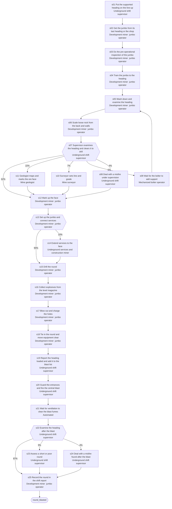

# Lateral development drilling and blasting

`mine-mine-dev-drill-blast` · gold mining · underground mine operations · part of `mining-operator-co`

Lateral development drives the drifts, ramps and crosscuts that give access to the ore, one blasted round of about 3.5-4 m at a time. A two-person development crew takes a supported heading, examines and scales it, marks up the face, drills the round with a two-boom jumbo, collects explosives from the level magazine, charges the holes and leaves the round for the central blast at the end of the shift. Rounds are held up by jumbos busy elsewhere, missing survey or geology marks, services short of the face, support that does not reach the face, and the wait for the blast and fume clearance at shift change.

| | |
|---|---|
| Unit of work | one development round (one heading advanced about 3.5-4 m) |
| Starts when | A heading is reported supported and is assigned to a development crew at a shift line-up. |
| Done when | The round has been blasted, the heading examined after the blast and the round recorded in the shift report, ready for mucking. |
| Organisation | A single-mine Canadian gold producer running a 500-650 tpd narrow-vein underground mine in northern Ontario on 12-hour shifts and 14-on/14-off rotations, with its own mill. (300 employees, 2019-2022) |
| Volume | 145 cases a month (range 110 to 190) |

## Where it sits

- Starts with **supported_heading** from mine-ground-support (70% of cases)
- Starts with **shift_lineup** from mine-shift-control (30% of cases)
- Relies on **installed_services** from mine-ug-services (a standing input; it does not start a case)
- Relies on **explosives_issue** from mine-explosives (a standing input; it does not start a case)
- Relies on **survey_data** from ts-survey (a standing input; it does not start a case)
- Sends **blasted_round** to mine-ground-support (outcome: round_blasted)
- Sends **broken_rock** to mine-mucking-haulage (outcome: round_blasted)
- Sends **developed_face** to ts-grade-control (outcome: round_blasted)
- Sends **developed_face** to ts-survey (outcome: round_blasted)
- Sends **incident_report** to hse-incident-mgmt (outcome: any)

## Flow

## Roles

| Role | Department | Layer | FTE on this process | Loaded cost per hour | Evidence |
|---|---|---|---:|---:|---|
| Development miner (jumbo operator) | Underground production and development | individual contributor | 15 | 56 CAD | B [jobbank-miner] |
| Underground shift supervisor | Underground production and development | supervisor | 1.2 | 82 CAD | B [noc-82020], [mltsd-exam] |
| Mechanized bolter operator | Underground production and development | individual contributor | 0.2 | 52 CAD | C |
| Mine surveyor | Mine engineering and survey | individual contributor | 0.3 | 50 CAD | C |
| Mine geologist | Mine geology | senior specialist | 0.4 | 68 CAD | C |
| Underground services and construction miner | Underground production and development | individual contributor | 0.4 | 47 CAD | C |

## Steps

Hands-on time and the wait before each step show the most common value. Evidence tier A is a sourced number, B a sourced description, C the author's estimate.

| Step | Who | Kind | Hands-on | Wait before | Control | Evidence |
|---|---|---|---:|---:|---|---|
| **s01 Put the supported heading on the line-up.** When the bolter crew reports a heading supported, the shift supervisor marks it ready to drill on the line-up board and assigns a development crew and jumbo to it at the next line-up, according to the captain's heading priorities. | Underground shift supervisor | intake | 5 min | 4.0 h |  | C |
| **s02 Get the jumbo from its last heading or the shop.** The jumbo operator finds the assigned two-boom jumbo, which may still be finishing a round in another heading or be on service in the shop, and takes it over when it comes free, checking its hour meter and fuel. | Development miner (jumbo operator) | coordination | 10 min | 30 min |  | C |
| **s03 Do the pre-operational inspection of the jumbo.** The operator walks around the jumbo with the inspection card, checking booms, hoses, brakes, lights, fire suppression, emergency stops and fluid levels, and records defects; a unit with a safety defect is tagged out. | Development miner (jumbo operator) | physical | 15 min | 0 min | Company pre-operational (circle check) inspection procedure for mobile equipment under the mine's health and safety program | C |
| **s04 Tram the jumbo to the heading.** The operator drives the jumbo down the ramp or along the level to the heading, giving way to haul trucks at passing bays and calling movements on the radio. | Development miner (jumbo operator) | travel | 20 min | 5 min |  | C |
| **s05 Wash down and examine the heading.** The crew washes down the back, walls and face with the water hose, then examines the ground and the face for loose rock, cracks, bootlegs and any misfired explosive left from the last round before anyone goes near the face. | Development miner (jumbo operator) | validation | 15 min | 0 min | Ontario Regulation 854, s. 66: ground conditions at an underground workplace are examined for dangers before work begins | B [mltsd-ground], [jobbank-miner] |
| **s06 Scale loose rock from the back and walls.** The crew bars down loose rock from the back and walls with a scaling bar, working from the supported area outward, or uses the jumbo boom for high backs, until the heading sounds solid. | Development miner (jumbo operator) | physical | 30 min | 0 min | Ontario Regulation 854, s. 67.1: scaling, and no other work that hinders scaling | B [mltsd-ground], [jobbank-miner] |
| **s07 Supervisor examines the heading and clears it to drill.** The shift supervisor visits the heading, checks the support reaches the face, looks for misfires, checks the survey line and grade marks, and either clears it to drill or sends it for extra support, survey or geology. | Underground shift supervisor | review | 10 min | 15 min | Ontario Regulation 854, s. 63(1): supervisor examines every drilling and blasting place each shift | B [mltsd-exam], [macassa] |
| **s08 Deal with a misfire under supervision.** The supervisor takes charge of the misfire: the area is guarded, the hole is washed out or re-primed and fired by a competent blaster under the mine's misfire procedure, and the event is logged and reported. | Underground shift supervisor | physical | 1.0 h | 15 min | Ontario Regulation 854 explosives provisions on misfires and the mine's written misfire procedure (section numbers not verified) | C |
| **s09 Wait for the bolter to add support.** A bolter operator brings the mechanised bolter back to install missing bolts or screen up to the face before drilling can start; the jumbo crew moves to another heading or does services work in the meantime. | Mechanized bolter operator | physical | 1.0 h | 4.0 h | Ontario Regulation 854, s. 6.1: workers kept out of unsupported excavations | B [mltsd-ground], [macassa] |
| **s10 Surveyor sets line and grade.** A surveyor travels to the heading, sets survey points and paints the centre line and grade so the round follows the design, and enters the work in the survey log. | Mine surveyor | physical | 30 min | 3.0 h |  | C |
| **s11 Geologist maps and marks the ore face.** In an ore heading the mine geologist maps the vein on the face, takes chip samples and paints the ore contacts and the direction for the next round so the drift stays in the vein. | Mine geologist | physical | 40 min | 2.0 h |  | C |
| **s12 Mark up the face.** The jumbo operator paints the drift outline and the hole positions for the burn cut, perimeter and lifters from the survey or geology marks, and sets the laser or string line for direction. | Development miner (jumbo operator) | physical | 20 min | 5 min |  | B [jobbank-miner] |
| **s13 Set up the jumbo and connect services.** The operator positions the jumbo, sets the jacks, connects the water hose and the electric cable to the heading services and checks the booms reach the full face. | Development miner (jumbo operator) | physical | 20 min | 0 min |  | C |
| **s14 Extend services to the face.** A services crew extends the water line, power cable or ventilation duct to reach the face; the jumbo waits or the crew moves to another heading until the services are in. | Underground services and construction miner | physical | 1.0 h | 2.0 h |  | B [jobbank-miner] |
| **s15 Drill the round.** The operator drills the round with both booms: about 40-55 holes of 3.7-4.3 m in a heading of about 4 m by 4.5 m, including uncharged relief holes for the burn cut, never collaring in a bootleg, and checks hole angles against the marks. | Development miner (jumbo operator) | physical | 3.0 h | 0 min | Ontario Regulation 854 explosives provisions: no drilling in or near a bootleg or hole that may contain explosive (section numbers not verified) | C |
| **s16 Collect explosives from the level magazine.** The partner takes the explosives carrier to the level magazine, signs out emulsion or ANFO cartridges, detonators and primers in the magazine book, and carries them to the heading in separate compartments. | Development miner (jumbo operator) | physical | 30 min | 10 min | Explosives Act (Canada) magazine licence conditions and Ontario Regulation 854 explosives provisions on storage, transport and records | C |
| **s17 Blow out and charge the holes.** The crew blows each hole clean with air, loads primers and explosive from the charging basket or scissor platform, leaves the relief holes empty, and stems the collars according to the round's loading plan. | Development miner (jumbo operator) | physical | 1.5 h | 10 min | Ontario Regulation 854 explosives provisions: charging by competent blasters only (section numbers not verified) | B [jobbank-miner] |
| **s18 Tie in the round and move equipment clear.** The crew connects the detonator leads into the firing circuit, checks every hole is tied in, and trams the jumbo and carrier back out of the blast zone. | Development miner (jumbo operator) | validation | 15 min | 0 min |  | C |
| **s19 Report the heading loaded and add it to the blast list.** The crew radios the supervisor that the heading is loaded; the supervisor adds it to the shift blast list and confirms no other crew is working within the blast area. | Underground shift supervisor | coordination | 5 min | 15 min |  | C |
| **s20 Guard the entrances and fire the central blast.** At blasting time near the end of the shift the supervisor places guards, confirms by radio that the mine is clear of the blast areas and fires the loaded headings from the central blasting point. | Underground shift supervisor | physical | 15 min | 2.5 h | Ontario Regulation 854, s. 141: blasting times, and only blasting and guarding workers in the vicinity | B [mltsd-postblast] |
| **s21 Wait for ventilation to clear the blast fumes.** The heading is closed while the ventilation clears smoke and gases over the shift change; nobody re-enters until the re-entry time has passed and the air is checked. | Automated | system auto | 0 min | 2.0 h | Ontario Regulation 854, s. 253(1)(a): work areas free of blasting contaminants before re-entry | B [mltsd-postblast] |
| **s22 Examine the heading after the blast.** At re-entry the incoming supervisor or a competent worker checks the air, looks at the muck pile and the new face for misfires and loose ground, and measures the advance. | Underground shift supervisor | validation | 15 min | 10 min | Ontario Regulation 854, s. 260: post-blast examination by competent workers | B [mltsd-postblast] |
| **s23 Assess a short or poor round.** The supervisor records the short advance, bootlegs or overbreak, decides whether the remnants need re-drilling in the next round and tells the engineer if the drift is off line or grade. | Underground shift supervisor | judgment | 20 min | 0 min |  | C |
| **s24 Deal with a misfire found after the blast.** The supervisor guards the area, has the misfired holes washed out or refired under the misfire procedure, records the event and raises an incident report before mucking can start. | Underground shift supervisor | physical | 1.0 h | 15 min | Ontario Regulation 854 explosives provisions on misfires and the mine's written misfire procedure (section numbers not verified) | C |
| **s25 Record the round in the shift report.** The supervisor and the crew record the heading, holes drilled, explosives used, advance and delays on the shift report, and the heading is handed to the mucking crew and then to bolting. | Development miner (jumbo operator) | drafting | 10 min | 0 min |  | C |

## Exceptions

| Exception | Share of cases | What happens |
|---|---:|---|
| Ore heading waits for geology | 22% | The geologist must map and mark the vein before the round is drilled so the drift follows the ore. |
| Support short of the face | 5% | The heading goes back to the bolter before drilling and is re-examined. |
| No survey marks | 7% | The crew waits for a surveyor to set line and grade. |
| Services short of the face | 10% | Water, power or vent duct must be extended before drilling. |
| Misfire | 8% | A misfire found before drilling or after the blast is handled under the misfire procedure and reported. |
| Short or poor round | 9% | Short advance, bootlegs or overbreak are recorded and corrected in the next round. |

## Benchmarks

| Metric | Value | Unit | Population | Evidence |
|---|---|---|---|---|
| cycle_time_days | p50 0.9, p90 1.6 | calendar days from heading supported to round blasted and examined | Narrow-vein Ontario underground gold mine with central end-of-shift blasting | C |
| round_length | 3.8 | metres per round | The organisation's development headings | C |

## Pain points

- A heading that is supported waits for the next line-up and for a jumbo that is still working in another heading. (steps s01, s02; B [cim-sic])
- Drilling cannot start until survey line and grade or the geologist's ore marks are on the face, and both teams are small and work across all headings. (steps s07, s10, s11; C)
- With blasting only at shift end, a round drilled and charged early still waits hours for the blast and then for fume clearance. (steps s20, s21; B [mltsd-postblast])
- Explosives counts are kept in paper magazine books and shift reports, so reconciling explosives use with rounds fired is slow. (steps s16, s25; C)

## Assumptions

- touch_min in crew steps counts the lead miner only; the partner's time is covered by the stated FTE. Resource occupied_min shows how long the jumbo and crew are tied up.
- Heading size (about 4 m by 4.5 m), holes per round and drilling times are the author's estimates; the reference mine's drill patterns were not found.
- Central blasting at the end of each 12-hour shift is assumed; the fume-clearing wait covers the shift change.
- Geology face mapping and survey line-and-grade steps are included because they hold up drilling; their staff time is also counted in ts-grade-control and ts-survey.
- The organisation file lists only dev-miner and ug-shift-supervisor for this process; this file adds surveyor, mine-geologist, ug-services-worker and bolter-operator, and the input survey_data from ts-survey.
- Mucking the round and installing ground support are separate processes (mine-mucking-haulage, mine-ground-support) and are not in this cycle time.
- Loaded costs from the organisation file (base pay x 1.35 for hourly site roles).
- Organisation file corrected on 2026-11-24 to match this workflow's sources: ids were renamed (mill-elution-refining to mill-gold-room-refining, loaded_carbon to gold_concentrate, tailings_slurry to filtered_tailings, elution-circuit to refinery), and roles and resources this workflow added are now in the organisation file. Notes above that describe a mismatch refer to the file before the correction.

## Sources

- [mltsd-exam] [Workplace examinations by supervisors (guideline on section 63 of Regulation 854)](https://bac-lac.wayback.archive-it.org/web/2022/https://www.ontario.ca/page/workplace-examinations-supervisors) (Ontario Ministry of Labour, Immigration, Training and Skills Development (archived copy in the Library and Archives Canada web archive), 2024). Regulation 854 s. 63(1): a supervisor examines every place where drilling and blasting is being carried out at least once each work shift; s. 63(3): every other place where workers work, in person, at least once each work week; the examination is to identify potential or actual hazards and assess general conditions. The guideline page is dated February 2024; the archive returned a June 2024 capture.
- [mltsd-ground] [Ground control in underground mines](https://bac-lac.wayback.archive-it.org/web/2022/https://www.ontario.ca/page/ground-control-underground-mines) (Ontario Ministry of Labour, Immigration, Training and Skills Development (archived copy in the Library and Archives Canada web archive), 2023). Regulation 854 s. 6: mine design assessing ground stability prepared under the direction of a professional engineer; s. 6.1: workers kept out of unsupported excavations unless an engineer's written report allows it; s. 66: ground conditions examined for hazards before work begins; s. 67: written procedures for installing ground support; s. 67.1: no other work that hinders scaling; s. 72: records of falls of ground and rockbursts; s. 73: torque and pull tests of rock bolts. Page dated December 2023.
- [mltsd-postblast] [Post-blast examinations in mines](https://bac-lac.wayback.archive-it.org/web/2022/https://www.ontario.ca/page/post-blast-examinations-mines) (Ontario Ministry of Labour, Immigration, Training and Skills Development (archived copy in the Library and Archives Canada web archive), 2022). Regulation 854 s. 141: blasting times set (jointly where several employers), all workers except those assisting in blasting and guarding leave the vicinity before a blast; s. 253(1)(a): work areas free of blasting contaminants before re-entry; s. 260: post-blast examination by competent workers; s. 64: supervisor makes a written record of a dangerous condition not remedied by the end of the shift; ss. 68 and 74: barricades. Page published August 2022.
- [macassa] [Macassa Mine NI 43-101 Technical Report (April 2019), exhibit 99.20](https://www.sec.gov/Archives/edgar/data/1713443/000162828019003767/a2019macassani4310101apr.htm) (Kirkland Lake Gold Ltd. (filed on SEC EDGAR), 2019). Comparable Ontario underground gold mine: one hole/one bolt policy with no pre-drilling; bolts on a 1.2 m by 1.2 m dice-five pattern; standard support carried to the working face and screen above 3 m; five ground support classes; longhole stopes for ore dipping about 45 degrees or steeper, drilled from a drilling horizon, with blasts started from a drop or inverse raise; mobile fleet of LHDs, jumbos, bolters and trucks (Table 15-6).
- [jobbank-miner] [Job description: Underground production and development miners (NOC 83100), near Thunder Bay (ON)](https://www.jobbank.gc.ca/marketreport/occupation/8707/22422) (Government of Canada, Job Bank, 2026). Miners set up and operate drills to produce a designated pattern of blast holes, load explosives and detonate them, scale loose rock from walls and roof, drill and install rock bolts, extend air and water pipes, operate LHDs and do routine maintenance; usually more than 40 hours a week.
- [noc-82020] [NOC 2021 unit group 82020: Supervisors, mining and quarrying](https://noc.esdc.gc.ca/Structure/NOCProfile?GocTemplateCulture=en-CA&code=82020&version=2021.0) (Employment and Social Development Canada, National Occupational Classification, 2021). Mine supervisors (shift boss, mine captain) supervise, coordinate and schedule the work of miners, oversee safety, resolve work problems, requisition materials, train workers and prepare production and other reports.
- [cim-sic] [A short solution for the long haul: transitioning from information overload to efficient operation with short interval control](https://magazine.cim.org/en/technology/a-short-solution-for-the-long-haul) (CIM Magazine (Canadian Institute of Mining, Metallurgy and Petroleum), Peter Braul, 2017). Short interval control can be as simple as a radio call every hour or two; in many mines it can take 12 hours for information to reach surface; equipment at a conventional underground mine moves about six hours of a 12-hour shift (against 10 or more at Lac des Iles, Ontario); a Canadian mine found tasks running 100% longer than planned because a jumbo blocked access; a 25-30% productivity gain is thought available at most mines.

Written by claude-opus on 2026-11-24.
