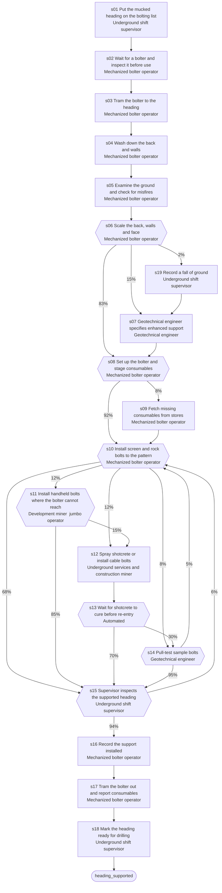

# Ground support installation

`mine-mine-ground-support` · gold mining · underground mine operations · part of `mining-operator-co`

After each development round is blasted and mucked, the rock above and beside the new opening must be held in place before anyone can work under it. A bolter operator examines and scales the heading, then installs screen and rock bolts one hole at a time on a 1.2 m pattern to the face, with extra support such as shotcrete or cable bolts where the geotechnical engineer finds poor ground. The supervisor checks the work and marks the heading ready for the next round. The heading cannot be drilled until this is done, so a busy bolter, a missing consumable or a wait for the engineer holds up development.

| | |
|---|---|
| Unit of work | one heading supported (one round, or one section of rehabilitation) |
| Starts when | A blasted development round has been mucked out, or a heading needs rehabilitation after inspection. |
| Done when | Support is installed to the ground control standard to the face, inspected and recorded, and the heading is marked ready for drilling. |
| Organisation | A single-mine Canadian gold producer running a 500-650 tpd narrow-vein underground mine in northern Ontario on 12-hour shifts and 14-on/14-off rotations, with its own mill. (300 employees, 2019-2022) |
| Volume | 160 cases a month (range 120 to 210) |

## Where it sits

- Starts with **blasted_round** from mine-dev-drill-blast (87% of cases)
- Starts with **geotech_assessment** from ts-geotech (13% of cases)
- Relies on **ground_control_standard** from ts-geotech (a standing input; it does not start a case)
- Relies on **shift_lineup** from mine-shift-control (a standing input; it does not start a case)
- Relies on **stores_issue** from site-warehouse (a standing input; it does not start a case)
- Sends **supported_heading** to mine-dev-drill-blast (outcome: heading_supported)
- Sends **ground_support_record** to ts-geotech (outcome: heading_supported)
- Sends **incident_report** to hse-incident-mgmt (outcome: any)

## Flow

## Roles

| Role | Department | Layer | FTE on this process | Loaded cost per hour | Evidence |
|---|---|---|---:|---:|---|
| Mechanized bolter operator | Underground production and development | individual contributor | 7.5 | 52 CAD | B [jobbank-miner] |
| Development miner (jumbo operator) | Underground production and development | individual contributor | 1 | 56 CAD | C |
| Underground shift supervisor | Underground production and development | supervisor | 0.6 | 82 CAD | B [mltsd-exam] |
| Geotechnical engineer | Mine engineering and survey | senior specialist | 0.2 | 78 CAD | B [mltsd-ground] |
| Underground services and construction miner | Underground production and development | individual contributor | 0.6 | 47 CAD | C |

## Steps

Hands-on time and the wait before each step show the most common value. Evidence tier A is a sourced number, B a sourced description, C the author's estimate.

| Step | Who | Kind | Hands-on | Wait before | Control | Evidence |
|---|---|---|---:|---:|---|---|
| **s01 Put the mucked heading on the bolting list.** When the scooptram operator reports the round mucked out, the shift supervisor adds the heading to the bolting list on the line-up board and assigns a bolter operator, ranking it against other headings waiting for support. | Underground shift supervisor | intake | 5 min | 4.0 h |  | C |
| **s02 Wait for a bolter and inspect it before use.** The bolter operator takes over the mechanised bolter when it comes free from another heading or the shop, and does the pre-operational check of the boom, bolting head, hydraulics, brakes, lights and fire suppression, recording defects on the card. | Mechanized bolter operator | physical | 15 min | 1.0 h | Company pre-operational (circle check) inspection procedure for mobile equipment | C |
| **s03 Tram the bolter to the heading.** The operator drives the bolter to the heading with a load of bolts, resin and screen sheets, calling movements on the radio and giving way to haul trucks. | Mechanized bolter operator | travel | 20 min | 5 min |  | C |
| **s04 Wash down the back and walls.** The operator hoses down the back, walls and the muck-pile remnants so cracks, slabs and any explosive left in sockets can be seen before anyone works under the new ground. | Mechanized bolter operator | physical | 10 min | 0 min |  | C |
| **s05 Examine the ground and check for misfires.** From under the last row of support the operator examines the unsupported span for loose rock, open joints and misfired explosive, and fills in the workplace inspection card. | Mechanized bolter operator | validation | 15 min | 0 min | Ontario Regulation 854, s. 66: ground examined for dangers before work begins | B [mltsd-ground] |
| **s06 Scale the back, walls and face.** The operator scales loose rock with the bolter's scaling attachment or a bar, working from supported ground forward, until the span sounds solid. | Mechanized bolter operator | physical | 35 min | 0 min | Ontario Regulation 854, s. 67.1: scaling, and no other work that hinders scaling | B [mltsd-ground], [jobbank-miner] |
| **s07 Geotechnical engineer specifies enhanced support.** The supervisor calls the geotechnical engineer, who inspects the heading, classifies the ground against the support classes in the ground control standard and writes the extra support needed, such as longer bolts, shotcrete or cable bolts. | Geotechnical engineer | judgment | 40 min | 6.0 h | Ontario Regulation 854, s. 6: ground support design under the direction of a professional engineer | B [mltsd-ground], [macassa] |
| **s08 Set up the bolter and stage consumables.** The operator positions and jacks the bolter, loads rock bolts, resin cartridges and screen sheets for the pattern on the support standard card, and checks there is enough of each for the round. | Mechanized bolter operator | physical | 20 min | 0 min |  | C |
| **s09 Fetch missing consumables from stores.** The operator or a helper drives to the level bay or the surface warehouse to get the missing bolts, resin or screen, signing for them on a stores issue slip. | Mechanized bolter operator | travel | 1.0 h | 30 min |  | C |
| **s10 Install screen and rock bolts to the pattern.** The operator drills and installs each bolt through the screen one hole at a time on the 1.2 m dice-five pattern in the back and walls, overlapping screen sheets and carrying support to the face, typically 20-30 bolts for a 3.8 m round. | Mechanized bolter operator | physical | 3.0 h | 0 min | Company ground control standard (one hole/one bolt, 1.2 m by 1.2 m pattern, screen to the face) under Ontario Regulation 854, s. 67 written procedures for installing ground support | B [macassa], [mltsd-ground] |
| **s11 Install handheld bolts where the bolter cannot reach.** A development miner installs bolts with a jackleg or stoper drill in corners, the face or a cut-out the bolter cannot reach, following the same pattern. | Development miner (jumbo operator) | physical | 45 min | 30 min | Company ground control standard (one hole/one bolt, 1.2 m by 1.2 m pattern, screen to the face) under Ontario Regulation 854, s. 67 written procedures for installing ground support | B [jobbank-miner] |
| **s12 Spray shotcrete or install cable bolts.** A services crew brings the shotcrete sprayer and a transmixer to spray a fibre-reinforced lining to the thickness specified, or drills and grouts cable bolts at an intersection, as the support instruction requires. | Underground services and construction miner | physical | 1.5 h | 6.0 h | Company ground control standard (one hole/one bolt, 1.2 m by 1.2 m pattern, screen to the face) under Ontario Regulation 854, s. 67 written procedures for installing ground support | C |
| **s13 Wait for shotcrete to cure before re-entry.** Nobody works under fresh shotcrete until it reaches the early strength in the mine's procedure, so the heading stays closed for several hours. | Automated | system auto | 0 min | 8.0 h | Company shotcrete re-entry time in the ground control standard | C |
| **s14 Pull-test sample bolts.** The geotechnical engineer or a trained technician pull-tests a sample of the new bolts with a hydraulic jack, or drills a shotcrete thickness check, and records the loads in the testing log. | Geotechnical engineer | validation | 40 min | 1.0 h | Ontario Regulation 854, s. 73: torque and pull testing of ground support | B [mltsd-ground] |
| **s15 Supervisor inspects the supported heading.** The supervisor checks the bolts and screen reach the face, the pattern is complete and any enhanced support is in, during the shift examination, and either accepts the heading or has missing bolts installed. | Underground shift supervisor | review | 10 min | 30 min | Ontario Regulation 854, s. 63(1): supervisor examines every drilling and blasting place each shift | B [mltsd-exam] |
| **s16 Record the support installed.** The operator writes the heading, support class, number and type of bolts, screen sheets and any shotcrete on the ground support record and the shift report. | Mechanized bolter operator | drafting | 10 min | 0 min |  | C |
| **s17 Tram the bolter out and report consumables.** The operator trams the bolter to the next heading or the parking bay, refuels if needed and reports bolts and resin used so the level bay can be restocked. | Mechanized bolter operator | travel | 15 min | 0 min |  | C |
| **s18 Mark the heading ready for drilling.** The supervisor marks the heading supported on the line-up board so it is assigned to a development crew and jumbo at the next line-up. | Underground shift supervisor | communication | 5 min | 15 min |  | C |
| **s19 Record a fall of ground.** When rock has fallen from the back or walls, the supervisor closes the area, records the time, location, size and any damage, and notifies the mine captain and the geotechnical engineer before support work resumes. | Underground shift supervisor | drafting | 40 min | 15 min | Ontario Regulation 854, s. 72: record of uncontrolled falls of ground and rockbursts | B [mltsd-ground] |

## Exceptions

| Exception | Share of cases | What happens |
|---|---:|---|
| Poor ground needs engineer's support instruction | 15% | The geotechnical engineer must classify the ground and specify heavier support before bolting continues. |
| Shotcrete or cable bolts | 14% | Enhanced support needs the shared sprayer and a curing wait before re-entry. |
| Missing consumables | 8% | The bolter runs short of bolts, resin or screen and someone fetches more from stores. |
| Deficiency found on inspection or testing | 7% | Missing bolts, screen gaps or failed pull tests send the heading back for re-bolting. |
| Fall of ground | 2% | A fall of ground is recorded under s. 72 and the engineer inspects before work resumes. |

## Benchmarks

| Metric | Value | Unit | Population | Evidence |
|---|---|---|---|---|
| cycle_time_days | p50 0.7, p90 1.3 | calendar days from round mucked (or rehab requested) to heading marked supported, including mucking wait | Narrow-vein Ontario underground mine with mechanised bolting | C |
| bolt_pattern_spacing | 1.2 | metres between bolts (dice-five) | Comparable Ontario underground gold mine (Macassa) | B [macassa] |

## Pain points

- Three bolters serve all headings, so mucked headings queue for a bolter and the jumbo cannot advance meanwhile. (steps s01, s02; C)
- Poor ground waits for the single geotechnical engineer, who works days on rotation. (steps s07; C)
- Shotcrete needs a shared sprayer and hours of curing before the heading reopens. (steps s12, s13; C)
- Support records are handwritten, so the geotechnical team re-keys bolt counts and support classes into its tracking spreadsheet. (steps s16; C)

## Assumptions

- The cycle includes the wait for mucking (done in mine-mucking-haulage) because a heading cannot be bolted until it is mucked.
- touch_min in crew steps counts one operator; occupied_min shows how long the bolter and crew are tied up.
- Bolting pattern and one hole/one bolt policy follow the Macassa technical report as a comparable Ontario mine; the reference mine's ground control standard was not found.
- Rehabilitation cases (about 13%) follow the same steps and are started by a geotechnical assessment; the organisation file lists only blasted rounds as a trigger.
- A shotcrete sprayer is added as a resource (not in the organisation file).
- The organisation file lists bolter-operator, dev-miner and ug-shift-supervisor; this file adds geotech-engineer and ug-services-worker, the input shift_lineup and stores_issue from site-warehouse.
- Loaded costs from the organisation file.
- Organisation file corrected on 2026-11-24 to match this workflow's sources: ids were renamed (mill-elution-refining to mill-gold-room-refining, loaded_carbon to gold_concentrate, tailings_slurry to filtered_tailings, elution-circuit to refinery), and roles and resources this workflow added are now in the organisation file. Notes above that describe a mismatch refer to the file before the correction.

## Sources

- [mltsd-exam] [Workplace examinations by supervisors (guideline on section 63 of Regulation 854)](https://bac-lac.wayback.archive-it.org/web/2022/https://www.ontario.ca/page/workplace-examinations-supervisors) (Ontario Ministry of Labour, Immigration, Training and Skills Development (archived copy in the Library and Archives Canada web archive), 2024). Regulation 854 s. 63(1): a supervisor examines every place where drilling and blasting is being carried out at least once each work shift; s. 63(3): every other place where workers work, in person, at least once each work week; the examination is to identify potential or actual hazards and assess general conditions. The guideline page is dated February 2024; the archive returned a June 2024 capture.
- [mltsd-ground] [Ground control in underground mines](https://bac-lac.wayback.archive-it.org/web/2022/https://www.ontario.ca/page/ground-control-underground-mines) (Ontario Ministry of Labour, Immigration, Training and Skills Development (archived copy in the Library and Archives Canada web archive), 2023). Regulation 854 s. 6: mine design assessing ground stability prepared under the direction of a professional engineer; s. 6.1: workers kept out of unsupported excavations unless an engineer's written report allows it; s. 66: ground conditions examined for hazards before work begins; s. 67: written procedures for installing ground support; s. 67.1: no other work that hinders scaling; s. 72: records of falls of ground and rockbursts; s. 73: torque and pull tests of rock bolts. Page dated December 2023.
- [macassa] [Macassa Mine NI 43-101 Technical Report (April 2019), exhibit 99.20](https://www.sec.gov/Archives/edgar/data/1713443/000162828019003767/a2019macassani4310101apr.htm) (Kirkland Lake Gold Ltd. (filed on SEC EDGAR), 2019). Comparable Ontario underground gold mine: one hole/one bolt policy with no pre-drilling; bolts on a 1.2 m by 1.2 m dice-five pattern; standard support carried to the working face and screen above 3 m; five ground support classes; longhole stopes for ore dipping about 45 degrees or steeper, drilled from a drilling horizon, with blasts started from a drop or inverse raise; mobile fleet of LHDs, jumbos, bolters and trucks (Table 15-6).
- [jobbank-miner] [Job description: Underground production and development miners (NOC 83100), near Thunder Bay (ON)](https://www.jobbank.gc.ca/marketreport/occupation/8707/22422) (Government of Canada, Job Bank, 2026). Miners set up and operate drills to produce a designated pattern of blast holes, load explosives and detonate them, scale loose rock from walls and roof, drill and install rock bolts, extend air and water pipes, operate LHDs and do routine maintenance; usually more than 40 hours a week.

Written by claude-opus on 2026-11-24.
