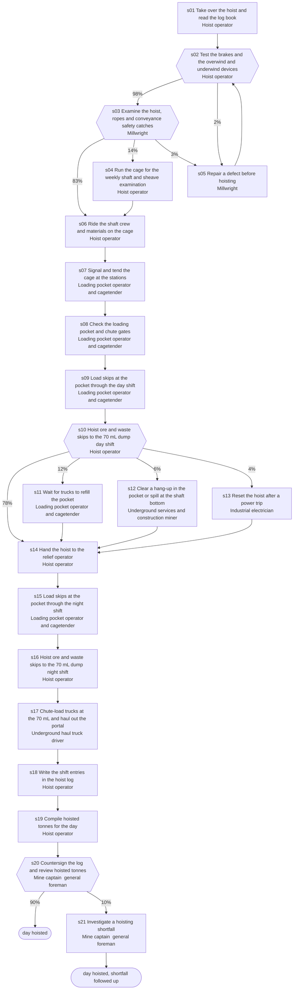

# Shaft hoisting (one hoisting day)

`mine-mine-hoisting` · gold mining · underground mine operations · part of `mining-operator-co`

Each day the hoist operators lift 540-600 tonnes of ore and some waste in 4-tonne skips from the loading pocket below the 460 m level to the skip dump at the 70 m level, where trucks chute-load it and haul it out the portal to the surface ore pad. A manual pocket operator loads every skip, a millwright examines the hoist and ropes daily, and the operator tests the brakes each shift and is relieved before eight hours at the controls. The hoist has spare capacity, so delays come from the pocket running empty, pocket hang-ups, power trips and the weekly shaft examination.

| | |
|---|---|
| Unit of work | one hoisting day |
| Starts when | The first hoist operator of the day takes over the hoist log and the loading pocket holds ore delivered by the trucks. |
| Done when | The day's ore is on the surface ore pad, the hoist log is written and the mine captain has countersigned it. |
| Organisation | A single-mine Canadian gold producer running a 500-600 tonne-per-day underground longhole mine with ramp and shaft access, a 1,000-1,200 tonne-per-day mill and about 280 rotational site staff in northern Ontario. (300 employees, 2019-2022) |
| Volume | 30 cases a month (range 29 to 31) |

## Where it sits

- Starts with **ore_tonnes** from mine-mucking-haulage (100% of cases)
- Relies on **hoist_clearance** from mnt-hoist-inspection (a standing input; it does not start a case)
- Sends **hoisted_ore** to mine-ore-stockpile (outcome: any)
- Sends **hoist_log** to mnt-hoist-inspection (outcome: any)
- Sends **work_request** to mnt-breakdown-repair (outcome: any)

## Flow

## Roles

| Role | Department | Layer | FTE on this process | Loaded cost per hour | Evidence |
|---|---|---|---:|---:|---|
| Hoist operator | Shaft and hoisting | individual contributor | 5.5 | 49 CAD | B [er2022], [reg854] |
| Loading pocket operator and cagetender | Shaft and hoisting | individual contributor | 3.6 | 47 CAD | B [er2022], [reg854] |
| Underground haul truck driver | Underground production and development | individual contributor | 2 | 49 CAD | B [er2022] |
| Millwright | Fixed plant and electrical | individual contributor | 0.4 | 53 CAD | C |
| Industrial electrician | Fixed plant and electrical | individual contributor | 0.15 | 55 CAD | C |
| Underground services and construction miner | Underground production and development | individual contributor | 0.3 | 47 CAD | C |
| Mine captain (general foreman) | Underground production and development | supervisor | 0.1 | 95 CAD | C |

## Steps

Hands-on time and the wait before each step show the most common value. Evidence tier A is a sourced number, B a sourced description, C the author's estimate.

| Step | Who | Kind | Hands-on | Wait before | Control | Evidence |
|---|---|---|---:|---:|---|---|
| **s01 Take over the hoist and read the log book.** The incoming hoist operator reads the Hoist Operator's Log Book entries from the previous shifts, notes any defects, brake or clutch problems and restrictions, and countersigns the previous operator's entries before taking the controls. | Hoist operator | review | 15 min | 0 min | Ontario Regulation 854 s. 239(1) and (2)(a): hoist operator records each shift in the Hoist Operator's Log Book and countersigns the previous entries | A [reg854] |
| **s02 Test the brakes and the overwind and underwind devices.** Before moving people or ore, the operator runs the brake tests on each drum and trips the overwind and underwind limits to confirm they stop the conveyance, and writes the results in the log book. | Hoist operator | validation | 15 min | 0 min | Ontario Regulation 854 s. 240(1)(a), (b) and (2): brakes tested at least once each shift and immediately before moving persons; overwind and underwind devices tested at least once in 24 hours of use | A [reg854] |
| **s03 Examine the hoist, ropes and conveyance safety catches.** A millwright designated as competent examines the outside of the hoist, the drums and clutches, the ropes over their visible length and the cage and skip safety catches and attachments, and signs the record book. | Millwright | validation | 45 min | 0 min | Ontario Regulation 854 s. 248(2)(a): hoist exterior, ropes and conveyance safety catches examined each day the hoist is in use | A [reg854] |
| **s04 Run the cage for the weekly shaft and sheave examination.** Once a week the operator runs the cage slowly from the collar to the shaft bottom while the shaft crew examines the shaft, guides and sheaves and records findings in the Shaft Inspection Record. No ore is hoisted during the examination. | Hoist operator | physical | 4.0 h | 0 min | Ontario Regulation 854 s. 249(1)(a) and (2) (shaft examined at least once a week and recorded) and s. 248(2.1) (sheaves and conveyance attachments examined weekly) | A [reg854] |
| **s05 Repair a defect before hoisting.** The millwright or electrician repairs the defect found in the tests or examination, writes it up in the maintenance system and the log, and the hoist operator re-runs the brake and limit tests before releasing the hoist. | Millwright | physical | 1.5 h | 1.0 h |  | C |
| **s06 Ride the shaft crew and materials on the cage.** The operator moves the loading pocket crew, shaft maintenance workers and any long or heavy materials on the six-person cage at the start of the shift, using the standard bell signals. No ore is hoisted while people ride. | Hoist operator | physical | 30 min | 0 min | Ontario Regulation 854 s. 244(1) (no person transported while ore or waste is hoisted, cage doors closed), s. 236 (signal code) and s. 133(2) (explosives in a conveyance handled under immediate supervision) | B [er2022], [reg854] |
| **s07 Signal and tend the cage at the stations.** The cagetender closes the gates, gives the cautionary, destination and executive signals to the hoist room and stays in charge of the cage while people and materials load and unload at the 70 mL station and the 460 mL pocket level. | Loading pocket operator and cagetender | physical | 30 min | 0 min | Ontario Regulation 854 s. 242(4) (designated competent person in charge of a shaft conveyance) and s. 236(3)-(4) (signal sequence and code) | A [reg854] |
| **s08 Check the loading pocket and chute gates.** At the 460 mL the pocket operator checks how full the pocket is, tests the chute gate and measuring controls, looks for oversize on the grizzly and radios the hoist room that skipping can start. | Loading pocket operator and cagetender | validation | 20 min | 0 min | Ontario Regulation 854 s. 210(6): equipment that discharges into a skip needs actuating power before any gate opens | B [er2022], [reg854] |
| **s09 Load skips at the pocket through the day shift.** For each trip the pocket operator opens the chute into the measuring flask, fills it to the 4-tonne skip load, dumps it into the waiting skip and signals the hoist room. Waste is loaded in separate runs when it is called for. | Loading pocket operator and cagetender | physical | 5.0 h | 0 min |  | B [er2022] |
| **s10 Hoist ore and waste skips to the 70 mL dump (day shift).** The hoist operator runs the double-drum hoist in balance, one skip up while the other comes down, from the 460 mL pocket to the skip dump above the 70 mL station. He watches the depth indicators and speed and counts the trips. | Hoist operator | physical | 5.0 h | 0 min | Ontario Regulation 854 s. 240(1)(d): operator remains at the controls while the hoist is in motion under manual control | B [er2022], [reg854] |
| **s11 Wait for trucks to refill the pocket.** When the pocket runs down the hoist stops and the pocket operator radios the shift supervisor for trucks. The long ramp haul means the pocket is often empty for part of the shift. | Loading pocket operator and cagetender | coordination | 10 min | 1.0 h |  | B [er2022] |
| **s12 Clear a hang-up in the pocket or spill at the shaft bottom.** Services workers lock out the chute, bar down or water-blast bridged ore in the pocket following the written procedure, or muck out spill below the loading pocket so the skips can run. Hoisting stops until it is clear. | Underground services and construction miner | physical | 2.0 h | 45 min | Ontario Regulation 854 s. 84(1), (3) and (4): written procedures for removing material from passes and chutes, worker positioning and lockable chute gates | A [reg854] |
| **s13 Reset the hoist after a power trip.** Summer lightning and storms on the long transmission line cause power dips that trip the hoist. An electrician checks the drive and protection relays and resets them, and the operator re-tests the brakes before moving people. | Industrial electrician | physical | 45 min | 30 min |  | C |
| **s14 Hand the hoist to the relief operator.** Before reaching eight hours at the controls, the operator writes his shift entries, briefs the relieving operator on trips, faults and the pocket level, and the relief operator countersigns and takes over. | Hoist operator | review | 15 min | 30 min | Ontario Regulation 854 s. 9(3) (no more than eight hours of hoist operation in any 24) and s. 239(2)(a) (countersigning previous entries) | A [reg854] |
| **s15 Load skips at the pocket through the night shift.** The night-shift pocket operator loads skips from the pocket as trucks deliver, keeping ore and waste runs separate and noting the number of skips of each. | Loading pocket operator and cagetender | physical | 4.0 h | 0 min |  | B [er2022] |
| **s16 Hoist ore and waste skips to the 70 mL dump (night shift).** The relief hoist operator continues skipping through the night shift as the pocket fills, stopping for the end-of-shift blast and for any shaft work, and counts the trips by type. | Hoist operator | physical | 4.0 h | 0 min | Ontario Regulation 854 s. 240(1)(d): operator remains at the controls while the hoist is in motion under manual control | B [er2022] |
| **s17 Chute-load trucks at the 70 mL and haul out the portal.** Truck drivers load from the chute under the 70 mL skip dump and haul the ore out the portal to the surface ore pad, where it is later reloaded into surface trucks for the 16.6 km haul to the mill. Touch time is the elapsed truck time over the day. | Underground haul truck driver | physical | 7.0 h | 0 min | Ontario Regulation 854 s. 105.1 and s. 106: traffic management program and ramp traffic control | B [er2022], [reg854] |
| **s18 Write the shift entries in the hoist log.** Each operator records hours run, trips, delays, faults, brake and clutch condition and any rope or shaft observations in the Hoist Operator's Log Book before leaving the hoist room. | Hoist operator | data entry | 15 min | 0 min | Ontario Regulation 854 s. 239(1): report of each shift in the Hoist Operator's Log Book | A [reg854] |
| **s19 Compile hoisted tonnes for the day.** The day-shift hoist operator adds up skips of ore and waste from both shifts, multiplies by the skip factor and types the totals into the daily production spreadsheet for the mine captain. | Hoist operator | data entry | 15 min | 1.0 h |  | B [er2022] |
| **s20 Countersign the log and review hoisted tonnes.** The mine captain reads and countersigns the hoist log, compares hoisted tonnes with the truck tallies and the plan at the morning meeting, and asks about delays. | Mine captain (general foreman) | review | 15 min | 4.0 h | Ontario Regulation 854 s. 239(4): supervisor countersigns the Hoist Operator's Log Book each working day | A [reg854] |
| **s21 Investigate a hoisting shortfall.** The mine captain finds why tonnes were short or did not match (pocket hang-up, trucks short, hoist down, counting error), arranges a fix such as an extra truck or a pocket clean-out, and notes it for the reconciliation. | Mine captain (general foreman) | analysis | 30 min | 30 min |  | C |

## Exceptions

| Exception | Share of cases | What happens |
|---|---:|---|
| Weekly shaft examination | 14% | The hoist runs the cage slowly for the weekly shaft and sheave examination and does not hoist ore for several hours. |
| Defect at start of day | 5% | A failed brake or limit test or a defect found in the daily examination stops hoisting until repaired and re-tested. |
| Pocket runs empty | 12% | Trucks cannot keep up with the hoist and the pocket runs down. |
| Pocket hang-up or shaft spill | 6% | Bridged ore or spill below the pocket stops skipping until services workers clear it. |
| Power trip | 4% | A storm-related power dip trips the hoist and an electrician resets it. |

## Benchmarks

| Metric | Value | Unit | Population | Evidence |
|---|---|---|---|---|
| cycle_time_days | p50 1.0, p90 1.1 | calendar days from the first operator's log take-over to the captain countersigning the log | One hoisting day | C |
| hoisting_hours_needed | p50 6.5, p90 8.5 | hours of skipping per day | Eagle River hoist at 540-600 t a day | B [er2022] |
| hoist_capacity | 3100 | tonnes per day on 20 operating hours from a 420 m hoisting depth | Eagle River hoist, 2016 | B [er2016] |

## Pain points

- The hoist has far more capacity than the trucks can feed it, so it often waits for ore while the operator and pocket operator must stay on station. (steps s10, s11; B [er2022])
- The manual loading pocket needs an operator for every skip and is the usual place for hang-ups; the technical report recommends automating any new pocket. (steps s09, s12, s15; B [er2022])
- Hoisted ore is rehandled twice more before the mill: chute-loaded into underground trucks at the 70 mL, then reloaded on the surface pad for a 16.6 km road haul. (steps s17; B [er2022])
- The eight-hour limit on hoist operation means each 12-hour shift needs a relief operator, so hoisting is staffed with three operators per rotation for a hoist that runs six to eight hours a day. (steps s14; A [reg854])

## Assumptions

- At this mine the shaft hoists ore from the 460 mL loading pocket to a skip dump above the 70 mL station, not to a surface headframe bin; trucks then carry the ore out the portal. The organisation file's description (skipping to surface bins) is corrected here, and the portal haul from the 70 mL is included because it is what delivers hoisted ore to the surface stockpile.
- The organisation file has no loading pocket operator or cagetender; the role is added with not_in_org_file because the pocket is manual and Reg. 854 requires a competent person in charge of the conveyance.
- Personnel mostly travel by ramp, so man-hoisting at shift change is small; this differs from the organisation file's description of moving people at shift change.
- Pocket loading and skipping (s09 with s10, s15 with s16) and the portal truck haul (s17) run at the same time and are linked with concurrent_with, so the simulated day (median about 1.1 days including the wait for the captain's countersignature) stays close to the 1.0-day benchmark.
- Hoist operator touch time is time attending the controls while skipping, which includes waiting for skips to be loaded; actual skipping is about 6.5 hours a day.
- Stated FTE (about 12) is above the hands-on estimate (about 7) because the hoist and the manual pocket must be staffed through both shifts whenever ore may arrive, and Reg. 854 s. 9(3) forces a relief operator each 12-hour shift; idle attended time between truck arrivals is not all counted as touch time.
- Daily examination by a millwright, frequencies of pocket hang-ups, power trips and the weekly examination duration are the author's estimates; the weekly shaft examination itself belongs to mnt-hoist-inspection and appears here only as hoist time lost to production.
- Organisation file corrected on 2026-11-24 to match this workflow's sources: ids were renamed (mill-elution-refining to mill-gold-room-refining, loaded_carbon to gold_concentrate, tailings_slurry to filtered_tailings, elution-circuit to refinery), and roles and resources this workflow added are now in the organisation file. Notes above that describe a mismatch refer to the file before the correction.

## Sources

- [er2022] [Technical Report for the Eagle River Gold Mining Complex, Ontario, Canada (SRK project CAPR001445, effective 31 December 2021)](https://s203.q4cdn.com/643390454/files/doc_downloads/2022/11/ERtechnicalReport.pdf) (SRK Consulting (Canada) Inc. for Wesdome Gold Mines Ltd., 2022). Three-compartment shaft with a skip-over-cage limited to 6 persons, main station at 70 mL with the skip dump above it, loading pocket below the 460 mL, shaft bottom at 580 mL; CIR double-drum hoist, 6 m/s, 4 t certified skip payload, controls upgraded in 2020, loading pocket not automated, 16 realistic operating hours a day with capacity well above production; ore chute-loaded into underground trucks at the 70 mL and hauled out the portal, then 16.6 km by surface truck to the mill; most personnel use the ramps; two 12-hour shifts 365 days a year; 6.9 km ramp haul to the pocket.
- [er2016] [Technical Report for the Eagle River Mining Complex including the Eagle River Gold Mine, the Mishi Gold Mine and related infrastructure (Mannard and Ng)](https://minedocs.com/12/EagleRiver_TechnicalReport_03172016.pdf) (Wesdome Gold Mines Ltd., 2016). Hoist rated at about 3,100 t a day on 20 operating hours from a 420 m hoisting depth, 8,800 lb payload.
- [reg854] [R.R.O. 1990, Reg. 854: Mines and Mining Plants, Occupational Health and Safety Act (e-Laws consolidation in force 1 July 2021, archived copy captured 17 January 2022)](https://bac-lac.wayback.archive-it.org/web/2021/https://www.ontario.ca/laws/regulation/900854) (Government of Ontario (archived by the Library and Archives Canada web archive), 2021). Eight-hour limit on hoist operation (s. 9(3)), log books (ss. 207, 239), brake and overwind tests (s. 240), operator at the controls (s. 240(1)(d)), daily and weekly hoist and conveyance examinations (s. 248), weekly shaft examination and Shaft Inspection Record (s. 249), signals (s. 236), conveyance attendant (s. 242(4)), no persons with ore (s. 244), explosives in conveyances (s. 133(2)), skip loading controls (s. 210(6)), chute and pass procedures (s. 84), traffic management (ss. 105.1, 106).

Written by claude-opus on 2026-11-24.
