# Mucking and haulage (one shift)

`mine-mine-mucking-haulage` · gold mining · underground mine operations · part of `mining-operator-co`

Each 12-hour shift, LHD operators muck broken ore from stope drawpoints and development miners muck their rounds, while truck drivers haul ore about 7 km up the ramp to the shaft loading pocket and waste to stopes needing backfill. The shift supervisor sets the line-up, examines workplaces after the end-of-shift blasts and turns paper truckload tallies into the shift report. The long uphill haul makes trucks the bottleneck, and fume clearance, hang-ups, breakdowns and a full loading pocket cut into the shift's tonnes.

| | |
|---|---|
| Unit of work | one shift of mucking and haulage |
| Starts when | The shift supervisor posts the line-up at the start of a 12-hour shift. |
| Done when | Ore is in the loading pocket, waste is in stopes, the tally is in the production spreadsheet and the mine captain has reviewed it. |
| Organisation | A single-mine Canadian gold producer running a 500-600 tonne-per-day underground longhole mine with ramp and shaft access, a 1,000-1,200 tonne-per-day mill and about 280 rotational site staff in northern Ontario. (300 employees, 2019-2022) |
| Volume | 60 cases a month (range 56 to 62) |

## Where it sits

- Starts with **shift_lineup** from mine-shift-control (100% of cases)
- Relies on **broken_ore** from mine-stope-blasting (a standing input; it does not start a case)
- Relies on **broken_rock** from mine-dev-drill-blast (a standing input; it does not start a case)
- Relies on **fuel_issue** from site-fuel (a standing input; it does not start a case)
- Sends **ore_tonnes** to mine-hoisting (outcome: any)
- Sends **waste_rock** to mine-backfill (outcome: any)
- Sends **mined_out_stope** to ts-survey (outcome: any)
- Sends **haulage_tally** to ts-reconciliation (outcome: any)
- Sends **work_request** to mnt-breakdown-repair (outcome: any)
- Sends **face_sample** to mill-assay-lab (outcome: any)

## Flow

```mermaid
flowchart TD
    s01["s01 Hold line-up and pre-shift safety talk<br/>Underground shift supervisor"]
    s02["s02 LHD operators travel down the ramp to the drawpoints<br/>Scooptram  LHD  operator"]
    s03["s03 Truck drivers travel to the parked trucks<br/>Underground haul truck driver"]
    s04["s04 Pre-use inspection of the scooptram<br/>Scooptram  LHD  operator"]
    s05["s05 Pre-use inspection of the haul truck<br/>Underground haul truck driver"]
    s06{{"s06 Examine workplaces and confirm re-entry after blasts<br/>Underground shift supervisor"}}
    s07["s07 Reassign equipment to another drawpoint or heading<br/>Underground shift supervisor"]
    s08["s08 Fuel and grease the loaders at the fuel bay<br/>Scooptram  LHD  operator"]
    s09["s09 Muck development rounds to remucks or trucks<br/>Development miner  jumbo operator"]
    s10["s10 Muck the stope drawpoints and load trucks<br/>Scooptram  LHD  operator"]
    s11{{"s11 Haul ore up the ramp to the shaft loading pocket<br/>Underground haul truck driver"}}
    s12["s12 Secondary blast oversize or a hang-up<br/>Production miner  longhole driller and blaster"]
    s13["s13 Dump to a temporary underground stockpile<br/>Underground haul truck driver"]
    s14{{"s14 Haul development waste to stopes needing backfill<br/>Underground haul truck driver"}}
    s15["s15 Report the breakdown and park the unit<br/>Scooptram  LHD  operator"]
    s16["s16 Repair the unit in the heading or tow it to the shop<br/>Heavy-duty equipment mechanic"]
    s17["s17 Confirm and report a stope that is mucked out<br/>Underground shift supervisor"]
    s18["s18 Record buckets and truckloads on the tally sheet<br/>Underground haul truck driver"]
    s19["s19 Park the loaders and travel back to the portal<br/>Scooptram  LHD  operator"]
    s20["s20 Park the trucks and travel back to the portal<br/>Underground haul truck driver"]
    s21["s21 Write the shift report and hand over<br/>Underground shift supervisor"]
    s22["s22 Key tallies into the production spreadsheet<br/>Underground shift supervisor"]
    s23{{"s23 Review shift tonnes at the morning meeting<br/>Mine captain  general foreman"}}
    s24["s24 Correct the tally with the supervisor<br/>Underground shift supervisor"]
    s01 --> s02
    s02 --> s03
    s03 --> s04
    s04 --> s05
    s05 --> s06
    s06 -->|"88%"| s08
    s06 -->|"12%"| s07
    s07 --> s08
    s08 --> s09
    s09 --> s10
    s10 --> s11
    s11 -->|"82%"| s14
    s11 -->|"8%"| s12
    s11 -->|"10%"| s13
    s12 --> s14
    s13 --> s14
    s14 -->|"18%"| s15
    s14 -->|"82%"| s17
    s15 --> s16
    s16 --> s17
    s17 --> s18
    s18 --> s19
    s19 --> s20
    s20 --> s21
    s21 --> s22
    s22 --> s23
    s23 -->|"92%"| end0
    s23 -->|"8%"| s24
    s24 --> end1
    end0(["shift tally posted"])
    end1(["shift tally posted after correction"])
```

## Roles

| Role | Department | Layer | FTE on this process | Loaded cost per hour | Evidence |
|---|---|---|---:|---:|---|
| Scooptram (LHD) operator | Underground production and development | individual contributor | 7.2 | 51 CAD | B [er2022] |
| Underground haul truck driver | Underground production and development | individual contributor | 18 | 49 CAD | B [er2022] |
| Development miner (jumbo operator) | Underground production and development | individual contributor | 2 | 56 CAD | C |
| Underground shift supervisor | Underground production and development | supervisor | 1.6 | 82 CAD | B [er2022] |
| Mine captain (general foreman) | Underground production and development | supervisor | 0.1 | 95 CAD | C |
| Heavy-duty equipment mechanic | Mobile equipment maintenance | individual contributor | 1 | 53 CAD | C |
| Production miner (longhole driller and blaster) | Underground production and development | individual contributor | 0.3 | 56 CAD | C |

## Steps

Hands-on time and the wait before each step show the most common value. Evidence tier A is a sourced number, B a sourced description, C the author's estimate.

| Step | Who | Kind | Hands-on | Wait before | Control | Evidence |
|---|---|---|---:|---:|---|---|
| **s01 Hold line-up and pre-shift safety talk.** The shift supervisor reads the previous shift's report and the line-up board, assigns LHD operators to drawpoints and stopes and truck drivers to haul routes, and gives a five-minute safety talk. Ore and waste destinations, blasted headings and any loading pocket problems are called out. | Underground shift supervisor | coordination | 25 min | 10 min | Site pre-shift line-up and safety meeting procedure (company policy) | C |
| **s02 LHD operators travel down the ramp to the drawpoints.** The two LHD operators on shift ride a personnel carrier from the portal down the main ramp to their levels. Most people enter by the ramp because the shaft cage holds only six; the trip to the deeper zones takes 30 to 60 minutes. | Scooptram (LHD) operator | travel | 40 min | 10 min |  | B [er2022] |
| **s03 Truck drivers travel to the parked trucks.** The truck drivers ride down in the same or a second personnel carrier to where the trucks were parked at the end of the last shift, near the truck dump or the remucks. | Underground haul truck driver | travel | 35 min | 0 min |  | C |
| **s04 Pre-use inspection of the scooptram.** Each LHD operator walks around the loader, checks brakes, steering, lights, fire suppression, tires and fluid levels, tests the remote-control transmitter where used, and signs the pre-shift checklist. Defects that affect safety park the machine and go to maintenance. | Scooptram (LHD) operator | validation | 15 min | 0 min | Ontario Regulation 854 s. 105(7)(a) and (d): brakes, steering, lighting and other safety components tested before initial use for the shift, with records | A [reg854] |
| **s05 Pre-use inspection of the haul truck.** Each truck driver checks brakes, steering, lights, the box hoist, tires and the fire suppression system on the 30-tonne truck and signs the checklist. The supervisor is radioed if the truck is unfit, and a spare truck is reassigned. | Underground haul truck driver | validation | 15 min | 0 min | Ontario Regulation 854 s. 105(7)(a) and (d): pre-shift test of brakes, steering and lighting with records | A [reg854] |
| **s06 Examine workplaces and confirm re-entry after blasts.** The supervisor visits each drawpoint, remuck and heading on the line-up, checks that blast fumes have cleared with a gas detector, looks at the back and walls for loose rock, checks brow markers and barricades at open stopes, and confirms the end-of-shift blast was clear of misfires before letting operators in. | Underground shift supervisor | validation | 35 min | 20 min | Ontario Regulation 854 s. 63(1) (supervisor examines places where drilling and blasting occur during each shift) and s. 66(1) (ground conditions examined before work begins) | A [reg854] |
| **s07 Reassign equipment to another drawpoint or heading.** When a drawpoint is still gassed out, has bad ground or has no ore to pull, the supervisor moves the loader and trucks to the next place on the plan, radios the change and notes the lost time for the shift report. | Underground shift supervisor | coordination | 10 min | 0 min |  | C |
| **s08 Fuel and grease the loaders at the fuel bay.** Operators drive to the underground fuel bay, fill the loader with diesel, record the litres against the unit number on the fuel sheet and grease the articulation and bucket pins. Trucks fuel at the same bay between loads. | Scooptram (LHD) operator | physical | 15 min | 5 min |  | C |
| **s09 Muck development rounds to remucks or trucks.** A development miner reads the geologist's ore or waste paint marks on the blasted face, wets the muckpile and mucks the round with a 6-yard LHD, either into a remuck bay or straight into a truck. Ore rounds go to the loading pocket and waste rounds to a stope needing backfill. | Development miner (jumbo operator) | physical | 2.0 h | 0 min |  | B [er2022], [cmj2012] |
| **s10 Muck the stope drawpoints and load trucks.** The two LHD operators muck broken ore from the drawpoints on the bottom haulage level and load the 30-tonne trucks, taking a handful of muck from each bucket into a sample bag for every truck. While a stope is still being blasted they pull only enough ore to make room for the next blast; once blasting is complete they empty it by remote control from behind the brow marker. Time spent waiting for a returning truck is included. | Scooptram (LHD) operator | physical | 7.5 h | 0 min | Ontario Regulation 854 s. 174 (remote-controlled equipment: one active controller, emergency stop, safe operator location) and the site's written brow-entry procedure | B [er2022], [cmj2012], [macassa], [reg854] |
| **s11 Haul ore up the ramp to the shaft loading pocket.** Four truck drivers haul loaded trucks up the 15% ramp to the truck dump feeding the 460 mL loading pocket, dump and return, about 100 minutes a round trip. They follow the ramp traffic rules, give way at passing bays and radio their position. | Underground haul truck driver | physical | 8.0 h | 0 min | Ontario Regulation 854 s. 105.1 (written traffic management program) and s. 106 (traffic control on ramps; supervisor sets load, speed and gear) | B [er2022], [islandgold], [reg854] |
| **s12 Secondary blast oversize or a hang-up.** A production miner places a small charge on an oversize boulder or a hang-up in the drawpoint, guards the approaches, warns and fires it, and the area stays closed until fumes clear. Meanwhile the loader works another drawpoint. | Production miner (longhole driller and blaster) | physical | 1.0 h | 1.0 h | Ontario Regulation 854 s. 141(1) (entrances guarded, warning given and area confirmed clear before firing) and s. 147.1(1) (no safety fuse for hang-ups in drawpoints) | A [reg854] |
| **s13 Dump to a temporary underground stockpile.** When the pocket is full because the hoist is stopped, the driver dumps the load in a designated stockpile bay near the truck dump and radios the supervisor. The ore is rehandled into the pocket later, costing a second loader pass. | Underground haul truck driver | physical | 30 min | 30 min |  | C |
| **s14 Haul development waste to stopes needing backfill.** One or two drivers haul waste from development remucks to the top access of a mined-out stope and dump it as uncemented rockfill, or to a waste pass when no stope is open. A small share goes to the pocket to be hoisted. | Underground haul truck driver | physical | 5.0 h | 0 min |  | B [er2022] |
| **s15 Report the breakdown and park the unit.** The operator radios the supervisor and the maintenance shop with the unit number, the fault and the location, parks the machine safely out of the traffic lane and writes a defect card. The supervisor decides whether to swap in a spare unit. | Scooptram (LHD) operator | communication | 10 min | 0 min |  | C |
| **s16 Repair the unit in the heading or tow it to the shop.** A heavy-duty mechanic drives down with a service truck, diagnoses the fault and repairs it in place or arranges a tow to the underground shop. The machine is out of production until it is fixed, which often ends the shift for that unit. | Heavy-duty equipment mechanic | physical | 2.0 h | 1.0 h |  | C |
| **s17 Confirm and report a stope that is mucked out.** When the last broken ore is pulled from a stope, the supervisor checks from behind the brow marker that it is empty, has the brow barricaded and signed, and emails engineering and survey so the stope can be scanned and released for backfill. Most shifts have no stope to report, so the step is short. | Underground shift supervisor | communication | 10 min | 0 min | Ontario Regulation 854 s. 84(2) para. 4 (signs and barriers to prevent inadvertent access to unsafe locations) | B [er2022], [reg854] |
| **s18 Record buckets and truckloads on the tally sheet.** Each truck driver writes the time, source, destination and load type of every trip on the paper tally card, and LHD operators note buckets and drawpoints. Muck sample bags are tagged with the date, sampler and location. | Underground haul truck driver | data entry | 15 min | 0 min |  | B [er2022] |
| **s19 Park the loaders and travel back to the portal.** LHD operators park loaders at the end-of-shift locations clear of the blast areas and ride back up the ramp to surface for shift change. Units needing fuel are flagged for the next shift. | Scooptram (LHD) operator | travel | 40 min | 5 min |  | C |
| **s20 Park the trucks and travel back to the portal.** Truck drivers park the trucks near the truck dump or remucks for the next shift and ride out with the LHD operators. | Underground haul truck driver | travel | 35 min | 0 min |  | C |
| **s21 Write the shift report and hand over.** The supervisor collects the tally cards, totals truckloads of ore and waste by source, lists delays (waiting for re-entry, breakdowns, pocket full) and writes the paper shift report. He briefs the incoming supervisor face to face at shift change. | Underground shift supervisor | data entry | 30 min | 0 min |  | C |
| **s22 Key tallies into the production spreadsheet.** The supervisor types the shift totals by stope, heading and destination into the production spreadsheet on the shared drive, multiplying truckloads by the truck factor to give tonnes. The spreadsheet feeds the daily report and the month-end reconciliation. | Underground shift supervisor | data entry | 15 min | 15 min |  | C |
| **s23 Review shift tonnes at the morning meeting.** The mine captain compares each shift's tonnes against the plan and the hoist count, asks about delays and decides where loaders and trucks go next. Gaps between trucked and hoisted tonnes are queried. | Mine captain (general foreman) | review | 15 min | 6.0 h |  | C |
| **s24 Correct the tally with the supervisor.** The supervisor who wrote the report checks the tally cards with the drivers on his next shift, finds the missing or misallocated loads and corrects the spreadsheet. | Underground shift supervisor | data entry | 15 min | 12.0 h |  | C |

## Exceptions

| Exception | Share of cases | What happens |
|---|---:|---|
| Heading or drawpoint not ready | 12% | A place on the line-up is still gassed out after the blast, has bad ground or has no void, and the loader is moved elsewhere. |
| Hang-up or oversize at a drawpoint | 8% | A boulder or bridged muck stops flow and needs secondary blasting before mucking resumes. |
| Loading pocket full | 10% | The hoist is stopped for inspection, a trip or a pocket hang-up, and trucks dump to a temporary stockpile that must be rehandled. |
| Equipment breakdown | 18% | A loader or truck fails during the shift and waits for a mechanic. |
| Tally does not agree | 8% | Trucked tonnes do not match the plan or the hoist count and the supervisor corrects the tally on his next shift. |

## Benchmarks

| Metric | Value | Unit | Population | Evidence |
|---|---|---|---|---|
| cycle_time_days | p50 0.8, p90 1.2 | calendar days from the start-of-shift line-up to the tally being reviewed at the next morning meeting | Day and night shifts at a two-shift underground mine | C |
| ore_hauled_per_day | 540 | tonnes per day | Eagle River underground ore, 2020 | B [er2022] |
| one_way_haul_distance | 6.9 | km from the active zone to the 460 mL truck dump | Eagle River, end of 2021 | B [er2022] |

## Pain points

- The long uphill haul (about 7 km one way) makes trucks the bottleneck; loaders wait at drawpoints and the ramp is congested. (steps s10, s11; B [er2022])
- Waiting for blast fumes to clear and for the supervisor's examination delays the start of mucking at the drawpoints that were blasted at the end of the last shift. (steps s06, s07; C)
- Tonnes are counted by truckloads on paper and re-keyed, so source tonnes by stope are uncertain and need correcting at month end. (steps s18, s21, s22, s24; C)
- Overpulling drawpoints while a stope is still being blasted lets the walls slough and adds dilution; the rule to shrink only enough for the next blast depends on operator judgment. (steps s10; B [er2022])

## Assumptions

- Crew steps use people: about 2 LHD operators, 5 truck drivers (4 on ore, 1-2 on waste) and 1 development miner on mucking per shift, so labour hours are touch time times people.
- Development mucking, drawpoint mucking, ore haulage and waste haulage run at the same time through the shift and are linked with concurrent_with; the simulator overlaps a step only with the step visited just before it, so cases that take the hang-up or stockpile branch show a longer cycle than real.
- The process is triggered by the shift line-up; broken ore and rock from the blasting processes are treated as standing inputs because every shift mucks whatever broken material the line-up assigns.
- Development rounds are mucked by the development crews (dev-miner), as the organisation's dev-crew resource describes, not by the dedicated LHD operators.
- The organisation file has 20 LHD operators and 12 truck drivers; the 2022 technical report lists 8 owner LHD operators and 24 truck operators. This workflow follows the technical report and the difference is reported.
- The organisation file lists 9 LHDs and 6 trucks; the 2022 technical report lists 19 LHDs (six 6-yard, two 4-yard, three 3.5-yard, eight 2-yard for captive sub-levels) and five 30-t trucks. The org resource ids are used with their stated counts.
- Truck round trips of about 100 minutes (6.9 km each way on grades up to 15%, plus loading and dumping) give about 5 trips per truck per shift, or about 20 loads (600 t) of ore per shift at capacity, against about 270 t needed; spare truck time absorbs queues, waste haulage and breakdowns.

## Sources

- [er2022] [Technical Report for the Eagle River Gold Mining Complex, Ontario, Canada (SRK project CAPR001445, effective 31 December 2021)](https://s203.q4cdn.com/643390454/files/doc_downloads/2022/11/ERtechnicalReport.pdf) (SRK Consulting (Canada) Inc. for Wesdome Gold Mines Ltd., 2022). Mining method (drawpoint mucking from the bottom haulage level, shrinking, fast mucking-out, rockfill from the top access), fleet (6, 2, 3 and 8 LHDs by size; five 30-t trucks), labour (8 owner LHD operators, 24 truck operators, 8 supervisors), ramp access for personnel and 6-person cage, ramp grades of 15%, 6.9 km haul to the 460 mL truck dump, muck sampling per truck, two 12-hour shifts 365 days a year.
- [cmj2012] [Moving Ahead (feature on Wesdome's Eagle River mine)](https://canadianminingjournal.com/featured-article/moving-ahead) (Canadian Mining Journal, 2012). Eagle River fleet in 2012 including 6-yard scooptrams for development and 5-yard and 3.5-yard scoops for remote mucking; 40-t trucks.
- [macassa] [Macassa Mine NI 43-101 Technical Report (April 2019), exhibit 99.20](https://www.sec.gov/Archives/edgar/data/1713443/000162828019003767/a2019macassani4310101apr.htm) (Kirkland Lake Gold Ltd. (filed with the US SEC), 2019). Brow markers set at least 4.5 m back from the stope brow as a no-go zone; tele-remote mucking in use at a comparable Ontario mine from 2018.
- [reg854] [R.R.O. 1990, Reg. 854: Mines and Mining Plants, Occupational Health and Safety Act (e-Laws consolidation in force 1 July 2021, archived copy captured 17 January 2022)](https://bac-lac.wayback.archive-it.org/web/2021/https://www.ontario.ca/laws/regulation/900854) (Government of Ontario (archived by the Library and Archives Canada web archive), 2021). Pre-shift equipment tests and records (s. 105(7)), traffic management and ramp rules (ss. 105.1, 106), workplace and ground examinations (ss. 63, 66), remote-controlled equipment (s. 174), barriers at unsafe locations (s. 84(2)), blasting guards and hang-ups (ss. 141(1), 147.1(1)).
- [islandgold] [Island Gold Mine NI 43-101 Technical Report (Phase III expansion), exhibit 99.1](https://www.sec.gov/Archives/edgar/data/1178819/000117881920000070/ex991technicalreportfo.htm) (Alamos Gold Inc. (filed with the US SEC), 2020). Ramp haulage cycle times increase as mining moves deeper at a neighbouring ramp-access mine.

Written by claude-opus on 2026-11-24.
