# Shift line-up and short-interval control

`mine-mine-shift-control` · gold mining · underground mine operations · part of `mining-operator-co`

Every 12-hour shift at the underground mine starts with a line-up: the shift supervisor reads the last shift's report, checks which machines are working, assigns each miner to a heading, stope or machine and holds a short safety meeting. During the shift the supervisor must examine every drilling and blasting place, takes radio progress calls and moves crews when a machine breaks down or a heading is unsafe. At the end of the shift the supervisor clears the mine for the blast and writes a paper report that the captain and superintendent review the next morning. Work is slowed by equipment that turns out to be down, absences, and information that reaches surface only at the end of the shift.

| | |
|---|---|
| Unit of work | one underground shift (about 12 hours, one crew) |
| Starts when | The scheduled start of a day or night shift, working to the weekly mine schedule from technical services. |
| Done when | The shift report, logbook and timesheets are complete, the shift has been reviewed at the morning meeting and its tallies are in the production spreadsheet. |
| Organisation | A single-mine Canadian gold producer running a 500-650 tpd narrow-vein underground mine in northern Ontario on 12-hour shifts and 14-on/14-off rotations, with its own mill. (300 employees, 2019-2022) |
| Volume | 60 cases a month (range 56 to 62) |

## Where it sits

- Starts with **mine_plan** from ts-short-range-plan (100% of cases)
- Relies on **grade_control_model** from ts-grade-control (a standing input; it does not start a case)
- Relies on **repaired_equipment** from mnt-mobile-pm (a standing input; it does not start a case)
- Relies on **repaired_equipment** from mnt-breakdown-repair (a standing input; it does not start a case)
- Relies on **training_record** from hse-training (a standing input; it does not start a case)
- Sends **shift_lineup** to mine-dev-drill-blast (outcome: shift_closed)
- Sends **shift_lineup** to mine-stope-drilling (outcome: shift_closed)
- Sends **shift_lineup** to mine-mucking-haulage (outcome: shift_closed)
- Sends **shift_lineup** to mine-ground-support (outcome: shift_closed)
- Sends **shift_report** to ts-reconciliation (outcome: shift_closed)
- Sends **timesheet** to site-payroll (outcome: shift_closed)
- Sends **work_request** to mnt-breakdown-repair (outcome: any)
- Sends **incident_report** to hse-incident-mgmt (outcome: any)

## Flow

```mermaid
flowchart TD
    s01["s01 Read outgoing shift report and logbook<br/>Underground shift supervisor"]
    s02{{"s02 Check equipment availability with maintenance<br/>Underground shift supervisor"}}
    s03["s03 Hold pre-shift planning meeting with supervisors<br/>Mine captain  general foreman"]
    s04["s04 Assign crews to headings and equipment on the line-up board<br/>Underground shift supervisor"]
    s05{{"s05 Hold line-up meeting with the crew<br/>Underground shift supervisor"}}
    s06["s06 Reassign crews for absences and training gaps<br/>Underground shift supervisor"]
    s07["s07 Wait for late crew-change arrivals<br/>Underground shift supervisor"]
    s08["s08 Travel underground with the crews<br/>Underground shift supervisor"]
    s09{{"s09 Examine each drilling and blasting place<br/>Underground shift supervisor"}}
    s10["s10 Barricade an unsafe heading and move its crew<br/>Underground shift supervisor"]
    s11{{"s11 Take radio progress calls from the crews<br/>Underground shift supervisor"}}
    s12["s12 Report a breakdown and raise a work request<br/>Underground shift supervisor"]
    s13["s13 Reassign crews and equipment around the breakdown<br/>Underground shift supervisor"]
    s14{{"s14 Make second round of workplace visits<br/>Underground shift supervisor"}}
    s15["s15 Report an incident<br/>Underground shift supervisor"]
    s16["s16 Confirm the blast list and clear the mine for the central blast<br/>Underground shift supervisor"]
    s17["s17 Travel out to surface with the crews<br/>Underground shift supervisor"]
    s18["s18 Write the shift report, logbook and timesheets<br/>Underground shift supervisor"]
    s19["s19 Hand over to the incoming supervisor<br/>Underground shift supervisor"]
    s20["s20 Compile the 24-hour production summary<br/>Mine captain  general foreman"]
    s21{{"s21 Review the shift at the morning production meeting<br/>Mine superintendent"}}
    s22["s22 Revise the week's priorities<br/>Mine superintendent"]
    s23["s23 Key shift tallies into the production spreadsheet<br/>Mine production clerk"]
    s01 --> s02
    s02 -->|"50%"| s03
    s02 -->|"50%"| s04
    s03 --> s04
    s04 --> s05
    s05 -->|"78%"| s08
    s05 -->|"18%"| s06
    s05 -->|"4%"| s07
    s06 --> s08
    s07 --> s06
    s08 --> s09
    s09 -->|"86%"| s11
    s09 -->|"14%"| s10
    s10 --> s11
    s11 -->|"35%"| s12
    s11 -->|"65%"| s14
    s12 --> s13
    s13 --> s14
    s14 -->|"6%"| s15
    s14 -->|"94%"| s16
    s15 --> s16
    s16 --> s17
    s17 --> s18
    s18 --> s19
    s19 --> s20
    s20 --> s21
    s21 -->|"25%"| s22
    s21 -->|"75%"| s23
    s22 --> s23
    s23 --> end0
    end0(["shift_closed"])
```

## Roles

| Role | Department | Layer | FTE on this process | Loaded cost per hour | Evidence |
|---|---|---|---:|---:|---|
| Underground shift supervisor | Underground production and development | supervisor | 2.8 | 82 CAD | C |
| Mine captain (general foreman) | Underground production and development | supervisor | 0.5 | 95 CAD | C |
| Mine superintendent | Mine operations | manager | 0.1 | 115 CAD | C |
| Mine production clerk | Underground production and development | individual contributor | 0.4 | 38 CAD | C |

## Steps

Hands-on time and the wait before each step show the most common value. Evidence tier A is a sourced number, B a sourced description, C the author's estimate.

| Step | Who | Kind | Hands-on | Wait before | Control | Evidence |
|---|---|---|---:|---:|---|---|
| **s01 Read outgoing shift report and logbook.** The incoming underground shift supervisor arrives about an hour before the shift, reads the outgoing supervisor's paper shift report and the logbook, and notes headings that were blasted, drilled but not loaded, waiting for bolting, or flagged with a hazard that was not fixed. | Underground shift supervisor | lookup | 15 min | 0 min |  | B [noc-82020], [mltsd-postblast] |
| **s02 Check equipment availability with maintenance.** The supervisor checks the equipment status board in the shop office and phones or radios the maintenance supervisor to confirm which jumbos, bolters, longhole drills, scooptrams and trucks are down, on scheduled service or returned to service since the last shift. | Underground shift supervisor | lookup | 10 min | 5 min |  | C |
| **s03 Hold pre-shift planning meeting with supervisors.** On day shift the mine captain meets the development and production supervisors, walks through the weekly schedule from technical services, sets the priority headings, stopes and mucking draw points for the shift, and agrees how to work around equipment that is down. | Mine captain (general foreman) | coordination | 20 min | 5 min |  | B [noc-82020] |
| **s04 Assign crews to headings and equipment on the line-up board.** The supervisor writes each miner's name against a heading, stope or machine on the line-up board, matching people to equipment they are trained on and keeping the priority headings covered, and notes headings that cannot be worked this shift. | Underground shift supervisor | judgment | 20 min | 0 min |  | C |
| **s05 Hold line-up meeting with the crew.** The supervisor runs the line-up: attendance, a short safety talk, hazards carried over from the previous shift, each crew's assignment and what to report by radio. Miners sign the line-up sheet before going to the cage or ramp. | Underground shift supervisor | communication | 20 min | 10 min | Company pre-shift safety meeting and work assignment procedure under the mine's health and safety program (OHSA duty of the supervisor to advise workers of hazards) | C |
| **s06 Reassign crews for absences and training gaps.** The supervisor moves miners between headings and machines to cover absences or an expired task ticket, usually leaving the lowest-priority heading or a support task unmanned, and corrects the line-up board. | Underground shift supervisor | judgment | 10 min | 0 min |  | C |
| **s07 Wait for late crew-change arrivals.** On a crew-change day the bus or charter bringing the incoming rotation is held up by a winter storm or a closure on the highway, so the supervisor starts the shift with the miners on site and adds the late arrivals when they reach the dry. | Underground shift supervisor | coordination | 10 min | 1.5 h |  | C |
| **s08 Travel underground with the crews.** The supervisor and crews ride the cage to the working levels and take personnel carriers down the ramp to their headings and stopes; the supervisor checks in at the refuge station and confirms tag-board numbers by radio. | Underground shift supervisor | travel | 40 min | 10 min |  | C |
| **s09 Examine each drilling and blasting place.** The supervisor visits every heading and stope where drilling or blasting will happen, looks at the back and walls, the ventilation and the services, checks the miners' workplace inspection cards and confirms each crew can start. | Underground shift supervisor | validation | 1.2 h | 15 min | Ontario Regulation 854, s. 63(1): supervisor examines every place where drilling and blasting is carried out at least once each work shift | B [mltsd-exam] |
| **s10 Barricade an unsafe heading and move its crew.** When a heading has loose ground, poor air, a blocked ramp or a misfire, the supervisor posts a barricade, tells the crew where to go instead, and records the hazard for follow-up or raises a hazard report in the incident system. | Underground shift supervisor | judgment | 30 min | 0 min | Ontario Regulation 854, s. 68: a dangerous area is closed off by barricades or other means | B [mltsd-postblast] |
| **s11 Take radio progress calls from the crews.** Through the shift the supervisor calls or is called by each crew on the leaky-feeder radio every hour or two for progress (holes drilled, buckets mucked, bolts installed) and problems, and writes the numbers on a pocket tally. | Underground shift supervisor | communication | 35 min | 2.0 h |  | B [cim-sic] |
| **s12 Report a breakdown and raise a work request.** When a jumbo, bolter, scooptram or truck breaks down, the supervisor radios the shop with the unit number, location and fault, and fills in a work request so a mechanic is sent underground or the unit is trammed to the shop. | Underground shift supervisor | communication | 15 min | 0 min |  | C |
| **s13 Reassign crews and equipment around the breakdown.** The supervisor decides whether the crew waits for the repair, takes a spare machine from another heading or moves to support work such as scaling, services or cleanup, and tells the other crews of any equipment swap. | Underground shift supervisor | judgment | 20 min | 10 min |  | B [cim-sic] |
| **s14 Make second round of workplace visits.** In the second half of the shift the supervisor revisits the headings and stopes, signs the miners' workplace inspection cards, checks drilled rounds and bolting quality, and confirms which headings will be loaded for the end-of-shift blast. | Underground shift supervisor | review | 1.2 h | 3.0 h |  | C |
| **s15 Report an incident.** The supervisor makes the area safe, arranges first aid if needed, notifies the mine captain and the safety coordinator, and enters a first incident report with names, location and what happened in the incident system before the end of the shift. | Underground shift supervisor | drafting | 40 min | 10 min | Occupational Health and Safety Act (Ontario), ss. 51-53 notice of critical injuries, accidents and occurrences, and the company incident reporting procedure | C |
| **s16 Confirm the blast list and clear the mine for the central blast.** Before the end-of-shift blast the supervisor confirms with the other supervisor which headings and stopes are loaded, has the crews leave the blasting areas, places guards at entrances, and confirms by radio that everyone is accounted for. | Underground shift supervisor | coordination | 20 min | 2.0 h | Ontario Regulation 854, s. 141: blasting times set, and all workers other than those blasting and guarding leave the vicinity before a blast | B [mltsd-postblast] |
| **s17 Travel out to surface with the crews.** Crews take the personnel carriers up the ramp and ride the cage to surface while the blast is fired; the supervisor checks the tag board to confirm everyone is out of the blasting areas. | Underground shift supervisor | travel | 40 min | 10 min |  | C |
| **s18 Write the shift report, logbook and timesheets.** On surface the supervisor fills in the paper shift report (metres drilled, rounds blasted, tonnes mucked, bolts installed, delays and their causes), writes unresolved hazards in the logbook and completes the crew timesheets with hours and bonus codes. | Underground shift supervisor | drafting | 30 min | 5 min | Ontario Regulation 854, s. 64: the supervisor makes a written record of a dangerous condition not remedied by the end of the shift | B [mltsd-postblast], [noc-82020] |
| **s19 Hand over to the incoming supervisor.** The outgoing supervisor talks the incoming supervisor through the state of each heading, what was blasted, equipment down and any hazard left, usually face to face in the shift office during the next line-up preparation. | Underground shift supervisor | communication | 10 min | 0 min |  | C |
| **s20 Compile the 24-hour production summary.** Early next morning the mine captain reads the night and day shift reports, adds up metres, tonnes and bolts against the weekly plan in a spreadsheet, and lists the main delays to discuss at the morning meeting. | Mine captain (general foreman) | analysis | 15 min | 6.0 h |  | B [cim-sic] |
| **s21 Review the shift at the morning production meeting.** The mine superintendent, mine captain, maintenance and technical services leads review the past 24 hours against plan, discuss the delays and equipment status, and decide whether the week's priorities still stand. | Mine superintendent | review | 15 min | 30 min |  | C |
| **s22 Revise the week's priorities.** The superintendent agrees changes with technical services, for example swapping a delayed stope for a ready one or moving a jumbo to a heading that is ahead, and the captain updates the written priorities for the next shifts. | Mine superintendent | approval | 20 min | 1.0 h |  | C |
| **s23 Key shift tallies into the production spreadsheet.** The mine clerk types the shift report figures into the production tally workbook used for reconciliation and checks the timesheets against the line-up before sending them to payroll. | Mine production clerk | data entry | 20 min | 3.0 h |  | C |

## Exceptions

| Exception | Share of cases | What happens |
|---|---:|---|
| Unsafe or blocked heading | 14% | Loose ground, poor ventilation, a blocked ramp or a misfire stops a heading; it is barricaded and the crew moved. |
| Major equipment breakdown | 35% | A jumbo, bolter, LHD or truck fails during the shift; a work request is raised and crews are reassigned. |
| Absences or training gaps at line-up | 18% | Missing miners or expired task training force the line-up to be redone. |
| Late crew change in bad weather | 4% | Storms or highway closures delay part of the incoming rotation. |
| Incident during the shift | 6% | An injury, near miss or equipment damage is reported before the end of the shift. |

## Benchmarks

| Metric | Value | Unit | Population | Evidence |
|---|---|---|---|---|
| cycle_time_days | p50 1.0, p90 1.4 | calendar days from the supervisor arriving for the shift to the shift's tallies being keyed | Mid-sized Canadian underground mine with paper shift reporting | C |
| equipment_moving_hours_per_12h_shift | 6 | hours | Conventional underground mines without real-time short-interval control (Canadian example quoted in CIM Magazine) | B [cim-sic] |
| information_lag_hours | 12 | hours for face information to reach surface | Many underground mines (CIM Magazine, 2017) | B [cim-sic] |

## Pain points

- Equipment status at line-up is often out of date, so crews are assigned to machines that are down and must be reassigned underground. (steps s02, s13; C)
- Progress is known only from radio calls and a pocket tally, and reaches management in the next morning's meeting, too late to correct the shift. (steps s11, s20, s21; B [cim-sic])
- Travel, line-up and blast clearance take two to three hours of each 12-hour shift, leaving about six hours of equipment working time. (steps s05, s08, s16, s17; B [cim-sic])
- Paper shift reports are re-typed into spreadsheets, so tallies and delay codes are entered twice and errors are found only at month-end reconciliation. (steps s18, s23; C)

## Assumptions

- The organisation file gives this process no trigger; the shift calendar starts each case, so the weekly mine plan from ts-short-range-plan is recorded as the trigger.
- One case is one crew-shift. Wait times inside the shift (s11, s14, s16) stand for the hours crews spend working between the supervisor's actions, so the simulated cycle covers the whole shift plus next-morning review.
- Shift timings follow two 12-hour shifts with blasting at shift end; the reference mine's exact shift times were not found.
- The mine captain works day shift only, so half of the cases skip the pre-shift planning meeting.
- A mine production clerk role is added (not in the organisation file) to key shift reports; at mines without one the supervisor or captain keys the data.
- This file adds shift_lineup to mine-ground-support, which the organisation file omits: bolter operators are lined up like other crews.
- Loaded costs come from the organisation file (base pay x 1.35 for hourly site roles, 1.30 for staff).
- fte_on_process is a share of headcount on a 14/14 rotation; each person works about 182 hours a month on average, more than the 130 productive hours the validator assumes, so stated FTE is somewhat above touch-time FTE.
- Organisation file corrected on 2026-11-24 to match this workflow's sources: ids were renamed (mill-elution-refining to mill-gold-room-refining, loaded_carbon to gold_concentrate, tailings_slurry to filtered_tailings, elution-circuit to refinery), and roles and resources this workflow added are now in the organisation file. Notes above that describe a mismatch refer to the file before the correction.

## Sources

- [mltsd-exam] [Workplace examinations by supervisors (guideline on section 63 of Regulation 854)](https://bac-lac.wayback.archive-it.org/web/2022/https://www.ontario.ca/page/workplace-examinations-supervisors) (Ontario Ministry of Labour, Immigration, Training and Skills Development (archived copy in the Library and Archives Canada web archive), 2024). Regulation 854 s. 63(1): a supervisor examines every place where drilling and blasting is being carried out at least once each work shift; s. 63(3): every other place where workers work, in person, at least once each work week; the examination is to identify potential or actual hazards and assess general conditions. The guideline page is dated February 2024; the archive returned a June 2024 capture.
- [mltsd-postblast] [Post-blast examinations in mines](https://bac-lac.wayback.archive-it.org/web/2022/https://www.ontario.ca/page/post-blast-examinations-mines) (Ontario Ministry of Labour, Immigration, Training and Skills Development (archived copy in the Library and Archives Canada web archive), 2022). Regulation 854 s. 141: blasting times set (jointly where several employers), all workers except those assisting in blasting and guarding leave the vicinity before a blast; s. 253(1)(a): work areas free of blasting contaminants before re-entry; s. 260: post-blast examination by competent workers; s. 64: supervisor makes a written record of a dangerous condition not remedied by the end of the shift; ss. 68 and 74: barricades. Page published August 2022.
- [noc-82020] [NOC 2021 unit group 82020: Supervisors, mining and quarrying](https://noc.esdc.gc.ca/Structure/NOCProfile?GocTemplateCulture=en-CA&code=82020&version=2021.0) (Employment and Social Development Canada, National Occupational Classification, 2021). Mine supervisors (shift boss, mine captain) supervise, coordinate and schedule the work of miners, oversee safety, resolve work problems, requisition materials, train workers and prepare production and other reports.
- [cim-sic] [A short solution for the long haul: transitioning from information overload to efficient operation with short interval control](https://magazine.cim.org/en/technology/a-short-solution-for-the-long-haul) (CIM Magazine (Canadian Institute of Mining, Metallurgy and Petroleum), Peter Braul, 2017). Short interval control can be as simple as a radio call every hour or two; in many mines it can take 12 hours for information to reach surface; equipment at a conventional underground mine moves about six hours of a 12-hour shift (against 10 or more at Lac des Iles, Ontario); a Canadian mine found tasks running 100% longer than planned because a jumbo blocked access; a 25-30% productivity gain is thought available at most mines.

Written by claude-opus on 2026-11-24.
