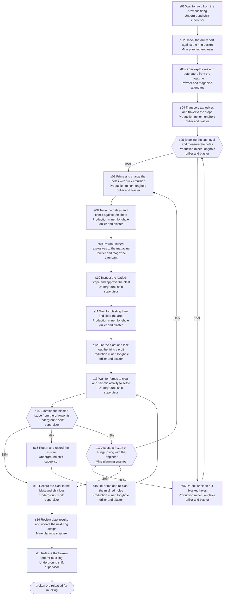

# Stope charging and blasting (one firing)

`mine-mine-stope-blasting` · gold mining · underground mine operations · part of `mining-operator-co`

Production miners charge and fire each group of longhole rings in a stope, retreating from the slot raise along three 15 m sub-levels. Before charging they wait for the drawpoints to make room, measure and clear the holes, collect stick emulsion and detonators from the magazine and carry them up the Alimak raise. The supervisor approves the loaded stope, the blast is fired at end of shift, and the next shift examines it for misfires and frozen rings. Blocked holes, misfires and waiting for void are what slow it down.

| | |
|---|---|
| Unit of work | one stope firing (slot raise or ring group) |
| Starts when | A drilled ring group is ready and the drawpoints have made enough void for it to be blasted. |
| Done when | The rings are fired, examined and the broken ore released to the mucking crews. |
| Organisation | A single-mine Canadian gold producer running a 500-600 tonne-per-day underground longhole mine with ramp and shaft access, a 1,000-1,200 tonne-per-day mill and about 280 rotational site staff in northern Ontario. (300 employees, 2019-2022) |
| Volume | 30 cases a month (range 20 to 40) |

## Where it sits

- Starts with **drilled_stope** from mine-stope-drilling (100% of cases)
- Relies on **explosives_issue** from mine-explosives (a standing input; it does not start a case)
- Relies on **stope_release** from ts-stope-design (a standing input; it does not start a case)
- Sends **broken_ore** to mine-mucking-haulage (outcome: broken ore released for mucking)
- Sends **shift_report** to ts-reconciliation (outcome: broken ore released for mucking)

## Flow

## Roles

| Role | Department | Layer | FTE on this process | Loaded cost per hour | Evidence |
|---|---|---|---:|---:|---|
| Production miner (longhole driller and blaster) | Underground production and development | individual contributor | 6 | 56 CAD | B [er2022] |
| Underground shift supervisor | Underground production and development | supervisor | 0.6 | 82 CAD | C |
| Powder and magazine attendant | Underground production and development | individual contributor | 0.3 | 46 CAD | C |
| Mine planning engineer | Mine engineering and survey | senior specialist | 0.3 | 74 CAD | C |

## Steps

Hands-on time and the wait before each step show the most common value. Evidence tier A is a sourced number, B a sourced description, C the author's estimate.

| Step | Who | Kind | Hands-on | Wait before | Control | Evidence |
|---|---|---|---:|---:|---|---|
| **s01 Wait for void from the previous firing.** Before the next ring group can be charged, LHD operators must pull enough broken ore from the drawpoints to give the new blast room to swell. The supervisor checks the drawpoint tonnage against the engineer's void requirement and puts the charge-up on the line-up when it is met. | Underground shift supervisor | coordination | 15 min | 1.0 d |  | B [er2022] |
| **s02 Check the drill report against the ring design.** The mine engineer compares the driller's report of hole lengths, dips and any lost holes with the ring design in the mine planning software, marks holes that need re-drilling and issues the charging sheet showing explosive per hole, primer positions and delay numbers. | Mine planning engineer | review | 40 min | 2.0 h | Site blasting standard: each firing is charged to an engineered ring design and charging sheet | B [er2022] |
| **s03 Order explosives and detonators from the magazine.** The powder attendant makes up the stick emulsion cases, primers and non-electric detonators listed on the charging sheet, signs them out of the underground magazines against the crew's name and records the quantities in the magazine log. | Powder and magazine attendant | data entry | 25 min | 30 min | Ontario Regulation 854 s. 127(1) (underground magazine under the control and direction of a competent person) and the federal magazine licence | B [er2022], [reg854] |
| **s04 Transport explosives and travel to the stope.** Two production miners load the explosives and detonators in separate boxes on the explosives vehicle, drive down the ramp to the stope's top access and, for captive sub-levels, carry them up the Alimak raise to the drilling sub-level. Touch time is the crew's elapsed travel time. | Production miner (longhole driller and blaster) | travel | 50 min | 15 min |  | B [er2022] |
| **s05 Examine the sub-level and measure the holes.** The crew scales and checks the ground and screen on the sub-level, then blows out each hole with compressed air and measures its depth with a tape or loading hose. They compare the depths with the charging sheet and mark blocked, short or broken-through holes. | Production miner (longhole driller and blaster) | validation | 1.2 h | 0 min | Ontario Regulation 854 s. 66(1) (ground conditions examined before work begins) and s. 67.1 (no other work during scaling) | B [reg854], [er2016] |
| **s06 Re-drill or clean out blocked holes.** A production miner brings the small longhole drill back to the sub-level and re-drills or cleans out the blocked holes, or the engineer approves charging around them. Re-drilling can push the charge-up to the next shift. | Production miner (longhole driller and blaster) | physical | 2.5 h | 6.0 h |  | C |
| **s07 Prime and charge the holes with stick emulsion.** The miners make up primers with non-electric detonators, push them to the toe of each hole and load stick emulsion with the pneumatic loader to the collar height on the charging sheet, leaving the stemming length. They keep a running count of cases used per hole. | Production miner (longhole driller and blaster) | physical | 5.0 h | 0 min | Site explosives handling procedure and Ontario Regulation 854 s. 144 (no vehicle over loaded holes unless a supervisor-adopted procedure allows it) | B [er2022], [reg854] |
| **s08 Tie in the delays and check against the sheet.** The crew connects the detonator leads to the trunk line in the delay sequence on the charging sheet, counts every connection and walks the round a second time to check for missed holes. The firing line is run back to the blasting station. | Production miner (longhole driller and blaster) | validation | 35 min | 0 min | Ontario Regulation 854 s. 141.1(1): only the worker who makes the final connections may fire the blast | A [reg854] |
| **s09 Return unused explosives to the magazine.** Left-over stick emulsion and detonators are carried back and returned to the magazines, and the powder attendant records the returns so that the issued amount minus the return equals the explosive used in this firing. | Powder and magazine attendant | data entry | 15 min | 30 min | Ontario Regulation 854 s. 128(5): explosives not attended must be returned to storage, not left at the workplace | A [reg854] |
| **s10 Inspect the loaded stope and approve the blast.** The shift supervisor walks the loaded sub-level, checks the tie-in and the charging sheet, confirms that drawpoints below are empty of people and equipment and that the brow barricades are up, and puts the stope on the end-of-shift blast list. | Underground shift supervisor | approval | 25 min | 30 min | Site blasting procedure: supervisor inspection before a stope blast is placed on the blast list | C |
| **s11 Wait for blasting time and clear the area.** Stope blasts are fired at the end of shift when the mine is cleared. Before firing, a worker is posted at every entrance to the blast area, the blaster shouts or sounds the warning and confirms that everyone has left. | Production miner (longhole driller and blaster) | physical | 25 min | 3.0 h | Ontario Regulation 854 s. 141(1)(a) and (b): guard posted at each entrance, warning given and confirmation that all persons have left | A [reg854] |
| **s12 Fire the blast and lock out the firing circuit.** The blaster who made the final connections initiates the blast from the firing station, then disconnects and short-circuits the firing line and locks the blasting switch open. The blast time is written in the blast log. | Production miner (longhole driller and blaster) | physical | 10 min | 5 min | Ontario Regulation 854 s. 141.1(1) (firing by the worker who made the final connections) and s. 149(c) (firing cables removed, short-circuited and the switch locked open before anyone returns) | A [reg854] |
| **s13 Wait for fumes to clear and seismic activity to settle.** No one returns until ventilation has cleared the blast fumes and, in seismically active areas, until the post-blast hold has passed. The blast area stays barricaded through shift change. | Underground shift supervisor | external wait | 0 min | 3.0 h | Ontario Regulation 854 s. 147 (minimum waiting periods before return) and the site post-blast re-entry procedure | B [reg854], [macassa] |
| **s14 Examine the blasted stope from the drawpoints.** The next shift's supervisor examines the drawpoints and the sub-level from outside the brow, looking for misfired holes, cut-offs, hang-ups and damage to ground support, and tests for gas before mucking is allowed. | Underground shift supervisor | validation | 25 min | 15 min | Ontario Regulation 854 s. 63(1): supervisor examines places where drilling and blasting occur during each shift | A [reg854] |
| **s15 Report and record the misfire.** The supervisor reports the misfire to the mine captain, barricades the area and writes it in the shift log. The misfired charge is not pulled out; it is re-primed and fired at the next safe blasting time. | Underground shift supervisor | communication | 20 min | 0 min | Ontario Regulation 854 s. 137(1), (3) and (4): misfired charge not withdrawn, blasted without undue delay, reported and recorded in the shift log | A [reg854] |
| **s16 Re-prime and re-blast the misfired holes.** A production miner washes out or exposes the misfired hole collars, places new primers as the blasting procedure allows, ties in and the area is fired again at the next blasting time. | Production miner (longhole driller and blaster) | physical | 2.0 h | 6.0 h | Ontario Regulation 854 s. 137(1): misfire blasted without undue delay at a time when no worker is exposed | A [reg854] |
| **s17 Assess a frozen or hung-up ring with the engineer.** When part of a ring did not break or the broken ore has bridged, the supervisor and the mine engineer look at the drawpoint and the sub-level, decide whether to re-drill, re-charge with extra relief or wait for more void, and record the decision. | Mine planning engineer | judgment | 1.0 h | 4.0 h |  | C |
| **s18 Record the blast in the blast and shift logs.** The supervisor records the stope, rings fired, explosive used, delays and any problems in the blast log and shift report, and enters the estimated broken tonnes in the production spreadsheet. | Underground shift supervisor | data entry | 15 min | 0 min |  | C |
| **s19 Review blast results and update the next ring design.** The mine engineer reviews the post-blast report, powder factor and drawpoint observations, and changes the charging for the next ring group where the last one broke badly or showed overbreak. The review is usually done the same day and does not hold up mucking. | Mine planning engineer | analysis | 20 min | 30 min |  | B [er2022] |
| **s20 Release the broken ore for mucking.** The supervisor marks the drawpoints open on the line-up board, removes the blast barricades and tells the mucking crew how much ore to pull: only enough for the next void while blasting continues, or all of it after the last firing. | Underground shift supervisor | communication | 10 min | 0 min |  | B [er2022] |

## Exceptions

| Exception | Share of cases | What happens |
|---|---:|---|
| Blocked or short holes | 15% | Holes are blocked by squeezing or broken ground and must be re-drilled before charging. |
| Misfire | 4% | One or more holes did not fire; the charge is re-primed and fired at the next blasting time and recorded in the shift log. |
| Frozen or hung-up ring | 8% | Part of the ring did not break or the muck bridged; the engineer decides whether to re-drill, re-charge or accept. |

## Benchmarks

| Metric | Value | Unit | Population | Evidence |
|---|---|---|---|---|
| cycle_time_days | p50 2.5, p90 5.5 | calendar days from the drilled ring group being ready to its broken ore being released for mucking | Longhole stope firings at a narrow-vein Ontario gold mine | C |
| hole_length | low 13, high 18 | metres per production down-hole, 64 mm diameter | Eagle River longhole stopes, 2021 | B [er2022] |
| wall_overbreak | 1.0 | metres average between hangingwall and footwall measured by CMS | Eagle River stopes | B [er2022] |

## Pain points

- Charging waits for the drawpoints to make enough void, so blasting and mucking of the same stope hold each other up. (steps s01, s20; B [er2022])
- Captive sub-levels are reached only through Alimak raises, so carrying explosives in and out takes time and exposes the crew. (steps s04; B [er2022])
- Blocked holes, frozen rings and misfires send work back to drilling or a second blast and cost a shift or more. (steps s05, s06, s15, s16, s17; C)
- Stick emulsion loaded by hand with pneumatic loaders is slower than bulk emulsion, and the technical report recommends a change. (steps s07; B [er2022])

## Assumptions

- A case is one firing (a slot raise or a group of rings), not a whole stope; a stope takes about 4-7 firings.
- Crew steps (s04, s05, s07, s08, s11, s16) use people = 2 for the two-person charge crew, so labour hours are twice the touch time.
- Firing is non-electric and done at end of shift from a firing station near the stope; central blasting from surface is not described in the sources for 2019-2022 and is not assumed.
- The organisation's process map lists only prod-miner and ug-shift-supervisor; the workflow adds explosives-handler (magazine sign-out and returns) and mine-engineer (charging sheet and blast review), both from the organisation file.
- Misfire, frozen-ring and re-drill shares are the author's estimates; no published rates for this mine were found.

## Sources

- [er2022] [Technical Report for the Eagle River Gold Mining Complex, Ontario, Canada (SRK project CAPR001445, effective 31 December 2021)](https://s203.q4cdn.com/643390454/files/doc_downloads/2022/11/ERtechnicalReport.pdf) (SRK Consulting (Canada) Inc. for Wesdome Gold Mines Ltd., 2022). Longitudinal retreat sub-level stoping from a slot raise on three 15 m sub-levels, 13-18 m 64 mm down-holes on a 3-2-3 pattern, stick emulsion loaded with pneumatic loaders, partial pulls between blasts, Alimak access to captive sub-levels, weekly explosives delivery to underground magazines, CMS wall overbreak of 1.0 m, improvement opportunity to move to bulk emulsion, and the injury and productivity cost of Alimak access.
- [er2016] [Technical Report for the Eagle River Mining Complex including the Eagle River Gold Mine, the Mishi Gold Mine and related infrastructure (Mannard and Ng)](https://minedocs.com/12/EagleRiver_TechnicalReport_03172016.pdf) (Wesdome Gold Mines Ltd., 2016). Woven screen in longhole sill backs to catch small loose during the loading cycle.
- [reg854] [R.R.O. 1990, Reg. 854: Mines and Mining Plants, Occupational Health and Safety Act (e-Laws consolidation in force 1 July 2021, archived copy captured 17 January 2022)](https://bac-lac.wayback.archive-it.org/web/2021/https://www.ontario.ca/laws/regulation/900854) (Government of Ontario (archived by the Library and Archives Canada web archive), 2021). Magazine control (s. 127(1)), return of unattended explosives (s. 128(5)), misfires (s. 137), vehicles over loaded holes (s. 144), guarding and warning before a blast (s. 141(1)), firing by the person who made the final connections (s. 141.1), firing circuit lock-out (s. 149(c)), waiting periods (s. 147), shift examination of blasting places (s. 63(1)), ground examination and scaling (ss. 66(1), 67.1).
- [macassa] [Macassa Mine NI 43-101 Technical Report (April 2019), exhibit 99.20](https://www.sec.gov/Archives/edgar/data/1713443/000162828019003767/a2019macassani4310101apr.htm) (Kirkland Lake Gold Ltd. (filed with the US SEC), 2019). Post-blast seismicity reports every 12 hours at a comparable Ontario mine.

Written by claude-opus on 2026-11-24.
