# Longhole stope drilling

`mine-mine-stope-drilling` · gold mining · underground mine operations · part of `mining-operator-co`

Most ore at the mine comes from longhole stopes: blocks of vein between two drill drifts that are drilled with rings of long holes and then blasted into an opening called a slot. Once technical services releases a stope, the drill drifts are checked and marked up, a production miner sets up a longhole drill, drills the slot and then several hundred metres of ring holes over many shifts, and records every hole. A surveyor and an engineer check the holes against the design and bad holes are redrilled. Stopes are delayed by drill drifts that are not ready, waits for one of three drills, breakdowns, idle time at shift changes and redrills.

| | |
|---|---|
| Unit of work | one stope drilled off |
| Starts when | Technical services releases a stope design and drill layout, and the stope is assigned at a shift line-up. |
| Done when | All rings and the slot are drilled and checked against design, holes are plugged and tagged, and the supervisor has signed the stope off for blasting. |
| Organisation | A single-mine Canadian gold producer running a 500-650 tpd narrow-vein underground mine in northern Ontario on 12-hour shifts and 14-on/14-off rotations, with its own mill. (300 employees, 2019-2022) |
| Volume | 6 cases a month (range 4 to 9) |

## Where it sits

- Starts with **stope_release** from ts-stope-design (80% of cases)
- Starts with **shift_lineup** from mine-shift-control (20% of cases)
- Relies on **survey_data** from ts-survey (a standing input; it does not start a case)
- Relies on **installed_services** from mine-ug-services (a standing input; it does not start a case)
- Sends **drilled_stope** to mine-stope-blasting (outcome: stope_drilled)
- Sends **survey_data** to ts-stope-design (outcome: stope_drilled)
- Sends **stope_design** to ts-stope-design (outcome: returned_to_design)
- Sends **work_request** to mnt-breakdown-repair (outcome: any)

## Flow

```mermaid
flowchart TD
    s01["s01 Receive the stope release and drill layout<br/>Underground shift supervisor"]
    s02{{"s02 Inspect the drill drifts<br/>Underground shift supervisor"}}
    s03["s03 Fix the drill drift<br/>Underground services and construction miner"]
    s04["s04 Mark up ring lines and hole collars<br/>Mine surveyor"]
    s05["s05 Assign a driller and drill to the stope<br/>Underground shift supervisor"]
    s06["s06 Do the pre-operational inspection of the drill<br/>Production miner  longhole driller and blaster"]
    s07["s07 Tram the drill to the stope<br/>Production miner  longhole driller and blaster"]
    s08["s08 Examine and scale the drill site<br/>Production miner  longhole driller and blaster"]
    s09["s09 Set up on the first ring<br/>Production miner  longhole driller and blaster"]
    s10{{"s10 Drill the slot raise<br/>Production miner  longhole driller and blaster"}}
    s11["s11 Wait for the drill to be repaired<br/>Underground shift supervisor"]
    s12["s12 Drill the production rings<br/>Production miner  longhole driller and blaster"]
    s13["s13 Hand over the drill at each shift change<br/>Production miner  longhole driller and blaster"]
    s14["s14 Record hole depths and problems in the drill log<br/>Production miner  longhole driller and blaster"]
    s15["s15 Supervisor examines the drill site each shift<br/>Underground shift supervisor"]
    s16["s16 Survey the as-drilled holes<br/>Mine surveyor"]
    s17{{"s17 Engineer compares as-drilled holes with the design<br/>Mine planning engineer"}}
    s18["s18 Redrill blocked or deviated holes<br/>Production miner  longhole driller and blaster"]
    s19["s19 Plug and tag the holes and tram the drill out<br/>Production miner  longhole driller and blaster"]
    s20["s20 Sign off the stope as drilled<br/>Underground shift supervisor"]
    s01 --> s02
    s02 -->|"72%"| s04
    s02 -->|"28%"| s03
    s03 --> s04
    s04 --> s05
    s05 --> s06
    s06 --> s07
    s07 --> s08
    s08 --> s09
    s09 --> s10
    s10 -->|"80%"| s12
    s10 -->|"20%"| s11
    s11 --> s12
    s12 --> s13
    s13 --> s14
    s14 --> s15
    s15 --> s16
    s16 --> s17
    s17 -->|"80%"| s19
    s17 -->|"17%"| s18
    s17 -->|"3%"| end0
    s18 --> s19
    s19 --> s20
    s20 --> end1
    end0(["returned_to_design"])
    end1(["stope_drilled"])
```

## Roles

| Role | Department | Layer | FTE on this process | Loaded cost per hour | Evidence |
|---|---|---|---:|---:|---|
| Production miner (longhole driller and blaster) | Underground production and development | individual contributor | 5 | 56 CAD | B [jobbank-miner] |
| Underground shift supervisor | Underground production and development | supervisor | 0.4 | 82 CAD | B [mltsd-exam] |
| Mine surveyor | Mine engineering and survey | individual contributor | 0.3 | 50 CAD | C |
| Mine planning engineer | Mine engineering and survey | senior specialist | 0.1 | 74 CAD | C |
| Underground services and construction miner | Underground production and development | individual contributor | 0.3 | 47 CAD | C |

## Steps

Hands-on time and the wait before each step show the most common value. Evidence tier A is a sourced number, B a sourced description, C the author's estimate.

| Step | Who | Kind | Hands-on | Wait before | Control | Evidence |
|---|---|---|---:|---:|---|---|
| **s01 Receive the stope release and drill layout.** The production supervisor receives the stope release package from technical services: the stope outline, the ring and hole layout with lengths and angles, the slot design and any ground support notes, and files it for the line-up. | Underground shift supervisor | intake | 20 min | 1.0 d |  | B [wiki-stoping] |
| **s02 Inspect the drill drifts.** The supervisor walks the top and bottom drill drifts, checking the ground support, scaling, water, power and air services, drainage and muck left on the floor, and decides whether the drill can set up. | Underground shift supervisor | validation | 30 min | 4.0 h | Ontario Regulation 854, s. 66: ground examined for dangers before work begins | B [mltsd-ground] |
| **s03 Fix the drill drift.** A services crew rehabilitates loose ground, extends water, power and air lines, pumps out water or cleans muck so the drill can set up on every ring. | Underground services and construction miner | physical | 4.0 h | 1.0 d |  | C |
| **s04 Mark up ring lines and hole collars.** A surveyor sets out the ring lines on the walls and back of the drill drift and marks collar positions and the drill azimuth for each ring from the stope design. | Mine surveyor | physical | 2.0 h | 12.0 h |  | C |
| **s05 Assign a driller and drill to the stope.** At line-up the supervisor assigns a longhole driller and one of the three longhole drills to the stope once the drill finishes its current stope or comes back from the shop. | Underground shift supervisor | coordination | 10 min | 1.0 d |  | C |
| **s06 Do the pre-operational inspection of the drill.** The driller walks around the longhole drill with the inspection card, checking the feed, rod handler, hoses, brakes, lights and fire suppression, and records defects before use. | Production miner (longhole driller and blaster) | physical | 15 min | 10 min | Company pre-operational (circle check) inspection procedure for mobile equipment | C |
| **s07 Tram the drill to the stope.** The driller trams the drill from its last stope or the shop to the drill drift, giving way to haulage traffic and calling movements on the radio. | Production miner (longhole driller and blaster) | travel | 30 min | 5 min |  | C |
| **s08 Examine and scale the drill site.** The driller examines the back and walls at the drill site, scales loose rock and fills in the workplace inspection card before setting up. | Production miner (longhole driller and blaster) | validation | 20 min | 0 min | Ontario Regulation 854, ss. 66 and 67.1: ground examination and scaling before work | B [mltsd-ground], [jobbank-miner] |
| **s09 Set up on the first ring.** The driller positions and jacks the drill on the first ring line, connects water, power and air, and aligns the feed to the marked azimuth and dip with the angle indicator. | Production miner (longhole driller and blaster) | physical | 45 min | 0 min |  | C |
| **s10 Drill the slot raise.** The driller drills the slot: a tight group of blastholes around larger uncharged reamer holes, or an inverse raise, that will open the first void the stope blasts into. | Production miner (longhole driller and blaster) | physical | 7.0 h | 0 min |  | B [wiki-stoping], [macassa] |
| **s11 Wait for the drill to be repaired.** The supervisor raises a work request and the drill waits for a mechanic to come underground or is trammed to the shop; the driller is moved to other work until it returns. | Underground shift supervisor | coordination | 20 min | 12.0 h |  | C |
| **s12 Drill the production rings.** Over several shifts the driller drills each ring of 64-76 mm holes, typically 10-20 m long, to the lengths and angles on the layout, moving the drill from ring to ring, for a total of roughly 700-1,200 m in a 2,000-3,500 t stope. | Production miner (longhole driller and blaster) | physical | 1.7 d | 1.0 h |  | B [wiki-stoping] |
| **s13 Hand over the drill at each shift change.** At every shift change the outgoing driller leaves notes on rings and holes completed and problems, and the incoming driller reads the drill log, re-examines the site and restarts; the drill sits idle over the travel, line-up and blast clearance. | Production miner (longhole driller and blaster) | communication | 1.0 h | 20.0 h |  | B [cim-sic] |
| **s14 Record hole depths and problems in the drill log.** Each shift the driller writes in the drill log the ring and hole numbers, depths drilled, angles, broken ground, water and any hole lost, so the engineer and blaster know which holes are good. | Production miner (longhole driller and blaster) | data entry | 40 min | 0 min |  | C |
| **s15 Supervisor examines the drill site each shift.** On each shift the supervisor visits the drill, examines the workplace, checks progress against the layout and signs the drill log and workplace card. | Underground shift supervisor | review | 1.0 h | 0 min | Ontario Regulation 854, s. 63(1): supervisor examines every drilling and blasting place each shift | B [mltsd-exam] |
| **s16 Survey the as-drilled holes.** A surveyor picks up the drilled collars and measures hole depths, and with the drill log produces an as-drilled record for the engineer. | Mine surveyor | physical | 1.5 h | 12.0 h |  | C |
| **s17 Engineer compares as-drilled holes with the design.** The mine engineer overlays the as-drilled holes on the stope design in the planning software, flags holes that are short, blocked or off line, and decides whether to redrill, adjust the loading or redesign part of the stope. | Mine planning engineer | review | 1.0 h | 1.0 d |  | C |
| **s18 Redrill blocked or deviated holes.** A driller brings a drill back to redrill or add holes from the redrill list, records them in the drill log and reports completion. | Production miner (longhole driller and blaster) | physical | 5.0 h | 1.0 d |  | C |
| **s19 Plug and tag the holes and tram the drill out.** The driller plugs the hole collars to keep out debris and water, tags the rings with their numbers, cleans up the drill site and trams the drill to its next stope. | Production miner (longhole driller and blaster) | physical | 40 min | 30 min |  | C |
| **s20 Sign off the stope as drilled.** The supervisor signs the stope off as drilled, sends the final drill log to technical services and tells the blasting crew and engineer that the stope is ready for the loading plan. | Underground shift supervisor | approval | 15 min | 1.0 h |  | C |

## Exceptions

| Exception | Share of cases | What happens |
|---|---:|---|
| Drill drift not ready | 28% | Loose ground, missing services, water or muck must be dealt with before the drill can set up. |
| Drill breakdown mid-stope | 20% | The drill waits for repair and the driller moves to other work. |
| Redrills | 17% | Blocked, short or deviated holes are redrilled after the engineer's review. |
| Stope returned for redesign | 3% | Squeezed ground or many bad holes mean technical services must change the design. |

## Benchmarks

| Metric | Value | Unit | Population | Evidence |
|---|---|---|---|---|
| cycle_time_days | p50 11, p90 20 | calendar days from stope release to stope signed off as drilled | Narrow-vein longhole stoping at a 500-650 tpd Ontario mine with three longhole drills | C |
| drilled_metres_per_stope | 950 | metres | 2,000-3,500 t narrow-vein stope | C |

## Pain points

- Released stopes wait for one of three longhole drills to finish its current stope or come back from the shop. (steps s05, s11; C)
- The drill stands idle for several hours at every shift change while crews travel, line up and clear for the blast. (steps s13; B [cim-sic])
- Bad holes are found only after the as-drilled survey and engineer's review, and redrills need the drill brought back. (steps s16, s17, s18; C)
- Drill logs are handwritten and re-keyed by survey and engineering. (steps s14, s16; C)

## Assumptions

- Stope size of 2,000-3,500 t comes from the organisation file; drilled metres per stope (about 700-1,200 m plus the slot) and drilling rate are the author's estimates.
- touch_min of the ring-drilling step adds up the driller's hands-on time across all shifts on the stope; the shift-change step carries the idle time between shifts as a wait.
- Steps s13-s15 run during the drilling shifts and are listed after it with concurrent_with set; their minutes are totals across the stope.
- Longhole drill hours per stope (about 70 h including repair waits) times 6 stopes is about 420 drill-hours a month, about 40% of the 1,080 available on three drills; the drills also drill cable bolt holes and slots for other work, which is not modelled here.
- The organisation file lists prod-miner and ug-shift-supervisor; this file adds surveyor, mine-engineer and ug-services-worker, the inputs survey_data from ts-survey and installed_services from mine-ug-services, and the as-drilled output back to ts-stope-design.
- The simulated p90 (about 13 days) is narrower than the benchmark p90 of 20 days because the simulation draws each wait independently, so long waits rarely coincide; in practice a stope that waits for a drill often also waits for drift repairs and survey, which this model does not correlate.
- Loaded costs from the organisation file.

## Sources

- [mltsd-exam] [Workplace examinations by supervisors (guideline on section 63 of Regulation 854)](https://bac-lac.wayback.archive-it.org/web/2022/https://www.ontario.ca/page/workplace-examinations-supervisors) (Ontario Ministry of Labour, Immigration, Training and Skills Development (archived copy in the Library and Archives Canada web archive), 2024). Regulation 854 s. 63(1): a supervisor examines every place where drilling and blasting is being carried out at least once each work shift; s. 63(3): every other place where workers work, in person, at least once each work week; the examination is to identify potential or actual hazards and assess general conditions. The guideline page is dated February 2024; the archive returned a June 2024 capture.
- [mltsd-ground] [Ground control in underground mines](https://bac-lac.wayback.archive-it.org/web/2022/https://www.ontario.ca/page/ground-control-underground-mines) (Ontario Ministry of Labour, Immigration, Training and Skills Development (archived copy in the Library and Archives Canada web archive), 2023). Regulation 854 s. 6: mine design assessing ground stability prepared under the direction of a professional engineer; s. 6.1: workers kept out of unsupported excavations unless an engineer's written report allows it; s. 66: ground conditions examined for hazards before work begins; s. 67: written procedures for installing ground support; s. 67.1: no other work that hinders scaling; s. 72: records of falls of ground and rockbursts; s. 73: torque and pull tests of rock bolts. Page dated December 2023.
- [macassa] [Macassa Mine NI 43-101 Technical Report (April 2019), exhibit 99.20](https://www.sec.gov/Archives/edgar/data/1713443/000162828019003767/a2019macassani4310101apr.htm) (Kirkland Lake Gold Ltd. (filed on SEC EDGAR), 2019). Comparable Ontario underground gold mine: one hole/one bolt policy with no pre-drilling; bolts on a 1.2 m by 1.2 m dice-five pattern; standard support carried to the working face and screen above 3 m; five ground support classes; longhole stopes for ore dipping about 45 degrees or steeper, drilled from a drilling horizon, with blasts started from a drop or inverse raise; mobile fleet of LHDs, jumbos, bolters and trucks (Table 15-6).
- [jobbank-miner] [Job description: Underground production and development miners (NOC 83100), near Thunder Bay (ON)](https://www.jobbank.gc.ca/marketreport/occupation/8707/22422) (Government of Canada, Job Bank, 2026). Miners set up and operate drills to produce a designated pattern of blast holes, load explosives and detonate them, scale loose rock from walls and roof, drill and install rock bolts, extend air and water pipes, operate LHDs and do routine maintenance; usually more than 40 hours a week.
- [cim-sic] [A short solution for the long haul: transitioning from information overload to efficient operation with short interval control](https://magazine.cim.org/en/technology/a-short-solution-for-the-long-haul) (CIM Magazine (Canadian Institute of Mining, Metallurgy and Petroleum), Peter Braul, 2017). Short interval control can be as simple as a radio call every hour or two; in many mines it can take 12 hours for information to reach surface; equipment at a conventional underground mine moves about six hours of a 12-hour shift (against 10 or more at Lac des Iles, Ontario); a Canadian mine found tasks running 100% longer than planned because a jumbo blocked access; a 25-30% productivity gain is thought available at most mines.
- [wiki-stoping] [Stoping](https://en.wikipedia.org/wiki/Stoping) (Wikipedia, 2026). Longhole stoping uses holes drilled by a production drill to a pattern designed by a mining engineer, generally in a radial pattern around the drive; top-hammer rigs are limited to about 30 m hole length; every stope needs a slot (often a longhole raise of tightly spaced blastholes and uncharged reamer holes) to give the initial void; the stope cannot be entered once blasting starts.

Written by claude-opus on 2026-11-24.
