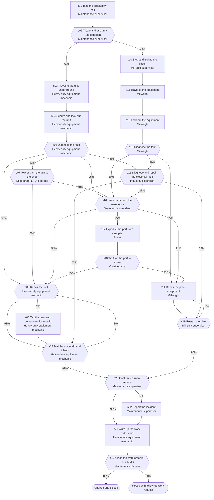

# Breakdown repair

`mine-mnt-breakdown-repair` · metal mining (gold) · maintenance · part of `mining-operator-co`

When a loader, truck or drill breaks down underground, or a crusher, conveyor or pump stops at the mill, the operator radios the maintenance supervisor, who sends a mechanic, millwright or electrician. The tradesperson travels to the equipment, locks it out, finds the fault and repairs it in place, tows it to the shop or waits for parts, then tests it and hands it back. Downtime is set less by the repair itself than by waiting for a free tradesperson, re-entry after blasting, travel down the ramp and parts that must come by road from the nearest towns; the paper work order card is typed into the CMMS a day or more later and failure causes are often lost.

| | |
|---|---|
| Unit of work | one breakdown work order |
| Starts when | An operator or the mill control room reports by radio that a unit or piece of plant has stopped working. |
| Done when | The equipment is back in service and the breakdown work order is closed in the CMMS, with a follow-up work request if the fix was temporary. |
| Organisation | A single-mine Canadian gold producer with one ramp-and-shaft underground mine, a 1,000 t/d class mill, about 300 employees on 14-on/14-off rotations living in camp, and a CMMS (ERP maintenance module) fed from paper work order cards. (300 employees, 2019-2022) |
| Volume | 150 cases a month (range 110 to 200) |

## Where it sits

- Starts with **work_request** from mine-shift-control (72% of cases)
- Starts with **work_request** from mill-crushing (12% of cases)
- Starts with **work_request** from mill-grind-leach (16% of cases)
- Sends **repaired_equipment** to mine-shift-control (outcome: any)
- Sends **repaired_equipment** to mill-grind-leach (outcome: any)
- Sends **stores_request** to site-warehouse (outcome: any)
- Sends **purchase_requisition** to site-purchasing (outcome: any)
- Sends **component_for_rebuild** to mnt-component-rebuild (outcome: any)
- Sends **completed_work_order** to mnt-work-planning (outcome: any)
- Sends **work_request** to mnt-work-planning (outcome: closed with follow-up work request)
- Sends **incident_report** to hse-incident-mgmt (outcome: any)

## Flow

## Roles

| Role | Department | Layer | FTE on this process | Loaded cost per hour | Evidence |
|---|---|---|---:|---:|---|
| Maintenance supervisor | Maintenance | supervisor | 0.8 | 76 CAD | C |
| Heavy-duty equipment mechanic | Mobile equipment maintenance | individual contributor | 7 | 53 CAD | B [er2022] |
| Scooptram (LHD) operator | Underground production and development | individual contributor | 0.15 | 51 CAD | C |
| Mill shift supervisor | Mill operations | supervisor | 0.3 | 72 CAD | C |
| Millwright | Fixed plant and electrical | individual contributor | 2 | 53 CAD | C |
| Industrial electrician | Fixed plant and electrical | individual contributor | 1.5 | 55 CAD | B [er2022] |
| Warehouse attendant | Supply chain and warehouse | individual contributor | 0.3 | 37 CAD | C |
| Buyer | Supply chain and warehouse | individual contributor | 0.15 | 45 CAD | C |
| Maintenance planner | Maintenance planning | senior specialist | 0.3 | 60 CAD | C |

## Steps

Hands-on time and the wait before each step show the most common value. Evidence tier A is a sourced number, B a sourced description, C the author's estimate.

| Step | Who | Kind | Hands-on | Wait before | Control | Evidence |
|---|---|---|---:|---:|---|---|
| **s01 Take the breakdown call.** The operator of the failed loader, truck, drill or mill equipment calls on the leaky feeder or surface radio. The maintenance supervisor on shift takes the call and writes the unit, location, symptom and time on the shift board. | Maintenance supervisor | intake | 5 min | 5 min |  | C |
| **s02 Triage and assign a tradesperson.** The supervisor decides how urgent the breakdown is (blocking a ramp, stopping the hoist or mill feed, or one of several spare units down) and which trade to send, pulling a mechanic or millwright off planned work if needed. | Maintenance supervisor | judgment | 10 min | 5 min |  | B [er2022] |
| **s03 Travel to the unit underground.** The mechanic finishes or makes safe the job in hand, loads the service truck with tools and common parts and drives down the ramp to the unit, which may be several levels away. | Heavy-duty equipment mechanic | travel | 30 min | 1.0 h |  | B [er2022], [ballantyne2019] |
| **s04 Secure and lock out the unit.** The mechanic checks the ground and ventilation around the unit, waits for re-entry if the area was just blasted, chocks the wheels, lowers or blocks raised parts and locks and tags the isolation switch before touching the machine. | Heavy-duty equipment mechanic | validation | 15 min | 0 min | Ontario Regulation 854 s. 107(2), s. 108(2) and s. 185(7)-(8) | A [reg854] |
| **s05 Diagnose the fault.** The mechanic reads the fault codes on the display, checks pressures, leaks and wiring and talks to the operator about what happened, then decides whether to repair in place, tow the unit to the shop, fetch parts or call an electrician. | Heavy-duty equipment mechanic | analysis | 40 min | 0 min |  | C |
| **s06 Repair the unit.** The mechanic replaces the failed hose, sensor, pump, cylinder seal or other part, tops up fluids and cleans up the spill. Heavier jobs such as a transmission or axle change are done in the shop with a second mechanic. | Heavy-duty equipment mechanic | physical | 2.0 h | 0 min |  | B [ballantyne2019] |
| **s07 Tow or tram the unit to the shop.** An operator brings a second loader or the unit itself, if it can move, and tows it up the ramp to the underground shop while the mechanic follows. The ramp is controlled while a disabled unit is moved. | Scooptram (LHD) operator | travel | 1.0 h | 1.0 h |  | B [reg854] |
| **s08 Tag the removed component for rebuild.** The mechanic drains and caps the removed engine, transmission or final drive, fills in the core tag with unit, hours and failure description and has it loaded for the rebuild shop or OEM exchange. | Heavy-duty equipment mechanic | data entry | 40 min | 1.0 h |  | C |
| **s09 Test the unit and hand it back.** The mechanic removes the locks, starts the unit, checks for leaks and codes, tests the service, emergency and parking brakes, and hands the unit back to the operator by radio. | Heavy-duty equipment mechanic | validation | 20 min | 0 min | Ontario Regulation 854 s. 105(b) and s. 119.1 (brakes able to stop and hold, each system testable); s. 185(7) on removing locks | A [reg854] |
| **s10 Stop and isolate the circuit.** The mill shift supervisor has the control room stop the crusher, conveyor or pump line, switch to a standby pump where one exists, and decide whether feed can continue from the fine ore bin while the repair is done. | Mill shift supervisor | coordination | 15 min | 5 min |  | C |
| **s11 Travel to the equipment.** The millwright on shift collects tools and walks or drives to the crusher building, mill floor or pump house. If the millwright is busy on planned work, the job waits until it can be made safe. | Millwright | travel | 15 min | 30 min |  | B [er2022] |
| **s12 Lock out the equipment.** The millwright and the operator apply locks and tags to the motor isolators and valves on the group lockout board, release stored energy in belts, hydraulics and accumulators and test that the equipment cannot start. | Millwright | validation | 20 min | 0 min | Ontario Regulation 854 s. 185(7)-(9) (stop, dissipate stored energy, lock, tag and verify) and s. 158 (locking and tagging programme for electrical work) | A [reg854] |
| **s13 Diagnose the fault.** The millwright inspects the failed bearing, belt, chute, pump or gearbox, checks the DCS trend with the control room and decides whether it can be fixed with shop stock, needs parts from the warehouse or is an electrical fault. | Millwright | analysis | 45 min | 0 min |  | C |
| **s14 Repair the plant equipment.** The millwright, often with a welder or a second millwright, replaces the bearing, belt, impeller or liner, patches the chute or realigns the drive, and cleans the area for restart. | Millwright | physical | 2.5 h | 0 min |  | C |
| **s15 Diagnose and repair the electrical fault.** The electrician on shift travels to the unit or plant, locks out the electrical supply under the site locking programme, traces the fault in sensors, harnesses, starters or motors and repairs it. One electrician per shift covers both the mine and the mill. | Industrial electrician | physical | 1.5 h | 1.0 h | Ontario Regulation 854 s. 158 (written locking and tagging programme; isolation verified by testing) | B [er2022], [reg854] |
| **s16 Issue parts from the warehouse.** The tradesperson or supervisor asks the warehouse for the part. The attendant searches the ERP by part number or description, picks it and issues it to the work order; at night the supervisor uses the after-hours key and leaves a note. | Warehouse attendant | lookup | 15 min | 30 min |  | B [ballantyne2019] |
| **s17 Expedite the part from a supplier.** The buyer phones dealers and OEMs for the part, chooses the fastest source, raises an emergency purchase order and arranges courier or hot-shot delivery to site. | Buyer | communication | 30 min | 12.0 h |  | C |
| **s18 Wait for the part to arrive.** The supplier ships the part by courier or hot-shot truck from Sudbury, Thunder Bay, Timmins or further, over the highway and the mine access road; the unit or plant stays down or runs on a standby. | Outside party | external wait | 0 min | 2.0 d |  | C |
| **s19 Restart the plant.** The mill shift supervisor checks the area is clear, the millwright removes the locks, and the control room restarts the circuit, watching amps, vibration and levels until the equipment runs normally. | Mill shift supervisor | validation | 30 min | 0 min | Ontario Regulation 854 s. 185(7)-(9) (locks removed only by those who applied them after the machine is clear) | B [reg854] |
| **s20 Confirm return to service.** The maintenance supervisor confirms with the operator or control room that the equipment is running, updates the shift board and decides whether the event needs an incident report, for example a fire, brake failure or damage. | Maintenance supervisor | review | 10 min | 30 min |  | C |
| **s21 Write up the work order card.** At the end of the shift the tradesperson writes the breakdown on a paper work order card: times, symptom, cause, parts used and whether the fix is permanent or temporary. | Heavy-duty equipment mechanic | data entry | 15 min | 5.0 h |  | C |
| **s22 Report the incident.** The supervisor enters an incident report in the HSE system with photos and a short description, notifies the safety coordinator and keeps the failed parts for the investigation. | Maintenance supervisor | drafting | 1.0 h | 2.0 h | Site incident reporting procedure (with notice to the Ministry of Labour where the Occupational Health and Safety Act requires it) | C |
| **s23 Close the work order in the CMMS.** The planner types the card into the CMMS as a breakdown work order, codes the failure mode and component, posts labour and parts and raises a follow-up work request when the fix was temporary. | Maintenance planner | data entry | 15 min | 1.0 d |  | C |

## Exceptions

| Exception | Share of cases | What happens |
|---|---:|---|
| Unit towed to the shop | 9% | The unit cannot be repaired where it stopped and is towed up the ramp. |
| Part not in stock | 8% | The part is expedited from a supplier and the equipment stays down for one to seven days. |
| Electrical fault | 13% | The electrician on shift, shared between mine and mill, is called in. |
| Major component replaced | 5% | A failed engine, transmission or final drive is swapped and sent for rebuild. |
| Incident report | 5% | A fire, brake failure or damage event is reported in the HSE system. |

## Benchmarks

| Metric | Value | Unit | Population | Evidence |
|---|---|---|---|---|
| equipment_downtime_per_breakdown_hours | low 2, mode 6, high 72 | hours from the radio call to return to service | Author's estimate | C |
| mill_availability_planned_percent | 93.3 | percent of calendar time | Eagle River mill | A [er2022] |
| cycle_time_days | p50 2.0, p90 4.0 | calendar days from the call to work order closure in the CMMS | Author's estimate | C |

## Pain points

- Equipment waits for a free mechanic or electrician, and for re-entry after blasting, before the repair starts. (steps s03, s04, s15; B [ballantyne2019])
- Parts not held on site must come by road, turning a two-hour repair into days of downtime. (steps s16, s17, s18; B [ballantyne2019])
- Paper cards with blank causes mean the CMMS failure history cannot guide PM or stocking decisions. (steps s21, s23; C)
- Breakdowns pull tradespeople off scheduled work, so the weekly schedule slips. (steps s02; B [umbrex])

## Assumptions

- touch_min records the lead tradesperson's minutes; about a third of jobs use a second person, which is included in the role FTE.
- The simulator does not remember which path a case took, so the parts and electrical steps send cases back to the mobile and plant repair steps in the 72:28 proportion of breakdowns.
- Equipment held is recorded against the LHD pool for mobile breakdowns (about half of the heavy fleet) and against the crusher for plant breakdowns; the occupied minutes include waiting for the tradesperson.
- Hoist breakdowns are rare and follow the fixed-plant path; the hoist is not listed separately.
- Repaired plant goes back to mill-crushing or mill-grind-leach; the organisation file lists repaired_equipment only to mine-shift-control, so a link to mill-grind-leach is added here.
- Loaded costs are the organisation file's.

## Sources

- [er2022] [Technical Report for the Eagle River Gold Mining Complex, Ontario, Canada (NI 43-101, effective date December 31, 2021)](https://s203.q4cdn.com/643390454/files/doc_downloads/2022/11/ERtechnicalReport.pdf) (SRK Consulting (Canada) Inc. for Wesdome Gold Mines Ltd., 2022). Owner underground fleet of 55 units (3 two-boom jumbos, 2 blockholers, 17 LHDs of 2 to 6 yd, 3 30-t trucks, 3 scissor lifts, 4 production drills, 23 light vehicles) plus 17 contractor units (Table 16-9); owner underground labour 111 including 12 mine maintenance and 8 mine electricians, plus 36 contractors (Table 16-10); underground mine scheduled 365 days a year on two 12-hour shifts; ramp access with 30-t trucks and a three-compartment shaft with a double-drum hoist, hoisting at most about 16 hours a day; ore trucked 16.6 km from the portal to the mill; mobile maintenance shop and an asset management and planning office (new in 2021) on site; mill planned at 93.3% availability but 86% in 2021 because of a planned August 2021 shutdown to replace the cone crusher and trash screen, inspect and reinstall the secondary ball mill gearbox with motor alignment and liner inspection, inspect the fine ore bin and repair the coarse ore bin; average throughput 779 t/d.
- [reg854] [R.R.O. 1990, Reg. 854: Mines and Mining Plants, under the Occupational Health and Safety Act (consolidated text)](https://www.ontario.ca/laws/regulation/900854) (Government of Ontario (e-Laws), 1990). s. 105 (vehicles in safe working condition with brakes that stop and hold under full load); s. 106(4) (operators test service and emergency brakes before using a main ramp); s. 107(2) (wheel chocks whenever a vehicle is maintained or repaired); s. 119.1 (service, emergency and parking brake systems each testable); s. 158 (written locking and tagging programme for electrical work); s. 185(7)-(9) (moving parts stopped, stored energy dissipated, energy isolating devices locked and tagged and verified by testing before work on a machine); s. 82 (hoisting suspended and protection provided when work is done in a shaft compartment); s. 228(2) (drum hoist rope tests at intervals of not more than six months); s. 229(4) (two test trips after rope attachments are reinstalled); s. 248 (daily, weekly, monthly, six-monthly and twelve-monthly examinations of hoisting plant by competent persons, recorded in the Hoisting Machinery Record Book). Read in its current consolidation; the cited duties were in force in 2019-2022.
- [ballantyne2019] [Challenging the Norms: Time Usage Model for Mobile Underground Mining Equipment (white paper)](https://www.ausimm.com/globalassets/bulletin/challenging-the-norms---time-usage-model-for-mobile-underground-mining-equipment.pdf) (RAK Developments (Ray Ballantyne), hosted by AusIMM, 2019). Underground mines on 2 x 12-hour shifts record equipment status for all calendar hours; typical maintenance statuses include the 250-hour service and breakdowns by subsystem (engine, transmission, hydraulics); opportunity maintenance when a unit is not required by operations; service overrun beyond the scheduled end; sites record waiting for fitter and waiting for parts within maintenance stoppages; jumbos accumulate diesel hours while travelling and electric hours while drilling.
- [umbrex] [Maintenance Compliance Rate](https://umbrex.com/resources/company-analysis/operations/maintenance-compliance-rate/) (Umbrex, n.d.). Weekly schedule compliance (completed scheduled work orders over scheduled work orders) of 80-90% in disciplined programmes; break-in work after the schedule freeze kept to 10-15% of weekly hours; freeze 70-80% of available hours with a joint operations-maintenance review; a site at 65% compliance can gain 15-20 points from a one-week freeze and a joint scheduling meeting; backlog ageing buckets 0-7, 8-14, 15-30 and 31+ days.

Written by claude-opus on 2026-11-24.
