# Mobile equipment preventive maintenance

`mine-mnt-mobile-pm` · metal mining (gold) · maintenance · part of `mining-operator-co`

Every 250 engine hours or so, each loader, truck, jumbo, bolter and drill in the underground fleet is taken out of production for a planned service: oils and filters are changed, the unit is greased and inspected, oil samples go to a laboratory and defects are fixed or put on the backlog. The planner turns hour-meter readings into work orders and kits the parts, the maintenance supervisor negotiates the release of the unit with the mine, and heavy-duty mechanics do the work in the underground bay or surface shop. The service is often delayed because production will not release the unit, a kit item is missing or the unit needs more repair than planned, and the paper work order card is typed into the CMMS days later.

| | |
|---|---|
| Unit of work | one PM work order |
| Starts when | The CMMS forecast shows a unit within about a week of its next service hours and the work order is placed on the weekly schedule. |
| Done when | The unit is back in production, the work order is closed in the CMMS and the oil analysis has been reviewed, with any follow-up work request raised. |
| Organisation | A single-mine Canadian gold producer with one ramp-and-shaft underground mine, a 1,000 t/d class mill, about 300 employees on 14-on/14-off rotations living in camp, and a CMMS (ERP maintenance module) fed from paper work order cards. (300 employees, 2019-2022) |
| Volume | 65 cases a month (range 50 to 85) |

## Where it sits

- Starts with **work_schedule** from mnt-work-planning (100% of cases)
- Sends **repaired_equipment** to mine-shift-control (outcome: any)
- Sends **stores_request** to site-warehouse (outcome: any)
- Sends **completed_work_order** to mnt-work-planning (outcome: any)
- Sends **work_request** to mnt-work-planning (outcome: closed with follow-up work request)
- Sends **component_for_rebuild** to mnt-component-rebuild (outcome: any)
- Sends **purchase_requisition** to site-purchasing (outcome: any)

## Flow

```mermaid
flowchart TD
    s01["s01 Key hour-meter readings into the CMMS<br/>Maintenance planner"]
    s02["s02 Generate the PM work order<br/>Automated"]
    s03["s03 Prepare the work order package<br/>Maintenance planner"]
    s04{{"s04 Check and reserve the PM kit<br/>Maintenance planner"}}
    s05["s05 Order the missing kit item<br/>Buyer"]
    s06["s06 Wait for the supplier delivery<br/>Outside party"]
    s07["s07 Pick and stage the PM kit<br/>Warehouse attendant"]
    s08{{"s08 Agree the release window with the mine<br/>Maintenance supervisor"}}
    s09["s09 Tram the unit to the shop<br/>Scooptram  LHD  operator"]
    s10["s10 Lock out, chock and assess hazards<br/>Heavy-duty equipment mechanic"]
    s11["s11 Change oils and filters and grease<br/>Heavy-duty equipment mechanic"]
    s12["s12 Take oil samples<br/>Heavy-duty equipment mechanic"]
    s13{{"s13 Inspect the unit against the checklist<br/>Heavy-duty equipment mechanic"}}
    s14["s14 Repair defects found<br/>Heavy-duty equipment mechanic"]
    s15{{"s15 Request parts and decide whether the unit can run<br/>Heavy-duty equipment mechanic"}}
    s16["s16 Change out a component for rebuild<br/>Heavy-duty equipment mechanic"]
    s17{{"s17 Test brakes and functions and remove locks<br/>Heavy-duty equipment mechanic"}}
    s18["s18 Sign off and release the unit<br/>Maintenance supervisor"]
    s19["s19 Tram the unit back to the work area<br/>Scooptram  LHD  operator"]
    s20["s20 Write up the work order card<br/>Heavy-duty equipment mechanic"]
    s21["s21 Close the work order in the CMMS<br/>Maintenance planner"]
    s22["s22 Wait for oil analysis results<br/>Outside party"]
    s23{{"s23 Review the oil analysis report<br/>Maintenance planner"}}
    s24["s24 Raise a follow-up work request<br/>Maintenance planner"]
    s01 --> s02
    s02 --> s03
    s03 --> s04
    s04 -->|"90%"| s07
    s04 -->|"10%"| s05
    s05 --> s06
    s06 --> s07
    s07 --> s08
    s08 -->|"80%"| s09
    s08 -->|"20%"| s08
    s09 --> s10
    s10 --> s11
    s11 --> s12
    s12 --> s13
    s13 -->|"50%"| s17
    s13 -->|"30%"| s14
    s13 -->|"14%"| s15
    s13 -->|"6%"| s16
    s14 --> s17
    s15 -->|"60%"| s14
    s15 -->|"40%"| s17
    s16 --> s17
    s17 -->|"95%"| s18
    s17 -->|"5%"| s14
    s18 --> s19
    s19 --> s20
    s20 --> s21
    s21 --> s22
    s22 --> s23
    s23 -->|"85%"| end0
    s23 -->|"15%"| s24
    s24 --> end1
    end0(["serviced and closed"])
    end1(["closed with follow-up work request"])
```

## Roles

| Role | Department | Layer | FTE on this process | Loaded cost per hour | Evidence |
|---|---|---|---:|---:|---|
| Heavy-duty equipment mechanic | Mobile equipment maintenance | individual contributor | 5.5 | 53 CAD | B [er2022] |
| Maintenance supervisor | Maintenance | supervisor | 0.3 | 76 CAD | C |
| Maintenance planner | Maintenance planning | senior specialist | 0.7 | 60 CAD | C |
| Warehouse attendant | Supply chain and warehouse | individual contributor | 0.2 | 37 CAD | C |
| Buyer | Supply chain and warehouse | individual contributor | 0.05 | 45 CAD | C |
| Scooptram (LHD) operator | Underground production and development | individual contributor | 0.5 | 51 CAD | C |

## Steps

Hands-on time and the wait before each step show the most common value. Evidence tier A is a sourced number, B a sourced description, C the author's estimate.

| Step | Who | Kind | Hands-on | Wait before | Control | Evidence |
|---|---|---|---:|---:|---|---|
| **s01 Key hour-meter readings into the CMMS.** The maintenance planner collects the hour-meter readings that operators write on their pre-shift inspection cards and shift sheets, and types the latest reading for each unit into the CMMS so that the PM forecast moves forward. Readings are entered in a batch two or three times a week because underground units have no live data link. | Maintenance planner | data entry | 5 min | 12.0 h |  | B [ballantyne2019] |
| **s02 Generate the PM work order.** The CMMS compares the forecast hours with the service interval (250, 500, 1,000 or 2,000 hours) and creates a preventive work order with the task list for that service level when the unit is within about a week of the due hours. | Automated | system auto | 1 min | 0 min |  | B [ballantyne2019], [hvi2026] |
| **s03 Prepare the work order package.** The planner prints the work order, adds the OEM checklist for the service level, attaches open backlog defects for the same unit so they are done during the stop, and writes the estimated hours. A unit that needs a large service is flagged for a longer release window. | Maintenance planner | drafting | 20 min | 12.0 h |  | C |
| **s04 Check and reserve the PM kit.** The planner looks up the filters, oils, grease and wear parts for the service in the ERP inventory, reserves them against the work order and sends a stores request to the warehouse. If a filter or kit item is short, a purchase requisition is raised. | Maintenance planner | lookup | 10 min | 1.0 h |  | B [hvi2026] |
| **s05 Order the missing kit item.** The buyer turns the requisition into a purchase order to the dealer or OEM, asks for expedited freight to site and records the promised date on the work order so the planner can move the service if needed. | Buyer | communication | 25 min | 12.0 h |  | C |
| **s06 Wait for the supplier delivery.** The dealer ships the part by courier or the site's scheduled freight truck along the highway and mine road. Snowstorms and road closures in winter add days. | Outside party | external wait | 0 min | 3.0 d |  | C |
| **s07 Pick and stage the PM kit.** The warehouse attendant picks the reserved filters, oils and parts, issues them to the work order in the ERP and places them in the labelled bin for the unit in the underground or surface shop. | Warehouse attendant | physical | 25 min | 12.0 h |  | C |
| **s08 Agree the release window with the mine.** At the shift line-up the maintenance supervisor asks the underground shift supervisor to release the unit for the scheduled day and time. The mine refuses when the unit is needed to muck a blasted stope or keep a heading cycle going, and the service is pushed back. | Maintenance supervisor | coordination | 10 min | 1.0 d |  | B [ballantyne2019] |
| **s09 Tram the unit to the shop.** The operator finishes the current cycle, parks the bucket or boom and trams the unit up or down the ramp to the underground service bay or to the surface shop for large services, then hands the keys to the mechanic. | Scooptram (LHD) operator | travel | 30 min | 1.0 h |  | B [er2022] |
| **s10 Lock out, chock and assess hazards.** The mechanic chocks the wheels, lowers or blocks the bucket, boom and dump box, applies a personal lock and tag to the isolation switch and verifies that the machine cannot start. A short written hazard assessment is completed before work starts. | Heavy-duty equipment mechanic | validation | 15 min | 30 min | Ontario Regulation 854 s. 107(2) (chocks during maintenance), s. 108(2) (blocking raised parts) and s. 185(7)-(8) (lock, tag and verify energy isolation) | A [reg854] |
| **s11 Change oils and filters and grease.** The mechanic drains and refills the oils and changes the filters required at this service level (engine, transmission, hydraulic, axles at the larger services), greases every point, checks belts and records fluid levels on the checklist. Larger services are done by a pair; times here are the lead mechanic's. | Heavy-duty equipment mechanic | physical | 3.3 h | 0 min |  | B [er2022], [ballantyne2019] |
| **s12 Take oil samples.** While the oils are hot the mechanic draws samples from the engine, transmission, hydraulics and differentials, labels each bottle with unit, hours and compartment, and fills in the lab form for shipment with the site freight. | Heavy-duty equipment mechanic | physical | 15 min | 0 min |  | C |
| **s13 Inspect the unit against the checklist.** The mechanic works through the inspection checklist: brakes and accumulators, steering, articulation joint, tyres and rims, hoses, frame cracks, fire suppression system, lights, guards and the operator cab. Each defect is written on the card as fixed now, needs parts or can wait. | Heavy-duty equipment mechanic | validation | 1.0 h | 0 min |  | C |
| **s14 Repair defects found.** The mechanic repairs the defects that can be done during the stop: replaces a hose or light, adjusts brakes, re-torques bolts or swaps a worn cutting edge, using parts from shop stock or brought from the warehouse. | Heavy-duty equipment mechanic | physical | 1.5 h | 30 min |  | B [er2022], [ballantyne2019] |
| **s15 Request parts and decide whether the unit can run.** The mechanic raises a stores request or work request for the missing part and asks the supervisor whether the defect is safe to defer. If the part is on site the repair goes ahead after it is fetched; otherwise the defect goes to the backlog and the unit runs if it is safe. | Heavy-duty equipment mechanic | communication | 20 min | 0 min |  | C |
| **s16 Change out a component for rebuild.** When an engine, transmission, torque converter or final drive reaches its planned life, the mechanic removes it, fits the exchange unit from stores and tags the old component with unit, hours and reason before it is sent to the rebuild process. | Heavy-duty equipment mechanic | physical | 6.0 h | 1.0 h |  | C |
| **s17 Test brakes and functions and remove locks.** The mechanic removes the locks, starts the unit, checks for leaks and warning lights, tests the service, emergency and parking brakes as the regulation requires and confirms the fire suppression system is armed. | Heavy-duty equipment mechanic | validation | 25 min | 0 min | Ontario Regulation 854 s. 105(b) and s. 119.1 (service, emergency and parking brakes able to stop and hold the vehicle and each testable) and s. 185(7) for removing locks | A [reg854] |
| **s18 Sign off and release the unit.** The maintenance supervisor reads the completed checklist and defect notes, signs the card and radios the underground shift supervisor that the unit is available again. | Maintenance supervisor | approval | 10 min | 1.0 h |  | C |
| **s19 Tram the unit back to the work area.** An operator collects the unit and trams it back to its heading or stope. If the area has just been blasted, the operator waits for the re-entry time and ventilation clearance before going in. | Scooptram (LHD) operator | travel | 30 min | 2.0 h |  | B [er2022] |
| **s20 Write up the work order card.** At the end of the shift the mechanic completes the paper work order card: start and finish times, meter reading, parts used, defects found and repaired, and any new work requests, and drops it in the planner's tray. | Heavy-duty equipment mechanic | data entry | 15 min | 5.0 h |  | C |
| **s21 Close the work order in the CMMS.** The planner types the card into the CMMS: labour hours by person, parts against the issue record, the new meter reading, defect codes and any follow-up work requests, then closes the work order. Unclear cards are sent back to the mechanic at the next rotation. | Maintenance planner | data entry | 20 min | 1.0 d |  | C |
| **s22 Wait for oil analysis results.** The samples travel with the weekly freight to the dealer or commercial laboratory, which tests them for wear metals, contamination and viscosity and emails a report graded normal, caution or critical. | Outside party | external wait | 0 min | 3.0 d |  | C |
| **s23 Review the oil analysis report.** The planner reads the report, files it against the unit and compares wear metals with the unit's history. A caution or critical result is passed to the supervisor for a follow-up inspection or resample. | Maintenance planner | review | 10 min | 12.0 h |  | C |
| **s24 Raise a follow-up work request.** For an abnormal result the planner raises a work request for an inspection, resample or component check, sets its priority with the supervisor and adds it to the backlog for the next weekly schedule. | Maintenance planner | drafting | 15 min | 1.0 h |  | C |

## Exceptions

| Exception | Share of cases | What happens |
|---|---:|---|
| Unit not released by production | 20% | The mine keeps the unit for a shift or more and the service runs over its due hours. |
| Kit item short | 10% | A filter or part is ordered and the service waits for road freight. |
| Defect needs parts | 14% | A defect found at inspection needs a part not in the kit; it is repaired after fetching or deferred to the backlog. |
| Planned component change-out | 6% | A major component at the end of its life is swapped and sent for rebuild during the service. |
| Brake or function test fails | 5% | The unit goes back to repair before release. |

## Benchmarks

| Metric | Value | Unit | Population | Evidence |
|---|---|---|---|---|
| service_interval_hours | 250 | engine hours between minor services | Underground mobile fleets | B [ballantyne2019], [hvi2026] |
| unit_downtime_per_pm_hours | low 4, high 16 | hours the unit is out of production per service | Author's estimate | C |
| cycle_time_days | p50 11, p90 17 | calendar days from work order creation to oil report review | Author's estimate | C |

## Pain points

- PM competes with production for machines; the mine often keeps a unit past its due hours. (steps s08; B [ballantyne2019])
- Hour readings and work order cards are on paper and typed in by planners days later, so forecasts and cost history lag. (steps s01, s20, s21; C)
- Missing kit items and parts for defects stretch a planned stop into days. (steps s04, s05, s06, s15; B [hvi2026])
- Oil results arrive after the unit is back at work, so abnormal wear is acted on a week late. (steps s22, s23; C)

## Assumptions

- touch_min records the lead mechanic's minutes. Larger services (500 hours and up) use a pair, so mechanic FTE (5.5) is set at about 1.4 times the lead's hands-on time multiplied by volume.
- Resource use is recorded against the LHD pool, which is about half of the owner heavy fleet; trucks, jumbos, bolters and drills follow the same steps with similar times.
- Contractor-owned equipment (17 units in 2022) is maintained by the contractor and is outside this process.
- The cycle ends when the oil report has been reviewed, which is usually after the work order is closed; the unit itself is out of production for about 4-16 hours.
- The organisation file lists only hd-mechanic and maint-supervisor; the planner, warehouse attendant, buyer and operators also take part and use the organisation file's role ids.
- Loaded costs are the organisation file's (wage x 1.35 for hourly site roles, x 1.30 for staff).

## Sources

- [er2022] [Technical Report for the Eagle River Gold Mining Complex, Ontario, Canada (NI 43-101, effective date December 31, 2021)](https://s203.q4cdn.com/643390454/files/doc_downloads/2022/11/ERtechnicalReport.pdf) (SRK Consulting (Canada) Inc. for Wesdome Gold Mines Ltd., 2022). Owner underground fleet of 55 units (3 two-boom jumbos, 2 blockholers, 17 LHDs of 2 to 6 yd, 3 30-t trucks, 3 scissor lifts, 4 production drills, 23 light vehicles) plus 17 contractor units (Table 16-9); owner underground labour 111 including 12 mine maintenance and 8 mine electricians, plus 36 contractors (Table 16-10); underground mine scheduled 365 days a year on two 12-hour shifts; ramp access with 30-t trucks and a three-compartment shaft with a double-drum hoist, hoisting at most about 16 hours a day; ore trucked 16.6 km from the portal to the mill; mobile maintenance shop and an asset management and planning office (new in 2021) on site; mill planned at 93.3% availability but 86% in 2021 because of a planned August 2021 shutdown to replace the cone crusher and trash screen, inspect and reinstall the secondary ball mill gearbox with motor alignment and liner inspection, inspect the fine ore bin and repair the coarse ore bin; average throughput 779 t/d.
- [reg854] [R.R.O. 1990, Reg. 854: Mines and Mining Plants, under the Occupational Health and Safety Act (consolidated text)](https://www.ontario.ca/laws/regulation/900854) (Government of Ontario (e-Laws), 1990). s. 105 (vehicles in safe working condition with brakes that stop and hold under full load); s. 106(4) (operators test service and emergency brakes before using a main ramp); s. 107(2) (wheel chocks whenever a vehicle is maintained or repaired); s. 119.1 (service, emergency and parking brake systems each testable); s. 158 (written locking and tagging programme for electrical work); s. 185(7)-(9) (moving parts stopped, stored energy dissipated, energy isolating devices locked and tagged and verified by testing before work on a machine); s. 82 (hoisting suspended and protection provided when work is done in a shaft compartment); s. 228(2) (drum hoist rope tests at intervals of not more than six months); s. 229(4) (two test trips after rope attachments are reinstalled); s. 248 (daily, weekly, monthly, six-monthly and twelve-monthly examinations of hoisting plant by competent persons, recorded in the Hoisting Machinery Record Book). Read in its current consolidation; the cited duties were in force in 2019-2022.
- [ballantyne2019] [Challenging the Norms: Time Usage Model for Mobile Underground Mining Equipment (white paper)](https://www.ausimm.com/globalassets/bulletin/challenging-the-norms---time-usage-model-for-mobile-underground-mining-equipment.pdf) (RAK Developments (Ray Ballantyne), hosted by AusIMM, 2019). Underground mines on 2 x 12-hour shifts record equipment status for all calendar hours; typical maintenance statuses include the 250-hour service and breakdowns by subsystem (engine, transmission, hydraulics); opportunity maintenance when a unit is not required by operations; service overrun beyond the scheduled end; sites record waiting for fitter and waiting for parts within maintenance stoppages; jumbos accumulate diesel hours while travelling and electric hours while drilling.
- [hvi2026] [Weekly Maintenance Scheduling for Mining Teams](https://heavyvehicleinspection.com/industries/mining/weekly-maintenance-work-management-process) (Heavy Vehicle Inspection & Maintenance (JRS Innovation Inc.), 2026). Weekly cycle for mining maintenance: mid-week sweep of open work orders, defects and coming PMs; planning with hour estimates, parts and permits; a job is not ready until its parts are on the shelf; schedule loaded to 80-85% of crew hours and frozen after machine release windows are confirmed with operations; daily 15-minute check; end-of-week schedule compliance and break-in review; wrench time 25-35% without structured planning; healthy backlog 2-4 weeks; a 250-hour service on a truck running 5,000-7,000 hours a year comes due every two to three weeks. Published after the reference period; used as a description of common practice, not as a 2019-2022 measurement.

Written by claude-opus on 2026-11-24.
