# Planned mill and hoist shutdowns

`mine-mnt-shutdown` · metal mining (gold) · maintenance · part of `mining-operator-co`

A few times a year the mill or the hoist is stopped for work that cannot be done while it runs: relining mills, changing crusher parts and screens, inspecting gearboxes, repairing ore bins, and changing or testing hoist ropes. Once a year a major mill shutdown of one to three weeks takes most of the year's planned downtime; the rest are short stops of one to three days. Planners build the scope and schedule weeks ahead, order long-lead parts and book contractors and camp rooms, and the plant is locked out, worked around the clock and restarted. Late parts, findings once equipment is opened, and restart problems decide whether the plant restarts on time.

| | |
|---|---|
| Unit of work | one shutdown |
| Starts when | A shutdown window is set from the shutdown work list in the weekly planning process, or from the annual budget for the major shutdown. |
| Done when | The plant or hoist is back in service, contractor certificates are approved, work orders are closed and the shutdown has been reviewed. |
| Organisation | A single-mine Canadian gold producer with one ramp-and-shaft underground mine, a 1,000 t/d class mill, about 300 employees on 14-on/14-off rotations living in camp, and a CMMS (ERP maintenance module) fed from paper work order cards. (300 employees, 2019-2022) |
| Volume | 0.42 cases a month (range 0.33 to 0.58) |

## Where it sits

- Starts with **shutdown_plan** from mnt-work-planning (100% of cases)
- Relies on **contractor_mobilization** from site-contractors (a standing input; it does not start a case)
- Relies on **travel_booking** from site-rotation-logistics (a standing input; it does not start a case)
- Sends **repaired_equipment** to mill-grind-leach (outcome: any)
- Sends **repaired_equipment** to mine-hoisting (outcome: any)
- Sends **purchase_requisition** to site-purchasing (outcome: any)
- Sends **contractor_certificate** to site-ap (outcome: any)
- Sends **completed_work_order** to mnt-work-planning (outcome: any)

## Flow

```mermaid
flowchart TD
    s01["s01 Set the shutdown date and length<br/>Maintenance superintendent"]
    s02["s02 Compile the shutdown scope<br/>Maintenance planner"]
    s03{{"s03 Review the scope with the mill<br/>Mill superintendent"}}
    s04["s04 Plan jobs and build the critical path schedule<br/>Maintenance planner"]
    s05["s05 Raise requisitions for long-lead parts<br/>Maintenance planner"]
    s06["s06 Wait for long-lead parts<br/>Outside party"]
    s07["s07 Award contractor scopes<br/>Maintenance superintendent"]
    s08["s08 Wait for contractor confirmations<br/>Outside party"]
    s09{{"s09 Approve the shutdown scope and budget<br/>Mine general manager"}}
    s10["s10 Prepare the shutdown safety plan<br/>Safety coordinator"]
    s11["s11 Book camp rooms and travel for contractors<br/>Site administrator  travel, camp and rotation"]
    s12["s12 Contractor crews travel to site<br/>Outside party"]
    s13["s13 Orient and train contractor crews<br/>Mine trainer"]
    s14{{"s14 Stage parts and tools at the laydown<br/>Warehouse attendant"}}
    s15["s15 Run down the mill<br/>Mill shift supervisor"]
    s16["s16 Park the hoist and clear the shaft<br/>Hoist operator"]
    s17{{"s17 Isolate and apply group lockout<br/>Industrial electrician"}}
    s18["s18 Execute the major mill shutdown work<br/>Millwright"]
    s19["s19 Execute the short mill shutdown work<br/>Millwright"]
    s20["s20 Execute the hoist shutdown work<br/>Millwright"]
    s21{{"s21 Track progress and manage emergent work<br/>Maintenance supervisor"}}
    s22["s22 Expedite parts for emergent work<br/>Buyer"]
    s23["s23 Repair emergent findings<br/>Millwright"]
    s24{{"s24 Walk down and remove the group lockout<br/>Maintenance supervisor"}}
    s25{{"s25 Restart and ramp up the mill<br/>Mill shift supervisor"}}
    s26["s26 Run hoist test trips<br/>Hoist operator"]
    s27["s27 Troubleshoot restart problems<br/>Millwright"]
    s28["s28 Approve contractor work certificates<br/>Maintenance superintendent"]
    s29["s29 Close the shutdown work orders<br/>Maintenance planner"]
    s30{{"s30 Review the shutdown<br/>Maintenance superintendent"}}
    s01 --> s02
    s02 --> s03
    s03 -->|"85%"| s04
    s03 -->|"15%"| s02
    s04 --> s05
    s05 --> s06
    s06 --> s07
    s07 --> s08
    s08 --> s09
    s09 -->|"90%"| s10
    s09 -->|"10%"| s02
    s10 --> s11
    s11 --> s12
    s12 --> s13
    s13 --> s14
    s14 -->|"75%"| s15
    s14 -->|"25%"| s16
    s15 --> s17
    s16 --> s17
    s17 -->|"20%"| s18
    s17 -->|"55%"| s19
    s17 -->|"25%"| s20
    s18 --> s21
    s19 --> s21
    s20 --> s21
    s21 -->|"70%"| s24
    s21 -->|"30%"| s22
    s22 --> s23
    s23 --> s24
    s24 -->|"75%"| s25
    s24 -->|"25%"| s26
    s25 -->|"85%"| s28
    s25 -->|"15%"| s27
    s26 --> s28
    s27 --> s25
    s28 --> s29
    s29 --> s30
    s30 -->|"60%"| end0
    s30 -->|"40%"| end1
    end0(["completed on schedule"])
    end1(["completed late"])
```

## Roles

| Role | Department | Layer | FTE on this process | Loaded cost per hour | Evidence |
|---|---|---|---:|---:|---|
| Maintenance superintendent | Maintenance | manager | 0.15 | 108 CAD | C |
| Maintenance planner | Maintenance planning | senior specialist | 0.4 | 60 CAD | C |
| Mill superintendent | Processing | manager | 0.03 | 112 CAD | C |
| Mine general manager | Site management and administration | director | 0.01 | 150 CAD | C |
| Safety coordinator | Health, safety, environment and community | senior specialist | 0.05 | 57 CAD | C |
| Site administrator (travel, camp and rotation) | Site services | individual contributor | 0.03 | 37 CAD | C |
| Mine trainer | Health, safety, environment and community | individual contributor | 0.03 | 53 CAD | C |
| Warehouse attendant | Supply chain and warehouse | individual contributor | 0.05 | 37 CAD | C |
| Mill shift supervisor | Mill operations | supervisor | 0.1 | 72 CAD | C |
| Hoist operator | Shaft and hoisting | individual contributor | 0.02 | 49 CAD | C |
| Industrial electrician | Fixed plant and electrical | individual contributor | 0.25 | 55 CAD | C |
| Millwright | Fixed plant and electrical | individual contributor | 0.8 | 53 CAD | C |
| Maintenance supervisor | Maintenance | supervisor | 0.15 | 76 CAD | C |
| Buyer | Supply chain and warehouse | individual contributor | 0.03 | 45 CAD | C |

## Steps

Hands-on time and the wait before each step show the most common value. Evidence tier A is a sourced number, B a sourced description, C the author's estimate.

| Step | Who | Kind | Hands-on | Wait before | Control | Evidence |
|---|---|---|---:|---:|---|---|
| **s01 Set the shutdown date and length.** The maintenance superintendent proposes a date and duration to the mill superintendent and general manager, timed against the production plan, the ore stockpile, gold shipment dates and contractor availability. Major shutdowns are fixed in the annual budget; short ones a month or two ahead. | Maintenance superintendent | judgment | 2.0 h | 2.0 d |  | B [er2022], [wdo2022q3] |
| **s02 Compile the shutdown scope.** The planner builds the scope list from the shutdown work list, liner wear measurements, inspection findings, OEM bulletins and the metallurgist's requests, with one line per job and the equipment it needs stopped. | Maintenance planner | drafting | 10.0 h | 1.0 d |  | B [er2022], [wdo2022q3] |
| **s03 Review the scope with the mill.** The mill superintendent goes through the draft scope, adds process items such as tank cleanouts, screen changes or instrument work, and agrees which jobs are essential if time runs short. | Mill superintendent | review | 2.0 h | 1.0 d |  | C |
| **s04 Plan jobs and build the critical path schedule.** The planner writes job plans and builds an hour-by-hour schedule in a spreadsheet or scheduling tool: sequence, trades and contractors per shift, crane lifts, lockout points and the critical path that sets the restart time. | Maintenance planner | drafting | 20.0 h | 1.0 d |  | C |
| **s05 Raise requisitions for long-lead parts.** The planner checks stock for liners, crusher parts, pumps, motors and screen decks, reserves what is on hand and raises purchase requisitions for the rest with the required-on-site date. | Maintenance planner | data entry | 3.0 h | 8.0 h |  | C |
| **s06 Wait for long-lead parts.** Suppliers manufacture or ship the liners, crusher components and pumps. Mill liners and major components can take weeks, so the shutdown date may move if they are late. | Outside party | external wait | 0 min | 21.0 d |  | C |
| **s07 Award contractor scopes.** The maintenance superintendent asks reline, crane, welding, electrical and hoist rope contractors for quotes, compares them, awards the work and agrees crew sizes, shifts and rates. This runs while parts are on order. | Maintenance superintendent | coordination | 5.0 h | 0 min |  | C |
| **s08 Wait for contractor confirmations.** Contractors confirm crew sizes and arrival dates and send their safety programmes, training records, equipment inspection certificates and crew lists for the safety coordinator to review. | Outside party | external wait | 0 min | 1.0 d |  | C |
| **s09 Approve the shutdown scope and budget.** The general manager reviews the scope, schedule, contractor costs and lost production against the budget and approves it, or asks for jobs to be cut or deferred. | Mine general manager | approval | 45 min | 2.0 d | Site delegation of authority for maintenance spending and planned production loss | C |
| **s10 Prepare the shutdown safety plan.** The safety coordinator prepares the group lockout plan with the isolation points, confined space entry plans for mills and tanks, hot work and crane lift permits, and the contractor orientation schedule, and reviews contractor safety documents. | Safety coordinator | drafting | 5.0 h | 1.0 d | Ontario Regulation 854 s. 185(7)-(9) and s. 158 (lock, tag and verify isolation); site confined space and hot work permit procedures | A [reg854] |
| **s11 Book camp rooms and travel for contractors.** The site administrator books camp rooms, buses and flights for 20 to 60 contractor workers. In a major shutdown the camp is full and some crews are lodged in town and bused in. | Site administrator (travel, camp and rotation) | coordination | 3.0 h | 1.0 d |  | C |
| **s12 Contractor crews travel to site.** Crews and crane equipment arrive by road on the day before the shutdown. Winter storms or highway closures can delay them by a day or more. | Outside party | external wait | 0 min | 5.0 d |  | C |
| **s13 Orient and train contractor crews.** The trainer runs the site orientation, lockout and confined space refresher and plant walk-through for contractor workers, checks their certificates and issues access cards. | Mine trainer | communication | 4.0 h | 4.0 h | Site contractor orientation and training requirements under the Occupational Health and Safety Act | C |
| **s14 Stage parts and tools at the laydown.** The warehouse attendant receives the shutdown parts, checks them against the pick list and stages them by job at the mill laydown, with consumables and rental tools. | Warehouse attendant | physical | 5.0 h | 0 min |  | C |
| **s15 Run down the mill.** The mill shift supervisor stops ore feed, grinds the mills out, flushes lines and drains the tanks needed for the work, while keeping leach and water treatment circulating where possible. | Mill shift supervisor | coordination | 4.0 h | 0 min |  | C |
| **s16 Park the hoist and clear the shaft.** The hoist operator parks the skips and cage at the positions in the plan, sets the brakes and confirms with the shaft crew that hoisting is suspended in the compartments where people will work. | Hoist operator | coordination | 1.0 h | 0 min | Ontario Regulation 854 s. 82 (hoisting suspended and protection provided when work is done in a shaft compartment) | A [reg854] |
| **s17 Isolate and apply group lockout.** The electrician opens and locks the breakers and isolators on the lockout plan, verifies zero energy, and hangs the group lock box where each tradesperson and contractor adds a personal lock before starting work. | Industrial electrician | validation | 2.0 h | 0 min | Ontario Regulation 854 s. 158 and s. 185(7)-(9) (lock, tag and verify by testing) | A [reg854] |
| **s18 Execute the major mill shutdown work.** Around the clock for one to three weeks, in-house millwrights and contractors reline the ball mills, inspect and reinstall gearboxes and check motor alignment, replace the cone crusher or screens, and repair ore bins and chutes, following the critical path schedule. | Millwright | physical | 14.0 d | 0 min |  | B [er2022], [wdo2022q3], [metso2020] |
| **s19 Execute the short mill shutdown work.** In one to three days, millwrights, electricians and a reline contractor change crusher liners and screen decks, inspect mill liners, replace pumps and chutes and complete inspections that need the plant stopped. | Millwright | physical | 1.5 d | 0 min |  | B [metso2020] |
| **s20 Execute the hoist shutdown work.** Millwrights and the hoist rope contractor change or cut and re-socket the hoisting ropes, send rope samples for testing, inspect sheaves, brakes, clutches and conveyances, and record each examination in the Hoisting Machinery Record Book. | Millwright | physical | 1.0 d | 0 min | Ontario Regulation 854 s. 228(2) (drum hoist rope tests at intervals of not more than six months), s. 229 and s. 248 (examinations by competent persons recorded in the Hoisting Machinery Record Book) | A [reg854], [er2022] |
| **s21 Track progress and manage emergent work.** The maintenance supervisor walks the jobs twice a shift, updates progress against the critical path and decides what to do with findings such as a cracked liner bolt hole or worn gear teeth: repair now, defer, or extend the shutdown. | Maintenance supervisor | coordination | 6.0 h | 0 min |  | C |
| **s22 Expedite parts for emergent work.** The buyer finds the part from the warehouse, other mines or suppliers, arranges a hot-shot delivery and tells the supervisor when it will arrive. | Buyer | communication | 1.0 h | 1.0 h |  | C |
| **s23 Repair emergent findings.** When the part arrives, millwrights and welders carry out the emergent repair, which often extends the shutdown by a shift or more. | Millwright | physical | 12.0 h | 12.0 h |  | C |
| **s24 Walk down and remove the group lockout.** The supervisor checks every job is closed, guards are back and tools and people are out of mills and tanks; each worker removes a personal lock, then the electrician removes the group locks and restores power. | Maintenance supervisor | validation | 2.0 h | 0 min | Ontario Regulation 854 s. 185(7)-(9) (locks removed only when the machine is clear) | A [reg854] |
| **s25 Restart and ramp up the mill.** The mill shift supervisor runs water through the circuit, restarts the crusher and mills, and ramps feed up over a shift or two while watching mill power, bearing temperatures, densities and leaks. | Mill shift supervisor | validation | 8.0 h | 0 min |  | C |
| **s26 Run hoist test trips.** The hoist operator makes test trips through the working part of the shaft with the conveyance empty and then loaded, a competent person examines the attachments and brakes, and the results are entered in the Hoisting Machinery Record Book before hoisting resumes. | Hoist operator | validation | 2.0 h | 0 min | Ontario Regulation 854 s. 229(4) (two test trips after rope attachments are installed or reinstalled) and s. 248 | A [reg854] |
| **s27 Troubleshoot restart problems.** Millwrights fix the leaks, misalignment, liner bolt leaks or instrument faults found on restart, under a fresh lockout where the equipment must be stopped. | Millwright | physical | 4.0 h | 0 min |  | C |
| **s28 Approve contractor work certificates.** The maintenance superintendent checks contractor timesheets and work tickets against the purchase orders and the hours seen on site, queries extras, and signs the certificates for payment. | Maintenance superintendent | approval | 3.0 h | 3.0 d | Purchase order holder certifies work before accounts payable pays | C |
| **s29 Close the shutdown work orders.** The planner enters the completed job cards in the CMMS, records actual hours and parts, updates liner wear and inspection records, and returns undone scope to the backlog for the next shutdown. | Maintenance planner | data entry | 8.0 h | 3.0 d |  | C |
| **s30 Review the shutdown.** The maintenance superintendent compares actual duration, cost and safety performance with the plan, holds a lessons-learned meeting with the planners, supervisors and mill, and sends a short report to the general manager. | Maintenance superintendent | drafting | 4.0 h | 5.0 d |  | C |

## Exceptions

| Exception | Share of cases | What happens |
|---|---:|---|
| Scope sent back | 25% | The mill adds substantial scope or the general manager cuts it, and the planner rebuilds the scope. |
| Emergent findings | 30% | Opening the equipment reveals damage that needs parts and extends the shutdown. |
| Restart problems | 11% | Leaks, vibration or instrument faults after restart need a further repair. |
| Hoist shutdown | 25% | Rope change or test and hoist inspections, followed by test trips recorded in the Hoisting Machinery Record Book. |

## Benchmarks

| Metric | Value | Unit | Population | Evidence |
|---|---|---|---|---|
| mill_availability_percent | low 86, high 93.3 | percent of calendar time | Eagle River mill: 93.3% planned, 86% in 2021 with an extended August shutdown | A [er2022] |
| drum_hoist_rope_test_interval_months | 6 | months (maximum) | Ontario mines | A [reg854] |
| cycle_time_days | p50 65, p90 95 | calendar days from setting the date to the shutdown review | Author's estimate | C |

## Pain points

- Long-lead parts set the date; a late liner or crusher part moves the shutdown or leaves scope undone. (steps s05, s06, s14; C)
- Equipment opened during the shutdown reveals damage that extends it. (steps s21, s22, s23; B [er2022])
- Camp capacity and road travel limit how many contractors can be brought in for a major shutdown. (steps s11, s12; C)
- Group lockout of many contractors and trades is slow to apply and remove and is the main safety exposure. (steps s17, s24; A [reg854])

## Assumptions

- Three kinds of shutdown are mixed in one graph: a major mill shutdown (about 20% of cases), short mill or crusher stops (55%) and hoist stops (25%). The simulator does not remember the type, so the planning steps use wide ranges that cover both major and short shutdowns.
- touch_min on execution steps is the elapsed time of the lead millwright position, staffed around the clock by alternating people, so it equals the shutdown's working duration. Crews of 10 to 60 in-house and contractor workers do the work; their hours are not in touch_min, which is why stated FTE is about three times the touch-time estimate.
- Contractor workers are external parties and are not counted in FTE.
- The organisation file describes shutdowns as one to four days several times a year; Wesdome's reports show an extended annual mill shutdown in August 2021 and July 2022, so a major shutdown of one to three weeks is included.
- Hoist work returns repaired equipment to mine-hoisting; the organisation file lists only mill-grind-leach, so that link is added here.
- The s12 wait includes the time from the end of preparation until the shutdown date.
- The mill, crusher and hoist are recorded as occupied for the whole shutdown to show lost availability; the simulator multiplies this by their running cost per hour, so its resource cost figure overstates spending (the plant does not run while it is down) and should be read as lost plant time, not cash.
- Loaded costs are the organisation file's.

## Sources

- [er2022] [Technical Report for the Eagle River Gold Mining Complex, Ontario, Canada (NI 43-101, effective date December 31, 2021)](https://s203.q4cdn.com/643390454/files/doc_downloads/2022/11/ERtechnicalReport.pdf) (SRK Consulting (Canada) Inc. for Wesdome Gold Mines Ltd., 2022). Owner underground fleet of 55 units (3 two-boom jumbos, 2 blockholers, 17 LHDs of 2 to 6 yd, 3 30-t trucks, 3 scissor lifts, 4 production drills, 23 light vehicles) plus 17 contractor units (Table 16-9); owner underground labour 111 including 12 mine maintenance and 8 mine electricians, plus 36 contractors (Table 16-10); underground mine scheduled 365 days a year on two 12-hour shifts; ramp access with 30-t trucks and a three-compartment shaft with a double-drum hoist, hoisting at most about 16 hours a day; ore trucked 16.6 km from the portal to the mill; mobile maintenance shop and an asset management and planning office (new in 2021) on site; mill planned at 93.3% availability but 86% in 2021 because of a planned August 2021 shutdown to replace the cone crusher and trash screen, inspect and reinstall the secondary ball mill gearbox with motor alignment and liner inspection, inspect the fine ore bin and repair the coarse ore bin; average throughput 779 t/d.
- [reg854] [R.R.O. 1990, Reg. 854: Mines and Mining Plants, under the Occupational Health and Safety Act (consolidated text)](https://www.ontario.ca/laws/regulation/900854) (Government of Ontario (e-Laws), 1990). s. 105 (vehicles in safe working condition with brakes that stop and hold under full load); s. 106(4) (operators test service and emergency brakes before using a main ramp); s. 107(2) (wheel chocks whenever a vehicle is maintained or repaired); s. 119.1 (service, emergency and parking brake systems each testable); s. 158 (written locking and tagging programme for electrical work); s. 185(7)-(9) (moving parts stopped, stored energy dissipated, energy isolating devices locked and tagged and verified by testing before work on a machine); s. 82 (hoisting suspended and protection provided when work is done in a shaft compartment); s. 228(2) (drum hoist rope tests at intervals of not more than six months); s. 229(4) (two test trips after rope attachments are reinstalled); s. 248 (daily, weekly, monthly, six-monthly and twelve-monthly examinations of hoisting plant by competent persons, recorded in the Hoisting Machinery Record Book). Read in its current consolidation; the cited duties were in force in 2019-2022.
- [wdo2022q3] [Wesdome Announces 2022 Third Quarter Production Results](https://markets.financialcontent.com/pennwell.industriallaser/article/gnwcq-2022-10-13-wesdome-announces-2022-third-quarter-production-results) (Wesdome Gold Mines Ltd. (GlobeNewswire, via FinancialContent), 2022). Eagle River had a planned shutdown in July 2022 to complete mill upgrades and refurbishment work, which went according to plan; Kiena had a planned shutdown in July 2022 for hoist upgrades; Eagle River Q3 2022 ore milled 52,247 t against 56,003 t in Q3 2021.
- [metso2020] [Boliden keeps improving uptime with new mill lining solutions](https://www.metso.com/insights/case-studies/mining-and-metals/boliden-improves-uptime-with-new-mill-linings/) (Metso, 2020). A large concentrator went from six maintenance shutdowns a year to two to three by balancing liner wear life; a new discharge-end liner design was expected to save up to 30 hours per reline; relining requires workers inside the mill unless bolts are fitted from outside.

Written by claude-opus on 2026-11-24.
