# Maintenance planning and scheduling

`mine-mnt-work-planning` · metal mining (gold) · maintenance · part of `mining-operator-co`

Every week the maintenance planners turn PMs falling due, inspection findings and backlog work requests into a schedule for the mechanics, millwrights and electricians on site. They screen and plan jobs, check and order parts, read the mine and mill plans, and agree equipment release windows with operations before the superintendent freezes the schedule; supervisors then run it shift by shift and the planner measures how much was done. The schedule breaks most weeks because breakdowns pull people away, production keeps units it was meant to release, and parts promised for the week do not arrive.

| | |
|---|---|
| Unit of work | one weekly schedule |
| Starts when | The weekly planning cycle starts on Monday from the backlog of work requests and the PMs due the following week. |
| Done when | The schedule week has been run, unfinished work returned to the backlog, and compliance reviewed by the maintenance superintendent. |
| Organisation | A single-mine Canadian gold producer with one ramp-and-shaft underground mine, a 1,000 t/d class mill, about 300 employees on 14-on/14-off rotations living in camp, and a CMMS (ERP maintenance module) fed from paper work order cards. (300 employees, 2019-2022) |
| Volume | 4.33 cases a month (range 4 to 5) |

## Where it sits

- Starts with **work_request** from mine-shift-control (30% of cases)
- Starts with **work_request** from hse-inspections (15% of cases)
- Starts with **work_request** from mnt-mobile-pm (20% of cases)
- Starts with **work_request** from mnt-breakdown-repair (15% of cases)
- Starts with **work_request** from mill-grind-leach (20% of cases)
- Relies on **mine_plan** from ts-short-range-plan (a standing input; it does not start a case)
- Relies on **completed_work_order** from mnt-mobile-pm (a standing input; it does not start a case)
- Relies on **completed_work_order** from mnt-breakdown-repair (a standing input; it does not start a case)
- Sends **work_schedule** to mnt-mobile-pm (outcome: any)
- Sends **work_schedule** to mnt-fixed-plant (outcome: any)
- Sends **work_schedule** to mnt-electrical (outcome: any)
- Sends **work_schedule** to mnt-hoist-inspection (outcome: any)
- Sends **work_schedule** to mnt-surface-infra (outcome: any)
- Sends **shutdown_plan** to mnt-shutdown (outcome: any)
- Sends **purchase_requisition** to site-purchasing (outcome: any)
- Sends **stores_request** to site-warehouse (outcome: any)

## Flow

```mermaid
flowchart TD
    s01["s01 Sweep and screen new work requests<br/>Maintenance planner"]
    s02["s02 Clarify unclear requests<br/>Maintenance planner"]
    s03["s03 Review and prioritise the backlog<br/>Maintenance superintendent"]
    s04["s04 List PMs due next week<br/>Automated"]
    s05["s05 Plan the top corrective jobs<br/>Maintenance planner"]
    s06["s06 Check parts and raise requisitions<br/>Maintenance planner"]
    s07["s07 Chase parts for planned jobs<br/>Buyer"]
    s08["s08 Read the mine and mill plans for the week<br/>Maintenance planner"]
    s09["s09 Check who is on site next week<br/>Maintenance planner"]
    s10["s10 Draft the weekly schedule<br/>Maintenance planner"]
    s11["s11 Hold the weekly planning meeting<br/>Maintenance superintendent"]
    s12{{"s12 Confirm equipment releases<br/>Mine captain  general foreman"}}
    s13["s13 Re-sequence the schedule<br/>Maintenance planner"]
    s14["s14 Update the shutdown work list<br/>Maintenance planner"]
    s15{{"s15 Approve and freeze the schedule<br/>Maintenance superintendent"}}
    s16["s16 Issue the schedule and job packages<br/>Maintenance planner"]
    s17["s17 Kit and stage parts by day<br/>Warehouse attendant"]
    s18["s18 Run the schedule at each shift line-up<br/>Maintenance supervisor"]
    s19["s19 Decide on break-in work<br/>Maintenance supervisor"]
    s20["s20 Close out the week<br/>Maintenance planner"]
    s21["s21 Calculate schedule and PM compliance<br/>Maintenance planner"]
    s22{{"s22 Review the week's results<br/>Maintenance superintendent"}}
    s01 --> s02
    s02 --> s03
    s03 --> s04
    s04 --> s05
    s05 --> s06
    s06 --> s07
    s07 --> s08
    s08 --> s09
    s09 --> s10
    s10 --> s11
    s11 --> s12
    s12 -->|"65%"| s14
    s12 -->|"35%"| s13
    s13 --> s14
    s14 --> s15
    s15 -->|"92%"| s16
    s15 -->|"8%"| s13
    s16 --> s17
    s17 --> s18
    s18 --> s19
    s19 --> s20
    s20 --> s21
    s21 --> s22
    s22 -->|"30%"| end0
    s22 -->|"70%"| end1
    end0(["week closed on target"])
    end1(["week closed below target"])
```

## Roles

| Role | Department | Layer | FTE on this process | Loaded cost per hour | Evidence |
|---|---|---|---:|---:|---|
| Maintenance planner | Maintenance planning | senior specialist | 1.2 | 60 CAD | C |
| Maintenance superintendent | Maintenance | manager | 0.15 | 108 CAD | C |
| Maintenance supervisor | Maintenance | supervisor | 0.2 | 76 CAD | C |
| Buyer | Supply chain and warehouse | individual contributor | 0.1 | 45 CAD | C |
| Warehouse attendant | Supply chain and warehouse | individual contributor | 0.25 | 37 CAD | C |
| Mine captain (general foreman) | Underground production and development | supervisor | 0.03 | 95 CAD | C |

## Steps

Hands-on time and the wait before each step show the most common value. Evidence tier A is a sourced number, B a sourced description, C the author's estimate.

| Step | Who | Kind | Hands-on | Wait before | Control | Evidence |
|---|---|---|---:|---:|---|---|
| **s01 Sweep and screen new work requests.** On Monday the planner pulls every new work request from the CMMS and the paper request book: operator defect reports, inspection findings, PM defects and follow-ups from temporary breakdown fixes. Duplicates are merged and each request is checked for a unit number, location and clear description. | Maintenance planner | review | 2.0 h | 0 min |  | B [hvi2026] |
| **s02 Clarify unclear requests.** For requests that say little more than 'fix leak', the planner looks at the equipment in the shop or phones the requester. Requesters who have gone out on rotation answer by email or not until they return. | Maintenance planner | communication | 30 min | 1.0 d |  | C |
| **s03 Review and prioritise the backlog.** The maintenance superintendent and the planner go through the backlog list in a short meeting, approve new requests, set priorities by safety and production consequence, and cancel stale ones. | Maintenance superintendent | approval | 1.0 h | 1.0 d |  | B [umbrex] |
| **s04 List PMs due next week.** The CMMS forecast lists the preventive work orders that fall due next week from the latest hour-meter readings and calendar intervals, for mobile equipment, fixed plant, electrical and hoist inspections. | Automated | system auto | 2 min | 0 min |  | B [hvi2026] |
| **s05 Plan the top corrective jobs.** For the highest-priority backlog jobs the planner writes the job scope and steps, estimates hours by trade, lists parts and special tools, notes permits (hot work, confined space, lockout points) and attaches drawings or manuals. | Maintenance planner | drafting | 10.0 h | 0 min |  | B [hvi2026] |
| **s06 Check parts and raise requisitions.** The planner checks stock for each planned job in the ERP, reserves what is on the shelf, and raises purchase requisitions for non-stock parts. Jobs without parts on site are marked not ready. | Maintenance planner | lookup | 3.0 h | 0 min |  | B [hvi2026] |
| **s07 Chase parts for planned jobs.** The buyer turns the requisitions into orders and phones suppliers about open orders for jobs on next week's list, then gives the planner expected delivery dates. | Buyer | communication | 2.0 h | 12.0 h |  | C |
| **s08 Read the mine and mill plans for the week.** The planner reads the short-range mine plan and the mill run plan: which headings and stopes are active, which units are critical, when ore will be short and when the mill or hoist could stop without losing production. | Maintenance planner | lookup | 40 min | 1.0 h |  | C |
| **s09 Check who is on site next week.** The planner checks the rotation roster for mechanics, millwrights, electricians and welders on each crew, subtracting training, vacation and people lent to projects, to get the available hours by trade and shift. | Maintenance planner | lookup | 30 min | 0 min |  | C |
| **s10 Draft the weekly schedule.** In the scheduling spreadsheet the planner assigns PMs and ready corrective jobs to days and crews, loading about 80% of available hours and leaving the rest for breakdowns, and lists the equipment release windows to request from operations. | Maintenance planner | drafting | 3.0 h | 0 min |  | B [hvi2026], [umbrex] |
| **s11 Hold the weekly planning meeting.** The maintenance superintendent takes the draft to the weekly meeting with the mine and mill superintendents and the mine captains, walks through the equipment release requests and plant stops, and hears production's objections. | Maintenance superintendent | coordination | 1.5 h | 1.0 d |  | B [hvi2026], [umbrex] |
| **s12 Confirm equipment releases.** The mine captain confirms which units can be released on which shifts given the production targets for the week. Units needed for a stope blast or a development push are often refused or moved. | Mine captain (general foreman) | judgment | 30 min | 0 min |  | C |
| **s13 Re-sequence the schedule.** The planner moves refused jobs to other days or the following week, fills the gaps with other ready work and re-checks that tradespeople and parts still line up. | Maintenance planner | drafting | 1.0 h | 2.0 h |  | C |
| **s14 Update the shutdown work list.** Jobs that need the mill, crusher or hoist stopped for more than a shift are moved onto the list for the next planned shutdown, and when a shutdown falls within the planning horizon the planner sends the list to the shutdown plan. | Maintenance planner | drafting | 30 min | 0 min |  | C |
| **s15 Approve and freeze the schedule.** The maintenance superintendent signs off the schedule. After the freeze, changes need the superintendent's agreement except for safety and production-stopping breakdowns. | Maintenance superintendent | approval | 20 min | 4.0 h | Site schedule freeze rule: after sign-off only the maintenance superintendent may add or drop jobs, except for safety and production-stopping breakdowns | B [umbrex], [hvi2026] |
| **s16 Issue the schedule and job packages.** The planner emails the schedule to supervisors, the mine and the mill, posts it in the shops and prints a package per day with work orders, job plans, checklists and parts lists. | Maintenance planner | communication | 1.5 h | 1.0 h |  | B [hvi2026] |
| **s17 Kit and stage parts by day.** The warehouse attendants pick the reserved parts for each scheduled job, issue them to the work orders and stage them in labelled bins in the surface shop, underground bay and mill shop. | Warehouse attendant | physical | 4.0 h | 12.0 h |  | B [hvi2026] |
| **s18 Run the schedule at each shift line-up.** During the schedule week the maintenance supervisor on each shift assigns the day's work orders to crews at the line-up, checks parts and unit releases, and moves jobs when a unit is not released or a breakdown takes the crew. | Maintenance supervisor | coordination | 3.5 h | 2.0 d |  | B [hvi2026] |
| **s19 Decide on break-in work.** When breakdowns or urgent requests arrive the supervisor decides which scheduled jobs to drop to free a tradesperson, and records the break-ins on the schedule sheet. | Maintenance supervisor | judgment | 2.0 h | 0 min |  | B [umbrex] |
| **s20 Close out the week.** After the schedule week the planner collects the returned job packages and schedule sheets, marks each job done, partly done or not started, and carries unfinished work back to the backlog. | Maintenance planner | data entry | 2.5 h | 6.0 d |  | B [hvi2026] |
| **s21 Calculate schedule and PM compliance.** The planner calculates schedule compliance (jobs completed over jobs scheduled), PM compliance, break-in hours and backlog in crew-weeks in a spreadsheet and lists the main reasons jobs were missed. | Maintenance planner | analysis | 1.5 h | 2.0 h |  | B [umbrex], [hvi2026] |
| **s22 Review the week's results.** The maintenance superintendent reviews the KPI sheet with the supervisors and planner, agrees actions on repeat causes such as missing parts or refused releases, and carries the figures into the monthly report to the general manager. | Maintenance superintendent | review | 40 min | 1.0 d |  | B [umbrex] |

## Exceptions

| Exception | Share of cases | What happens |
|---|---:|---|
| Releases refused | 35% | Production refuses key equipment releases and the planner re-sequences the week. |
| Schedule sent back | 8% | The superintendent sends the schedule back for changes before the freeze. |
| Week below target | 70% | Breakdowns, missing parts and refused releases leave schedule compliance under 80%. |

## Benchmarks

| Metric | Value | Unit | Population | Evidence |
|---|---|---|---|---|
| weekly_schedule_compliance_percent | low 80, high 90 | percent of scheduled jobs completed | Disciplined maintenance programmes (cross-industry) | B [umbrex], [hvi2026] |
| break_in_share_of_hours_percent | low 10, high 15 | percent of weekly hours | Guideline for disciplined programmes | B [umbrex] |
| healthy_backlog_weeks | low 2, high 4 | crew-weeks of ready work | Mining maintenance guidance | B [hvi2026] |
| cycle_time_days | p50 16, p90 19 | calendar days from the Monday sweep to the post-week review | Author's estimate | C |

## Pain points

- Breakdowns pull tradespeople off scheduled work, and break-ins are rarely held to the 10-15% guideline. (steps s18, s19; B [umbrex])
- Production keeps units it was asked to release, so PMs slip and the week is re-planned. (steps s11, s12, s13; C)
- Parts promised for the week do not arrive at a remote site, so jobs are scheduled that cannot be done. (steps s06, s07, s17; B [hvi2026])
- Requests are vague and requesters are off on rotation, so planners spend time chasing details. (steps s01, s02; C)

## Assumptions

- The unit of work is one weekly schedule; the cycle runs from the Monday sweep through the schedule week to the review, so consecutive cycles overlap.
- touch_min for planning steps is the total for the week (10-20 planned jobs and 15-20 PMs), not per job.
- The organisation file lists only hse-inspections as a trigger; work requests also come from mine operators, mill operators, PM defects and breakdown follow-ups, so these are added with estimated shares.
- The buyer, warehouse attendant and mine captain take part although the organisation file lists only planner, superintendent and supervisor.
- hvi2026 was published in 2026 and is used only as a description of the weekly cycle, which was common practice in 2019-2022.
- Loaded costs are the organisation file's.

## Sources

- [umbrex] [Maintenance Compliance Rate](https://umbrex.com/resources/company-analysis/operations/maintenance-compliance-rate/) (Umbrex, n.d.). Weekly schedule compliance (completed scheduled work orders over scheduled work orders) of 80-90% in disciplined programmes; break-in work after the schedule freeze kept to 10-15% of weekly hours; freeze 70-80% of available hours with a joint operations-maintenance review; a site at 65% compliance can gain 15-20 points from a one-week freeze and a joint scheduling meeting; backlog ageing buckets 0-7, 8-14, 15-30 and 31+ days.
- [hvi2026] [Weekly Maintenance Scheduling for Mining Teams](https://heavyvehicleinspection.com/industries/mining/weekly-maintenance-work-management-process) (Heavy Vehicle Inspection & Maintenance (JRS Innovation Inc.), 2026). Weekly cycle for mining maintenance: mid-week sweep of open work orders, defects and coming PMs; planning with hour estimates, parts and permits; a job is not ready until its parts are on the shelf; schedule loaded to 80-85% of crew hours and frozen after machine release windows are confirmed with operations; daily 15-minute check; end-of-week schedule compliance and break-in review; wrench time 25-35% without structured planning; healthy backlog 2-4 weeks; a 250-hour service on a truck running 5,000-7,000 hours a year comes due every two to three weeks. Published after the reference period; used as a description of common practice, not as a 2019-2022 measurement.

Written by claude-opus on 2026-11-24.
