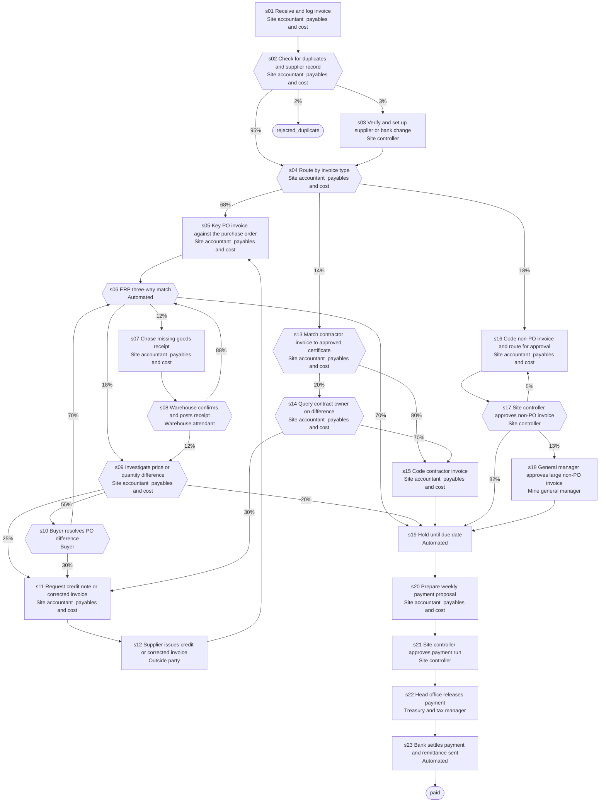

# Site accounts payable: supplier invoice to payment at a remote underground gold mine

`mine-site-ap` · gold mining · finance · part of `mining-operator-co`

Site accountants receive supplier and contractor invoices by email and mail, key them into the ERP, and match them to the purchase order and the warehouse receipt, or to a contractor work certificate. Invoices without a purchase order are coded and sent to the budget holder for approval. Matched and approved invoices wait for their due date and go out in a weekly payment run that the site controller approves and head office releases from the bank portal. Missing receipts, price differences between invoice and PO, and contractor quantities that differ from the signed certificate cause most of the rework and the late payments.

| | |
|---|---|
| Unit of work | one supplier invoice |
| Starts when | A supplier, contractor or utility invoice arrives in the site payables email inbox or the mail. |
| Done when | The invoice is posted to the payables ledger and paid in a weekly run, or rejected as a duplicate. |
| Organisation | A single-mine Canadian gold producer with about 280 people at a remote northern Ontario site, a mid-market ERP with purchasing, inventory and payables, and a six-person site finance team under the site controller. (300 employees, 2019-2022) |
| Volume | 1,600 cases a month (range 1,200 to 2,200) |

## Where it sits

- Starts with **supplier_invoice** from suppliers (60% of cases)
- Starts with **supplier_invoice** from other-contractors (18% of cases)
- Starts with **supplier_invoice** from drilling-contractor (6% of cases)
- Starts with **supplier_invoice** from fuel-supplier (4% of cases)
- Starts with **supplier_invoice** from reagent-supplier (4% of cases)
- Starts with **supplier_invoice** from explosives-supplier (3% of cases)
- Starts with **supplier_invoice** from travel-providers (2% of cases)
- Starts with **supplier_invoice** from mining-contractor (1% of cases)
- Starts with **supplier_invoice** from power-utility (1% of cases)
- Starts with **supplier_invoice** from commercial-lab (1% of cases)
- Relies on **po_record** from site-purchasing (a standing input; it does not start a case)
- Relies on **goods_receipt** from site-warehouse (a standing input; it does not start a case)
- Relies on **goods_receipt** from site-fuel (a standing input; it does not start a case)
- Relies on **contractor_certificate** from mine-open-pit (a standing input; it does not start a case)
- Relies on **contractor_certificate** from ts-definition-drilling (a standing input; it does not start a case)
- Relies on **contractor_certificate** from mnt-shutdown (a standing input; it does not start a case)
- Relies on **contractor_certificate** from site-contractors (a standing input; it does not start a case)
- Relies on **contractor_certificate** from expl-drilling (a standing input; it does not start a case)
- Sends **supplier_payment** to suppliers (outcome: paid)
- Sends **payment_run** to corp-treasury (outcome: paid)
- Sends **ap_ledger** to site-cost-reporting (outcome: any)

## Flow

## Roles

| Role | Department | Layer | FTE on this process | Loaded cost per hour | Evidence |
|---|---|---|---:|---:|---|
| Site accountant (payables and cost) | Site finance and payroll | individual contributor | 2.3 | 43 CAD | C |
| Site controller | Site finance and payroll | manager | 0.3 | 95 CAD | C |
| Mine general manager | Site management and administration | director | 0.03 | 150 CAD | C |
| Buyer | Supply chain and warehouse | individual contributor | 0.25 | 45 CAD | C |
| Warehouse attendant | Supply chain and warehouse | individual contributor | 0.1 | 37 CAD | C |
| Treasury and tax manager | Corporate finance and reporting | manager | 0.03 | 105 CAD | C |

## Steps

Hands-on time and the wait before each step show the most common value. Evidence tier A is a sourced number, B a sourced description, C the author's estimate.

| Step | Who | Kind | Hands-on | Wait before | Control | Evidence |
|---|---|---|---:|---:|---|---|
| **s01 Receive and log invoice.** A site accountant opens the payables inbox or the mail, saves each invoice as a PDF to the invoice folder, stamps the received date and sorts it into PO, contractor or non-PO piles. | Site accountant (payables and cost) | intake | 1 min | 1.0 d |  | C |
| **s02 Check for duplicates and supplier record.** The accountant searches the ERP for the same supplier invoice number and amount, and checks that the supplier exists with current remit-to and banking details. | Site accountant (payables and cost) | lookup | 1 min | 30 min |  | C |
| **s03 Verify and set up supplier or bank change.** The site controller checks the supplier's forms, phones a known contact at the supplier to confirm any new or changed bank details, and enters or approves the vendor master change, which the accountant who keys invoices cannot do. | Site controller | validation | 20 min | 1.0 d | Internal control over financial reporting: vendor master changes verified and made by someone other than the invoice processor | C |
| **s04 Route by invoice type.** The accountant decides which path the invoice takes: against a purchase order, against a contractor work certificate, or a non-PO invoice such as freight, power, travel or a service without an order. | Site accountant (payables and cost) | judgment | 0.5 min | 0 min |  | C |
| **s05 Key PO invoice against the purchase order.** The accountant opens the PO in the ERP payables screen, keys the invoice number, date, amounts, freight and taxes, and selects the receipt lines being billed. | Site accountant (payables and cost) | data entry | 4 min | 2.0 h |  | C |
| **s06 ERP three-way match.** The ERP compares invoice price and quantity with the PO and the posted goods receipt within the set tolerance, and either clears the invoice for payment or puts it on hold with a reason code. | Automated | system auto | 0 min | 0 min | Internal control over financial reporting: three-way match of invoice, purchase order and receipt before payment | C |
| **s07 Chase missing goods receipt.** The accountant emails the warehouse or the requisitioner asking whether the goods or service arrived and to post the receipt in the ERP. | Site accountant (payables and cost) | communication | 4 min | 4.0 h |  | C |
| **s08 Warehouse confirms and posts receipt.** A warehouse attendant finds the packing slip or checks the bin, posts the receipt in the ERP, or reports that the goods never arrived or arrived short. | Warehouse attendant | data entry | 6 min | 1.0 d |  | C |
| **s09 Investigate price or quantity difference.** The accountant compares the invoice with the PO, the receipt and the packing slip, works out whether the difference is freight, a price increase, a partial shipment or a keying error, and decides who has to act. | Site accountant (payables and cost) | analysis | 12 min | 1.0 d |  | C |
| **s10 Buyer resolves PO difference.** The buyer checks the quote and the supplier's acknowledgement, then either amends the PO price or freight line or tells the accountant the supplier must credit the difference. | Buyer | judgment | 10 min | 1.0 d |  | B [discovery-buyer] |
| **s11 Request credit note or corrected invoice.** The accountant emails the supplier with the PO price or quantity, asks for a credit note or corrected invoice, and puts the invoice on hold with a note. | Site accountant (payables and cost) | communication | 8 min | 2.0 h |  | C |
| **s12 Supplier issues credit or corrected invoice.** The supplier's receivables team reviews the request and sends a credit note or a replacement invoice, often after a reminder. | Outside party | external wait | 0 min | 10.0 d |  | C |
| **s13 Match contractor invoice to approved certificate.** The accountant compares the contractor's invoice with the work certificate signed by the contract owner: metres drilled, equipment and labour hours, rates from the contract schedule, holdback and taxes. | Site accountant (payables and cost) | validation | 12 min | 1.0 d | Internal control over financial reporting: contractor invoices paid only against certified quantities | C |
| **s14 Query contract owner on difference.** The accountant emails the superintendent or geologist who signed the certificate with the difference and waits for them to confirm the extra work or ask the contractor to reissue; owners on rotation or underground answer slowly. | Site accountant (payables and cost) | communication | 10 min | 2.0 d |  | C |
| **s15 Code contractor invoice.** The accountant codes the invoice to the operating cost centre or capital project, records any construction holdback and posts it to the payables ledger. | Site accountant (payables and cost) | data entry | 7 min | 1.0 h |  | C |
| **s16 Code non-PO invoice and route for approval.** The accountant keys the invoice, codes it to the general ledger account and cost centre, attaches the PDF and sends it to the budget holder through the ERP workflow or by email. | Site accountant (payables and cost) | data entry | 5 min | 2.0 h |  | C |
| **s17 Site controller approves non-PO invoice.** The site controller, who holds the budgets for freight, power, camp services and travel, checks that the charge is real and coded correctly and approves it, or recodes it or sends it to the general manager when it is above their limit. | Site controller | approval | 2 min | 1.0 d | Delegation of financial authority: budget holder approval of non-PO invoices | C |
| **s18 General manager approves large non-PO invoice.** The general manager reviews larger non-PO invoices such as power bills or one-off services with the controller's note and approves them in the workflow. | Mine general manager | approval | 3 min | 1.0 d | Delegation of financial authority approved by the board | C |
| **s19 Hold until due date.** The ERP holds the approved invoice until the payment run that falls before its due date, usually net 30 days from the invoice date, which is often a week or more before the site received it. | Automated | system auto | 0 min | 12.0 d |  | C |
| **s20 Prepare weekly payment proposal.** Each week the accountant runs the payment proposal in the ERP, removes invoices on hold or in dispute, checks large payments and new bank details against the vendor change log, and exports the EFT file and cheque list. | Site accountant (payables and cost) | analysis | 0.6 min | 1.0 d |  | C |
| **s21 Site controller approves payment run.** The site controller reviews the payment register, totals by supplier and any unusual payees, compares with the cash forecast, and signs the approval. | Site controller | approval | 0.2 min | 4.0 h | Payment run approved by someone other than the person who prepared it | C |
| **s22 Head office releases payment.** The treasury and tax manager in Toronto uploads the approved EFT file to the bank portal, checks the batch total against the site approval, and releases it with a second authoriser; cheques are signed and mailed. | Treasury and tax manager | approval | 0.1 min | 1.0 d | Bank mandate: two authorised signatories release payments | C |
| **s23 Bank settles payment and remittance sent.** The bank settles EFT payments the next business day and the ERP emails remittance advices; cheques take several days in the mail. | Automated | system auto | 0 min | 1.0 d |  | C |

## Exceptions

| Exception | Share of cases | What happens |
|---|---:|---|
| Missing goods receipt | 12% | Goods arrived but nobody posted the receipt; AP chases the warehouse and rematches. |
| Price or quantity difference | 18% | Invoice differs from the PO; the buyer amends the PO or the supplier credits the difference. |
| Credit note needed | 7% | The supplier has to credit or reissue, which can take weeks. |
| Contractor quantity dispute | 3% | Contractor bills more than the signed certificate and the contract owner must confirm. |
| Bank detail change | 3% | New supplier or changed bank account verified by callback before any payment. |

## Benchmarks

| Metric | Value | Unit | Population | Evidence |
|---|---|---|---|---|
| cycle_time_days | p50 15, p90 30 | calendar days from receipt of invoice until payment is transmitted | APQC Open Standards Benchmarking, cross-industry | A [cfo-ap] |
| invoice_to_payment_days_quartiles | p25 12, p50 15, p75 24 | calendar days | APQC Open Standards Benchmarking, cross-industry | A [cfo-ap] |

## Pain points

- About three in ten PO invoices fail the first match, mostly because receipts are not posted or freight and price changes were never put on the PO. (steps s06, s07, s08, s09, s10; C)
- Credit notes and corrected invoices from suppliers take weeks, so disputed invoices age past their terms and suppliers call to chase payment. (steps s11, s12; C)
- Approvers and contract owners work rotations or are underground, so non-PO approvals and contractor queries wait days. (steps s14, s17, s18; C)
- Paper and PDF invoices are keyed by hand; three accountants also carry cost accounting and the close. (steps s05, s16; C)

## Assumptions

- Invoices are keyed manually; OCR capture was not yet common at single-mine producers of this size in 2019-2022.
- The cycle time includes the deliberate wait until the due date (s19). Most invoices are paid near net 30 from the invoice date, so the simulated median is above the cross-industry APQC median of 15 days, whose population includes companies paying faster than terms.
- The organisation file triggers this process only from suppliers, other contractors and the drilling contractor. This file adds invoices from the fuel, reagent and explosives suppliers (which purchasing sends POs to), the open pit mining contractor, travel providers, the power utility and commercial labs, all of which are outside parties in the organisation file.
- Approvers: the organisation file lists only the site accountant and site controller on this process. This file adds the general manager (large non-PO invoices), the buyer (price differences), a warehouse attendant (late receipts) and the treasury and tax manager (payment release), all existing roles.
- Contractor certificates are approved upstream by their owners; AP only queries an owner when the invoice differs from the certificate.
- Weekly payment runs prepared at site and released by head office from the bank portal; the organisation file links the payment run to corp-treasury.
- Staffing gap: at 1,600 invoices a month the touch times (about 17 minutes of accountant time per invoice once exceptions are averaged in) imply about 3.5 FTE of accountant work, more than the three site accountants can give while also doing cost accounting and the close. Either the organisation file volume is high (its note assumes about three invoices per PO; one to one and a half per PO plus contractor and non-PO invoices gives about 1,000-1,200 a month) or site finance needs a dedicated payables clerk.
- Loaded costs are taken from the organisation file.

## Sources

- [cfo-ap] [Hidden delays that slow payments and strain cash flow (Metric of the Month)](https://www.cfo.com/news/hidden-delays-that-slow-payments-and-strain-cash-flow-metric-of-the-month/806681/) (CFO.com (Perry D. Wiggins, APQC), 2025). APQC Open Standards Benchmarking: cycle time from receipt of invoice until payment is transmitted is 12 days at the 25th percentile, 15 days at the median and 24 days at the 75th percentile.
- [discovery-buyer] [Buyer, Porcupine operations (Timmins, Ontario) job posting](https://discovery.applicantstack.com/x/detail/a2vy5j81wf6t) (Discovery Silver Corp. (ApplicantStack), 2026). Buyer at an Ontario underground and open pit gold operation follows the procure-to-pay process, obtains three quotes for items over $500, issues purchase orders and change orders, expedites past-due and rush orders, follows up with end users, updates the ERP and resolves invoice issues with vendors; reports to the procurement and warehouse manager.
- [wdo-guidance] [Wesdome Announces 2020 Fourth Quarter and Full Year Production Results; Provides 2021 Guidance](https://finance.yahoo.com/news/wesdome-announces-2020-fourth-quarter-213000875.html) (Wesdome Gold Mines (via Yahoo Finance), 2021). Eagle River complex 2021 guidance: 92,000-105,000 oz, operating cost C$900-1,000 per oz, AISC C$1,300-1,450 per oz, sustaining capital C$23-27 million and growth capital C$22-26 million; 2020 ore milled 236,297 t and production 90,278 oz.

Written by claude-opus on 2026-11-24.
