# Monthly site cost close, cost report and forecast at a remote underground gold mine

`mine-site-cost-reporting` · gold mining · finance · part of `mining-operator-co`

Each month the site finance team closes the mine's books and tells head office what the month cost and what the year will cost. Accountants cut off payables, accrue goods received and contractor work not yet invoiced, value ore stockpiles and gold in the mill, split development between capital and operating cost, and produce cost per tonne and cost per ounce against budget. The site controller then walks the mine, mill and maintenance superintendents through their variances, writes the commentary, gets the general manager's sign-off and sends the report and an updated forecast to head office. Late receipts, contractor accruals that depend on superintendents on rotation, and the wait for the month's production numbers drive most of the adjustments and delay.

| | |
|---|---|
| Unit of work | one monthly site close |
| Starts when | The calendar month ends; payables and receiving are cut off on the last day and the close checklist starts on the first working day. |
| Done when | The site cost report signed by the general manager and the updated full-year forecast are with head office, and head office queries are answered. |
| Organisation | A single-mine Canadian gold producer with about 280 people at a remote northern Ontario site, a mid-market ERP, spreadsheets for metallurgical accounting and cost reporting, and a six-person site finance team. (300 employees, 2019-2022) |
| Volume | 1 cases a month (range 1 to 1) |

## Where it sits

- Starts with **ap_ledger** from site-ap (100% of cases)
- Relies on **payroll_journal** from site-payroll (a standing input; it does not start a case)
- Relies on **stores_issue** from site-warehouse (a standing input; it does not start a case)
- Relies on **production_report** from mill-met-accounting (a standing input; it does not start a case)
- Relies on **reconciliation_report** from ts-reconciliation (a standing input; it does not start a case)
- Relies on **camp_occupancy** from site-camp (a standing input; it does not start a case)
- Relies on **annual_budget** from corp-budget (a standing input; it does not start a case)
- Sends **cost_report** to corp-financial-reporting (outcome: reported)
- Sends **site_forecast** to corp-budget (outcome: reported)

## Flow

```mermaid
flowchart TD
    s01["s01 Cut off payables and receipts<br/>Site accountant  payables and cost"]
    s02["s02 Accrue goods received not invoiced<br/>Site accountant  payables and cost"]
    s03["s03 Request contractor and service accruals<br/>Site accountant  payables and cost"]
    s04["s04 Mine superintendent estimates contractor accruals<br/>Mine superintendent"]
    s05["s05 Maintenance superintendent estimates shutdown and repair accruals<br/>Maintenance superintendent"]
    s06["s06 Accrue payroll and bonuses<br/>Payroll and timekeeping administrator"]
    s07["s07 Post accruals and recurring journals<br/>Site accountant  payables and cost"]
    s08["s08 Reconcile stores inventory and issues<br/>Site accountant  payables and cost"]
    s09["s09 Receive and check the production report<br/>Site controller"]
    s10["s10 Value stockpiles, gold in circuit and dore<br/>Site controller"]
    s11["s11 Split development between capital and operating cost<br/>Site accountant  payables and cost"]
    s12["s12 Run preliminary cost report<br/>Site controller"]
    s13["s13 Mine superintendent reviews mine variances<br/>Mine superintendent"]
    s14["s14 Mill superintendent reviews mill variances<br/>Mill superintendent"]
    s15{{"s15 Maintenance superintendent reviews maintenance variances<br/>Maintenance superintendent"}}
    s16["s16 Post corrections and reclassifications<br/>Site accountant  payables and cost"]
    s17["s17 Write variance commentary and KPI package<br/>Site controller"]
    s18{{"s18 General manager reviews and signs off<br/>Mine general manager"}}
    s19["s19 Send cost report to head office<br/>Site controller"]
    s20{{"s20 Corporate controller reviews site report<br/>Corporate controller"}}
    s21["s21 Answer head office queries<br/>Site controller"]
    s22{{"s22 Update full-year forecast<br/>Site controller"}}
    s23["s23 General manager reviews quarterly reforecast<br/>Mine general manager"]
    s24["s24 Submit forecast to head office<br/>Site controller"]
    s01 --> s02
    s02 --> s03
    s03 --> s04
    s04 --> s05
    s05 --> s06
    s06 --> s07
    s07 --> s08
    s08 --> s09
    s09 --> s10
    s10 --> s11
    s11 --> s12
    s12 --> s13
    s13 --> s14
    s14 --> s15
    s15 -->|"65%"| s16
    s15 -->|"35%"| s17
    s16 --> s17
    s17 --> s18
    s18 -->|"80%"| s19
    s18 -->|"20%"| s17
    s19 --> s20
    s20 -->|"65%"| s22
    s20 -->|"35%"| s21
    s21 --> s22
    s22 -->|"67%"| s24
    s22 -->|"33%"| s23
    s23 --> s24
    s24 --> end0
    end0(["reported"])
```

## Roles

| Role | Department | Layer | FTE on this process | Loaded cost per hour | Evidence |
|---|---|---|---:|---:|---|
| Site controller | Site finance and payroll | manager | 0.35 | 95 CAD | C |
| Site accountant (payables and cost) | Site finance and payroll | individual contributor | 0.6 | 43 CAD | C |
| Payroll and timekeeping administrator | Site finance and payroll | individual contributor | 0.02 | 40 CAD | C |
| Mine superintendent | Mine operations | manager | 0.03 | 115 CAD | C |
| Mill superintendent | Processing | manager | 0.02 | 112 CAD | C |
| Maintenance superintendent | Maintenance | manager | 0.03 | 108 CAD | C |
| Mine general manager | Site management and administration | director | 0.03 | 150 CAD | C |
| Corporate controller | Corporate finance and reporting | manager | 0.02 | 115 CAD | C |

## Steps

Hands-on time and the wait before each step show the most common value. Evidence tier A is a sourced number, B a sourced description, C the author's estimate.

| Step | Who | Kind | Hands-on | Wait before | Control | Evidence |
|---|---|---|---:|---:|---|---|
| **s01 Cut off payables and receipts.** On the first working days of the month the site accountants post the last invoices dated in the month, make sure warehouse receipts up to month end are entered, close the payables period in the ERP and run the open-PO and goods-received-not-invoiced reports. | Site accountant (payables and cost) | data entry | 6.0 h | 6.0 h |  | C |
| **s02 Accrue goods received not invoiced.** An accountant reviews the received-not-invoiced report, removes lines already invoiced or received in error, and prepares the accrual journal for the rest. | Site accountant (payables and cost) | analysis | 2.0 h | 0 min |  | C |
| **s03 Request contractor and service accruals.** The accountant emails each contract owner a list of their contractors with invoices received and asks for the value of work done in the month but not yet billed: drilling metres, open pit tonnes, shutdown crews, service calls. | Site accountant (payables and cost) | coordination | 1.0 h | 0 min |  | C |
| **s04 Mine superintendent estimates contractor accruals.** The mine superintendent, or the mine captain on the other rotation, works out the open pit contractor's tonnes and the underground contractors' unbilled work from shift reports and contractor dailies and returns the estimates. | Mine superintendent | judgment | 45 min | 12.0 h |  | C |
| **s05 Maintenance superintendent estimates shutdown and repair accruals.** The maintenance superintendent lists contractor crews, outside repairs and rentals used in the month that have not been invoiced and estimates their value from timesheets and quotes. | Maintenance superintendent | judgment | 45 min | 0 min |  | C |
| **s06 Accrue payroll and bonuses.** The payroll administrator calculates wages, premiums and production bonus earned between the last pay period end and month end from the timesheets and bonus sheets, and gives the accrual to the accountant. | Payroll and timekeeping administrator | analysis | 1.5 h | 0 min |  | C |
| **s07 Post accruals and recurring journals.** The accountant posts the receipt, contractor and payroll accruals, reverses last month's, and posts recurring journals for power, insurance, camp catering, prepaid items, depreciation and royalties. | Site accountant (payables and cost) | data entry | 4.0 h | 2.0 h |  | C |
| **s08 Reconcile stores inventory and issues.** A second accountant reconciles the stores inventory ledger with the warehouse system, checks that issues are charged to the right department and work order, and books count adjustments and the obsolete stock provision. | Site accountant (payables and cost) | validation | 4.0 h | 0 min | Internal control over financial reporting: monthly inventory reconciliation | C |
| **s09 Receive and check the production report.** The site controller receives the month's production report and mine-to-mill reconciliation: tonnes mined and milled, head grade, recovery, ounces poured and shipped, stockpile tonnes and gold in circuit. They check that the numbers tie between mine, mill and gold room. | Site controller | validation | 1.0 h | 8.0 h |  | C |
| **s10 Value stockpiles, gold in circuit and dore.** The controller applies the month's cost per tonne and per ounce to surface ore stockpiles, gold in circuit and dore on hand, compares the result with net realisable value at the current gold price and books the inventory adjustment. | Site controller | analysis | 2.0 h | 0 min | IFRS (IAS 2 Inventories) measurement at lower of cost and net realisable value, reviewed by the external auditor | C |
| **s11 Split development between capital and operating cost.** An accountant takes the metres of lateral development by heading from engineering, classifies each heading as capital (ramp, access) or operating (ore drives), and moves the matching labour, consumables and equipment cost to capital projects. | Site accountant (payables and cost) | analysis | 1.5 h | 0 min |  | C |
| **s12 Run preliminary cost report.** The controller runs the trial balance, refreshes the cost report workbook and calculates cost per tonne mined and milled, cost per ounce and all-in sustaining cost against budget and last month, and flags the departments with the largest variances. | Site controller | analysis | 5.0 h | 2.0 h |  | B [wdo-guidance] |
| **s13 Mine superintendent reviews mine variances.** The controller sits down with the mine superintendent, or phones them on their days off, to go through mining costs by account: explosives, ground support, contractor and equipment costs, overtime. The superintendent explains real variances and points out miscoded charges. | Mine superintendent | review | 1.0 h | 12.0 h |  | C |
| **s14 Mill superintendent reviews mill variances.** The mill superintendent goes through reagents, grinding media, power and mill labour against budget and the tonnes milled and explains the differences. | Mill superintendent | review | 1.0 h | 2.0 h |  | C |
| **s15 Maintenance superintendent reviews maintenance variances.** The maintenance superintendent goes through parts, outside repairs, component rebuilds and contractor costs by fleet and plant area and explains large items. | Maintenance superintendent | review | 1.0 h | 2.0 h |  | C |
| **s16 Post corrections and reclassifications.** An accountant posts journals to move miscoded charges between departments and capital projects and to add accruals the superintendents identified, then reruns the report. | Site accountant (payables and cost) | data entry | 1.5 h | 2.0 h |  | C |
| **s17 Write variance commentary and KPI package.** The controller writes the monthly commentary: costs against budget by department, cost per tonne and per ounce, capital spend by project, key one-offs and accrual risks, and assembles the KPI tables head office uses. | Site controller | drafting | 5.0 h | 2.0 h |  | C |
| **s18 General manager reviews and signs off.** The general manager reads the report, questions large variances and the forecast risks, and signs it off or sends it back for more explanation. | Mine general manager | review | 1.0 h | 8.0 h | Site general manager accountable for site cost reporting | C |
| **s19 Send cost report to head office.** The controller emails the signed cost report, trial balance and supporting schedules to the corporate controller and uploads them to the consolidation folder. | Site controller | communication | 15 min | 1.0 h |  | C |
| **s20 Corporate controller reviews site report.** The corporate controller in Toronto reviews the site trial balance and cost report for consolidation, compares with prior months and guidance, and sends questions on accruals, inventory and capital classification. | Corporate controller | review | 1.0 h | 12.0 h |  | C |
| **s21 Answer head office queries.** The controller researches and answers the corporate controller's questions, posts any late adjustments head office asks for in the still-open period, and resends the affected schedules and trial balance. | Site controller | communication | 1.0 h | 4.0 h |  | C |
| **s22 Update full-year forecast.** The controller rolls the forecast forward: actual months replace budget, the remaining months are adjusted for the latest mine plan tonnes and grade, known contractor and maintenance spend, gold price and exchange rate, and the full-year cost per ounce and capital are recalculated. | Site controller | analysis | 5.0 h | 2.0 h |  | C |
| **s23 General manager reviews quarterly reforecast.** At quarter end the general manager reviews the reforecast with the controller, checks the department heads' input on remaining spend and capital timing, and approves the numbers that go to head office for guidance. | Mine general manager | review | 2.0 h | 12.0 h |  | C |
| **s24 Submit forecast to head office.** The controller sends the forecast workbook to head office for the corporate budget and guidance tracking and files the month's close binder. | Site controller | communication | 20 min | 1.0 h |  | C |

## Exceptions

| Exception | Share of cases | What happens |
|---|---:|---|
| Corrections after variance review | 65% | Superintendents find miscoded charges or missed accruals that are posted before the report goes out. |
| GM sends report back | 20% | The general manager asks for more explanation of variances or forecast risks. |
| Head office queries | 35% | The corporate controller questions accruals, inventory or capital classification. |
| Quarter-end reforecast | 33% | A fuller reforecast reviewed by the general manager at quarter end. |

## Benchmarks

| Metric | Value | Unit | Population | Evidence |
|---|---|---|---|---|
| cycle_time_days | p50 6.4, p90 10 | calendar days from running the trial balance to completed consolidated statements | APQC General Accounting Open Standards Benchmarking, about 2,300 organisations, cross-industry | A [cfo-close] |
| monthly_close_days_top_quartile | 4.8 | calendar days | APQC, cross-industry | A [cfo-close] |

## Pain points

- Contractor accruals depend on superintendents on 14/14 rotation, so estimates arrive late and are often wrong, which shows up as next month's variances. (steps s03, s04, s05; C)
- The cost report waits for the metallurgical balance and reconciliation, which are themselves finalised days after month end. (steps s09, s10; C)
- Miscoded charges are found only in the variance meetings, forcing a second pass of journals and reruns. (steps s13, s15, s16; C)
- Cost report, forecast and KPI tables live in linked spreadsheets refreshed by hand each month. (steps s12, s17, s22; C)

## Assumptions

- The organisation file gives this process no trigger. A monthly close starts on the calendar; this file records the payables cut-off (ap_ledger from site-ap) as the trigger and lists the other feeds, including the annual budget from corp-budget, as inputs.
- The simulated cycle runs from month end to the forecast being submitted, so it is longer than the APQC trial-balance-to-statements measure; a median of about 8-10 days is consistent with a site report by working day 5-6 and the forecast a few days later.
- Staffing: touch time per close is about 70 hours across all roles (about 0.5 FTE). Stated FTE are higher because cost accounting outside the close (daily coding questions, capital tracking, audit requests) is not stepped through.
- Superintendents take part in accruals and variance review; the organisation file lists them on this process. The corporate controller is added as the head office reviewer (an existing role).
- Loaded costs are taken from the organisation file.

## Sources

- [cfo-close] [Metric of the Month: Cycle time for monthly close](https://www.cfo.com/accounting-2/2018/03/metric-month-cycle-time-monthly-close/) (CFO.com (Perry D. Wiggins, APQC), 2018). APQC General Accounting benchmark (about 2,300 organisations): calendar days from running the trial balance to completed consolidated statements are 4.8 or fewer for the top quartile, 6.4 at the median and 10 or more for the bottom quartile.
- [wdo-guidance] [Wesdome Announces 2020 Fourth Quarter and Full Year Production Results; Provides 2021 Guidance](https://finance.yahoo.com/news/wesdome-announces-2020-fourth-quarter-213000875.html) (Wesdome Gold Mines (via Yahoo Finance), 2021). Eagle River complex 2021 guidance: 92,000-105,000 oz, operating cost C$900-1,000 per oz, AISC C$1,300-1,450 per oz, sustaining capital C$23-27 million and growth capital C$22-26 million; 2020 ore milled 236,297 t and production 90,278 oz.

Written by claude-opus on 2026-11-24.
