# Site timekeeping and biweekly payroll at a remote underground gold mine

`mine-site-payroll` · gold mining · finance · part of `mining-operator-co`

Every two weeks the mine pays about 280 hourly and staff employees who work 12-hour shifts on 14-days-on, 14-days-off rotations. Shift supervisors finalise crew timesheets with overtime, night and underground premiums and production bonus metres; the mine captain checks the bonus sheets; two payroll administrators check the hours against the rotation schedule, calculate bonuses in a spreadsheet, key everything into an outsourced payroll service and get the register approved before the service's cut-off. Late or unsigned timesheets from supervisors who have rotated off, bonus calculations and mid-period rate changes cause most of the corrections and the off-cycle payments after pay day.

| | |
|---|---|
| Unit of work | one biweekly pay period for the site |
| Starts when | The last shift of the two-week pay period ends and supervisors must hand in their crews' timesheets. |
| Done when | Employees are paid on pay day, source deductions are remitted to the CRA, and the payroll journal is posted and reconciled in the ERP. |
| Organisation | A single-mine Canadian gold producer with about 280 people at a remote northern Ontario site on fly-in or drive-in rotations, an outsourced Canadian payroll service with site time entry, and a mid-market ERP. (300 employees, 2019-2022) |
| Volume | 2.2 cases a month (range 2 to 3) |

## Where it sits

- Starts with **timesheet** from mine-shift-control (55% of cases)
- Starts with **timesheet** from mill-grind-leach (20% of cases)
- Starts with **timesheet** from mnt-work-planning (25% of cases)
- Relies on **new_hire** from site-recruitment (a standing input; it does not start a case)
- Relies on **compensation_plan** from corp-hr-compensation (a standing input; it does not start a case)
- Sends **payroll_run** to employees-banks (outcome: paid)
- Sends **payroll_remittance** to cra (outcome: paid)
- Sends **payroll_journal** to site-cost-reporting (outcome: paid)

## Flow

```mermaid
flowchart TD
    s01["s01 Underground supervisors finalise crew timesheets<br/>Underground shift supervisor"]
    s02["s02 Mill supervisors finalise crew timesheets<br/>Mill shift supervisor"]
    s03["s03 Maintenance supervisors finalise crew timesheets<br/>Maintenance supervisor"]
    s04["s04 Mine captain approves bonus sheets<br/>Mine captain  general foreman"]
    s05["s05 HR sends employee changes for the period<br/>Site HR coordinator"]
    s06{{"s06 Collect timesheets and check completeness<br/>Payroll and timekeeping administrator"}}
    s07["s07 Chase missing or unsigned timesheets<br/>Payroll and timekeeping administrator"]
    s08["s08 Check hours, overtime and premiums<br/>Payroll and timekeeping administrator"]
    s09["s09 Calculate production bonuses<br/>Payroll and timekeeping administrator"]
    s10["s10 Enter employee changes<br/>Payroll and timekeeping administrator"]
    s11["s11 Key hours and bonuses into the payroll service<br/>Payroll and timekeeping administrator"]
    s12["s12 Payroll service calculates preliminary register<br/>Automated"]
    s13{{"s13 Second administrator reviews register<br/>Payroll and timekeeping administrator"}}
    s14["s14 Correct payroll entries<br/>Payroll and timekeeping administrator"]
    s15{{"s15 Site controller approves the register<br/>Site controller"}}
    s16["s16 Commit payroll before the service cut-off<br/>Payroll and timekeeping administrator"]
    s17["s17 Head office funds the payroll<br/>Treasury and tax manager"]
    s18["s18 Pay day deposits and pay statements<br/>Automated"]
    s19{{"s19 Answer employee pay queries<br/>Payroll and timekeeping administrator"}}
    s20["s20 Process off-cycle adjustment<br/>Payroll and timekeeping administrator"]
    s21["s21 Remit source deductions to the CRA<br/>Automated"]
    s22["s22 Post payroll journal and labour distribution<br/>Payroll and timekeeping administrator"]
    s23["s23 Reconcile payroll accounts<br/>Site accountant  payables and cost"]
    s01 --> s02
    s02 --> s03
    s03 --> s04
    s04 --> s05
    s05 --> s06
    s06 -->|"40%"| s08
    s06 -->|"60%"| s07
    s07 --> s08
    s08 --> s09
    s09 --> s10
    s10 --> s11
    s11 --> s12
    s12 --> s13
    s13 -->|"55%"| s15
    s13 -->|"45%"| s14
    s14 --> s15
    s15 -->|"95%"| s16
    s15 -->|"5%"| s14
    s16 --> s17
    s17 --> s18
    s18 --> s19
    s19 -->|"60%"| s21
    s19 -->|"40%"| s20
    s20 --> s21
    s21 --> s22
    s22 --> s23
    s23 --> end0
    end0(["paid"])
```

## Roles

| Role | Department | Layer | FTE on this process | Loaded cost per hour | Evidence |
|---|---|---|---:|---:|---|
| Payroll and timekeeping administrator | Site finance and payroll | individual contributor | 1.2 | 40 CAD | C |
| Underground shift supervisor | Underground production and development | supervisor | 0.15 | 82 CAD | C |
| Mill shift supervisor | Mill operations | supervisor | 0.04 | 72 CAD | C |
| Maintenance supervisor | Maintenance | supervisor | 0.05 | 76 CAD | C |
| Mine captain (general foreman) | Underground production and development | supervisor | 0.03 | 95 CAD | C |
| Site HR coordinator | Site services | individual contributor | 0.05 | 48 CAD | C |
| Site controller | Site finance and payroll | manager | 0.03 | 95 CAD | C |
| Treasury and tax manager | Corporate finance and reporting | manager | 0.005 | 105 CAD | C |
| Site accountant (payables and cost) | Site finance and payroll | individual contributor | 0.03 | 43 CAD | C |

## Steps

Hands-on time and the wait before each step show the most common value. Evidence tier A is a sourced number, B a sourced description, C the author's estimate.

| Step | Who | Kind | Hands-on | Wait before | Control | Evidence |
|---|---|---|---:|---:|---|---|
| **s01 Underground supervisors finalise crew timesheets.** At the end of their last shift of the period, the underground shift supervisors on site total each crew member's hours from the daily shift sheets, mark overtime, night and underground premiums and absences, add the development metres and stope tonnes that drive the bonus, sign the timesheets and scan or email them to payroll. | Underground shift supervisor | data entry | 1.5 h | 4.0 h |  | C |
| **s02 Mill supervisors finalise crew timesheets.** The mill shift supervisors on site do the same for mill, crusher and gold room operators, using the mill shift log and line-up, and send the signed timesheets to payroll. | Mill shift supervisor | data entry | 45 min | 0 min |  | C |
| **s03 Maintenance supervisors finalise crew timesheets.** Maintenance supervisors total mechanics', electricians' and millwrights' hours, including call-outs and shutdown overtime, checking them against hours booked to work orders, and send the signed timesheets. | Maintenance supervisor | data entry | 45 min | 0 min |  | C |
| **s04 Mine captain approves bonus sheets.** The mine captain compares each crew's claimed development metres and stope tonnes with the survey advance and the haulage tally, adjusts disputed claims and signs the bonus sheet. | Mine captain (general foreman) | approval | 1.5 h | 12.0 h | Site production bonus plan: bonus paid only on surveyed advance and measured tonnes | C |
| **s05 HR sends employee changes for the period.** The site HR coordinator emails payroll the period's new hires with their signed offer and tax forms, terminations, promotions and rate changes approved under the compensation plan, and leave starts and returns. | Site HR coordinator | communication | 1.0 h | 0 min |  | C |
| **s06 Collect timesheets and check completeness.** A payroll administrator downloads the scanned timesheets, ticks every name on the period's rotation roster against a timesheet, and lists missing, unsigned or illegible sheets. | Payroll and timekeeping administrator | validation | 2.0 h | 1.0 d |  | C |
| **s07 Chase missing or unsigned timesheets.** The administrator emails or phones the supervisors concerned; a supervisor who has rotated off may have to be reached at home, or the mine captain signs on their behalf. | Payroll and timekeeping administrator | communication | 45 min | 8.0 h |  | C |
| **s08 Check hours, overtime and premiums.** The administrators compare each employee's hours with the rotation schedule and the averaging agreement, check overtime and premium codes, and compare days claimed with gate and camp records where they differ. | Payroll and timekeeping administrator | validation | 4.0 h | 1.0 h | Ontario Employment Standards Act, 2000: hours of work, overtime and averaging agreements | C |
| **s09 Calculate production bonuses.** An administrator enters the approved metres and tonnes into the bonus workbook, which applies the bonus rates by heading and crew, splits each crew's bonus by hours worked, and produces a bonus amount per employee. | Payroll and timekeeping administrator | analysis | 3.0 h | 0 min |  | C |
| **s10 Enter employee changes.** The administrator sets up new hires (tax forms, banking, rate, cost centre), ends terminated employees and keys rate changes and leave in the payroll service. | Payroll and timekeeping administrator | data entry | 1.0 h | 0 min |  | C |
| **s11 Key hours and bonuses into the payroll service.** The administrators key or import each employee's regular, overtime and premium hours by earnings code and cost centre, the bonus amounts and any one-off earnings and deductions into the payroll service's web input screens. | Payroll and timekeeping administrator | data entry | 8.0 h | 1.0 h |  | C |
| **s12 Payroll service calculates preliminary register.** The payroll service calculates gross pay, tax, CPP, EI, union dues and benefit deductions and produces a preliminary register and variance report. | Automated | system auto | 0 min | 30 min |  | C |
| **s13 Second administrator reviews register.** The second payroll administrator, who did not key the batch, compares the register with last period by employee and department, looks at negative net pays, very large cheques and employees with no pay, and lists corrections. | Payroll and timekeeping administrator | review | 2.0 h | 1.0 h | Payroll input reviewed by someone other than the person who keyed it | C |
| **s14 Correct payroll entries.** The administrator who keyed the batch fixes the listed entries in the payroll service, asks the service to recalculate, and checks the changed employees again on the new register. | Payroll and timekeeping administrator | data entry | 45 min | 0 min |  | C |
| **s15 Site controller approves the register.** The site controller reviews the register summary, total gross and net pay by department against the previous period and the budget, asks about large movements and approves the payroll. | Site controller | approval | 30 min | 8.0 h | Payroll approval by the site controller before release | C |
| **s16 Commit payroll before the service cut-off.** The administrator submits the approved payroll in the payroll service before its processing cut-off, a few business days before pay day, and saves the confirmation. | Payroll and timekeeping administrator | data entry | 10 min | 1.0 h |  | C |
| **s17 Head office funds the payroll.** The treasury and tax manager checks the funding notice from the payroll service against the approved total and releases the transfer of net pay and remittances from the operating account. | Treasury and tax manager | approval | 15 min | 12.0 h | Bank mandate: funding released by head office treasury, not site payroll | C |
| **s18 Pay day deposits and pay statements.** On pay day the payroll service deposits net pay into employees' bank accounts by direct deposit and publishes pay statements online, with the few remaining cheques mailed to site. | Automated | system auto | 0 min | 1.5 d |  | C |
| **s19 Answer employee pay queries.** In the days after pay day employees phone, email or come to the office about missing overtime, bonus amounts or deductions; the administrator checks the timesheet and bonus sheet and agrees whether an adjustment is due. | Payroll and timekeeping administrator | communication | 3.0 h | 12.0 h |  | C |
| **s20 Process off-cycle adjustment.** For large shortfalls the administrator runs an off-cycle payment in the payroll service; smaller ones are carried into the next period's input. | Payroll and timekeeping administrator | data entry | 1.0 h | 4.0 h |  | C |
| **s21 Remit source deductions to the CRA.** The payroll service remits the income tax, CPP and EI withheld and the employer's share to the CRA for the remitting period that contains pay day. With withholdings well above C$100,000 a month the company is a threshold 2 accelerated remitter, so each remittance is due the third working day after the 7th, 14th, 21st or last day of the month. | Automated | system auto | 0 min | 1.0 d | Income Tax Regulations s.108 and CRA remitting rules for threshold 2 accelerated remitters | A [cra-due], [cra-types] |
| **s22 Post payroll journal and labour distribution.** The administrator exports the payroll journal from the service, maps earnings and deductions to ERP accounts and labour cost by department and cost centre, imports it into the ERP and posts it. | Payroll and timekeeping administrator | data entry | 1.5 h | 1.0 d |  | C |
| **s23 Reconcile payroll accounts.** A site accountant reconciles the payroll clearing, source deduction and benefit payable accounts against the register, the funding transfer and the remittance, and clears or follows up differences. | Site accountant (payables and cost) | validation | 1.0 h | 12.0 h | Internal control over financial reporting: monthly reconciliation of payroll liability accounts | C |

## Exceptions

| Exception | Share of cases | What happens |
|---|---:|---|
| Missing or unsigned timesheets | 60% | One or more supervisors have rotated off without sending signed timesheets. |
| Register corrections | 45% | Second review finds keying or bonus errors that are fixed before approval. |
| Off-cycle payment | 40% | An employee is short-paid by enough to need an off-cycle payment. |

## Benchmarks

| Metric | Value | Unit | Population | Evidence |
|---|---|---|---|---|
| cycle_time_days | p50 10, p90 14 | calendar days from the end of the pay period to the payroll journal posted and reconciled | Biweekly site payroll with an outsourced service, 2019-2022 | C |
| remittance_due_working_days | 3 | working days after the end of each quarter-month remitting period | CRA threshold 2 accelerated remitters | A [cra-due] |

## Pain points

- Supervisors on 14/14 rotation leave site before timesheets are signed, so payroll chases them at home. (steps s06, s07; C)
- Bonus metres are tallied by hand, checked against survey and calculated in a spreadsheet, the main source of pay errors and queries. (steps s04, s09, s19; C)
- Hours and bonuses are re-keyed from paper or scanned timesheets into the payroll service. (steps s11; C)

## Assumptions

- The case is one biweekly pay period for the site's hourly and staff employees. Head office staff in Toronto are assumed to be paid by the same payroll service but set up by head office; they are not stepped through here.
- Daily time recording during the period is part of the shift control processes; this file starts when the period ends.
- The organisation file triggers payroll only from mine shift control and the mill. Maintenance timesheets are added here through mnt-work-planning, the nearest maintenance process in the organisation file, because about 53 maintenance employees are paid hourly. HSE, warehouse, camp and administration timesheets also arrive but are small.
- Roles added beyond the organisation file's list for this process (payroll-admin, site-controller, ug-shift-supervisor): mill-shift-supervisor, maint-supervisor, mine-captain, hr-coordinator, treasury-tax-manager and site-accountant, all existing roles.
- Staffing: per-period work in this file implies about 0.5-0.6 FTE of payroll administrator time; the organisation file has 2 administrators. The difference is daily timekeeping support, benefits, records of employment, WSIB and Employer Health Tax filings and year-end slips, which are outside this per-period flow.
- Remitter type: about C$30 million of annual site payroll gives withholdings far above the CRA's C$100,000 monthly threshold, so the company is a threshold 2 accelerated remitter (cra-types, cra-due). The amount is an estimate.
- Pay day falls about six calendar days after period end; this lag and the payroll service cut-off are estimates of common Canadian practice, not taken from a provider's published schedule.
- The simulated median of about 11.5 days is slightly above the 10-day estimate because the validator adds the payroll administrators' 30 or so hands-on hours per period end to end as elapsed time, whereas in practice two administrators split them over two working days.
- Loaded costs are taken from the organisation file.

## Sources

- [cra-due] [When to remit (pay): remitting due dates for source deductions](https://www.canada.ca/en/revenue-agency/services/tax/businesses/topics/payroll/remitting-source-deductions/how-when-remit-due-dates.html) (Canada Revenue Agency, 2026). Threshold 2 accelerated remitters remit up to four times a month (periods 1-7, 8-14, 15-21, 22-end), due the third working day after each period ends; threshold 1 remits twice a month.
- [cra-types] [Types of remitters](https://www.canada.ca/en/revenue-agency/services/tax/businesses/topics/payroll/remitting-source-deductions/how-when-remit-more-information.html) (Canada Revenue Agency, 2026). Threshold 2 accelerated remitter status applies when the average monthly withholding amount two calendar years earlier was $100,000 or more; remitter type is not related to pay periods.

Written by claude-opus on 2026-11-24.
