# Site purchasing: requisition to delivery at a remote underground gold mine

`mine-site-purchasing` · gold mining · supply chain · part of `mining-operator-co`

Buyers at the mine turn approved purchase requisitions from maintenance, the warehouse, shutdown planners and capital projects into purchase orders, get quotes for larger or unusual items, route orders over their limit for approval, and then chase suppliers and freight until the goods reach a site about an hour's drive from the nearest town. Most of the elapsed time is supplier lead time and freight, but buyer queues, unclear requisitions, slow quotes and approval waits add days. Emergency breakdown parts jump the queue and are often collected by a site driver, and a winter highway closure can hold freight for a day or more.

| | |
|---|---|
| Unit of work | one purchase order |
| Starts when | An approved purchase requisition (stock replenishment, maintenance work order part, shutdown scope item or capital item) lands in the buyers' ERP queue. |
| Done when | The goods are at site, the buyer has confirmed the delivery against the warehouse receipt and the PO is ready for invoice matching; or the requisition is cancelled. |
| Organisation | A single-mine Canadian gold producer with about 280 people at a remote northern Ontario site, a mid-market ERP with purchasing and inventory modules, and a small site supply team under the site controller. (300 employees, 2019-2022) |
| Volume | 500 cases a month (range 350 to 700) |

## Where it sits

- Starts with **purchase_requisition** from site-warehouse (45% of cases)
- Starts with **purchase_requisition** from mnt-work-planning (35% of cases)
- Starts with **purchase_requisition** from mnt-shutdown (10% of cases)
- Starts with **purchase_requisition** from corp-capital-projects (10% of cases)
- Sends **purchase_order** to suppliers (outcome: delivered)
- Sends **purchase_order** to explosives-supplier (outcome: delivered)
- Sends **purchase_order** to reagent-supplier (outcome: delivered)
- Sends **purchase_order** to fuel-supplier (outcome: delivered)
- Sends **po_record** to site-ap (outcome: delivered)

## Flow

```mermaid
flowchart TD
    s01["s01 Pick up requisition from the queue<br/>Buyer"]
    s02{{"s02 Check requisition completeness<br/>Buyer"}}
    s03["s03 Clarify requisition with requisitioner<br/>Maintenance planner"]
    s04{{"s04 Check stock, contracts and suppliers<br/>Buyer"}}
    s05["s05 Review safety data sheet for new hazardous product<br/>Safety coordinator"]
    s06["s06 Prepare and send request for quotation<br/>Buyer"]
    s07{{"s07 Suppliers return quotes<br/>Outside party"}}
    s08["s08 Chase late quotes<br/>Buyer"]
    s09{{"s09 Evaluate quotes<br/>Buyer"}}
    s10["s10 Technical review of quotes by requisitioner<br/>Maintenance planner"]
    s11["s11 Create purchase order in the ERP<br/>Buyer"]
    s12{{"s12 ERP routes PO by approval limit<br/>Automated"}}
    s13{{"s13 Supply chain supervisor approves PO<br/>Supply chain supervisor"}}
    s14["s14 Site controller checks budget and capital code<br/>Site controller"]
    s15{{"s15 General manager approves PO<br/>Mine general manager"}}
    s16["s16 Chief operating officer approves PO<br/>Chief operating officer"]
    s17["s17 Send PO to supplier<br/>Buyer"]
    s18{{"s18 Supplier acknowledges order<br/>Outside party"}}
    s19["s19 Issue PO change order<br/>Buyer"]
    s20["s20 Expedite and track the order<br/>Buyer"]
    s21{{"s21 Book freight to site<br/>Buyer"}}
    s22["s22 Drive to collect an emergency part<br/>Warehouse attendant"]
    s23{{"s23 Goods in transit to site<br/>Outside party"}}
    s24["s24 Freight held by highway closure<br/>Outside party"]
    s25{{"s25 Confirm delivery and close expediting<br/>Buyer"}}
    s26["s26 Arrange return or replacement<br/>Buyer"]
    s01 --> s02
    s02 -->|"82%"| s04
    s02 -->|"15%"| s03
    s02 -->|"3%"| end0
    s03 --> s02
    s04 -->|"60%"| s11
    s04 -->|"37%"| s06
    s04 -->|"3%"| s05
    s05 --> s06
    s06 --> s07
    s07 -->|"78%"| s09
    s07 -->|"22%"| s08
    s08 --> s09
    s09 -->|"67%"| s11
    s09 -->|"30%"| s10
    s09 -->|"3%"| end0
    s10 --> s11
    s11 --> s12
    s12 -->|"72%"| s17
    s12 -->|"28%"| s13
    s13 -->|"78%"| s17
    s13 -->|"20%"| s14
    s13 -->|"2%"| s11
    s14 --> s15
    s15 -->|"90%"| s17
    s15 -->|"10%"| s16
    s16 --> s17
    s17 --> s18
    s18 -->|"85%"| s20
    s18 -->|"15%"| s19
    s19 --> s20
    s20 --> s21
    s21 -->|"97%"| s23
    s21 -->|"3%"| s22
    s22 --> s25
    s23 -->|"96%"| s25
    s23 -->|"4%"| s24
    s24 --> s25
    s25 -->|"92%"| end1
    s25 -->|"8%"| s26
    s26 --> s23
    end0(["cancelled"])
    end1(["delivered"])
```

## Roles

| Role | Department | Layer | FTE on this process | Loaded cost per hour | Evidence |
|---|---|---|---:|---:|---|
| Buyer | Supply chain and warehouse | individual contributor | 2 | 45 CAD | C |
| Supply chain supervisor | Supply chain and warehouse | supervisor | 0.45 | 70 CAD | C |
| Site controller | Site finance and payroll | manager | 0.04 | 95 CAD | C |
| Mine general manager | Site management and administration | director | 0.03 | 150 CAD | C |
| Chief operating officer | Executive and governance | executive | 0.005 | 230 CAD | C |
| Maintenance planner | Maintenance planning | senior specialist | 0.3 | 60 CAD | C |
| Safety coordinator | Health, safety, environment and community | senior specialist | 0.01 | 57 CAD | C |
| Warehouse attendant | Supply chain and warehouse | individual contributor | 0.3 | 37 CAD | C |

## Steps

Hands-on time and the wait before each step show the most common value. Evidence tier A is a sourced number, B a sourced description, C the author's estimate.

| Step | Who | Kind | Hands-on | Wait before | Control | Evidence |
|---|---|---|---:|---:|---|---|
| **s01 Pick up requisition from the queue.** The buyer opens the ERP list of approved requisitions assigned to them, sorted by need date and priority, opens the next one and reads the lines, the requisitioner's notes and any attached drawing or part number cross-reference. | Buyer | intake | 2 min | 5.0 h |  | C |
| **s02 Check requisition completeness.** The buyer checks that each line has a usable part number or description, quantity, unit, cost code or work order, need date and an approver within limit. They compare the part against the item master and previous POs to spot duplicates of an open order. | Buyer | validation | 3 min | 0 min |  | C |
| **s03 Clarify requisition with requisitioner.** The buyer emails or radios the requisitioner, usually a maintenance planner, asking for the OEM part number, a photo of the nameplate, the cost code or a clearer specification. The planner looks it up in the maintenance system or asks the mechanic and edits the requisition. | Maintenance planner | communication | 10 min | 1.0 d |  | C |
| **s04 Check stock, contracts and suppliers.** The buyer checks whether the item is stocked at site or on order, whether a blanket order or price agreement covers it, and who supplied it last and at what price. They decide whether the order can go straight to a known supplier or needs quotes under the purchasing policy. | Buyer | lookup | 4 min | 0 min |  | B [discovery-buyer] |
| **s05 Review safety data sheet for new hazardous product.** Before a chemical, lubricant or other hazardous product is bought for the first time, the safety coordinator reviews the supplier's safety data sheet, checks it against site restrictions underground and in the mill, and approves it into the site product list with any handling conditions. | Safety coordinator | review | 40 min | 2.0 d | WHMIS 2015 requirement for current safety data sheets and site new-chemical approval procedure | C |
| **s06 Prepare and send request for quotation.** The buyer writes a request for quotation with the specification, quantity, need date, delivery to site terms and any certification needed, and emails it to three suppliers from the approved list. | Buyer | drafting | 15 min | 1.0 h |  | B [discovery-buyer], [noc-12102] |
| **s07 Suppliers return quotes.** Suppliers price the request, check stock and lead time, and email back quotes. Distributors in Sudbury, Sault Ste. Marie and Toronto answer within days; OEM and fabricated items take longer. | Outside party | external wait | 0 min | 3.0 d |  | C |
| **s08 Chase late quotes.** The buyer phones or emails suppliers that have not quoted, agrees a new date or decides to go ahead with two quotes and notes the reason on the requisition. | Buyer | communication | 10 min | 2.0 d |  | C |
| **s09 Evaluate quotes.** The buyer puts the quotes side by side in a spreadsheet: unit price, freight to site, lead time, warranty and whether the item meets the specification. They pick the lowest total cost that meets the need date, or send technical alternatives to the requisitioner. | Buyer | analysis | 12 min | 2.0 h |  | B [discovery-buyer] |
| **s10 Technical review of quotes by requisitioner.** The maintenance planner, sometimes with the maintenance supervisor, checks that the quoted alternative part fits the machine, compares data sheets and replies to the buyer with an accept or reject. | Maintenance planner | review | 20 min | 1.0 d |  | C |
| **s11 Create purchase order in the ERP.** The buyer converts the requisition to a PO in the ERP, selects the supplier, enters prices, freight terms, delivery address and need date, checks the cost code or work order on each line and saves it for approval. | Buyer | data entry | 7 min | 30 min |  | B [discovery-buyer] |
| **s12 ERP routes PO by approval limit.** The ERP compares the PO value with the delegation of authority and either releases it on the buyer's own limit or puts it in the approver's queue and emails them. | Automated | system auto | 0 min | 0 min | Delegation of financial authority approved by the board | C |
| **s13 Supply chain supervisor approves PO.** The supply chain supervisor opens the PO, checks the supplier, price against the quote file and whether competitive quotes were obtained, and approves it or returns it with a question. | Supply chain supervisor | approval | 4 min | 6.0 h | Delegation of financial authority: PO above buyer limit approved by someone other than the buyer | C |
| **s14 Site controller checks budget and capital code.** For large POs the site controller checks that the spend is in the approved budget or an approved capital project, that the capital or operating code is right, and adds a note for the general manager. | Site controller | validation | 10 min | 1.0 d | Capital expenditure policy and site budget control | C |
| **s15 General manager approves PO.** The general manager reviews the large PO with the controller's note and approves it in the ERP, or forwards it to head office when it is above site authority. | Mine general manager | approval | 5 min | 1.0 d | Delegation of financial authority approved by the board | C |
| **s16 Chief operating officer approves PO.** The chief operating officer in Toronto reviews the PO and supporting quote comparison, sometimes calls the general manager, and approves it. | Chief operating officer | approval | 10 min | 2.0 d | Delegation of financial authority approved by the board | C |
| **s17 Send PO to supplier.** The buyer prints the released PO to PDF and emails it to the supplier, or phones emergency orders through and sends the PO afterwards, asking for an acknowledgement with a ship date. | Buyer | communication | 2 min | 1.0 h |  | C |
| **s18 Supplier acknowledges order.** The supplier confirms price, quantity and ship date, or replies with a price change, a back order or a substitute part. | Outside party | external wait | 0 min | 1.0 d |  | C |
| **s19 Issue PO change order.** The buyer amends the PO for the new price, date or substitute part, checks with the requisitioner when the date no longer meets the need, and sends the revised PO. | Buyer | data entry | 12 min | 2.0 h |  | B [discovery-buyer] |
| **s20 Expedite and track the order.** The buyer works the open-order report: past-due lines, critical spares and shutdown items. They call the supplier for ship dates and tracking numbers and tell the requisitioner when a date slips. | Buyer | coordination | 2 min | 1.0 d |  | B [discovery-buyer] |
| **s21 Book freight to site.** The buyer arranges for the shipment to go through the site's consolidating carrier or warehouse in town, books a courier or hot-shot for urgent items, and adds the freight cost to the PO when it is charged separately. | Buyer | coordination | 3 min | 0 min |  | C |
| **s22 Drive to collect an emergency part.** A warehouse attendant signs out the site pickup truck and drives to the nearest town, bus depot or airport to collect a breakdown part that a courier has brought north, then drives back to site. | Warehouse attendant | travel | 2.5 h | 3.0 h |  | C |
| **s23 Goods in transit to site.** The supplier ships and the carrier brings the goods north, usually on a scheduled consolidated run to site; back orders and long-lead items stretch this wait. | Outside party | external wait | 0 min | 5.0 d |  | C |
| **s24 Freight held by highway closure.** Winter storms or collisions close the highway to site and the carrier holds the load in town until it reopens; the buyer updates the requisitioner on the new arrival. | Outside party | external wait | 0 min | 1.0 d |  | C |
| **s25 Confirm delivery and close expediting.** The buyer checks the warehouse receipt against the PO, quantity and part number, clears the line from the open-order report and tells the requisitioner the item is in stores. | Buyer | validation | 2 min | 4.0 h |  | C |
| **s26 Arrange return or replacement.** For a wrong, short or damaged shipment the buyer contacts the supplier, gets a return authorisation, arranges freight back and has the replacement shipped, and notes the claim for the accounts payable team. | Buyer | communication | 30 min | 2.0 h |  | C |

## Exceptions

| Exception | Share of cases | What happens |
|---|---:|---|
| Incomplete requisition | 15% | Missing part number, cost code or specification sends the requisition back to the planner. |
| Emergency breakdown part | 3% | A part for a down machine is phoned through, shipped by courier or hot-shot, and collected by a site driver. |
| Large PO approval chain | 6% | POs above C$50,000 go through the supply supervisor, site controller and general manager, and occasionally the COO. |
| Weather hold on freight | 4% | Highway closure holds a load in town. |
| Wrong or damaged delivery | 8% | Return and replacement restart the transit wait. |

## Benchmarks

| Metric | Value | Unit | Population | Evidence |
|---|---|---|---|---|
| cycle_time_days | p50 14, p90 40 | calendar days from approved requisition to goods confirmed at site | Remote Canadian underground mine buying from Ontario distributors and OEMs, 2019-2022 | C |
| quote_threshold | 500 | CAD per item above which three quotes are required | One Ontario gold operation's buyer posting | B [discovery-buyer] |

## Pain points

- Two buyers carry about 500 POs a month plus expediting, so routine requisitions wait in the queue while emergencies are handled. (steps s01, s20; C)
- Vague requisitions (no OEM part number or cost code) bounce between buyer and planner. (steps s02, s03; C)
- Approval of large POs waits on managers who are underground, on rotation or in Toronto. (steps s13, s15, s16; C)
- Long freight legs and winter road closures make expediting a large share of buyer time. (steps s20, s23, s24; B [discovery-buyer])

## Assumptions

- The process starts when a requisition is already approved by its department; requisition creation and departmental approval sit in the maintenance, warehouse and capital processes. Receiving and stores are the site-warehouse process; this file only covers the buyer's confirmation of the receipt.
- Approval limits are assumed: buyer up to about C$10,000, supply chain supervisor up to C$50,000, general manager up to site authority (about C$250,000-500,000), COO above. Shares of POs in each band are estimates.
- Staffing gap: the touch times (about 45 minutes of buyer time per PO on average) imply about 3.7 FTE of buyer work at 500 POs a month, against 2 buyers in the organisation file. The file keeps the estimated touch times rather than shrinking them to fit; the evidence on buyer duties (quotes, change orders, expediting, invoice issues) points to 3-4 purchasing staff, or a buyer plus an expediter, at this volume.
- Shift patterns: buyers, the supply chain supervisor and the site controller are set to office_hours (weekday days) because the organisation file gives them no rotation; requests that arrive on Friday evening wait for Monday.
- The site pickup truck is not in the organisation file's resource list and is added here with not_in_org_file.
- Loaded costs are taken from the organisation file (wage times 1.30 for staff roles).
- The simulated median of about 19 days is above the 14-day estimate in benchmarks because quote waits (s07), approval waits and the expediting cycle stack on top of transit; the 90th percentile (about 31 days) is below the 40-day estimate because very long OEM lead times are folded into the high end of one triangular wait. Both are within the range the estimate rests on, so the times were not forced to match.
- Elapsed time is dominated by supplier lead time and freight (s23), which is outside the company's control; the simulated cycle covers requisition to delivery, not requisition to PO.
- Organisation file corrected on 2026-11-24 to match this workflow's sources: ids were renamed (mill-elution-refining to mill-gold-room-refining, loaded_carbon to gold_concentrate, tailings_slurry to filtered_tailings, elution-circuit to refinery), and roles and resources this workflow added are now in the organisation file. Notes above that describe a mismatch refer to the file before the correction.

## Sources

- [discovery-buyer] [Buyer, Porcupine operations (Timmins, Ontario) job posting](https://discovery.applicantstack.com/x/detail/a2vy5j81wf6t) (Discovery Silver Corp. (ApplicantStack), 2026). Buyer at an Ontario underground and open pit gold operation follows the procure-to-pay process, obtains three quotes for items over $500, issues purchase orders and change orders, expedites past-due and rush orders, follows up with end users, updates the ERP and resolves invoice issues with vendors; reports to the procurement and warehouse manager.
- [noc-12102] [NOC 2021 unit group 12102: Procurement and purchasing agents and officers](https://noc.esdc.gc.ca/Structure/NOCProfile?GocTemplateCulture=en-CA&code=12102&version=2021.0) (Employment and Social Development Canada, 2021). Purchasing agents invite tenders, consult suppliers and review quotations, negotiate terms, award or recommend contracts, establish delivery schedules, monitor progress and contact suppliers to resolve problems.
- [wdo-guidance] [Wesdome Announces 2020 Fourth Quarter and Full Year Production Results; Provides 2021 Guidance](https://finance.yahoo.com/news/wesdome-announces-2020-fourth-quarter-213000875.html) (Wesdome Gold Mines (via Yahoo Finance), 2021). Eagle River complex 2021 guidance: 92,000-105,000 oz, operating cost C$900-1,000 per oz, AISC C$1,300-1,450 per oz, sustaining capital C$23-27 million and growth capital C$22-26 million; 2020 ore milled 236,297 t and production 90,278 oz.

Written by claude-opus on 2026-11-24.
