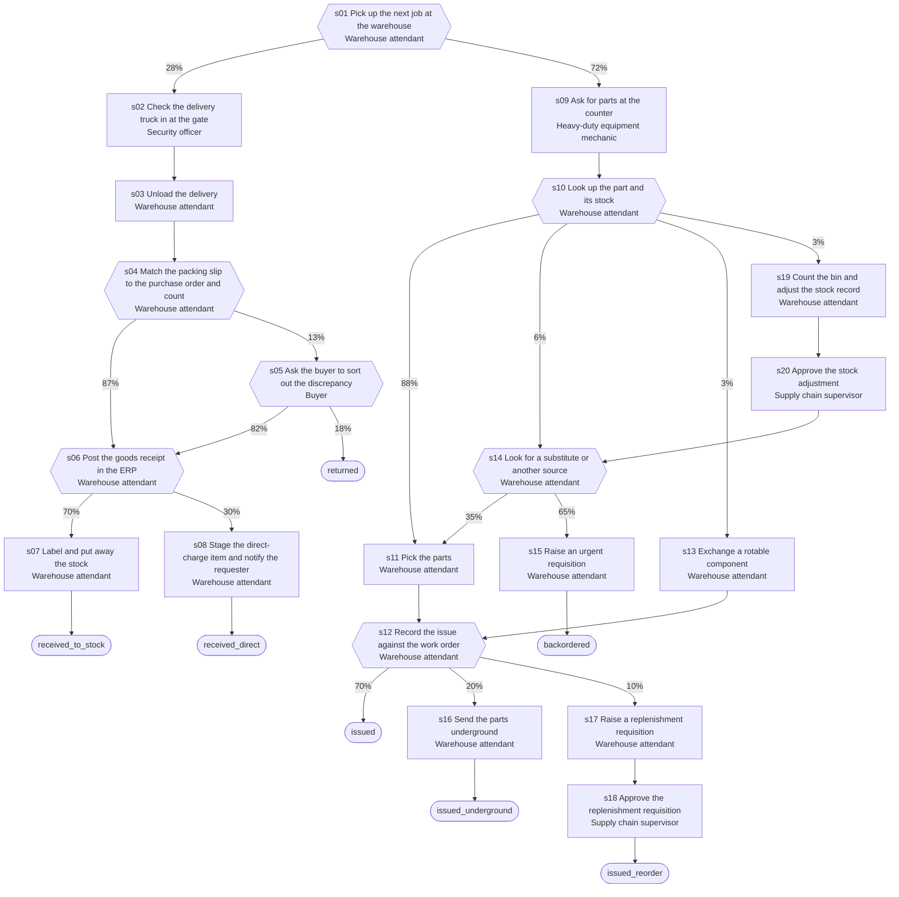

# Receiving, stores and inventory

`mine-site-warehouse` · mining (underground gold) · supply chain · part of `mining-operator-co`

The mine's warehouse receives every supplier delivery against a purchase order, keeps several thousand spare parts and consumables, and issues them to mechanics, electricians and mining crews around the clock. Warehouse attendants on 14-on/14-off rotation check deliveries against orders in the ERP, put stock away, issue parts against work orders, exchange rotable components, and send parts underground by cage. Discrepancies go to the buyers, and stockouts turn into urgent orders. Errors come from issues not recorded against a work order, parts put in the wrong bin and vague requests, which spoil stock records and job costs and show up as stockouts when a machine is down.

| | |
|---|---|
| Unit of work | one receipt (one supplier delivery) or one stores issue |
| Starts when | A supplier truck arrives with a delivery, or a mechanic or crew asks for parts. |
| Done when | The receipt is posted and the stock put away or staged for the job, or the parts are issued and charged to a work order (or an urgent order is raised when nothing is on site). |
| Organisation | A single-mine Canadian gold producer running a 500-650 tpd underground mine and its own mill near Wawa in northern Ontario, with 12-hour shifts on 14-on/14-off rotations and a camp. (300 employees, 2019-2022) |
| Volume | 2,200 cases a month (range 1,500 to 3,000) |

## Where it sits

- Starts with **goods_delivery** from suppliers (24% of cases)
- Starts with **goods_receipt** from mine-explosives (1% of cases)
- Starts with **goods_receipt** from mill-reagents (1% of cases)
- Starts with **fuel_delivery** from site-fuel (2% of cases)
- Starts with **stores_request** from mnt-mobile-pm (20% of cases)
- Starts with **stores_request** from mnt-breakdown-repair (30% of cases)
- Starts with **stores_request** from mnt-fixed-plant (12% of cases)
- Starts with **rebuilt_component** from mnt-component-rebuild (3% of cases)
- Starts with **stores_request** from mine-ug-services (7% of cases)
- Sends **goods_receipt** to site-ap (outcome: received_to_stock)
- Sends **goods_receipt** to site-ap (outcome: received_direct)
- Sends **purchase_requisition** to site-purchasing (outcome: backordered)
- Sends **purchase_requisition** to site-purchasing (outcome: issued_reorder)
- Sends **stores_issue** to site-cost-reporting (outcome: issued)
- Sends **stores_issue** to site-cost-reporting (outcome: issued_underground)
- Sends **component_for_rebuild** to mnt-component-rebuild (outcome: any)
- Sends **goods_delivery** to suppliers (outcome: returned)

## Flow

## Roles

| Role | Department | Layer | FTE on this process | Loaded cost per hour | Evidence |
|---|---|---|---:|---:|---|
| Warehouse attendant | Supply chain and warehouse | individual contributor | 5 | 37 CAD | B [noc-14401] |
| Supply chain supervisor | Supply chain and warehouse | supervisor | 0.3 | 70 CAD | C |
| Buyer | Supply chain and warehouse | individual contributor | 0.2 | 45 CAD | C |
| Security officer | Site services | individual contributor | 0.3 | 35 CAD | C |
| Heavy-duty equipment mechanic | Mobile equipment maintenance | individual contributor | 1.5 | 53 CAD | C |

## Steps

Hands-on time and the wait before each step show the most common value. Evidence tier A is a sourced number, B a sourced description, C the author's estimate.

| Step | Who | Kind | Hands-on | Wait before | Control | Evidence |
|---|---|---|---:|---:|---|---|
| **s01 Pick up the next job at the warehouse.** The warehouse attendant on shift takes the next piece of work: a supplier truck at the gate with a delivery, or a mechanic or crew member at the counter, on the phone or on a pick list asking for parts. They decide whether it is a receipt or an issue. | Warehouse attendant | intake | 2 min | 5 min |  | C |
| **s02 Check the delivery truck in at the gate.** The security officer checks the driver's identity and paperwork at the gatehouse, records the truck in the gate log, gives the site safety rules and radios the warehouse that a delivery is coming. | Security officer | validation | 5 min | 15 min | Site access and security procedure: all vehicles logged at the gatehouse | C |
| **s03 Unload the delivery.** The attendant unloads pallets, crates and long material from the truck with the forklift into the receiving bay or yard and signs the driver's bill of lading, noting any visible damage. | Warehouse attendant | physical | 15 min | 20 min |  | C |
| **s04 Match the packing slip to the purchase order and count.** The attendant looks up the purchase order in the ERP from the packing slip, counts and inspects each line, and compares part numbers and quantities with what was ordered. | Warehouse attendant | validation | 10 min | 1.0 h |  | B [noc-14401] |
| **s05 Ask the buyer to sort out the discrepancy.** The attendant emails the buyer with photos and the packing slip; the buyer calls the supplier, agrees a credit, a replacement or a return, or raises a missing purchase order, and tells the warehouse what to do with the goods. | Buyer | communication | 30 min | 1.0 d |  | C |
| **s06 Post the goods receipt in the ERP.** The attendant enters the received quantities against the purchase order lines in the ERP, which updates stock on hand and makes the receipt available for three-way matching in accounts payable. | Warehouse attendant | data entry | 5 min | 30 min | Internal control over purchasing: goods receipt posted by stores, separate from the buyer and accounts payable, for three-way match | B [noc-14401] |
| **s07 Label and put away the stock.** The attendant labels each item with its stock number and bin location and puts it away on the shelves, in the bulk storage or the yard, using the forklift for heavy items. | Warehouse attendant | physical | 12 min | 2.0 h |  | B [noc-14401] |
| **s08 Stage the direct-charge item and notify the requester.** The attendant puts the item on the hold shelf tagged with the work order or job, and calls or emails the planner or supervisor who ordered it to collect it or have it sent to the shop. | Warehouse attendant | communication | 5 min | 1.0 h |  | C |
| **s09 Ask for parts at the counter.** A mechanic or crew member comes to the counter with a work order number or a pick list from the planner, or phones from underground, and describes the parts needed, often by machine model and description rather than part number. | Heavy-duty equipment mechanic | intake | 4 min | 5 min |  | C |
| **s10 Look up the part and its stock.** The attendant searches the ERP item master by part number, description or machine, checks the quantity on hand and bin location, and checks interchangeable numbers when the first one is not found. | Warehouse attendant | lookup | 3 min | 0 min |  | B [mmh-mro] |
| **s11 Pick the parts.** The attendant walks to the bins or the yard, picks the quantity, checks it against the request with the mechanic, and brings heavy items with the forklift. | Warehouse attendant | physical | 5 min | 0 min |  | B [noc-14401] |
| **s12 Record the issue against the work order.** The attendant enters the issue in the ERP against the work order or cost centre and the equipment number, prints or signs the issue slip, and hands over the parts. On night shift or when the counter is busy, issues are written on paper and keyed in later. | Warehouse attendant | data entry | 3 min | 0 min | Inventory control: every stores issue recorded against a work order or cost centre | C |
| **s13 Exchange a rotable component.** For a rotable part (a pump, starter, hydraulic cylinder or transmission) the attendant takes the failed core from the mechanic, tags it for rebuild with the work order, and issues a rebuilt unit from stock. | Warehouse attendant | physical | 15 min | 10 min |  | C |
| **s14 Look for a substitute or another source.** With the planner or the mechanic the attendant checks alternative part numbers, a cannibalized unit, or parts on an order that has arrived but not been received, before raising an urgent order. | Warehouse attendant | lookup | 20 min | 0 min |  | C |
| **s15 Raise an urgent requisition.** The attendant raises a rush purchase requisition in the ERP with the work order and equipment down, and phones the buyer to expedite with the supplier and a hot-shot courier. | Warehouse attendant | data entry | 10 min | 10 min |  | C |
| **s16 Send the parts underground.** The attendant packs the parts in a tote or on a pallet tagged with the level and work order, books space on the next material cage or personnel-carrier run, and radios the underground crew when they are on their way. | Warehouse attendant | coordination | 10 min | 2.0 h |  | C |
| **s17 Raise a replenishment requisition.** When the ERP shows the item below its reorder point, the attendant reviews usage and raises a replenishment requisition for the reorder quantity. | Warehouse attendant | data entry | 5 min | 4.0 h |  | B [noc-14401] |
| **s18 Approve the replenishment requisition.** The supply chain supervisor reviews the day's replenishment requisitions in the ERP for quantity and value, adjusts reorder points for slow movers, and releases them to the buyers. | Supply chain supervisor | approval | 3 min | 1.0 d | Purchasing authority limits: requisitions approved by the supply chain supervisor before purchase | C |
| **s19 Count the bin and adjust the stock record.** The attendant counts the bin and nearby locations, searches for the item, checks recent issues and receipts, and prepares a stock adjustment in the ERP with the reason. | Warehouse attendant | validation | 20 min | 0 min |  | B [mmh-mro] |
| **s20 Approve the stock adjustment.** The supply chain supervisor reviews the adjustment and its value, approves it in the ERP or asks for a recount, and the attendant then treats the item as out of stock. | Supply chain supervisor | approval | 5 min | 1.0 h | Inventory control: stock adjustments approved by someone other than the person who counted | C |

## Exceptions

| Exception | Share of cases | What happens |
|---|---:|---|
| Receiving discrepancy | 4% | About 13% of deliveries are short, over, wrong, damaged or arrive without a purchase order; the buyer resolves them with the supplier and about one in five is returned. |
| Stockout | 5% | The part is not on site; a substitute is found for about a third, the rest become urgent orders. |
| Phantom stock | 2% | The ERP shows stock but the bin is empty, usually after an unrecorded issue or a wrong put-away; the attendant counts, the supervisor approves an adjustment and the request becomes a stockout. |

## Benchmarks

| Metric | Value | Unit | Population | Evidence |
|---|---|---|---|---|
| cycle_time_days | p50 0.05, p90 1.0 | calendar days from the job reaching the warehouse to receipt posted and put away or parts handed over | Mine site warehouse issuing to maintenance around the clock | C |
| stockout_rate | 0.074 | share of requests not filled from stock (industry average) | MRO storerooms | B [mmh-mro] |
| inventory_accuracy | 0.946 | share of items with correct record (industry average) | MRO storerooms | B [mmh-mro] |

## Pain points

- Parts issued without a slip on night shift or taken underground directly are keyed in late or never, so the ERP shows stock that is not there and job costs are wrong. (steps s12, s19; C)
- Requests by description rather than part number take repeated searches and lead to wrong parts. (steps s09, s10; C)
- Stockouts of critical spares leave equipment down while urgent orders travel to a remote site. (steps s14, s15; B [mmh-mro])

## Assumptions

- About 28% of cases are receipts and 72% issues. Cycle time for backorders ends when the urgent requisition is raised; the wait for the supplier belongs to site-purchasing.
- Fuel deliveries and underground services materials were added as triggers; the organisation file routes fuel to site-fuel only and lists no stores requests from mine-ug-services.
- Mechanics stand in for all requesters at the counter (electricians, millwrights, miners).
- The forklift is not in the organisation file and was added as a resource.
- The simulated median (about 0.09 days, roughly two hours) is above the 0.05-day estimate because receipts wait for counting and put-away and parts for underground wait for the cage; counter issues alone take under an hour.
- The staffing check implies about 11 FTE against 7.3 stated because triangular step times have long tails and requesters' counter time is included; attendants on 14/14 rotation also work about 168 hours a month rather than 130.
- Attendants on a 14/14 rotation with 12-hour shifts work about 168 hours a month, more than the 130 productive hours the staffing check assumes.
- Loaded costs are the organisation file's rates: base wage times 1.30 for office and staff roles and 1.35 for hourly site roles.
- Organisation file corrected on 2026-11-24 to match this workflow's sources: ids were renamed (mill-elution-refining to mill-gold-room-refining, loaded_carbon to gold_concentrate, tailings_slurry to filtered_tailings, elution-circuit to refinery), and roles and resources this workflow added are now in the organisation file. Notes above that describe a mismatch refer to the file before the correction.

## Sources

- [noc-14401] [NOC 2021 unit group 14401: Storekeepers and partspersons](https://noc.esdc.gc.ca/Structure/NOCProfile?GocTemplateCulture=en-CA&code=14401&version=2021.0) (Employment and Social Development Canada, National Occupational Classification, 2021). Storekeepers receive and sort incoming parts and supplies, store them in a warehouse, tool room or supply room, process requisitions and issue parts for internal use, keep records of the amount, kind and location of stock in a manual or computerized inventory system, and prepare requisitions to replenish stock.
- [mmh-mro] [MRO efficiency can help keep costs down (Phil Hebert and Rick Wakeland)](https://www.mmh.com/article/managing_mro_for_a_profit/MRO) (Modern Materials Handling, 2018). MRO storeroom key performance indicators: industry average stockouts 7.4% against a target of 5% or lower; inventory accuracy 94.6% against a 95% target; customer service level 95% or higher; inventory turns 2 a year against a target of 4.

Written by claude-opus on 2026-11-24.
