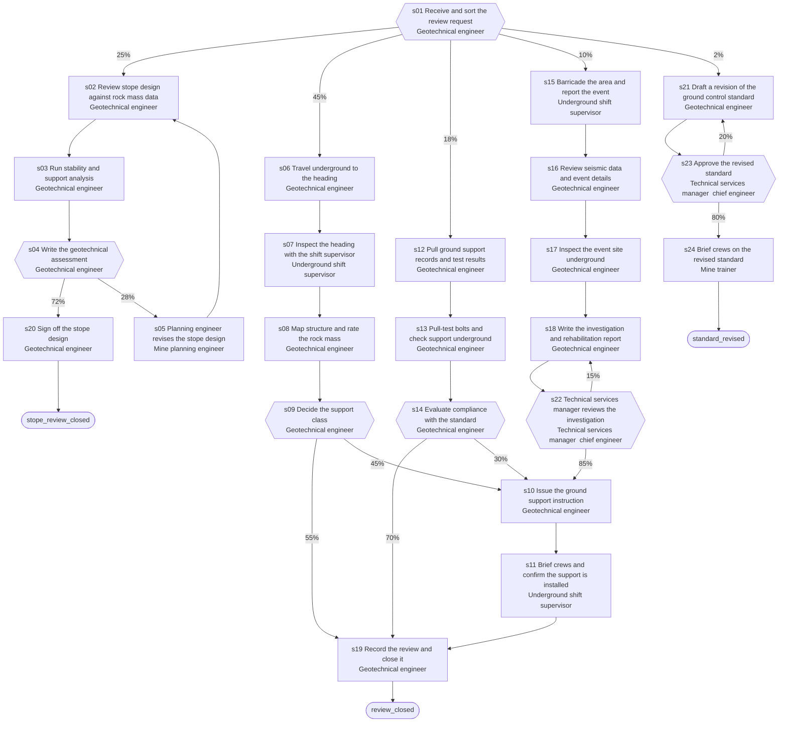

# Ground control program and geotechnical review

`mine-ts-geotech` · gold mining (underground) · technical services (ground control) · part of `mining-operator-co`

Rock in an underground mine can fall from the back or walls, so the mine keeps a ground control program that sets how every opening is supported and checked. The geotechnical engineer reviews stope designs before release, inspects headings with shift supervisors when ground looks poor, audits installed bolts and investigates falls of ground and seismic events. Each review ends with a sign-off, a support instruction to the crews, or a change to the standard. The work is slow and error-prone because one engineer on a two-week rotation carries it, underground inspections need travel and a supervisor at the same time, and urgent events push routine reviews back.

| | |
|---|---|
| Unit of work | one geotechnical review |
| Starts when | A stope design is submitted, a supervisor reports poor ground, a support audit is due, a fall of ground or seismic event occurs, or a standard needs revising. |
| Done when | The stope design is signed off, a support instruction is installed and recorded, an investigation is closed, or a revised standard is in force. |
| Organisation | A 600 tpd underground gold mine in northern Ontario with one site geotechnical engineer, consultant reviews once a year, and 14/14 rotations. (300 employees, 2019-2022) |
| Volume | 25 cases a month (range 15 to 40) |

## Where it sits

- Starts with **stope_design** from ts-stope-design (25% of cases)
- Starts with **shift_report** from mine-shift-control (45% of cases)
- Starts with **ground_support_record** from mine-ground-support (18% of cases)
- Starts with **incident_report** from mine-shift-control (10% of cases)
- Starts with **geotech_assessment** from consultants (2% of cases)
- Sends **geotech_assessment** to ts-stope-design (outcome: stope_review_closed)
- Sends **ground_control_standard** to mine-ground-support (outcome: review_closed)
- Sends **ground_control_standard** to mine-ground-support (outcome: standard_revised)
- Sends **ground_control_standard** to hse-training (outcome: standard_revised)
- Sends **investigation_report** to hse-incident-mgmt (outcome: review_closed)
- Sends **geotech_assessment** to ts-lom-planning (outcome: any)

## Flow

## Roles

| Role | Department | Layer | FTE on this process | Loaded cost per hour | Evidence |
|---|---|---|---:|---:|---|
| Geotechnical engineer | Mine engineering and survey | senior specialist | 1.8 | 78 CAD | C |
| Underground shift supervisor | Underground production and development | supervisor | 0.15 | 82 CAD | C |
| Mine planning engineer | Mine engineering and survey | senior specialist | 0.1 | 74 CAD | C |
| Technical services manager (chief engineer) | Technical services | manager | 0.06 | 115 CAD | C |
| Mine trainer | Health, safety, environment and community | individual contributor | 0.02 | 53 CAD | C |

## Steps

Hands-on time and the wait before each step show the most common value. Evidence tier A is a sourced number, B a sourced description, C the author's estimate.

| Step | Who | Kind | Hands-on | Wait before | Control | Evidence |
|---|---|---|---:|---:|---|---|
| **s01 Receive and sort the review request.** The geotechnical engineer picks up the request from the stope release queue, a supervisor's call or shift report about bad ground, the weekly ground support records or an incident report. He decides what kind of review it is and how urgent, and logs it in his review tracker. | Geotechnical engineer | intake | 20 min | 2.0 h |  | C |
| **s02 Review stope design against rock mass data.** The engineer opens the stope design in the planning software and checks the stope dimensions, hangingwall and footwall exposure, brow and pillar sizes against the rock mass quality mapped in nearby development. He compares the design with the agreed mining sequence and with how neighbouring stopes behaved. | Geotechnical engineer | review | 1.5 h | 12.0 h |  | B [src2] |
| **s03 Run stability and support analysis.** The engineer runs a stability-graph or wedge analysis for the stope walls and back and designs cable bolting for brows and hangingwalls where needed, aiming for the factor of safety the ground control program sets. He checks the expected overbreak against the dilution allowance used in the reserve. | Geotechnical engineer | analysis | 3.0 h | 1.0 h |  | B [src1] |
| **s04 Write the geotechnical assessment.** The engineer writes the geotechnical assessment: allowed spans, cable bolt pattern, sequence and fill requirements, and any hold points. He either accepts the design as drawn or returns it to the planning engineer with required changes. | Geotechnical engineer | drafting | 2.0 h | 2.0 h |  | C |
| **s05 Planning engineer revises the stope design.** The mine planning engineer changes the stope shape, splits it into smaller stopes or adds a pillar or cable bolting to meet the assessment, then resubmits it. Changes can also move the drill rings and the stope's tonnes and grade. | Mine planning engineer | drafting | 4.0 h | 1.0 d |  | C |
| **s06 Travel underground to the heading.** The engineer signs in at the lamp room, rides the cage or ramp vehicle to the level and drives a utility vehicle to the heading, arranging to meet the shift supervisor there by radio. Travel to deeper levels can take most of an hour each way. | Geotechnical engineer | travel | 45 min | 12.0 h |  | C |
| **s07 Inspect the heading with the shift supervisor.** The supervisor and engineer examine the back and walls from under supported ground, sound and scale loose rock, look for cracking, bagging mesh, plate loading and water, and check the bolt pattern against the standard. The supervisor points out what the crew reported. | Underground shift supervisor | physical | 1.0 h | 30 min | Ontario Regulation 854 (Mines and Mining Plants): examination of ground conditions and no work under unsupported ground; company ground control program | B [src1] |
| **s08 Map structure and rate the rock mass.** The engineer maps joint sets, faults and shear zones in the heading, estimates a rock mass rating, takes photos and marks positions on a level plan. He notes how the structures line up with the heading direction and planned stopes. | Geotechnical engineer | physical | 1.0 h | 0 min |  | C |
| **s09 Decide the support class.** Back on surface the engineer compares the rating and observations with the support classes in the ground control standard and decides whether standard support is enough or the heading needs heavier support such as cable bolts, straps, shotcrete or a shorter round. | Geotechnical engineer | judgment | 1.0 h | 2.0 h |  | B [src1] |
| **s10 Issue the ground support instruction.** The engineer writes a short support instruction with the area, the support class, the bolt type and pattern, and any cable bolting or rehabilitation, with a sketch, and sends it to the mine captain and the shift supervisors. He posts it at the line-up room so every crew sees it. | Geotechnical engineer | drafting | 1.0 h | 1.0 h |  | C |
| **s11 Brief crews and confirm the support is installed.** At the next line-up the shift supervisor explains the instruction to the bolter and development crews and assigns the work. After installation he checks the heading and records the support installed on the shift report before the heading is released for the next round. | Underground shift supervisor | communication | 30 min | 6.0 h | Ontario Regulation 854 (Mines and Mining Plants): examination of ground conditions and no work under unsupported ground; company ground control program | C |
| **s12 Pull ground support records and test results.** The engineer collects the bolter shift records, bolt counts by heading, pull-test results and shotcrete thickness checks for the period from the shift sheets and compares them with the support required in each heading. He chooses headings to check in person. | Geotechnical engineer | lookup | 2.0 h | 1.0 d |  | C |
| **s13 Pull-test bolts and check support underground.** The engineer and a helper travel to the sampled headings, pull-test a set of bolts with a hydraulic jack, measure shotcrete thickness and check plates, mesh overlap and spacing. Results go into a field book. | Geotechnical engineer | physical | 3.0 h | 1.0 d | Ontario Regulation 854 (Mines and Mining Plants): examination of ground conditions and no work under unsupported ground; company ground control program | C |
| **s14 Evaluate compliance with the standard.** The engineer compares test loads, spacing and coverage with the standard and lists headings that fall short. Nonconforming headings get a corrective support instruction; the rest are recorded as compliant. | Geotechnical engineer | analysis | 1.5 h | 2.0 h |  | C |
| **s15 Barricade the area and report the event.** After a fall of ground or a felt seismic event the shift supervisor withdraws people, barricades and posts the area, and reports it by radio to the mine captain, the safety coordinator and the geotechnical engineer. He fills in the incident report for the safety system. | Underground shift supervisor | communication | 45 min | 0 min | Ontario Occupational Health and Safety Act and Regulation 854: notice of significant falls of ground and preservation of the area | C |
| **s16 Review seismic data and event details.** The engineer reviews the event location and magnitude from the seismic monitoring system where it covers the area, the blast records and recent support work, and sets the re-entry conditions and quiet period before anyone inspects the area. | Geotechnical engineer | analysis | 2.0 h | 2.0 h |  | B [src1] |
| **s17 Inspect the event site underground.** When re-entry conditions are met the engineer travels to the area with the supervisor, inspects from supported ground, measures the size of the fall, photographs damaged support and judges whether the failure follows a structure. He decides how the area must be made safe. | Geotechnical engineer | physical | 4.0 h | 4.0 h | Ontario Regulation 854 (Mines and Mining Plants): examination of ground conditions and no work under unsupported ground; company ground control program | C |
| **s18 Write the investigation and rehabilitation report.** The engineer writes up the cause, the size and the support performance, attaches the survey of the cavity, and recommends rehabilitation, support changes for similar ground and any change to the mining sequence. The report goes to the safety coordinator for the incident file. | Geotechnical engineer | drafting | 6.0 h | 1.0 d |  | C |
| **s19 Record the review and close it.** The engineer records the outcome in the ground control files: the heading, rating, support class, instruction and photos, and updates the level plan of ground conditions. He closes the request in his tracker. | Geotechnical engineer | data entry | 30 min | 2.0 h | Ontario Regulation 854: records of ground conditions and support under the ground control program | C |
| **s20 Sign off the stope design.** The engineer signs the stope release form for ground control, attaching the geotechnical assessment and noting any hold points such as cable bolting before blasting. The signed package goes back to the planning engineer for operations and geology signatures. | Geotechnical engineer | approval | 30 min | 4.0 h | Company stope design and release procedure: geotechnical sign-off before release | C |
| **s21 Draft a revision of the ground control standard.** Prompted by the annual consultant review, an investigation or new ground at depth, the engineer drafts changes to the ground control standard: support classes, bolt types, patterns, cable bolting rules and quality control checks. He checks the bolts and mesh are stocked before proposing them. | Geotechnical engineer | drafting | 1.2 d | 3.0 d |  | B [src1] |
| **s22 Technical services manager reviews the investigation.** The technical services manager reads the investigation report, questions the cause and the recommended rehabilitation, and agrees changes to support or sequence with the mine superintendent. He sends it back for more work when the cause is not supported. | Technical services manager (chief engineer) | review | 2.0 h | 2.0 d |  | C |
| **s23 Approve the revised standard.** The technical services manager reviews the draft standard with the mine superintendent and the joint health and safety committee representative and signs it into the ground control program. About one draft in five goes back for changes. | Technical services manager (chief engineer) | approval | 2.0 h | 4.0 d | Ontario Regulation 854: written ground control program kept current for the mine | C |
| **s24 Brief crews on the revised standard.** The mine trainer adds the change to the task training material and briefs each crew at line-ups over a full rotation cycle, collecting sign-off sheets. Old copies are removed from the line-up rooms. | Mine trainer | communication | 4.0 h | 5.0 d |  | C |

## Exceptions

| Exception | Share of cases | What happens |
|---|---:|---|
| Stope design returned for changes | 7% | The review finds spans or brows that need a smaller stope, a pillar or cable bolting, and the planning engineer revises the design. |
| Audit finds nonconforming support | 5% | Pull tests or spacing checks fail and a corrective instruction is issued to the crews. |
| Fall of ground investigation | 10% | The area is barricaded, re-entry waits for a quiet period, and the investigation leads to rehabilitation and support changes. |
| Engineer off rotation | 30% | Requests arriving while the only geotechnical engineer is off site wait, are handled by phone, or are covered by the chief engineer. |

## Benchmarks

| Metric | Value | Unit | Population | Evidence |
|---|---|---|---|---|
| cycle_time_days | p50 3, p90 12 | calendar days from request to closed review | Mixed geotechnical reviews at a single underground mine | C |
| minimum_factor_of_safety | 1.2 short-term, 1.5 long-term | factor of safety | Comparable Ontario underground gold mine | A [src1] |
| bolt_pattern | 1.2 m by 1.2 m dice-five | pattern | Comparable Ontario underground gold mine | A [src1] |

## Pain points

- One geotechnical engineer on a 14/14 rotation means half the month has no one on site; requests wait or are judged by phone from photos. (steps s01, s02, s12; C)
- Underground inspections need a vehicle and a supervisor free at the same time, and travel takes a large share of the inspection. (steps s06, s07, s13; C)
- Support instructions pass by line-up and paper, so a crew on the other shift or rotation can miss them. (steps s10, s11; C)
- Stope design rework between engineering and ground control delays stope release and can cost grade when stopes fail. (steps s04, s05; B [src3])

## Assumptions

- Loaded costs come from the organisation file (salary times 1.30 for staff roles, 1.35 for hourly roles).
- The geotechnical engineer's hands-on time in this file averages about 9.4 hours per review, or about 235 hours a month at 25 reviews (1.8 FTE). One person on a 14/14 rotation is on site about 168 hours a month and away the other half, so the file states 1.8 FTE: in practice a second geotechnical engineer or ground control technologist works the opposite rotation, or the chief engineer and a consultant absorb the overflow. The organisation file's headcount of one is reported as too low.
- Ontario Regulation 854 duties (workplace examination of ground, ground control program, records, reporting of falls of ground) are described from general knowledge because the e-Laws and ministry pages returned errors; those controls carry tier C evidence.
- The seismic monitoring step assumes a microseismic system covers the main mining area, as at the comparable mine; whether the reference mine had one in 2019-2022 was not confirmed.
- Mine engineer, technical services manager and trainer take part but are not listed for this process in the organisation file.

## Sources

- [src1] [Macassa Mine NI 43-101 Technical Report (April 2019), exhibit 99.20](https://www.sec.gov/Archives/edgar/data/1713443/000162828019003767/a2019macassani4310101apr.htm) (Kirkland Lake Gold Ltd. (filed on SEC EDGAR), 2019). Comparable Ontario underground gold mine, section 15.5: back support checked with two-dimensional wedge analysis and Unwedge for 3D; minimum factor of safety 1.2 for short-term and 1.5 for long-term headings; five support classes with bolts on a 1.2 m by 1.2 m dice-five pattern; one hole one bolt policy; support to within 1 m of the sill unless ground control approves 1.5 m; 24/7 seismic monitoring by ground control and security with post-blast seismicity reports every 12 hours and bi-weekly mXrap hazard reports; annual ground control reviews by qualified consultants; regular numerical stress modelling; class D support for rockburst-prone headings
- [src2] [Island Gold Mine NI 43-101 Technical Report (Phase III expansion), exhibit 99.1](https://www.sec.gov/Archives/edgar/data/1178819/000117881920000070/ex991technicalreportfo.htm) (Alamos Gold Inc. (filed on SEC EDGAR), 2020). Comparable Wawa-area underground mine: longitudinal and transverse open stoping, move to a centre-out stoping sequence to support improved mining stress management, paste fill justified partly by geotechnical de-risking, stope dilution of 15-50 percent by sector and method
- [src3] [Wesdome Announces 2020 Fourth Quarter and Full Year Production Results; Provides 2021 Guidance](https://finance.yahoo.com/news/wesdome-announces-2020-fourth-quarter-213000875.html) (Wesdome Gold Mines Ltd. (news release, via Yahoo Finance), 2021). Reference mine Q4 2020: geotechnical problems in one underground stope hurt grade performance and were resolved within the month

Written by claude-opus on 2026-11-24.
