# Face mapping, sampling and grade control

`mine-ts-grade-control` · mining (underground gold) · mine geology · part of `mining-operator-co`

After every blast in an ore heading, a mine geologist and a sampler go to the new face, check that it is supported, wash it, map the vein and chip a line of samples across it, and tell the crew where the next round should go and whether the muck is ore or waste. The samples go up with the end-of-shift traffic and travel by the daily company shuttle to the mine's own assay office in Wawa, and the results come back by email a day or two later. The geologist then loads the assays, updates the ore outline and grades used by planners and engineers, and corrects the ore or waste call if the assays disagree with what was seen. Delays come from waiting for headings to be bolted, the daily shuttle and lab batching; errors come from inconsistent chipping, a visual ore call that turns out wrong and sample mix-ups.

| | |
|---|---|
| Unit of work | one face mapped and sampled |
| Starts when | A development round in an ore heading (sill, sub-level, drawpoint or raise on vein) has been blasted, mucked and supported, exposing a new face. |
| Done when | The face assays are loaded, the grade control outline and grades are updated and sent to shift control and planners, and any wrong ore or waste call has been corrected. |
| Organisation | A single-mine Canadian gold producer running a 500-650 tpd narrow-vein underground mine in northern Ontario, with a technical services department of about 20 engineers, surveyors and geologists on a 14-on, 14-off rotation. (300 employees, 2019-2022) |
| Volume | 65 cases a month (range 40 to 100) |

## Where it sits

- Starts with **developed_face** from mine-dev-drill-blast (100% of cases)
- Relies on **assay_result** from mill-assay-lab (a standing input; it does not start a case)
- Sends **face_sample** to mill-assay-lab (outcome: any)
- Sends **grade_control_model** to ts-stope-design (outcome: model updated)
- Sends **grade_control_model** to mine-shift-control (outcome: model updated)
- Sends **grade_control_model** to ts-reconciliation (outcome: model updated)

## Flow

```mermaid
flowchart TD
    s01["s01 Check line-up for ore rounds ready to sample<br/>Mine geologist"]
    s02["s02 Plan sampling route and confirm headings are free<br/>Mine geologist"]
    s03["s03 Drive underground to the heading<br/>Geology technician and sampler"]
    s04{{"s04 Check the heading is safe to enter<br/>Mine geologist"}}
    s05["s05 Wash and mark up the face<br/>Geology technician and sampler"]
    s06["s06 Map the face and set sample intervals<br/>Mine geologist"]
    s07["s07 Give direction and ore or waste call to the crew<br/>Mine geologist"]
    s08["s08 Chip samples across the face<br/>Geology technician and sampler"]
    s09["s09 Carry samples to the core shack and surface<br/>Geology technician and sampler"]
    s10["s10 Collect muck or test-hole samples instead<br/>Scooptram  LHD  operator"]
    s11{{"s11 Log samples and fill in the submission sheet<br/>Geology technician and sampler"}}
    s12["s12 Lab receives and sorts the samples<br/>Assay technician"]
    s13["s13 Hold samples on site until the shuttle runs<br/>Geology technician and sampler"]
    s14["s14 Prepare and fire-assay the samples<br/>Assay technician"]
    s15{{"s15 Review lab QC and release results<br/>Assay lab superintendent or shift supervisor"}}
    s16["s16 Load assays and match them to samples<br/>Mine geologist"]
    s17{{"s17 Check assays against the face map<br/>Mine geologist"}}
    s18["s18 Composite the face grade and update the outline<br/>Mine geologist"]
    s19{{"s19 Compare assays with the visual ore call<br/>Mine geologist"}}
    s20["s20 Correct the tally and the routing of the muck<br/>Underground shift supervisor"]
    s21{{"s21 Send the daily geology note<br/>Mine geologist"}}
    s22["s22 Chief geologist reviews the outline change<br/>Chief mine geologist"]
    s01 --> s02
    s02 --> s03
    s03 --> s04
    s04 -->|"88%"| s05
    s04 -->|"12%"| s10
    s05 --> s06
    s06 --> s07
    s07 --> s08
    s08 --> s09
    s09 --> s11
    s10 --> s11
    s11 -->|"96%"| s12
    s11 -->|"4%"| s13
    s12 --> s14
    s13 --> s12
    s14 --> s15
    s15 -->|"95%"| s16
    s15 -->|"5%"| s14
    s16 --> s17
    s17 -->|"95%"| s18
    s17 -->|"5%"| s14
    s18 --> s19
    s19 -->|"90%"| s21
    s19 -->|"10%"| s20
    s20 --> s21
    s21 -->|"80%"| end0
    s21 -->|"20%"| s22
    s22 --> end0
    end0(["model updated"])
```

## Roles

| Role | Department | Layer | FTE on this process | Loaded cost per hour | Evidence |
|---|---|---|---:|---:|---|
| Mine geologist | Mine geology | senior specialist | 1.3 | 68 CAD | B [er2022] |
| Geology technician and sampler | Mine geology | individual contributor | 0.9 | 43 CAD | B [er2022], [island] |
| Chief mine geologist | Mine geology | manager | 0.03 | 108 CAD | C |
| Assay technician | Assay laboratory | individual contributor | 0.45 | 40 CAD | B [er2022], [er2016] |
| Assay lab superintendent or shift supervisor | Assay laboratory | supervisor | 0.03 | 64 CAD | B [er2016] |
| Scooptram (LHD) operator | Underground production and development | individual contributor | 0.02 | 51 CAD | B [er2022], [er2016] |
| Underground shift supervisor | Underground production and development | supervisor | 0.01 | 82 CAD | C |

## Steps

Hands-on time and the wait before each step show the most common value. Evidence tier A is a sourced number, B a sourced description, C the author's estimate.

| Step | Who | Kind | Hands-on | Wait before | Control | Evidence |
|---|---|---|---:|---:|---|---|
| **s01 Check line-up for ore rounds ready to sample.** At the start of shift the mine geologist reads the shift reports and line-up board to see which ore headings were blasted, mucked out and bolted on the previous shift. A face can only be sampled after the heading has been inspected for safety and all rock support is installed, so freshly blasted faces wait for the mucking and bolting cycle. | Mine geologist | intake | 10 min | 10.0 h |  | B [er2022] |
| **s02 Plan sampling route and confirm headings are free.** The geologist orders the faces by level to make one trip, then radios or phones the shift supervisor to confirm that each heading is not being drilled, charged or mucked when the pair arrives. Headings that are busy are moved to later in the shift or to the next day. | Mine geologist | coordination | 10 min | 2.0 h |  | C |
| **s03 Drive underground to the heading.** The sampler and geologist take a light vehicle down the ramp with sample bags, tags, hammer, wedge, paint and a water hose, and drive between the faces on the route. The time shown is the share of the round trip charged to one face, since a trip usually covers several faces. | Geology technician and sampler | travel | 25 min | 1.0 h |  | C |
| **s04 Check the heading is safe to enter.** The geologist examines the back and walls for loose rock, confirms bolts and screen are installed to the face and checks that blasting fumes have cleared before anyone stands at the face. Faces in raises or under unsupported ground are not chipped; they are sampled from the muck or by test holes instead. | Mine geologist | validation | 10 min | 0 min | Ontario Regulation 854 under the Occupational Health and Safety Act: workplace examination and no work under unsupported ground; site sampling procedure | B [er2022], [er2016] |
| **s05 Wash and mark up the face.** The sampler washes the face with the water hose so the vein and contacts show, then paints a horizontal sample line at shoulder height. The line position is measured as distance and azimuth from the nearest survey bolt so the samples can be plotted later. | Geology technician and sampler | physical | 15 min | 0 min |  | B [er2022] |
| **s06 Map the face and set sample intervals.** The geologist sketches the vein, sheared diorite contacts, structures and any visible gold on a face sheet, and paints sample limits that respect the contacts: at least 0.3 m in ore, at most 0.3 m where visible gold shows, one sample across waste. This judgement decides how well the samples represent the face. | Mine geologist | judgment | 30 min | 0 min |  | B [er2022], [er2016] |
| **s07 Give direction and ore or waste call to the crew.** From the map, the geologist paints the vein limits and centre line for the next round and tells the shift supervisor or jumbo operator whether to follow, slash or turn the heading. The geologist also calls the current muck pile ore or waste by eye, because the assays will not be back before it is hauled. | Mine geologist | communication | 10 min | 0 min |  | C |
| **s08 Chip samples across the face.** The sampler chips each interval with a rock hammer or mallet and wedge, catching the fragments in a bag held at the face, and bags and tags each sample in sequence. A face usually gives four to ten samples of about 1.5 to 2.5 kg. | Geology technician and sampler | physical | 40 min | 0 min |  | B [er2022], [er2016], [island] |
| **s09 Carry samples to the core shack and surface.** The samples are dropped at the underground core shack during the shift and brought to surface at the end of the beat geologist's shift. On surface they go into the sample boxes between the geology office and the warehouse to wait for the shuttle. | Geology technician and sampler | travel | 15 min | 4.0 h |  | B [er2022] |
| **s10 Collect muck or test-hole samples instead.** When the face cannot be chipped, the geologist hands the crew pre-tagged bags. LHD operators take a handful of muck from each bucket while loading a truck, making one composite of about 3 kg per 25 to 30 t truck, and send the bags up at the end of their shift. | Scooptram (LHD) operator | physical | 15 min | 8.0 h |  | B [er2022], [er2016] |
| **s11 Log samples and fill in the submission sheet.** The sampler enters the sample numbers, heading, interval and visible gold flags in the geology database and prints the lab submission list that travels with the bags. Visible gold samples get an orange tag so the lab applies its extra QC steps. | Geology technician and sampler | data entry | 10 min | 1.0 h |  | B [er2022] |
| **s12 Lab receives and sorts the samples.** The daily company shuttle takes the sealed bags to the mine assay office in Wawa. An assay technician puts the bags in numerical order, checks them against the submission list and adds them to the next preparation batch. | Assay technician | intake | 5 min | 15.0 h |  | B [er2022], [er2016] |
| **s13 Hold samples on site until the shuttle runs.** When the shuttle is cancelled by a snowstorm or road closure, the sampler keeps the bags in the locked sample boxes, tells the geologist that results will be late and sends them on the next run. The heading keeps advancing on the visual call in the meantime. | Geology technician and sampler | coordination | 10 min | 1.0 d |  | C |
| **s14 Prepare and fire-assay the samples.** Technicians dry, crush to about 6 mm, riffle split, pulverise and fuse each sample, cupel the lead button and weigh the gold bead on a microbalance, in furnace batches of 24 to 28 samples that include a blank, a standard and a duplicate. The time shown is the lab time for one face's samples. | Assay technician | physical | 45 min | 12.0 h |  | B [er2022], [er2016] |
| **s15 Review lab QC and release results.** The assay supervisor checks the blank, standard and duplicate in each tray and the visible gold replicates, reruns trays that fail and emails the certificate to mine geology. The lab is not accredited, so this internal QC is the main check on the numbers. | Assay lab superintendent or shift supervisor | review | 10 min | 4.0 h | Mine assay office internal QC protocol: one blank, one certified reference material and one duplicate per 28-sample tray, extra checks on visible gold samples | B [er2022] |
| **s16 Load assays and match them to samples.** The geologist saves the emailed certificate, imports the results into the drillhole and sample database and the channel samples into Promine, and checks that every sample number on the submission sheet has a result. Missing or duplicate numbers are queried with the lab. | Mine geologist | data entry | 15 min | 5.0 h |  | B [er2022], [island] |
| **s17 Check assays against the face map.** The geologist compares each result with the mapped geology: high grades should sit in quartz and visible gold intervals, waste samples should be low. A result that contradicts the map is sent back for a re-assay of the reject. | Mine geologist | validation | 10 min | 0 min |  | C |
| **s18 Composite the face grade and update the outline.** The geologist calculates the length-weighted grade and true width for the face, plots it on the level plan and longitudinal section, and moves the ore outline and block grades for the heading and the stope above or below. Before 2021 this was a polygonal model on longitudinal sections; from 2021 the chip composites also fed a 3D model. | Mine geologist | analysis | 35 min | 4.0 h |  | B [er2022], [er2016] |
| **s19 Compare assays with the visual ore call.** The geologist checks whether the round that was called ore by eye really is above the 2 g/t development cut-off, and whether a waste call hid ore. If the call was wrong, shift control must correct the tally and change the routing of any muck still on the level. | Mine geologist | judgment | 10 min | 0 min |  | B [er2022] |
| **s20 Correct the tally and the routing of the muck.** The shift supervisor changes the ore or waste code of the loads on the shift sheet and, if muck is still on the level or at the remuck, tells the LHD and truck operators where to send it. Loads already hoisted or dumped stay as they are and become a reconciliation item. | Underground shift supervisor | communication | 15 min | 6.0 h |  | C |
| **s21 Send the daily geology note.** The geologist emails the updated face grades, ore outlines and heading directions to shift control, the mine captains and the planning engineers, and posts the marked-up level plans. Outline changes that affect a stope design or the monthly plan are flagged for the chief geologist. | Mine geologist | communication | 10 min | 2.0 h |  | C |
| **s22 Chief geologist reviews the outline change.** The chief geologist looks at the face results, the revised outline and the effect on the stope tonnes and grade, and accepts the change or asks for more sampling. Accepted changes are passed to the planning and stope design engineers. | Chief mine geologist | review | 15 min | 1.0 d | Geology department rule that changes to key composites and ore outlines are made or approved by the department head | C |

## Exceptions

| Exception | Share of cases | What happens |
|---|---:|---|
| Face not accessible | 12% | Raise faces or headings under unsupported ground are sampled from the muck or by test holes, which are less representative. |
| Shuttle cancelled | 4% | A snowstorm or road closure holds samples on site for a day or two while the heading keeps advancing on the visual call. |
| Wrong visual call | 10% | Assays show the round was misclassified; the tally is corrected and loads already sent become a reconciliation difference. |
| Lab QC failure | 5% | A tray fails its blank or standard and is rerun, adding a day. |

## Benchmarks

| Metric | Value | Unit | Population | Evidence |
|---|---|---|---|---|
| cycle_time_days | p50 3.5, p90 6 | calendar days from face exposed to grade control model updated | Narrow-vein underground gold mine with off-site company lab and daily shuttle | C |
| chip_sample_spacing | every round, 3-4 m | metres of advance between sampled faces | Eagle River ore development headings | A [er2016] |
| lab_qc_insertion_rate | 0.11 | share of samples that are QC samples | Eagle River mine assay office, 2021 | A [er2022] |
| muck_sample_support | 25-30 | tonnes represented by one muck sample | Eagle River | A [er2022], [er2016] |

## Pain points

- Assays return a day or more after the round, so the ore or waste call and the heading direction rest on the geologist's eye; wrong calls send waste to the mill or ore to the waste fill. (steps s07, s19, s20; C)
- Chip samples average higher than drill core in the same domains, so grade control grades need capping and can overstate stope grades. (steps s08, s18; A [er2022])
- The mine lab is not accredited and reported unreliable gold values below 3 g/t and a 15-20% positive bias on the low-grade standard in 2021, which matters for ore or waste decisions near the 2 g/t development cut-off. (steps s14, s15; A [er2022])
- Sampling depends on the beat geologist's route and on headings being bolted and free, so faces are skipped or sampled late when crews move fast. (steps s01, s02; C)

## Assumptions

- Volume is 40-100 faces a month (mode 65), below the organisation file's 90-170 (mode 130), because only ore and on-vein headings are chip sampled; waste capital development is under survey control (er2022).
- The assay lab steps (s12, s14, s15) are the same work as the mill-assay-lab process; when assembling the organisation model, count the lab labour once.
- The assay office is in Wawa, about an hour from the mine, reached by a daily company shuttle (er2022, er2016); the organisation file places the lab in the processing department at site, which this workflow keeps for role ids.
- Travel time underground is the share of one trip charged to one face; a sampling trip covers three to five faces.
- Touch times per face are the author's estimates. The simulated cycle time adds every wait in sequence; the sampler and geologist work together at the face, which the step list shows as alternating roles.
- Loaded costs per hour are taken from the organisation file (wage times 1.30 for staff and 1.35 for hourly roles).
- Organisation file corrected on 2026-11-24 to match this workflow's sources: ids were renamed (mill-elution-refining to mill-gold-room-refining, loaded_carbon to gold_concentrate, tailings_slurry to filtered_tailings, elution-circuit to refinery), and roles and resources this workflow added are now in the organisation file. Notes above that describe a mismatch refer to the file before the correction.

## Sources

- [er2022] [Technical Report for the Eagle River Gold Mining Complex, Ontario, Canada (CAPR001445)](https://s203.q4cdn.com/643390454/files/doc_downloads/2022/11/ERtechnicalReport.pdf) (SRK Consulting (Canada) Inc. for Wesdome Gold Mines Ltd., 2022). Reference mine practice: channel (chip) sampling of underground faces by production geologist and technician after each advance once the heading is inspected and supported, sample lengths 0.3 m minimum in ore and 0.3 m maximum with visible gold; test-hole, long-hole and muck sampling (one muck sample per 25-30 t truck, taken by muckers); samples brought to surface at end of the beat geologist's shift and shuttled daily to the company assay office in Wawa; mine lab not accredited, 11% QC insertion (blank, CRM, duplicate per 28-sample tray), VG protocol, low-grade CRM bias; channel results recorded in Promine; polygonal estimates before 2021, Leapfrog/Datamine 3D model from 2021; chip samples average higher than core; mine-to-mill reconciliation within 5%; stope design with 1.5 m minimum width, 0.5 m HW and FW dilution from CMS reconciliation, 90% stope and 99% development recovery, stope cut-off 5.5 g/t, development cut-off 2.0 g/t, density 2.7 t/m3; captive sub-level open stoping via Alimak raises, 13-18 m 64 mm down-holes on a 3-2-3 pattern, shrink mucking, CRF sill mats and URF fill; 19% of mill feed from sill development; ore hoisted in 4 t skips and trucked 16.6 km from the portal pad to the mill; two 12 h shifts 365 days a year; UG labour table with 9 mine engineering and 10 mine geology staff; recommendation to evaluate tools for short-term planning; ventilation rule 0.06 m3/s per kW of diesel
- [er2016] [Technical Report for the Eagle River Mining Complex including the Eagle River Gold Mine, the Mishi Gold Mine and Related Infrastructure](https://minedocs.com/12/EagleRiver_TechnicalReport_03172016.pdf) (Wesdome Gold Mines Ltd. (G. Mannard and P. Ng), hosted by minedocs.com, 2016). Chip samples taken every round (every 3 to 4 m) in ore development headings across the full face, about 2.5 kg, 0.3-0.5 m lengths; raises sometimes chip sampled and always muck sampled; muck sample per 25-30 t; sealed samples transported daily to the company Mine Assay office with results emailed to the mine; assay data in Microsoft Access linked to Promine and Surpac/Gemcom, databases updated weekly and audited monthly; about 30% of production from silling and development; CMS surveys show about 1.0 m wall overbreak; Mishi grade control on blast hole samples
- [island] [NI 43-101 Technical Report for the Island Gold Mine, Dubreuilville, Ontario, Canada (exhibit 99.1)](https://www.sec.gov/Archives/edgar/data/1178819/000117881920000070/ex991technicalreportfo.htm) (Alamos Gold Inc. (filed on SEC EDGAR), 2020). Neighbouring Wawa-area mine: resource shapes created by geology and passed to production engineering for mineable stope design with recovery and dilution factors; each stope gets a package with drilling plans, blast letters, ventilation and gas check instructions, mucking plans and backfilling directives; Matthews stability graph used for stope dimensions; CMS surveys and beat geologists control dilution while mucking; chip samples 1.5-2 kg taken by geological technician or geologist, assays entered into Promine; all underground production samples assayed at the Wesdome laboratory in Wawa; 2019 production reconciled to mill was 107% of tonnes, 98% of grade and 105% of ounces of the current reserve model, with monthly comparison going forward

Written by claude-opus on 2026-11-24.
