# Life-of-mine and annual production plan

`mine-ts-lom-planning` · gold mining (underground) · technical services (mine engineering) · part of `mining-operator-co`

Each year the mine's engineers turn the latest mineral reserve into a schedule that shows, year by year until the ore runs out, which tunnels will be driven, which stopes will be mined, how many tonnes and ounces come out and what it will cost. The first year of that schedule, split into months, becomes the production plan behind the company budget and public guidance. Engineering, geology, the superintendents, the site controller, the general manager and the chief operating officer all touch it. It is slow because the schedule is rebuilt by hand in planning software, every change in rates, ventilation limits or gold price forces another pass, and site and head office usually iterate two or three times before the board meets in December.

| | |
|---|---|
| Unit of work | one annual life-of-mine plan and production plan |
| Starts when | The corporate budget calendar opens and the latest reserve statement is available as the planning basis. |
| Done when | The board-approved life-of-mine plan and monthly production plan are issued to short-range planning, finance and disclosure. |
| Organisation | A single-mine Canadian gold producer with a 600 tpd underground mine, a technical services team of about 22 at site and an 18-person head office. (300 employees, 2019-2022) |
| Volume | 0.1 cases a month (range 0.08 to 0.17) |

## Where it sits

- Starts with **reserve_statement** from ts-reserve-estimate (100% of cases)
- Relies on **reconciliation_report** from ts-reconciliation (a standing input; it does not start a case)
- Relies on **site_forecast** from site-cost-reporting (a standing input; it does not start a case)
- Relies on **geotech_assessment** from ts-geotech (a standing input; it does not start a case)
- Relies on **board_approval** from board (a standing input; it does not start a case)
- Sends **lom_plan** to corp-budget (outcome: plan_issued)
- Sends **lom_plan** to ts-short-range-plan (outcome: plan_issued)
- Sends **lom_plan** to corp-disclosure (outcome: plan_issued)
- Sends **project_proposal** to corp-capital-projects (outcome: plan_issued)

## Flow

```mermaid
flowchart TD
    s01["s01 Launch the annual planning cycle<br/>Technical services manager  chief engineer"]
    s02["s02 Obtain corporate planning assumptions<br/>Chief operating officer"]
    s03["s03 Load reserve model and depletion into planning software<br/>Mine planning engineer"]
    s04["s04 Set resource conversion and grade factors<br/>Chief mine geologist"]
    s05["s05 Review geotechnical constraints for new areas<br/>Geotechnical engineer"]
    s06["s06 Update development and infrastructure design<br/>Mine planning engineer"]
    s07["s07 Check ventilation and services capacity<br/>Mine planning engineer"]
    s08["s08 Agree productivity and fleet rates<br/>Mine superintendent"]
    s09["s09 Build the life-of-mine schedule<br/>Mine planning engineer"]
    s10["s10 Set mill throughput and recovery plan<br/>Mill superintendent"]
    s11["s11 Convert physicals into cost drivers<br/>Mine planning engineer"]
    s12["s12 Build operating cost and headcount model<br/>Site controller"]
    s13{{"s13 Technical review of schedule and costs<br/>Technical services manager  chief engineer"}}
    s14["s14 Draft capital project proposals<br/>Technical services manager  chief engineer"]
    s15{{"s15 Site management review<br/>Mine general manager"}}
    s16["s16 Run price and cost scenarios<br/>Mine planning engineer"]
    s17["s17 Present plan to head office<br/>Mine general manager"]
    s18{{"s18 Head office challenge and acceptance<br/>Chief operating officer"}}
    s19["s19 Produce the monthly production plan for the budget<br/>Mine planning engineer"]
    s20{{"s20 Wait for board approval of budget and guidance<br/>Outside party"}}
    s21["s21 Finalise and issue the plan documents<br/>Technical services manager  chief engineer"]
    s22["s22 Hand over to short-range planning<br/>Mine planning engineer"]
    s23["s23 Revise schedule and costs for review comments<br/>Mine planning engineer"]
    s01 --> s02
    s02 --> s03
    s03 --> s04
    s04 --> s05
    s05 --> s06
    s06 --> s07
    s07 --> s08
    s08 --> s09
    s09 --> s10
    s10 --> s11
    s11 --> s12
    s12 --> s13
    s13 -->|"70%"| s14
    s13 -->|"30%"| s23
    s14 --> s15
    s15 -->|"78%"| s16
    s15 -->|"22%"| s23
    s16 --> s17
    s17 --> s18
    s18 -->|"70%"| s19
    s18 -->|"15%"| s16
    s18 -->|"15%"| s23
    s19 --> s20
    s20 -->|"90%"| s21
    s20 -->|"10%"| s16
    s21 --> s22
    s22 --> end0
    s23 --> s13
    end0(["plan_issued"])
```

## Roles

| Role | Department | Layer | FTE on this process | Loaded cost per hour | Evidence |
|---|---|---|---:|---:|---|
| Mine planning engineer | Mine engineering and survey | senior specialist | 0.4 | 74 CAD | C |
| Technical services manager (chief engineer) | Technical services | manager | 0.1 | 115 CAD | C |
| Chief mine geologist | Mine geology | manager | 0.04 | 108 CAD | C |
| Geotechnical engineer | Mine engineering and survey | senior specialist | 0.03 | 78 CAD | C |
| Mine superintendent | Mine operations | manager | 0.02 | 115 CAD | C |
| Maintenance superintendent | Maintenance | manager | 0.01 | 108 CAD | C |
| Mill superintendent | Processing | manager | 0.02 | 112 CAD | C |
| Site controller | Site finance and payroll | manager | 0.05 | 95 CAD | C |
| Mine general manager | Site management and administration | director | 0.03 | 150 CAD | C |
| Chief operating officer | Executive and governance | executive | 0.02 | 230 CAD | C |

## Steps

Hands-on time and the wait before each step show the most common value. Evidence tier A is a sourced number, B a sourced description, C the author's estimate.

| Step | Who | Kind | Hands-on | Wait before | Control | Evidence |
|---|---|---|---:|---:|---|---|
| **s01 Launch the annual planning cycle.** The technical services manager opens the corporate budget calendar, the latest published reserve statement and last year's plan, and writes a short planning memo with the deadlines, the reserve model to use and who owns each part. He holds a kickoff meeting with engineering, geology, the superintendents and the site controller. | Technical services manager (chief engineer) | coordination | 5.0 h | 2.0 d |  | B [src1] |
| **s02 Obtain corporate planning assumptions.** The chief operating officer and head office finance send the gold price, exchange rate, escalation and production targets the site must plan against. The technical services manager chases them by email when the price deck is late, because cut-off grades and stope economics depend on it. | Chief operating officer | communication | 2.0 h | 4.0 d |  | C |
| **s03 Load reserve model and depletion into planning software.** A mine planning engineer imports the reserve block model, the reserve stope shapes and the as-built development and mined-out solids from survey into the mine design and scheduling software. He checks that tonnes and grade in the software match the published reserve tables within rounding. | Mine planning engineer | data entry | 20.0 h | 3.0 d |  | B [src4] |
| **s04 Set resource conversion and grade factors.** The chief geologist decides which inferred and target areas may enter the life-of-mine plan beyond reserves, and at what conversion rate, and supplies grade and tonnage factors from the year's mine-to-mill reconciliation. He writes them into a short assumptions table for the engineers. | Chief mine geologist | judgment | 12.0 h | 4.0 d |  | B [src4] |
| **s05 Review geotechnical constraints for new areas.** The geotechnical engineer reviews the planned stoping blocks and sequence for spans, pillar sizes, mining-induced stress and backfill needs, and marks areas that need a centre-out sequence or smaller stopes. He returns a marked-up plan and a list of constraints to the planning engineer. | Geotechnical engineer | review | 12.0 h | 1.0 d |  | B [src3] |
| **s06 Update development and infrastructure design.** The planning engineer designs or updates ramps, level accesses, sills, ore and waste passes and ventilation raises needed to reach each stoping block, and classes each metre as operating, capital or exploration development. He records the design in the planning software. | Mine planning engineer | drafting | 4.2 d | 2.0 d |  | B [src3], [src4] |
| **s07 Check ventilation and services capacity.** The planning engineer checks the airflow available on each level against the diesel fleet the schedule needs, and the hoisting, pumping and backfill capacity, and flags years where a fan, raise or upgrade must be in place first. Ventilation limits are the most common reason the planned mining rate has to be cut. | Mine planning engineer | analysis | 16.0 h | 1.0 d |  | B [src2] |
| **s08 Agree productivity and fleet rates.** The planning engineer meets the mine superintendent and maintenance superintendent to agree development advance per heading, stope cycle times, equipment availability and the rebuild schedule. They compare the rates with last year's actuals from shift reports before accepting them. | Mine superintendent | judgment | 6.0 h | 4.0 d |  | C |
| **s09 Build the life-of-mine schedule.** The planning engineer schedules every development heading and stope year by year and month by month for the first two years, levelling the work to the number of jumbos, bolters, loaders, trucks and the hoist. He iterates the sequence until tonnes and grade are smooth and the backfill cycle is met. | Mine planning engineer | analysis | 5.8 d | 1.0 d |  | B [src1] |
| **s10 Set mill throughput and recovery plan.** The mill superintendent reviews the monthly ore tonnes and head grade from the draft schedule, sets mill throughput, planned shutdown days and recovery by ore source, and returns the processing plan. He flags months where ore supply is below the mill's economic rate. | Mill superintendent | analysis | 6.0 h | 1.0 d |  | C |
| **s11 Convert physicals into cost drivers.** The planning engineer exports metres, tonnes, equipment hours, backfill volumes and consumables by year into the cost workbook in the format the site controller uses. He lists capital items such as raises, fans and fleet replacements with their timing. | Mine planning engineer | data entry | 18.0 h | 1.0 d |  | B [src1] |
| **s12 Build operating cost and headcount model.** The site controller applies unit costs, labour rates, contractor rates and headcount to the physicals and produces operating cost per tonne, cost per ounce and the capital estimate by year. He compares the result with the year's forecast and asks engineering to explain large differences. | Site controller | analysis | 1.7 d | 4.0 d |  | C |
| **s13 Technical review of schedule and costs.** The technical services manager reviews the schedule against the reserve, the rates and the capacity limits, checks year-one physicals against the current year's actuals, and lists corrections. About a third of drafts go back for rescheduling. | Technical services manager (chief engineer) | review | 14.0 h | 3.0 d | Company planning procedure: chief engineer review before site sign-off | C |
| **s14 Draft capital project proposals.** The technical services manager writes a proposal for each major capital item in the plan, such as a ventilation raise, a fan upgrade or a fleet addition, with cost, timing, alternatives and the production at risk without it. He sends them with the plan for capital approval. | Technical services manager (chief engineer) | drafting | 20.0 h | 1.0 d |  | B [src2] |
| **s15 Site management review.** The general manager walks through the plan with the superintendents, site controller and technical services manager, challenges rates and costs and decides what the site will commit to. About a quarter of plans go back for changes to rates or sequence. | Mine general manager | review | 8.0 h | 5.0 d | Delegation of authority: site plan endorsed by the general manager | C |
| **s16 Run price and cost scenarios.** The planning engineer and site controller run the plan at the low and high gold price and cost cases, and with and without the conversion tonnes, to give head office the guidance range. They summarise ounces, cost per ounce and capital for each case in one table. | Mine planning engineer | analysis | 1.0 d | 1.0 d |  | B [src4] |
| **s17 Present plan to head office.** The general manager sends the plan, scenario table and capital proposals to the chief operating officer and chief financial officer and presents them at a planning meeting, usually by video call from site. He records the questions raised. | Mine general manager | communication | 5.0 h | 3.0 d |  | C |
| **s18 Head office challenge and acceptance.** The chief operating officer reviews the plan against guidance, corporate cash needs and analyst expectations, and either accepts it or asks for more ounces, lower costs or deferred capital. About a third of plans need another scheduling pass. | Chief operating officer | review | 6.0 h | 4.0 d | Corporate budget process: COO acceptance of the site plan | C |
| **s19 Produce the monthly production plan for the budget.** The planning engineer splits year one into months with tonnes, grade, ounces, development metres, backfill and stopes by level, and checks the months against planned mill shutdowns and holidays. He passes the file to head office finance for the budget. | Mine planning engineer | drafting | 20.0 h | 1.0 d |  | B [src1] |
| **s20 Wait for board approval of budget and guidance.** Head office takes the plan into the budget package and the board of directors considers it at its December meeting; the site waits for the decision. In a minority of years the board asks for changes that send the plan back for scenarios. | Outside party | external wait | 0 min | 18.0 d | Board approval of the annual budget under the company's governance mandate | B [src2] |
| **s21 Finalise and issue the plan documents.** The technical services manager updates the plan for any final changes, writes the life-of-mine plan report and issues it with the schedule files to short-range planning, finance and the disclosure team. He records the version in the document library. | Technical services manager (chief engineer) | drafting | 12.0 h | 2.0 d |  | C |
| **s22 Hand over to short-range planning.** The planning engineer walks the short-range planners through the first-year sequence, the key constraints and the capital timing so the monthly plans start from the approved plan. He archives the planning database for next year's cycle. | Mine planning engineer | communication | 4.0 h | 1.0 d |  | C |
| **s23 Revise schedule and costs for review comments.** The planning engineer works through the reviewer's list: resequences stopes, changes rates or capital timing, reruns the schedule for the affected years and refreshes the physicals export for the cost model. He sends the revised version back for technical review with a list of what changed. | Mine planning engineer | analysis | 1.2 d | 1.0 d |  | C |

## Exceptions

| Exception | Share of cases | What happens |
|---|---:|---|
| Rescheduling after technical review | 32% | The chief engineer finds sequence conflicts, missed development or rates above actuals and sends the schedule back. |
| Head office asks for more ounces or less capital | 32% | The COO returns the plan for new scenarios or a new schedule to meet guidance or cash targets. |
| Board requests changes | 10% | The board asks for a lower-risk case or deferred capital and the plan is rerun before guidance. |
| Ventilation limit cuts the mining rate | 20% | The capacity check shows the fleet needs more air than available until an upgrade is built, and the schedule and capital timing are rebuilt. |

## Benchmarks

| Metric | Value | Unit | Population | Evidence |
|---|---|---|---|---|
| cycle_time_days | p50 105, p90 140 | calendar days from kickoff to issued plan | Annual plan cycle at a single-mine underground producer | B [src1] |
| plan_horizon_review_frequency | annual LOM, quarterly two-year plan | frequency | Mine planning practice | B [src1] |
| mining_rate_target_2021 | 600 | tonnes of ore per day | Reference mine (Eagle River) after ventilation upgrade | A [src2] |

## Pain points

- Each change to rates, price or ventilation forces the schedule to be rebuilt by hand in the planning software, so most of the cycle is rework loops between s09 and the reviews. (steps s23, s13, s15, s18; C)
- Physicals are re-keyed from the planning software into the finance workbook, and unit or period errors show up only when costs look wrong. (steps s11, s12; B [src1])
- Reviewers on two-week rotations hold the work while they are off site. (steps s05, s08, s13, s15; C)
- Ventilation capacity rather than ore availability often caps the plan, and the fix is a capital project with its own lead time. (steps s07, s14; A [src2])

## Assumptions

- Loaded costs come from the organisation file (salary times 1.30 for staff roles).
- The simulated median of about 128 days is about three weeks longer than the 105-day benchmark. The simulator adds the roughly 620 hands-on hours to elapsed time as if one person worked them back to back, around the clock; in practice two or three engineers work the design, schedule and cost model in parallel during day shifts, which roughly cancels out. The simulated p90 (about 185 days) is above the benchmark p90 because a plan that loops through head office and board changes twice would in practice be cut short by the December board date and finished as a mid-year revision.
- The planning software is a commercial 3D design and scheduling package; the product name is not stated because the reference mine's choice was not confirmed.
- Mine superintendent, maintenance superintendent, mill superintendent and site controller take part but are not listed for this process in the organisation file's process map.
- The board approval step is shown as a calendar wait because board decisions are handled by the corporate budget process.

## Sources

- [src1] [Long-term mine planning and the mine-planning process](https://www.amcconsultants.com/experience/long-term-mine-planning-and-the-mine-planning-process) (AMC Consultants, 2026). Planning hierarchy: life-of-mine plan reviewed and updated annually, five-year plan generated annually, two-year rolling plan updated quarterly, annual budget taken from the plan version created three to six months before the budget year; budget physical quantities drive costs through cost models; planning covers geological and geotechnical inputs, mine designs, mining and treatment schedules and cash flow forecasts; failing to look far enough ahead is a common cause of operational problems
- [src2] [Wesdome Announces 2020 Fourth Quarter and Full Year Production Results; Provides 2021 Guidance](https://finance.yahoo.com/news/wesdome-announces-2020-fourth-quarter-213000875.html) (Wesdome Gold Mines Ltd. (news release, via Yahoo Finance), 2021). Reference mine 2021 guidance released 14 January 2021: 90,000-102,000 oz at 13.0-15.0 g/t from Eagle River, mining rate target above 600 tpd after a ventilation upgrade due in Q1 2021, sustaining capital C$23-27M and growth capital C$22-26M, annual resource and reserve update in March
- [src3] [Island Gold Mine NI 43-101 Technical Report (Phase III expansion), exhibit 99.1](https://www.sec.gov/Archives/edgar/data/1178819/000117881920000070/ex991technicalreportfo.htm) (Alamos Gold Inc. (filed on SEC EDGAR), 2020). Comparable Wawa-area mine: reserve cut-off 4.03 g/t, US$1,250/oz long-term price, stope dilution 15-50 percent, mining recovery 67-95 percent; life-of-mine plan with 95 km of development split into operating, capital and exploration development; centre-out stoping sequence adopted for stress management; production rate scenarios
- [src4] [Macassa Mine NI 43-101 Technical Report (April 2019), exhibit 99.20](https://www.sec.gov/Archives/edgar/data/1713443/000162828019003767/a2019macassani4310101apr.htm) (Kirkland Lake Gold Ltd. (filed on SEC EDGAR), 2019). Comparable Ontario mine: life-of-mine schedules with and without resource conversion (Table 15-2 and 15-3), 3D planning software, development split into operating and capital metres, LOM cash flow and NPV sensitivity to gold price and grade; ventilation and hoisting capacity as constraints on the plan

Written by claude-opus on 2026-11-24.
