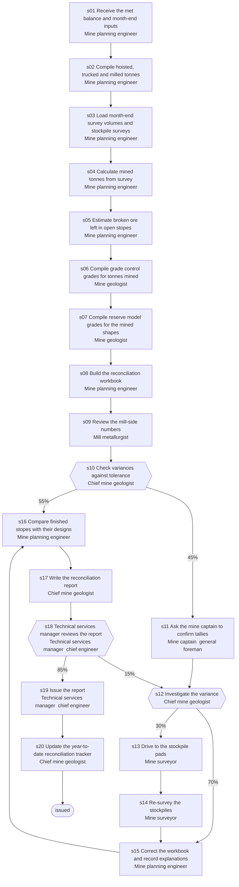

# Mine-to-mill reconciliation

`mine-ts-reconciliation` · mining (underground gold) · technical services · part of `mining-operator-co`

Every month the mine compares what it planned to mine, what the survey says was mined, what the tallies say was hoisted and trucked, and what the mill says it processed, in tonnes, grade and ounces, and explains the differences. A planning engineer compiles the tonnes from skip counts, truck loads, survey volumes and an estimate of broken ore still in the stopes, a mine geologist adds the grade control and reserve model grades, the metallurgist checks the mill numbers, and the chief geologist investigates gaps and writes the report for the technical services manager. The work is slow because the numbers sit in separate spreadsheets and survey files, much of the broken ore stays in open stopes between months, and tally or sampling errors only show up when the totals do not tie.

| | |
|---|---|
| Unit of work | one monthly reconciliation |
| Starts when | The mill issues its month-end metallurgical balance (tonnes milled, calculated head grade and ounces recovered). |
| Done when | The reconciliation report with planned, mined, hoisted and milled tonnes, grade and ounces, the reconciliation factors and explained variances is issued to planning, site cost reporting and the reserve team. |
| Organisation | A single-mine Canadian gold producer running a 500-650 tpd narrow-vein underground mine in northern Ontario, with a technical services department of about 20 engineers, surveyors and geologists on a 14-on, 14-off rotation. (300 employees, 2019-2022) |
| Volume | 1 cases a month (range 1 to 1) |

## Where it sits

- Starts with **met_balance** from mill-met-accounting (100% of cases)
- Relies on **shift_report** from mine-shift-control (a standing input; it does not start a case)
- Relies on **haulage_tally** from mine-mucking-haulage (a standing input; it does not start a case)
- Relies on **stockpile_survey** from mine-ore-stockpile (a standing input; it does not start a case)
- Relies on **survey_data** from ts-survey (a standing input; it does not start a case)
- Relies on **grade_control_model** from ts-grade-control (a standing input; it does not start a case)
- Relies on **mine_plan** from ts-short-range-plan (a standing input; it does not start a case)
- Relies on **hoist_log** from mine-hoisting (a standing input; it does not start a case)
- Sends **reconciliation_report** to ts-short-range-plan (outcome: issued)
- Sends **reconciliation_report** to site-cost-reporting (outcome: issued)
- Sends **reconciliation_report** to ts-reserve-estimate (outcome: issued)

## Flow

## Roles

| Role | Department | Layer | FTE on this process | Loaded cost per hour | Evidence |
|---|---|---|---:|---:|---|
| Mine planning engineer | Mine engineering and survey | senior specialist | 0.25 | 74 CAD | B [er2022] |
| Mine geologist | Mine geology | senior specialist | 0.12 | 68 CAD | B [potvin] |
| Chief mine geologist | Mine geology | manager | 0.1 | 108 CAD | B [potvin] |
| Mill metallurgist | Mill operations | senior specialist | 0.05 | 70 CAD | C |
| Technical services manager (chief engineer) | Technical services | manager | 0.03 | 115 CAD | C |
| Mine captain (general foreman) | Underground production and development | supervisor | 0.02 | 95 CAD | C |
| Mine surveyor | Mine engineering and survey | individual contributor | 0.03 | 50 CAD | C |

## Steps

Hands-on time and the wait before each step show the most common value. Evidence tier A is a sourced number, B a sourced description, C the author's estimate.

| Step | Who | Kind | Hands-on | Wait before | Control | Evidence |
|---|---|---|---:|---:|---|---|
| **s01 Receive the met balance and month-end inputs.** The planning engineer saves the mill's month-end metallurgical balance and collects the month's shift reports, haulage tallies, hoist log, stockpile survey and survey volumes into the reconciliation folder. Missing items are chased by email. | Mine planning engineer | intake | 45 min | 8.0 h |  | C |
| **s02 Compile hoisted, trucked and milled tonnes.** The engineer adds up skips hoisted at the certified 4 t payload, underground truck loads, surface truck loads from the portal pad to the mill 16.6 km away, and the mill weightometer tonnes, by day and source. Each count comes from a different sheet with its own load factor. | Mine planning engineer | data entry | 5.0 h | 2.0 h |  | B [er2022] |
| **s03 Load month-end survey volumes and stockpile surveys.** The engineer imports the surveyors' month-end development pick-ups, cavity monitoring scans of finished stopes and the portal pad and mill pad stockpile volumes. The step waits until survey has processed all month-end pick-ups. | Mine planning engineer | lookup | 1.5 h | 1.0 d |  | B [potvin], [er2022] |
| **s04 Calculate mined tonnes from survey.** The engineer converts development metres and profiles and finished-stope cavity volumes into tonnes at 2.7 t/m3, split into ore and waste and by stope and heading. | Mine planning engineer | analysis | 5.0 h | 1.0 h |  | B [er2022] |
| **s05 Estimate broken ore left in open stopes.** Because LHDs only pull enough ore after each blast to make room for the next, most broken ore stays in the stope until the last blast. The engineer estimates the blasted tonnes from the ring designs and subtracts the mucked tally to get broken stock carried into next month. | Mine planning engineer | judgment | 2.0 h | 0 min |  | B [er2022] |
| **s06 Compile grade control grades for tonnes mined.** The mine geologist assigns each heading's chip-composite grade, the muck sample grades and each stope's design grade to the tonnes mucked from it, giving the grade control prediction of what was sent to the mill. | Mine geologist | analysis | 4.0 h | 12.0 h |  | B [er2022], [er2016] |
| **s07 Compile reserve model grades for the mined shapes.** The geologist reports the reserve model tonnes and grade inside the month's mined development and stope shapes, so the grade control figures can be compared with the long-term model. Before 2021 this was the polygonal model; from 2021 the 3D block model. | Mine geologist | analysis | 3.0 h | 4.0 h |  | B [er2022], [island] |
| **s08 Build the reconciliation workbook.** The engineer lines up planned, surveyed, hoisted and trucked, and milled tonnes, grade and ounces with the stockpile and broken-stock changes, and calculates the factors: grade control against the reserve model (F1), mill against grade control (F2) and mill against the model (F3). | Mine planning engineer | analysis | 5.0 h | 4.0 h |  | B [parker] |
| **s09 Review the mill-side numbers.** The metallurgist checks the weightometer calibration and moisture, compares the sampled head grade with the head back-calculated from gold produced and tailings, and accounts for gold locked up in the circuit at month end. Adjustments are written into the workbook with a note. | Mill metallurgist | review | 2.0 h | 1.0 d | Site metallurgical accounting procedure: weightometer calibration and head grade checks before month-end figures are used | C |
| **s10 Check variances against tolerance.** The chief geologist looks at each stage-to-stage difference and the three factors and decides whether they are within the site's tolerance, about 5 to 10% on tonnes and ounces, or need investigating. | Chief mine geologist | judgment | 1.0 h | 12.0 h |  | B [er2022], [island] |
| **s11 Ask the mine captain to confirm tallies.** The chief geologist sends the captain the days and headings where tallies, survey and mill disagree, asking about missed loads, ore sent to waste fill or waste sent to the ore pass. The captain checks with the shift supervisors and answers on the next shift. | Mine captain (general foreman) | communication | 45 min | 1.0 d |  | C |
| **s12 Investigate the variance.** The chief geologist works through the likely causes: tally errors, misrouted loads, overbreak shown by cavity scans, chip sample bias, assay bias at the mine lab and broken stock. If the stockpile tonnes do not tie, the stockpiles are re-surveyed. | Chief mine geologist | analysis | 5.0 h | 4.0 h |  | B [parker], [er2022], [potvin] |
| **s13 Drive to the stockpile pads.** A surveyor drives to the portal pad and the mill pad with the survey gear. In winter the survey waits for snow to be cleared or a whiteout to pass, since snow cover spoils the pile surface. | Mine surveyor | travel | 1.0 h | 1.0 d |  | C |
| **s14 Re-survey the stockpiles.** The surveyor picks up the toe and surface of each stockpile, builds a new surface and recalculates the volume and tonnes, then sends the figures to the chief geologist. | Mine surveyor | physical | 1.5 h | 0 min |  | C |
| **s15 Correct the workbook and record explanations.** The engineer applies the confirmed tally corrections and revised stockpile tonnes, reruns the factors and writes a one-line explanation for each remaining variance. | Mine planning engineer | data entry | 2.0 h | 4.0 h |  | C |
| **s16 Compare finished stopes with their designs.** For each stope finished in the month the engineer overlays the cavity scan on the design and calculates overbreak, underbreak and dilution against the 0.5 m hangingwall and footwall allowance, and the tonnes and grade recovered. | Mine planning engineer | analysis | 3.0 h | 4.0 h |  | B [potvin], [er2022] |
| **s17 Write the reconciliation report.** The chief geologist writes the monthly report: the stage-by-stage table, the factors with year-to-date trends, stope dilution, the explained variances and actions for planning and grade control. | Chief mine geologist | drafting | 3.0 h | 12.0 h |  | C |
| **s18 Technical services manager reviews the report.** The technical services manager reads the report, questions any explanation that does not hold up and sends it back for more work or accepts it. | Technical services manager (chief engineer) | review | 1.0 h | 1.0 d | Technical services review of the monthly reconciliation before it feeds cost reporting and the qualified person's reserve update | C |
| **s19 Issue the report.** The technical services manager emails the report to the planning engineers, the site controller for cost reporting and the resource geologist, and presents it at the monthly technical meeting. | Technical services manager (chief engineer) | communication | 30 min | 2.0 h |  | C |
| **s20 Update the year-to-date reconciliation tracker.** The chief geologist adds the month to the year-to-date tracker of factors and stope dilution that feeds the year-end reserve update and the dilution assumptions in stope design. | Chief mine geologist | data entry | 1.0 h | 0 min |  | B [er2022], [potvin] |

## Exceptions

| Exception | Share of cases | What happens |
|---|---:|---|
| Variance outside tolerance | 45% | Stage-to-stage differences exceed tolerance and are investigated with the captains. |
| Stockpile re-survey | 14% | Stockpile tonnes do not tie and the pads are re-surveyed, sometimes after waiting for weather. |
| Report sent back | 15% | The manager does not accept an explanation and asks for more investigation. |

## Benchmarks

| Metric | Value | Unit | Population | Evidence |
|---|---|---|---|---|
| cycle_time_days | p50 9, p90 14 | calendar days from met balance issued to reconciliation report issued | Small underground gold mine | C |
| mine_to_mill_reconciliation | 0.05 | absolute difference, global mine production versus mill | Eagle River, recent history to 2021 | A [er2022] |
| production_vs_reserve_model_2019 | tonnes 1.07, grade 0.98, ounces 1.05 | ratio of production reconciled to mill over reserve model | Island Gold mine, 2019 (neighbouring mine) | A [island] |

## Pain points

- Tonnes come from skip counts, truck counts, survey and the mill weightometer in separate spreadsheets, so errors only appear when the totals do not tie. (steps s02, s08, s12; C)
- Shrink mucking leaves most broken ore in the stopes between months, so the month's mined tonnes rest on an estimate of broken stock. (steps s05; B [er2022])
- Comparing cavity scans with designs means moving data between survey software, design software and spreadsheets. (steps s03, s16; B [potvin])
- Grade sources have known biases: chip samples run higher than core and the unaccredited mine lab showed bias on low-grade standards, which makes F1 and F2 hard to interpret. (steps s06, s12; A [er2022])

## Assumptions

- The case starts when the met balance is issued, a few days after month end; month-end survey pick-ups and the routine stockpile survey are done in their own processes and arrive as inputs.
- Extra interfaces beyond the organisation file: the grade control model, the monthly plan and the hoist log as inputs.
- The mine geologist, mine captain and surveyor take part, although the organisation file's process entry lists only the engineer, chief geologist, metallurgist and manager.
- The surface pickup truck is not in the organisation file's resources; four is the author's estimate for technical services.
- Ore is trucked 16.6 km from a portal pad to the mill (er2022), so there are two stockpiles to reconcile; the organisation file describes the mill as next to the shaft.
- Steps s02-s04 and s06 run partly in parallel; their waits are kept short so the simulated cycle is not inflated.
- Loaded costs per hour are taken from the organisation file.
- Organisation file corrected on 2026-11-24 to match this workflow's sources: ids were renamed (mill-elution-refining to mill-gold-room-refining, loaded_carbon to gold_concentrate, tailings_slurry to filtered_tailings, elution-circuit to refinery), and roles and resources this workflow added are now in the organisation file. Notes above that describe a mismatch refer to the file before the correction.

## Sources

- [er2022] [Technical Report for the Eagle River Gold Mining Complex, Ontario, Canada (CAPR001445)](https://s203.q4cdn.com/643390454/files/doc_downloads/2022/11/ERtechnicalReport.pdf) (SRK Consulting (Canada) Inc. for Wesdome Gold Mines Ltd., 2022). Reference mine practice: channel (chip) sampling of underground faces by production geologist and technician after each advance once the heading is inspected and supported, sample lengths 0.3 m minimum in ore and 0.3 m maximum with visible gold; test-hole, long-hole and muck sampling (one muck sample per 25-30 t truck, taken by muckers); samples brought to surface at end of the beat geologist's shift and shuttled daily to the company assay office in Wawa; mine lab not accredited, 11% QC insertion (blank, CRM, duplicate per 28-sample tray), VG protocol, low-grade CRM bias; channel results recorded in Promine; polygonal estimates before 2021, Leapfrog/Datamine 3D model from 2021; chip samples average higher than core; mine-to-mill reconciliation within 5%; stope design with 1.5 m minimum width, 0.5 m HW and FW dilution from CMS reconciliation, 90% stope and 99% development recovery, stope cut-off 5.5 g/t, development cut-off 2.0 g/t, density 2.7 t/m3; captive sub-level open stoping via Alimak raises, 13-18 m 64 mm down-holes on a 3-2-3 pattern, shrink mucking, CRF sill mats and URF fill; 19% of mill feed from sill development; ore hoisted in 4 t skips and trucked 16.6 km from the portal pad to the mill; two 12 h shifts 365 days a year; UG labour table with 9 mine engineering and 10 mine geology staff; recommendation to evaluate tools for short-term planning; ventilation rule 0.06 m3/s per kW of diesel
- [er2016] [Technical Report for the Eagle River Mining Complex including the Eagle River Gold Mine, the Mishi Gold Mine and Related Infrastructure](https://minedocs.com/12/EagleRiver_TechnicalReport_03172016.pdf) (Wesdome Gold Mines Ltd. (G. Mannard and P. Ng), hosted by minedocs.com, 2016). Chip samples taken every round (every 3 to 4 m) in ore development headings across the full face, about 2.5 kg, 0.3-0.5 m lengths; raises sometimes chip sampled and always muck sampled; muck sample per 25-30 t; sealed samples transported daily to the company Mine Assay office with results emailed to the mine; assay data in Microsoft Access linked to Promine and Surpac/Gemcom, databases updated weekly and audited monthly; about 30% of production from silling and development; CMS surveys show about 1.0 m wall overbreak; Mishi grade control on blast hole samples
- [island] [NI 43-101 Technical Report for the Island Gold Mine, Dubreuilville, Ontario, Canada (exhibit 99.1)](https://www.sec.gov/Archives/edgar/data/1178819/000117881920000070/ex991technicalreportfo.htm) (Alamos Gold Inc. (filed on SEC EDGAR), 2020). Neighbouring Wawa-area mine: resource shapes created by geology and passed to production engineering for mineable stope design with recovery and dilution factors; each stope gets a package with drilling plans, blast letters, ventilation and gas check instructions, mucking plans and backfilling directives; Matthews stability graph used for stope dimensions; CMS surveys and beat geologists control dilution while mucking; chip samples 1.5-2 kg taken by geological technician or geologist, assays entered into Promine; all underground production samples assayed at the Wesdome laboratory in Wawa; 2019 production reconciled to mill was 107% of tonnes, 98% of grade and 105% of ounces of the current reserve model, with monthly comparison going forward
- [potvin] [Benchmarking of stope design and reconciliation practices (Underground Mining Technology 2020)](https://papers.acg.uwa.edu.au/d/2035_14_Potvin/14_Potvin.pdf) (Australian Centre for Geomechanics (Y. Potvin, K.R. Woodward, B. McFadyen, I. Thin, D. Grant), 2020). 2019 workshops in Perth and Rouyn-Noranda with 19 underground mines: stope design note contents (shape, wireframe, ground support, slot and rings, fill, ventilation, predicted overbreak); definition drilling completed ahead of design if needed; design about three months before extraction at large stopes and within a few weeks at small rapid-turnaround stopes; drill and blast design a few days before drilling; most mines have a comprehensive sign-off involving geotechnical, backfill, ventilation and management; stope reconciliation starts with CMS; all mines reconcile volume, tonnes and grade per stope and feed a periodic mine reconciliation led by geology; multiple software packages make reconciliation slow; narrow vein mines focus on hangingwall overbreak and ELOS
- [parker] [Reconciliation principles for the mining industry (35th APCOM Symposium 2011), abstract](https://ausimm.com/publications/conference-proceedings/35th-apcom-symposium-2011/reconciliation-principles-for-the-mining-industry) (The AusIMM (H.M. Parker), 2011). Reconciliation compares tonnes, grade and metal from exploration data, production sampling and plant data using factors: F1 grade control model versus reserves depleted, F2 mill received versus production delivered (unplanned dilution between ore control and mill), F3 overall; reconciliation should be part of the mining process and a key performance indicator

Written by claude-opus on 2026-11-24.
