# Annual mineral resource and reserve estimate

`mine-ts-reserve-estimate` · gold mining (underground) · technical services (geology and engineering) · part of `mining-operator-co`

Once a year a listed mining company must say how much gold it has in the ground (resources) and how much it can mine at a profit (reserves). Mine geologists rebuild the geological model with the year's drilling, independent consultants estimate grades, the engineers apply stope shapes, costs, dilution and the gold price, and qualified persons review and sign before the statement is published with the year-end results in March. It is slow because late assays hold up the database freeze, interpretation is a long manual task, the model is reconciled against what the mill actually recovered, and every number must agree across the news release, the annual information form and the financial statements.

| | |
|---|---|
| Unit of work | one annual mineral resource and reserve estimate |
| Starts when | The annual estimate cycle starts in early autumn so that the statement, effective 31 December, can be published with year-end results. |
| Done when | The resource and reserve statement is published and the model and tables are issued to planning and disclosure. |
| Organisation | A single-mine Canadian gold producer listed on the TSX that uses site geologists and engineers with independent consultant qualified persons. (300 employees, 2019-2022) |
| Volume | 0.08 cases a month (range 0.08 to 0.08) |

## Where it sits

- Starts with **drill_results** from ts-definition-drilling (100% of cases)
- Relies on **reconciliation_report** from ts-reconciliation (a standing input; it does not start a case)
- Relies on **exploration_results** from expl-data (a standing input; it does not start a case)
- Relies on **survey_data** from ts-survey (a standing input; it does not start a case)
- Relies on **cost_report** from site-cost-reporting (a standing input; it does not start a case)
- Relies on **qp_review** from consultants (a standing input; it does not start a case)
- Sends **reserve_statement** to ts-lom-planning (outcome: published)
- Sends **reserve_statement** to corp-disclosure (outcome: published)
- Sends **reserve_statement** to corp-investor-relations (outcome: published)

## Flow

```mermaid
flowchart TD
    s01["s01 Set the data cut-off and timetable<br/>Chief mine geologist"]
    s02["s02 Engage the independent consultants<br/>Technical services manager  chief engineer"]
    s03["s03 Wait for outstanding assays and freeze the database<br/>Mine geologist"]
    s04{{"s04 Validate the database and QA/QC<br/>Mine geologist"}}
    s05["s05 Update the geological interpretation<br/>Mine geologist"]
    s06{{"s06 Chief geologist reviews the interpretation<br/>Chief mine geologist"}}
    s07["s07 Compile depletion solids to year end<br/>Mine surveyor"]
    s08["s08 Composite, cap and analyse grades<br/>Independent resource and reserve consultant  qualified person"]
    s09["s09 Estimate block model grades<br/>Independent resource and reserve consultant  qualified person"]
    s10["s10 Validate the block model<br/>Independent resource and reserve consultant  qualified person"]
    s11{{"s11 Reconcile the model to production<br/>Chief mine geologist"}}
    s12["s12 Classify and report mineral resources<br/>Independent resource and reserve consultant  qualified person"]
    s13["s13 Approve metal price and exchange rate<br/>Chief operating officer"]
    s14["s14 Calculate cut-off grades<br/>Mine planning engineer"]
    s15["s15 Design reserve stopes and apply modifying factors<br/>Mine planning engineer"]
    s16["s16 Schedule and test reserve economics<br/>Mine planning engineer"]
    s17["s17 Tabulate reserves and explain changes<br/>Mine planning engineer"]
    s18{{"s18 Independent qualified person reviews the reserve<br/>Independent resource and reserve consultant  qualified person"}}
    s19["s19 Technical services manager approves the estimate<br/>Technical services manager  chief engineer"]
    s20["s20 Company qualified person signs off<br/>Vice-president, exploration"]
    s21["s21 Draft the statement tables and notes<br/>Chief mine geologist"]
    s22{{"s22 Legal and disclosure review<br/>General counsel and corporate secretary"}}
    s23["s23 Qualified persons consent to the disclosure<br/>Independent resource and reserve consultant  qualified person"]
    s24["s24 Publish with year-end results and issue to users<br/>Chief mine geologist"]
    s01 --> s02
    s02 --> s03
    s03 --> s04
    s04 -->|"85%"| s05
    s04 -->|"15%"| s03
    s05 --> s06
    s06 -->|"80%"| s07
    s06 -->|"20%"| s05
    s07 --> s08
    s08 --> s09
    s09 --> s10
    s10 --> s11
    s11 -->|"80%"| s12
    s11 -->|"20%"| s08
    s12 --> s13
    s13 --> s14
    s14 --> s15
    s15 --> s16
    s16 --> s17
    s17 --> s18
    s18 -->|"85%"| s19
    s18 -->|"15%"| s15
    s19 --> s20
    s20 --> s21
    s21 --> s22
    s22 -->|"84%"| s23
    s22 -->|"16%"| s21
    s23 --> s24
    s24 --> end0
    end0(["published"])
```

## Roles

| Role | Department | Layer | FTE on this process | Loaded cost per hour | Evidence |
|---|---|---|---:|---:|---|
| Chief mine geologist | Mine geology | manager | 0.08 | 108 CAD | C |
| Mine geologist | Mine geology | senior specialist | 0.2 | 68 CAD | C |
| Mine planning engineer | Mine engineering and survey | senior specialist | 0.15 | 74 CAD | C |
| Mine surveyor | Mine engineering and survey | individual contributor | 0.01 | 50 CAD | C |
| Technical services manager (chief engineer) | Technical services | manager | 0.02 | 115 CAD | C |
| Vice-president, exploration | Executive and governance | executive | 0.01 | 190 CAD | C |
| Chief operating officer | Executive and governance | executive | 0.005 | 230 CAD | C |
| General counsel and corporate secretary | Executive and governance | director | 0.01 | 185 CAD | C |
| Independent resource and reserve consultant (qualified person) | External consultants | external party | 0.12 | 200 CAD | B [src1] |

## Steps

Hands-on time and the wait before each step show the most common value. Evidence tier A is a sourced number, B a sourced description, C the author's estimate.

| Step | Who | Kind | Hands-on | Wait before | Control | Evidence |
|---|---|---|---:|---:|---|---|
| **s01 Set the data cut-off and timetable.** The chief geologist sets the date after which new drill results will wait for next year, agrees the timetable back from the March results release with the technical services manager and engineering, and lists which zones need a full remodel. He sends the plan to the team and consultants. | Chief mine geologist | coordination | 6.0 h | 3.0 d |  | B [src2] |
| **s02 Engage the independent consultants.** The technical services manager confirms scope, fees and dates with the resource and reserve consultants and raises the purchase order. He sends them the timetable and the access they need to the database and models. | Technical services manager (chief engineer) | communication | 4.0 h | 4.0 d |  | B [src1] |
| **s03 Wait for outstanding assays and freeze the database.** The mine geologist chases the commercial laboratory and site lab for assays from holes drilled before the cut-off, loads the last certificates, then exports a frozen copy of collars, surveys, logs and assays for the estimate. Late assays are the usual reason the freeze slips. | Mine geologist | data entry | 8.0 h | 14.0 d |  | B [src4] |
| **s04 Validate the database and QA/QC.** The geologist checks collars against survey, downhole surveys for jumps, overlapping or missing intervals, and assays against the certificates, and reviews standards, blanks and duplicates for failures. Failed batches go back to the lab for re-assay. | Mine geologist | validation | 1.0 d | 1.0 d |  | B [src4] |
| **s05 Update the geological interpretation.** The geologist updates the vein and zone wireframes with the year's drill holes and face mapping, splits domains where grade behaviour differs, and builds the mined-out and development solids into the model. This is the longest single task in the estimate. | Mine geologist | analysis | 4.6 d | 2.0 d |  | B [src3] |
| **s06 Chief geologist reviews the interpretation.** The chief geologist reviews the wireframes section by section against the drill holes and underground mapping and asks for changes where continuity is stretched. About one interpretation in five goes back. | Chief mine geologist | review | 12.0 h | 4.0 d |  | C |
| **s07 Compile depletion solids to year end.** The surveyor compiles the cavity scans of mined stopes and the as-built development to date and adds the planned mining to 31 December, so the model can be depleted to the effective date. He sends the solids to geology and engineering. | Mine surveyor | data entry | 12.0 h | 0 min |  | C |
| **s08 Composite, cap and analyse grades.** The resource consultant composites assays to a fixed length within each domain, studies grade distributions to choose capping levels, and models spatial continuity to set search ranges. He documents the parameters in a memo. | Independent resource and reserve consultant (qualified person) | analysis | 1.7 d | 7.0 d |  | B [src3], [src4] |
| **s09 Estimate block model grades.** The consultant builds the block model, interpolates gold grades by ordinary kriging or inverse distance with several search passes, assigns density and flags the depleted blocks. He runs the model for every domain that changed. | Independent resource and reserve consultant (qualified person) | analysis | 2.1 d | 2.0 d |  | B [src3] |
| **s10 Validate the block model.** The consultant checks the model against the composites with swath plots, a nearest-neighbour comparison and visual sections, and fixes blocks that look wrong. He sends the model with a validation memo to the chief geologist. | Independent resource and reserve consultant (qualified person) | validation | 1.0 d | 1.0 d |  | B [src3] |
| **s11 Reconcile the model to production.** The chief geologist compares the model's tonnes, grade and ounces for the stopes mined this year with the grade control model and the mill's reconciled ounces. When the model is well off, he sends it back with changes to capping or search. | Chief mine geologist | review | 16.0 h | 3.0 d |  | B [src3] |
| **s12 Classify and report mineral resources.** The consultant classifies blocks as measured, indicated or inferred from drill spacing and confidence, applies stope shapes to show reasonable prospects of economic extraction at the resource cut-off, and tabulates the resource. He writes the resource notes. | Independent resource and reserve consultant (qualified person) | analysis | 20.0 h | 2.0 d |  | B [src1], [src5] |
| **s13 Approve metal price and exchange rate.** The chief operating officer and chief financial officer set the reserve and resource gold prices and the exchange rate, usually below spot and consistent with peers, and send them to site. Engineering cannot finish cut-offs until they arrive. | Chief operating officer | approval | 2.0 h | 5.0 d | Company policy on long-term metal price assumptions for disclosure | B [src1] |
| **s14 Calculate cut-off grades.** The planning engineer takes mining, milling and general costs per tonne from the year's cost reports, the approved price, mill recovery and royalties, and calculates the reserve and resource cut-off grades and the incremental cut-off for development ore. | Mine planning engineer | analysis | 12.0 h | 2.0 d |  | B [src1], [src3] |
| **s15 Design reserve stopes and apply modifying factors.** The engineer runs stope shapes on the measured and indicated blocks at the reserve cut-off, adds the development to reach them, and applies wall dilution, minimum mining width and mining recovery. He removes stopes that do not pay for their own access. | Mine planning engineer | analysis | 4.6 d | 2.0 d |  | B [src1] |
| **s16 Schedule and test reserve economics.** The engineer schedules the reserve stopes and development at achievable rates and runs a cash flow at the reserve price to show that the reserve as a whole is economic. Blocks that fail are removed and the schedule rerun. | Mine planning engineer | analysis | 1.7 d | 1.0 d |  | B [src3] |
| **s17 Tabulate reserves and explain changes.** The engineer tabulates proven and probable reserves by zone and builds the year-on-year bridge: depletion by mining, additions from drilling, model changes and price or cost changes. He checks the totals against the resource model. | Mine planning engineer | analysis | 1.0 d | 1.0 d |  | C |
| **s18 Independent qualified person reviews the reserve.** The reserve consultant reviews the cut-offs, stope shapes, modifying factors, schedule and tabulation, visits site if he has not recently, and lists issues. About one estimate in seven needs rework of stope design or factors. | Independent resource and reserve consultant (qualified person) | review | 1.2 d | 5.0 d | National Instrument 43-101: scientific and technical disclosure based on information prepared by or under the supervision of a qualified person | B [src1], [src5], [src6] |
| **s19 Technical services manager approves the estimate.** The technical services manager reviews the final tables, the change bridge and the consultants' comments and approves the estimate for the company. He confirms the reserve is consistent with the mine plan the site is working to. | Technical services manager (chief engineer) | approval | 4.0 h | 2.0 d |  | C |
| **s20 Company qualified person signs off.** The vice-president exploration, as the company's qualified person, reviews the estimate and the notes for disclosure and accepts it. Questions go back to site by email and call. | Vice-president, exploration | approval | 6.0 h | 4.0 d | National Instrument 43-101: scientific and technical disclosure based on information prepared by or under the supervision of a qualified person | B [src1] |
| **s21 Draft the statement tables and notes.** The chief geologist drafts the resource and reserve tables and the notes on cut-off, price, dilution, recovery, density and the qualified persons, in the format of the prior year's release, and writes a short explanation of the changes. | Chief mine geologist | drafting | 12.0 h | 1.0 d |  | B [src1] |
| **s22 Legal and disclosure review.** The general counsel and the chief financial officer check the statement against the news release, the annual information form and the financial statements, and check the qualified person and cautionary language. About one draft in six comes back with changes. | General counsel and corporate secretary | review | 4.0 h | 4.0 d | National Instrument 43-101 and National Instrument 51-102 continuous disclosure requirements | C |
| **s23 Qualified persons consent to the disclosure.** The independent consultants read the final text and give written consent to being named and to the summary of their work. A late wording change can send it back to them. | Independent resource and reserve consultant (qualified person) | approval | 2.0 h | 3.0 d | National Instrument 43-101: scientific and technical disclosure based on information prepared by or under the supervision of a qualified person | B [src1] |
| **s24 Publish with year-end results and issue to users.** The statement is released with the year-end results in March and the chief geologist sends the final model, tables and change bridge to engineering for the plan and to head office for the annual information form. The files are archived as the year's estimate of record. | Chief mine geologist | communication | 3.0 h | 10.0 d |  | A [src1], [src2] |

## Exceptions

| Exception | Share of cases | What happens |
|---|---:|---|
| Late or failed assays | 15% | QA/QC failures or missing certificates send batches back to the lab and push the database freeze. |
| Model does not reconcile to the mill | 20% | The model's ounces for mined stopes differ from the mill and the consultant revises capping or search. |
| Reserve rework after QP review | 15% | The independent QP finds stope design or modifying factor issues and engineering redoes the reserve. |
| Disclosure text inconsistent | 16% | Numbers or notes differ between the statement, news release and AIF and the draft is redone. |

## Benchmarks

| Metric | Value | Unit | Population | Evidence |
|---|---|---|---|---|
| cycle_time_days | p50 160, p90 185 | calendar days from data cut-off planning to publication | Annual estimate at a single-mine TSX gold producer | C |
| days_from_effective_date_to_publication | 72 | calendar days | Reference company, estimate effective 31 December 2022 published 13 March 2023 | A [src1] |
| qa_qc_insertion_rate | 1 standard and 1 blank per 25 samples | samples | Comparable Wawa-area mine | A [src4] |

## Pain points

- The database freeze waits on late assays from outside labs, which compresses the modelling time before year end. (steps s03, s04; B [src3])
- Wireframe interpretation and reserve stope design are long manual tasks done by a few people, and review loops repeat them. (steps s05, s06, s15; C)
- Model-to-mill differences force late changes to capping or search after the model was thought finished. (steps s11, s08; B [src3])
- Every number has to agree across the statement, news release, AIF and financial statements, checked by hand. (steps s21, s22; C)

## Assumptions

- Loaded costs come from the organisation file; the consultant rate is a billing rate, so the simulated labour cost includes consultant fees.
- The workflow follows the reference company's model of independent consultants doing the estimation and reserve work under company supervision; some comparable mines (src3, src4) use site staff as qualified persons, which would move steps s08-s12 and s18 to the chief geologist and chief engineer.
- The organisation file lists no trigger for this process; the case is started by the annual calendar, and the year's definition drill results are used as the triggering object.
- Surveyor, chief operating officer and general counsel take part but are not listed for this process in the organisation file.
- Software names in the comparable report (Datamine, Snowden Supervisor) are examples; the reference mine's software was not confirmed.
- Organisation file corrected on 2026-11-24 to match this workflow's sources: ids were renamed (mill-elution-refining to mill-gold-room-refining, loaded_carbon to gold_concentrate, tailings_slurry to filtered_tailings, elution-circuit to refinery), and roles and resources this workflow added are now in the organisation file. Notes above that describe a mismatch refer to the file before the correction.

## Sources

- [src1] [Wesdome Announces Annual Mineral Resource and Reserve Updates for Eagle River and Kiena Mine Complexes](https://ca.finance.yahoo.com/news/wesdome-announces-annual-mineral-updates-110300964.html) (Wesdome Gold Mines Ltd. (news release, via Yahoo Finance Canada), 2023). Reference company annual update released 13 March 2023 with estimates effective 31 December 2022; Eagle River reserves estimated by an independent consultant (P.Eng.) and resources by an independent contractor (P.Geo.) working under company supervision, with the company's director of geology reviewing and updating parts; CIM standards; reserve cut-off 6.52 g/t, resource cut-off 5.36 g/t; US$1,400/oz for reserves and US$1,500/oz for resources; 1.5 m minimum mining width; 0.5 m external dilution on each wall (1.25 m in one zone at depth); 90 percent mine recovery; 97 percent mill recovery; density 2.7 t/m3; costs per tonne used in the cut-off; reserves based on block model classification; added definition and infill drilling (25,000 m in one zone)
- [src2] [Wesdome Announces 2020 Fourth Quarter and Full Year Production Results; Provides 2021 Guidance](https://finance.yahoo.com/news/wesdome-announces-2020-fourth-quarter-213000875.html) (Wesdome Gold Mines Ltd. (news release, via Yahoo Finance), 2021). Reference company release of 14 January 2021: recent drilling results will be included in the annual resource and reserve update in March 2021; 50,000 m of underground definition drilling and 60,000-70,000 m of underground exploration drilling planned at Eagle River in 2021
- [src3] [Macassa Mine NI 43-101 Technical Report (April 2019), exhibit 99.20](https://www.sec.gov/Archives/edgar/data/1713443/000162828019003767/a2019macassani4310101apr.htm) (Kirkland Lake Gold Ltd. (filed on SEC EDGAR), 2019). Comparable Ontario mine (effective date 31 December 2018, issued 1 April 2019): block models in Datamine Studio RM with ordinary kriging for main domains and inverse distance squared elsewhere, validation with nearest neighbour and ID3 and Snowden Supervisor, three search passes, capping applied to composites, ounce reconciliation of block models against mill head ounces (model 4.5-11.5 percent low), stope-by-stope cut-off grades, dilution 0.6 m for longhole stopes, 90 percent extraction; all four qualified persons not independent of the company
- [src4] [Island Gold Mine NI 43-101 Technical Report (Phase III expansion), exhibit 99.1](https://www.sec.gov/Archives/edgar/data/1178819/000117881920000070/ex991technicalreportfo.htm) (Alamos Gold Inc. (filed on SEC EDGAR), 2020). Comparable Wawa-area mine: estimate as of 31 December 2019 in a report effective July 2020; capping by zone (75-300 g/t), density 2.78-2.82 t/m3, stope cut-off 4.03 g/t, US$1,250/oz, dilution 15-50 percent, mining recovery 67-95 percent; qualified persons are the site chief geologist and chief engineer; QA/QC with certified reference material and blanks each at 1 in 25 samples and check pulps at a second lab; QA/QC audited by a consultant in 2019
- [src5] [Estimation of Mineral Resources & Mineral Reserves (CIM best practice guidelines page)](https://mrmr.cim.org/en/practice-guidelines/estimation-of-mineral-resources-mineral-reserves/) (Canadian Institute of Mining, Metallurgy and Petroleum (CIM MRMR committee), 2019). CIM Estimation of Mineral Resources and Mineral Reserves Best Practice Guidelines help the Qualified Person with the planning, supervision, preparation and reporting of MRMR estimates; 2019 version supersedes the 2003 version
- [src6] [2019 MRMR Best Practice Guidelines adopted (news, 3 February 2020)](https://cim.org/news/2020/2019-mrmr-best-practice-guidelines) (Canadian Institute of Mining, Metallurgy and Petroleum, 2020). CIM Council adopted the 2019 MRMR Best Practice Guidelines on 29 November 2019, superseding the 2003 version

Written by claude-opus on 2026-11-24.
