# Monthly and weekly mine plan

`mine-ts-short-range-plan` · mining (underground gold) · mine engineering · part of `mining-operator-co`

Each month a mine planning engineer works out which development headings, stopes and backfill the underground crews will work next month so that the mine sends enough tonnes and ounces to the mill, using last month's reconciliation, the budget, stope and fill status from the mine captains, equipment availability from maintenance and grades from geology. The draft goes through a geotechnical check, a ventilation check and a planning meeting, is accepted by the mine superintendent and the general manager, and is issued with weekly targets that are re-planned every week. The plan is built in AutoCAD and spreadsheets by one or two engineers on rotation, and late stope releases, equipment breakdowns and reconciliation surprises force mid-month revisions.

| | |
|---|---|
| Unit of work | one monthly plan |
| Starts when | The mine-to-mill reconciliation and month-end actuals for the previous month are issued, which opens planning for the month after the current one. |
| Done when | The monthly plan and weekly targets have been issued and executed, with any mid-month revision reissued, and month-end compliance to plan has been reviewed. |
| Organisation | A single-mine Canadian gold producer running a 500-650 tpd narrow-vein underground mine in northern Ontario, with a technical services department of about 20 engineers, surveyors and geologists on a 14-on, 14-off rotation. (300 employees, 2019-2022) |
| Volume | 1 cases a month (range 1 to 1) |

## Where it sits

- Starts with **reconciliation_report** from ts-reconciliation (100% of cases)
- Relies on **backfilled_stope** from mine-backfill (a standing input; it does not start a case)
- Relies on **lom_plan** from ts-lom-planning (a standing input; it does not start a case)
- Relies on **annual_budget** from corp-budget (a standing input; it does not start a case)
- Relies on **grade_control_model** from ts-grade-control (a standing input; it does not start a case)
- Relies on **work_schedule** from mnt-work-planning (a standing input; it does not start a case)
- Relies on **shift_report** from mine-shift-control (a standing input; it does not start a case)
- Sends **mine_plan** to mine-shift-control (outcome: plan executed)
- Sends **mine_plan** to ts-stope-design (outcome: plan executed)
- Sends **services_plan** to mine-ug-services (outcome: plan executed)
- Sends **pit_plan** to mine-open-pit (outcome: plan executed)
- Sends **mine_plan** to mnt-work-planning (outcome: plan executed)
- Sends **drill_plan** to ts-definition-drilling (outcome: plan executed)
- Sends **mine_plan** to mill-grind-leach (outcome: plan executed)
- Sends **mine_plan** to ts-ventilation (outcome: plan executed)
- Sends **mine_plan** to ts-reconciliation (outcome: plan executed)

## Flow

```mermaid
flowchart TD
    s01["s01 Collect the reconciliation and month-end actuals<br/>Mine planning engineer"]
    s02["s02 Update as-built headings and mined-out stopes<br/>Mine planning engineer"]
    s03["s03 Drive underground to the active workplaces<br/>Mine planning engineer"]
    s04["s04 Inspect headings, stope brows and fill status<br/>Mine planning engineer"]
    s05["s05 Get stope, fill and crew status from the mine captain<br/>Mine captain  general foreman"]
    s06["s06 Get equipment availability and planned shutdowns<br/>Maintenance planner"]
    s07["s07 Supply grades and tonnes for planned stopes and headings<br/>Mine geologist"]
    s08["s08 Look up budget and life-of-mine targets<br/>Mine planning engineer"]
    s09["s09 List available workplaces and set the sequence<br/>Mine planning engineer"]
    s10["s10 Schedule development metres by heading and crew<br/>Mine planning engineer"]
    s11["s11 Schedule stope tonnes, grade and backfill<br/>Mine planning engineer"]
    s12["s12 Check airflow against the diesel fleet by level<br/>Mine planning engineer"]
    s13{{"s13 Geotechnical review of the sequence<br/>Geotechnical engineer"}}
    s14{{"s14 Compare plan physicals with budget<br/>Mine planning engineer"}}
    s15["s15 Draft next month's definition drill program<br/>Chief mine geologist"]
    s16{{"s16 Draft the underground services plan<br/>Mine planning engineer"}}
    s17["s17 Draft the open pit plan with the contractor<br/>Mine planning engineer"]
    s18{{"s18 Run the monthly planning meeting<br/>Technical services manager  chief engineer"}}
    s19["s19 Mine superintendent accepts the targets<br/>Mine superintendent"]
    s20["s20 General manager approves the monthly forecast<br/>Mine general manager"]
    s21["s21 Issue the monthly plan package<br/>Mine planning engineer"]
    s22["s22 Set weekly targets and the first week's schedule<br/>Mine planning engineer"]
    s23["s23 Run the weekly schedule reviews through the month<br/>Mine planning engineer"]
    s24{{"s24 Decide whether a mid-month revision is needed<br/>Technical services manager  chief engineer"}}
    s25["s25 Re-sequence and reissue the revised plan<br/>Mine planning engineer"]
    s26["s26 Review compliance to plan at month end<br/>Mine planning engineer"]
    s01 --> s02
    s02 --> s03
    s03 --> s04
    s04 --> s05
    s05 --> s06
    s06 --> s07
    s07 --> s08
    s08 --> s09
    s09 --> s10
    s10 --> s11
    s11 --> s12
    s12 --> s13
    s13 -->|"85%"| s14
    s13 -->|"15%"| s11
    s14 -->|"80%"| s15
    s14 -->|"20%"| s09
    s15 --> s16
    s16 -->|"40%"| s17
    s16 -->|"60%"| s18
    s17 --> s18
    s18 -->|"75%"| s19
    s18 -->|"25%"| s11
    s19 --> s20
    s20 --> s21
    s21 --> s22
    s22 --> s23
    s23 --> s24
    s24 -->|"35%"| s25
    s24 -->|"65%"| s26
    s25 --> s26
    s26 --> end0
    end0(["plan executed"])
```

## Roles

| Role | Department | Layer | FTE on this process | Loaded cost per hour | Evidence |
|---|---|---|---:|---:|---|
| Mine planning engineer | Mine engineering and survey | senior specialist | 0.8 | 74 CAD | B [er2022], [fowke] |
| Technical services manager (chief engineer) | Technical services | manager | 0.05 | 115 CAD | C |
| Mine superintendent | Mine operations | manager | 0.03 | 115 CAD | C |
| Chief mine geologist | Mine geology | manager | 0.04 | 108 CAD | C |
| Mine geologist | Mine geology | senior specialist | 0.05 | 68 CAD | C |
| Mine captain (general foreman) | Underground production and development | supervisor | 0.03 | 95 CAD | C |
| Maintenance planner | Maintenance planning | senior specialist | 0.02 | 60 CAD | C |
| Geotechnical engineer | Mine engineering and survey | senior specialist | 0.03 | 78 CAD | C |
| Mine general manager | Site management and administration | director | 0.01 | 150 CAD | C |

## Steps

Hands-on time and the wait before each step show the most common value. Evidence tier A is a sourced number, B a sourced description, C the author's estimate.

| Step | Who | Kind | Hands-on | Wait before | Control | Evidence |
|---|---|---|---:|---:|---|---|
| **s01 Collect the reconciliation and month-end actuals.** The planning engineer saves the reconciliation report, the month-end development metres and stope tonnes from the shift tallies and the survey as-builts, and lists how far each heading and stope got against last month's plan. This shows what carries over into the next plan. | Mine planning engineer | intake | 2.0 h | 12.0 h |  | C |
| **s02 Update as-built headings and mined-out stopes.** The engineer updates the AutoCAD and Promine planning file with month-end face positions, mined-out and filled stopes and new survey lines, so the plan starts from where the mine really is. Metres to go and stope tonnes remaining are recalculated. | Mine planning engineer | data entry | 4.0 h | 4.0 h |  | C |
| **s03 Drive underground to the active workplaces.** The engineer rides a light vehicle down the ramp to walk the headings, stope brows and fill horizons that will be in next month's plan. The trip waits for a free vehicle and a day when the engineer is not tied up in meetings. | Mine planning engineer | travel | 1.5 h | 1.0 d |  | C |
| **s04 Inspect headings, stope brows and fill status.** Underground, the engineer checks the face positions, ground conditions, services and the state of open stopes and fill, and notes where the plan must allow for rehabilitation, extra support or waiting for fill to cure. Entry follows the tag board and workplace examination rules. | Mine planning engineer | physical | 2.5 h | 0 min | Ontario Regulation 854: underground entry with tag board, self-rescuer and workplace examination before entering a heading | C |
| **s05 Get stope, fill and crew status from the mine captain.** The engineer asks the mine captain which stopes will finish drilling, blasting and mucking this month, which are waiting for fill, how many development and production crews will be available and which headings have ground or water problems. The captain answers between shifts. | Mine captain (general foreman) | communication | 45 min | 1.0 d |  | C |
| **s06 Get equipment availability and planned shutdowns.** The maintenance planner sends the jumbo, LHD, truck and longhole drill rebuilds and planned services for next month, and the hoist and crusher shutdowns, from the maintenance system. The planner works office hours, so a request sent on a weekend waits. | Maintenance planner | communication | 1.0 h | 4.0 h |  | C |
| **s07 Supply grades and tonnes for planned stopes and headings.** The mine geologist gives diluted tonnes and grade for each stope and ore heading in the draft list from the latest grade control outline and stope designs. Where face assays are only a few days old, the figures can still change. | Mine geologist | analysis | 4.0 h | 4.0 h |  | B [er2022] |
| **s08 Look up budget and life-of-mine targets.** The engineer reads next month's budget tonnes, grade, ounces and development metres and the year-to-date variance, and the life-of-mine sequence the month must stay on. | Mine planning engineer | lookup | 1.0 h | 1.0 h |  | C |
| **s09 List available workplaces and set the sequence.** The engineer lists every heading and stope that can be worked next month, with its constraints (ground support, fill curing, ventilation, shared haulage levels), and sets the order so people, equipment and space do not clash. This list is the backbone of the plan. | Mine planning engineer | analysis | 5.0 h | 4.0 h |  | B [fowke] |
| **s10 Schedule development metres by heading and crew.** The engineer assigns rounds per shift to each development crew and heading, using advance rates for captive sub-levels, mechanised sub-levels and ramps, and totals the metres and ore development tonnes by week. | Mine planning engineer | analysis | 7.0 h | 1.0 h |  | B [er2022], [fowke] |
| **s11 Schedule stope tonnes, grade and backfill.** The engineer schedules blasts and mucking by stope (shrink mucking until the last blast, then pulling the stope empty), backfill pours and fill curing, and checks the total against hoisting with 4 t skips, the 30 t underground trucks, the 16.6 km surface haul and the mill's daily feed. | Mine planning engineer | analysis | 6.0 h | 1.0 h |  | B [er2022] |
| **s12 Check airflow against the diesel fleet by level.** The engineer allocates LHDs and trucks by level and checks that each level gets at least 0.06 cubic metres per second of air for each kilowatt of diesel equipment working there, moving equipment or headings where it does not. | Mine planning engineer | validation | 1.5 h | 0 min | Ontario Regulation 854 s.183.1(3): at least 0.06 m3/s of air per kW of diesel equipment operating in the workplace | B [er2022] |
| **s13 Geotechnical review of the sequence.** The geotechnical engineer reviews the stope sequence, pillars and the time open spans will stand before fill, and asks for changes where the sequence leaves a long open span or mines toward a stressed pillar. | Geotechnical engineer | review | 2.0 h | 1.0 d | Site ground control program: geotechnical review of the stoping sequence | B [er2022] |
| **s14 Compare plan physicals with budget.** The engineer totals planned tonnes, grade, ounces and metres for the month and compares them with budget. If ounces fall short by more than the site's tolerance, the engineer re-sequences to bring forward higher-grade stopes or headings. | Mine planning engineer | analysis | 2.0 h | 1.0 h |  | C |
| **s15 Draft next month's definition drill program.** The chief geologist picks the definition drill holes needed ahead of the stopes in the plan, sets the drill bays and metres for the contract underground rigs and sends the program to the drilling contractor. | Chief mine geologist | drafting | 2.0 h | 12.0 h |  | C |
| **s16 Draft the underground services plan.** The engineer lists the pipe, ventilation tubing, electrical, pumps and refuge work needed for the new headings and stopes and sends it to the services crew supervisor. | Mine planning engineer | drafting | 2.0 h | 0 min |  | B [er2022] |
| **s17 Draft the open pit plan with the contractor.** In months when the Mishi pit is mined, the engineer sets the benches, ore and waste tonnes and blast schedule with the open pit supervisor and the mining contractor, and checks the mill blend of pit and underground ore. | Mine planning engineer | drafting | 3.0 h | 4.0 h |  | B [er2016], [er2022] |
| **s18 Run the monthly planning meeting.** The technical services manager chairs the meeting with the mine superintendent, captains, chief geologist, maintenance and mill, walks through the plan and its risks and records requested changes. The meeting is held on a fixed day late in the month. | Technical services manager (chief engineer) | review | 2.0 h | 2.0 d |  | B [fowke] |
| **s19 Mine superintendent accepts the targets.** The mine superintendent confirms operations will commit to the tonnes, metres and crew allocation, sometimes after trimming targets for headings the captains doubt. | Mine superintendent | approval | 30 min | 12.0 h |  | C |
| **s20 General manager approves the monthly forecast.** The general manager signs off the month's ounces and cost forecast that goes to the chief operating officer and corporate reporting. | Mine general manager | approval | 30 min | 1.0 d | Site delegation of authority: monthly production forecast approved by the general manager before reporting to corporate | C |
| **s21 Issue the monthly plan package.** The engineer publishes the plan drawings by level, the heading and stope target tables and the forecast to shift control, maintenance, the mill, ventilation and stope design, and posts the targets on the line-up board. | Mine planning engineer | communication | 1.5 h | 4.0 h |  | C |
| **s22 Set weekly targets and the first week's schedule.** Before the month starts the engineer splits the targets into weeks and writes the first week's schedule by crew and heading in a spreadsheet, with a look-ahead to the second week. | Mine planning engineer | drafting | 2.0 h | 1.0 d |  | B [fowke] |
| **s23 Run the weekly schedule reviews through the month.** Each week the engineer compares actual metres and tonnes with the weekly schedule, meets the captains and maintenance, and reissues the next week's schedule. The time shown is the sum of the three to four weekly reviews after the first week. | Mine planning engineer | coordination | 9.0 h | 7.0 d |  | B [fowke] |
| **s24 Decide whether a mid-month revision is needed.** The technical services manager looks at the gap to plan halfway through the month and decides whether to reissue the plan formally, for example when a stope release is late, a jumbo or the hoist is down, or the reconciliation shows a grade shortfall. | Technical services manager (chief engineer) | judgment | 30 min | 0 min |  | C |
| **s25 Re-sequence and reissue the revised plan.** The engineer re-sequences the rest of the month around the missing stope or equipment, recalculates the physicals and forecast, and reissues the plan and weekly schedule with the changes marked. | Mine planning engineer | analysis | 5.0 h | 12.0 h |  | C |
| **s26 Review compliance to plan at month end.** After the month closes the engineer compares actual metres and tonnes by heading and stope with the plan, records the reason for each miss and passes the list to the next month's planning and the reconciliation. | Mine planning engineer | analysis | 2.5 h | 22.0 d |  | B [fowke] |

## Exceptions

| Exception | Share of cases | What happens |
|---|---:|---|
| Mid-month revision | 35% | A late stope release, a major breakdown or a reconciliation surprise forces a formal reissue of the plan. |
| Short of budget | 20% | The first draft misses budget ounces and the sequence is rebuilt. |
| Changes at the planning meeting | 25% | Operations, geology or maintenance ask for changes and the stope schedule is redone. |
| Open pit active | 40% | In 2019-2020 months the plan also covers the contractor-run Mishi pit. |

## Benchmarks

| Metric | Value | Unit | Population | Evidence |
|---|---|---|---|---|
| cycle_time_days | p50 48, p90 56 | calendar days from reconciliation issued (about day 12 of the month before) to month-end compliance review | Monthly underground plan at a small mine | C |
| planning_horizons | monthly 1+2 months; weekly 1+1 weeks; daily 12+12 hours | lock-in plus look-ahead | Oyu Tolgoi underground (large block cave, used for structure only) | A [fowke] |
| operating_schedule | 365 days, two 12-hour shifts | underground operating calendar | Eagle River mine | A [er2022] |

## Pain points

- The plan is rebuilt by hand in AutoCAD and spreadsheets each month, and the reference mine's technical report recommends evaluating better short-term planning tools. (steps s09, s10, s11, s22; A [er2022])
- Stope releases arrive late and reconciliation surprises change grades, forcing mid-month revisions. (steps s24, s25; C)
- Inputs from captains, maintenance and geology arrive at different times from people on different rotations, stretching the drafting phase. (steps s05, s06, s07; C)
- Output depends on how many headings and stopes can be developed and produced at once, so a few late headings move the whole month. (steps s09, s10; A [er2022], [er2016])

## Assumptions

- One case covers drafting next month's plan and running it through that month, so cases overlap: the plan for month M+1 is drafted while month M runs.
- The weekly reviews after the first week are one aggregated step (s23); its touch time is the sum of three to four weekly cycles.
- The mine geologist, mine captain, maintenance planner, geotechnical engineer and general manager take part, although the organisation file's process entry lists only the engineer, manager, superintendent and chief geologist.
- Extra interfaces beyond the organisation file: grade control model, maintenance schedule and shift reports as inputs, and the plan sent to reconciliation for planned-versus-actual comparison.
- Steps s05-s07 run in parallel in practice; their waits are kept short so the simulated cycle is not inflated.
- The wait before s26 covers the rest of the month after the weekly reviews plus two to three days for month-end data, so the case spans about seven weeks.
- Loaded costs per hour are taken from the organisation file.

## Sources

- [er2022] [Technical Report for the Eagle River Gold Mining Complex, Ontario, Canada (CAPR001445)](https://s203.q4cdn.com/643390454/files/doc_downloads/2022/11/ERtechnicalReport.pdf) (SRK Consulting (Canada) Inc. for Wesdome Gold Mines Ltd., 2022). Reference mine practice: channel (chip) sampling of underground faces by production geologist and technician after each advance once the heading is inspected and supported, sample lengths 0.3 m minimum in ore and 0.3 m maximum with visible gold; test-hole, long-hole and muck sampling (one muck sample per 25-30 t truck, taken by muckers); samples brought to surface at end of the beat geologist's shift and shuttled daily to the company assay office in Wawa; mine lab not accredited, 11% QC insertion (blank, CRM, duplicate per 28-sample tray), VG protocol, low-grade CRM bias; channel results recorded in Promine; polygonal estimates before 2021, Leapfrog/Datamine 3D model from 2021; chip samples average higher than core; mine-to-mill reconciliation within 5%; stope design with 1.5 m minimum width, 0.5 m HW and FW dilution from CMS reconciliation, 90% stope and 99% development recovery, stope cut-off 5.5 g/t, development cut-off 2.0 g/t, density 2.7 t/m3; captive sub-level open stoping via Alimak raises, 13-18 m 64 mm down-holes on a 3-2-3 pattern, shrink mucking, CRF sill mats and URF fill; 19% of mill feed from sill development; ore hoisted in 4 t skips and trucked 16.6 km from the portal pad to the mill; two 12 h shifts 365 days a year; UG labour table with 9 mine engineering and 10 mine geology staff; recommendation to evaluate tools for short-term planning; ventilation rule 0.06 m3/s per kW of diesel
- [fowke] [Overview of mine scheduling for Oyu Tolgoi Underground Project (Caving 2018)](https://papers.acg.uwa.edu.au/d/1815_29_Fowke/29_Fowke.pdf) (Australian Centre for Geomechanics (S. Fowke and B. Groeneveld, Rio Tinto), 2018). Planning horizons: monthly plan of 1 month plus 2 months look-ahead to align people, equipment, materials, time and space and escalate deviations; weekly plan of 1 week plus 1 week; daily shift plan; monthly plans handed to short-range planners for weekly plans; weekly and daily planning mainly in Microsoft Excel; variance to plan reviewed each cycle and compliance to plan tracked weekly, monthly and quarterly
- [er2016] [Technical Report for the Eagle River Mining Complex including the Eagle River Gold Mine, the Mishi Gold Mine and Related Infrastructure](https://minedocs.com/12/EagleRiver_TechnicalReport_03172016.pdf) (Wesdome Gold Mines Ltd. (G. Mannard and P. Ng), hosted by minedocs.com, 2016). Chip samples taken every round (every 3 to 4 m) in ore development headings across the full face, about 2.5 kg, 0.3-0.5 m lengths; raises sometimes chip sampled and always muck sampled; muck sample per 25-30 t; sealed samples transported daily to the company Mine Assay office with results emailed to the mine; assay data in Microsoft Access linked to Promine and Surpac/Gemcom, databases updated weekly and audited monthly; about 30% of production from silling and development; CMS surveys show about 1.0 m wall overbreak; Mishi grade control on blast hole samples

Written by claude-opus on 2026-11-24.
