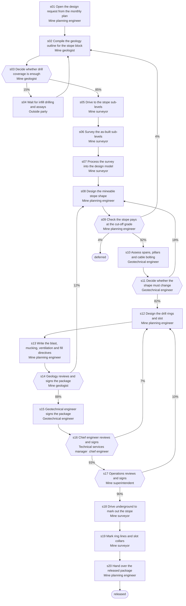

# Stope design and release

`mine-ts-stope-design` · mining (underground gold) · mine engineering · part of `mining-operator-co`

Before a block of ore between two sub-levels can be drilled and blasted, the engineers produce a stope package: the mineable shape around the vein, the longhole drill rings, the blasting, mucking, ventilation and backfill instructions, and the ground support. Geology supplies the ore outline from face samples and definition drill holes, a surveyor picks up the as-built sub-levels, the mine planning engineer designs the shape and rings, the single geotechnical engineer checks spans and cable bolting, and geology, engineering and operations sign the package before the surveyor marks the collars and it is handed to the longhole crew. Work queues behind the few people on a 14-on, 14-off rotation, and new assays that move the vein edge send designs back for rework.

| | |
|---|---|
| Unit of work | one stope package |
| Starts when | The monthly mine plan schedules a stope (one sub-level block of a stope panel) for drilling in the coming weeks, or a released stope must be redesigned. |
| Done when | A signed stope package is filed and handed to the longhole crew with ring collars marked, or the stope is deferred because it does not pay. |
| Organisation | A single-mine Canadian gold producer running a 500-650 tpd narrow-vein underground mine in northern Ontario, with a technical services department of about 20 engineers, surveyors and geologists on a 14-on, 14-off rotation. (300 employees, 2019-2022) |
| Volume | 6 cases a month (range 4 to 9) |

## Where it sits

- Starts with **mine_plan** from ts-short-range-plan (100% of cases)
- Relies on **grade_control_model** from ts-grade-control (a standing input; it does not start a case)
- Relies on **geotech_assessment** from ts-geotech (a standing input; it does not start a case)
- Relies on **drill_results** from ts-definition-drilling (a standing input; it does not start a case)
- Relies on **survey_data** from ts-survey (a standing input; it does not start a case)
- Sends **stope_release** to mine-stope-drilling (outcome: released)
- Sends **stope_design** to ts-geotech (outcome: any)

## Flow

## Roles

| Role | Department | Layer | FTE on this process | Loaded cost per hour | Evidence |
|---|---|---|---:|---:|---|
| Mine planning engineer | Mine engineering and survey | senior specialist | 1.5 | 74 CAD | B [er2022], [island] |
| Mine geologist | Mine geology | senior specialist | 0.45 | 68 CAD | B [island], [er2022] |
| Geotechnical engineer | Mine engineering and survey | senior specialist | 0.35 | 78 CAD | B [potvin], [island] |
| Mine surveyor | Mine engineering and survey | individual contributor | 0.35 | 50 CAD | C |
| Technical services manager (chief engineer) | Technical services | manager | 0.05 | 115 CAD | C |
| Mine superintendent | Mine operations | manager | 0.04 | 115 CAD | B [potvin] |

## Steps

Hands-on time and the wait before each step show the most common value. Evidence tier A is a sourced number, B a sourced description, C the author's estimate.

| Step | Who | Kind | Hands-on | Wait before | Control | Evidence |
|---|---|---|---:|---:|---|---|
| **s01 Open the design request from the monthly plan.** The mine planning engineer picks the next stope from the monthly plan's list of stopes due for drilling, opens the design folder and checks which sub-levels, raises and cable bolting are already done. Requests queue behind other designs and the engineer's days off the rotation. | Mine planning engineer | intake | 30 min | 1.0 d |  | C |
| **s02 Compile the geology outline for the stope block.** The mine geologist gathers the chip sample composites from the sub-levels, the definition drill holes and the face maps for the block, and draws the vein outline and grade on sections and the longitudinal section. This resource shape is passed to engineering as the starting point for the design. | Mine geologist | analysis | 7.0 h | 2.0 d |  | B [island], [er2022] |
| **s03 Decide whether drill coverage is enough.** The geologist checks the spacing of drill holes and sampled sub-levels against the stope outline. Where the vein edge or a fault offset is not known, the geologist asks for infill definition holes before the design goes further. | Mine geologist | judgment | 45 min | 0 min |  | B [potvin] |
| **s04 Wait for infill drilling and assays.** The diamond drilling contractor drills the extra holes from the nearest drill bay, the core is logged and sampled, and the assays come back from the lab. The design waits until the outline can be redrawn. | Outside party | external wait | 0 min | 14.0 d |  | C |
| **s05 Drive to the stope sub-levels.** A surveyor books a light vehicle and travels down the ramp to the stope's haulage level and, for captive sub-levels, climbs through the Alimak raise to reach the sub-levels. The surveyor and vehicle are shared with month-end surveys and development lines. | Mine surveyor | travel | 1.0 h | 1.0 d |  | B [er2022] |
| **s06 Survey the as-built sub-levels.** The surveyor picks up the walls, backs and brows of each sub-level and the raise with a total station, so the design uses where the drifts really are rather than where they were planned. Before working in the raise and captive sub-levels the surveyor checks the workplace and ground support. | Mine surveyor | physical | 2.5 h | 0 min | Ontario Regulation 854: workplace examination and ground support check before work; site procedure for travel in Alimak raises and captive sub-levels | C |
| **s07 Process the survey into the design model.** Back on surface the surveyor downloads the instrument, builds the as-built drift outlines and adds them to the mine model in AutoCAD and Promine. The engineer is told the as-builts are ready. | Mine surveyor | data entry | 2.0 h | 4.0 h |  | C |
| **s08 Design the mineable stope shape.** The engineer wraps a mineable shape around the vein outline with at least 1.5 m mining width, adds 0.5 m of hangingwall and 0.5 m of footwall dilution, places rib and sill pillars, and calculates diluted tonnes and grade with 90% mining recovery. Waste needed for the broken ore to flow to the drawpoints is added as planned dilution. | Mine planning engineer | analysis | 8.0 h | 12.0 h |  | B [er2022] |
| **s09 Check the stope pays at the cut-off grade.** The engineer compares the diluted grade with the 5.5 g/t stope cut-off and looks at the marginal blocks at the ends. Stopes that do not pay are deferred; marginal ones go back to geology for a second look at the outline. | Mine planning engineer | judgment | 1.0 h | 0 min |  | B [er2022], [island] |
| **s10 Assess spans, pillars and cable bolting.** The geotechnical engineer checks the stope's hangingwall and back spans on the Matthews stability graph using Q' and N' for the sheared diorite walls, compares with overbreak measured by cavity surveys in nearby stopes, and specifies cable bolts for the walls and brows. With one geotechnical engineer on a rotation, this review is the usual bottleneck. | Geotechnical engineer | analysis | 5.0 h | 2.0 d |  | B [island], [potvin], [er2022] |
| **s11 Decide whether the shape must change.** From the assessment the geotechnical engineer either accepts the shape or asks the engineer to shorten the stope, add a rib pillar or change the sequence so a long open span is not left waiting for fill. | Geotechnical engineer | judgment | 30 min | 0 min |  | B [er2022] |
| **s12 Design the drill rings and slot.** The engineer lays out the longhole rings for each sub-level: 64 mm down-holes 13 to 18 m long on a 3-2-3 pattern with 0.9 m burden and 1.2 m spacing, up-holes at 70 degrees for the sill pillar, and the slot raise at the far end. Ring drawings with collar positions, hole lengths and angles are printed for the drillers. | Mine planning engineer | drafting | 6.0 h | 8.0 h |  | B [er2022], [er2016] |
| **s13 Write the blast, mucking, ventilation and fill directives.** The engineer writes the blast letter (stick emulsion loading, delays, retreat sequence from the slot back to the raise), the shrink-mucking instructions that leave broken ore in the stope until the last blast, the ventilation and gas-check instructions, and whether a cemented rockfill sill mat is needed before uncemented fill. These go into the package with the tonnes, grade and drawings. | Mine planning engineer | drafting | 3.0 h | 4.0 h |  | B [island], [er2022], [potvin] |
| **s14 Geology reviews and signs the package.** The mine geologist checks that the stope outline and grade still match the latest face and drill assays and signs the package. If new assays have moved the vein edge, the shape goes back for rework. | Mine geologist | review | 1.0 h | 1.0 d | Site stope release procedure: geology, engineering, geotechnical and operations signatures before drilling | B [potvin] |
| **s15 Geotechnical engineer signs the package.** The geotechnical engineer checks that the cable bolt pattern, pillars and sequence in the final package match the assessment and signs it. Designs wait when the engineer is on days off. | Geotechnical engineer | approval | 30 min | 1.0 d | Site ground control program under Ontario Regulation 854: stope spans, pillars and support designed and approved by a qualified engineer | B [potvin], [stephenson] |
| **s16 Chief engineer reviews and signs.** The technical services manager reads the package against the monthly plan and sequence, checks tonnes, grade and fill timing, and signs or asks for changes to the drilling or sequence. | Technical services manager (chief engineer) | approval | 40 min | 1.0 d | Site stope release procedure: engineering approval | B [potvin], [stephenson] |
| **s17 Operations reviews and signs.** The mine superintendent, usually with the mine captain, checks that the drill can be slung to the sub-levels, the drawpoints and remucks suit the LHDs, and the timing fits the crews, then signs. Access or equipment problems send the rings back for change. | Mine superintendent | approval | 30 min | 1.0 d | Site stope release procedure: operations approval | B [potvin], [er2022] |
| **s18 Drive underground to mark out the stope.** The surveyor takes the signed ring drawings and a light vehicle to the stope and climbs to each sub-level. The trip waits for a free vehicle and a day when the sub-level is not being cable bolted. | Mine surveyor | travel | 1.0 h | 1.0 d |  | C |
| **s19 Mark ring lines and slot collars.** The surveyor paints the ring lines on the walls and back and marks the slot raise and collar positions so the longhole driller sets up on the design. Sub-levels still being cleaned or bolted are marked on a later visit. | Mine surveyor | physical | 2.0 h | 1.0 h |  | C |
| **s20 Hand over the released package.** The engineer files the signed package, emails it to the mine captain and longhole drillers and walks them through the rings, slot and blast sequence at the start of shift. The stope is then released for drilling, and the design goes to the geotechnical file for later comparison with the cavity survey. | Mine planning engineer | communication | 1.0 h | 4.0 h |  | B [potvin] |

## Exceptions

| Exception | Share of cases | What happens |
|---|---:|---|
| Infill drilling needed | 15% | Gaps in drill coverage hold the design for two to four weeks of drilling and assays. |
| New assays move the vein edge | 12% | Face or drill assays that arrive after the shape is drawn send the package back to the shape design. |
| Span too large | 18% | The geotechnical check shortens the stope or adds a rib pillar. |
| Stope does not pay | 4% | The diluted grade is below the cut-off and the stope is deferred. |

## Benchmarks

| Metric | Value | Unit | Population | Evidence |
|---|---|---|---|---|
| cycle_time_days | p50 18, p90 35 | calendar days from stope scheduled in the plan to package released | Small, rapid-turnaround open stopes | B [potvin] |
| external_dilution | 1.0 | metres of wall overbreak (0.5 m hangingwall plus 0.5 m footwall) | Eagle River stopes measured by cavity monitoring surveys | A [er2022], [er2016] |
| mining_recovery | 0.9 | share of designed stope tonnes recovered | Eagle River reserve design | A [er2022] |
| stope_cut_off_grade | 5.5 | g/t gold | Eagle River reserve design 2021 | A [er2022] |

## Pain points

- One geotechnical engineer on a 14-on, 14-off rotation reviews and signs every stope, so packages wait for the engineer's return. (steps s10, s15; C)
- New face and drill assays arrive while the design is in progress and move the vein edge, sending the shape and rings back for rework. (steps s02, s08, s14; B [potvin])
- Designs pass through several programs (Promine, survey software, spreadsheets, later Deswik), and comparing designs with cavity surveys means re-keying between them. (steps s07, s08, s12; B [potvin], [er2022])
- Hangingwall dilution from the sheared diorite grows with depth and uncemented fill leaves large open spans, which pushes designs toward smaller stopes and more pillars. (steps s10, s11; A [er2022])

## Assumptions

- One case is one sub-level block of a stope panel between rib pillars; a full panel of three sub-levels may be released in two or three packages.
- The geotechnical assessment (s10, s11) is the same work as the ts-geotech process triggered by stope_design; count it once when assembling the organisation model.
- Surveyors (as-builts and collar mark-up) and the technical services manager (sign-off) take part, although the organisation file's process entry lists neither.
- The simulated cycle time adds waits in sequence; the survey trip (s05-s07) in practice overlaps the geology outline (s02), so the simulated median runs a little longer than the benchmark.
- Drill and blast details follow the captive sub-level open stoping method of the reference mine; mechanised sub-levels skip the raise climb but follow the same steps.
- Loaded costs per hour are taken from the organisation file.

## Sources

- [er2022] [Technical Report for the Eagle River Gold Mining Complex, Ontario, Canada (CAPR001445)](https://s203.q4cdn.com/643390454/files/doc_downloads/2022/11/ERtechnicalReport.pdf) (SRK Consulting (Canada) Inc. for Wesdome Gold Mines Ltd., 2022). Reference mine practice: channel (chip) sampling of underground faces by production geologist and technician after each advance once the heading is inspected and supported, sample lengths 0.3 m minimum in ore and 0.3 m maximum with visible gold; test-hole, long-hole and muck sampling (one muck sample per 25-30 t truck, taken by muckers); samples brought to surface at end of the beat geologist's shift and shuttled daily to the company assay office in Wawa; mine lab not accredited, 11% QC insertion (blank, CRM, duplicate per 28-sample tray), VG protocol, low-grade CRM bias; channel results recorded in Promine; polygonal estimates before 2021, Leapfrog/Datamine 3D model from 2021; chip samples average higher than core; mine-to-mill reconciliation within 5%; stope design with 1.5 m minimum width, 0.5 m HW and FW dilution from CMS reconciliation, 90% stope and 99% development recovery, stope cut-off 5.5 g/t, development cut-off 2.0 g/t, density 2.7 t/m3; captive sub-level open stoping via Alimak raises, 13-18 m 64 mm down-holes on a 3-2-3 pattern, shrink mucking, CRF sill mats and URF fill; 19% of mill feed from sill development; ore hoisted in 4 t skips and trucked 16.6 km from the portal pad to the mill; two 12 h shifts 365 days a year; UG labour table with 9 mine engineering and 10 mine geology staff; recommendation to evaluate tools for short-term planning; ventilation rule 0.06 m3/s per kW of diesel
- [er2016] [Technical Report for the Eagle River Mining Complex including the Eagle River Gold Mine, the Mishi Gold Mine and Related Infrastructure](https://minedocs.com/12/EagleRiver_TechnicalReport_03172016.pdf) (Wesdome Gold Mines Ltd. (G. Mannard and P. Ng), hosted by minedocs.com, 2016). Chip samples taken every round (every 3 to 4 m) in ore development headings across the full face, about 2.5 kg, 0.3-0.5 m lengths; raises sometimes chip sampled and always muck sampled; muck sample per 25-30 t; sealed samples transported daily to the company Mine Assay office with results emailed to the mine; assay data in Microsoft Access linked to Promine and Surpac/Gemcom, databases updated weekly and audited monthly; about 30% of production from silling and development; CMS surveys show about 1.0 m wall overbreak; Mishi grade control on blast hole samples
- [island] [NI 43-101 Technical Report for the Island Gold Mine, Dubreuilville, Ontario, Canada (exhibit 99.1)](https://www.sec.gov/Archives/edgar/data/1178819/000117881920000070/ex991technicalreportfo.htm) (Alamos Gold Inc. (filed on SEC EDGAR), 2020). Neighbouring Wawa-area mine: resource shapes created by geology and passed to production engineering for mineable stope design with recovery and dilution factors; each stope gets a package with drilling plans, blast letters, ventilation and gas check instructions, mucking plans and backfilling directives; Matthews stability graph used for stope dimensions; CMS surveys and beat geologists control dilution while mucking; chip samples 1.5-2 kg taken by geological technician or geologist, assays entered into Promine; all underground production samples assayed at the Wesdome laboratory in Wawa; 2019 production reconciled to mill was 107% of tonnes, 98% of grade and 105% of ounces of the current reserve model, with monthly comparison going forward
- [potvin] [Benchmarking of stope design and reconciliation practices (Underground Mining Technology 2020)](https://papers.acg.uwa.edu.au/d/2035_14_Potvin/14_Potvin.pdf) (Australian Centre for Geomechanics (Y. Potvin, K.R. Woodward, B. McFadyen, I. Thin, D. Grant), 2020). 2019 workshops in Perth and Rouyn-Noranda with 19 underground mines: stope design note contents (shape, wireframe, ground support, slot and rings, fill, ventilation, predicted overbreak); definition drilling completed ahead of design if needed; design about three months before extraction at large stopes and within a few weeks at small rapid-turnaround stopes; drill and blast design a few days before drilling; most mines have a comprehensive sign-off involving geotechnical, backfill, ventilation and management; stope reconciliation starts with CMS; all mines reconcile volume, tonnes and grade per stope and feed a periodic mine reconciliation led by geology; multiple software packages make reconciliation slow; narrow vein mines focus on hangingwall overbreak and ELOS
- [stephenson] [Optimising stope design and ground support: a case study (Ground Support 2013)](https://papers.acg.uwa.edu.au/d/1304_25_Stephenson/25_Stephenson.pdf) (Australian Centre for Geomechanics (R.M. Stephenson and M.P. Sandy, AMC Consultants), 2013). At a Western Australian underground gold mine, geotechnical engineers review stope designs with planning engineers, followed by a sign-off process documenting the conclusions for management approval and a team-based risk assessment for each stope

Written by claude-opus on 2026-11-24.
