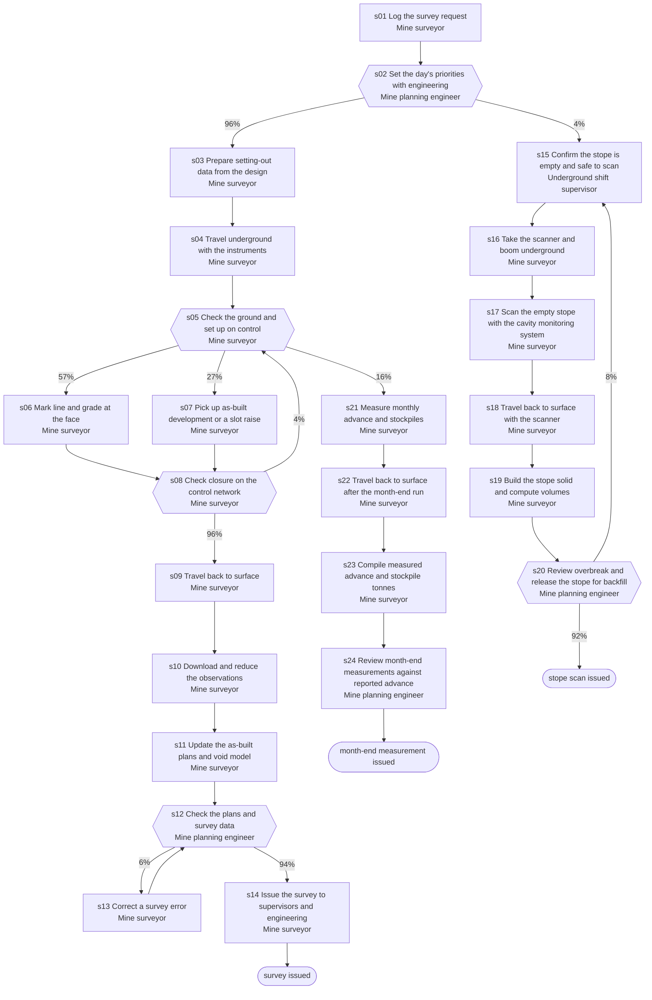

# Mine survey and cavity monitoring (one survey task)

`mine-ts-survey` · gold mining · technical services · part of `mining-operator-co`

The mine's survey crew keeps development on design and measures what was mined. Each day the two-person crew marks line and grade in development headings, picks up newly advanced drifts and slot raises, and at month end measures every heading and stockpile; when a stope is emptied they scan it with a cavity monitoring laser on a boom so engineering can measure overbreak before backfill. Requests queue on the survey board and wait for the daily run down the ramp, and stope scans wait for mucking to finish, so a small crew and long travel are what slow it down.

| | |
|---|---|
| Unit of work | one survey task |
| Starts when | A heading has advanced past its last marks, a stope is reported mucked out, or month-end measurement is due. |
| Done when | The survey is checked and issued to supervisors, engineering and the reconciliation, or the stope scan is reviewed and the stope released for backfill. |
| Organisation | A single-mine Canadian gold producer running a 500-600 tonne-per-day underground longhole mine with ramp and shaft access, a 1,000-1,200 tonne-per-day mill and about 280 rotational site staff in northern Ontario. (300 employees, 2019-2022) |
| Volume | 170 cases a month (range 120 to 220) |

## Where it sits

- Starts with **developed_face** from mine-dev-drill-blast (82% of cases)
- Starts with **mined_out_stope** from mine-mucking-haulage (4% of cases)
- Starts with **mine_plan** from ts-short-range-plan (14% of cases)
- Sends **survey_data** to ts-reconciliation (outcome: survey issued)
- Sends **survey_data** to ts-reconciliation (outcome: month-end measurement issued)
- Sends **cms_survey** to mine-backfill (outcome: stope scan issued)
- Sends **cms_survey** to ts-reconciliation (outcome: stope scan issued)

## Flow

## Roles

| Role | Department | Layer | FTE on this process | Loaded cost per hour | Evidence |
|---|---|---|---:|---:|---|
| Mine surveyor | Mine engineering and survey | individual contributor | 3.8 | 50 CAD | B [er2022] |
| Mine planning engineer | Mine engineering and survey | senior specialist | 0.5 | 74 CAD | C |
| Underground shift supervisor | Underground production and development | supervisor | 0.1 | 82 CAD | C |

## Steps

Hands-on time and the wait before each step show the most common value. Evidence tier A is a sourced number, B a sourced description, C the author's estimate.

| Step | Who | Kind | Hands-on | Wait before | Control | Evidence |
|---|---|---|---:|---:|---|---|
| **s01 Log the survey request.** The surveyor collects requests from the shift reports, the survey board and emails: headings blasted past their last line, slot raises to pick up, stopes reported mucked out, and month-end measurements. Each is written on the survey board with its location and priority. | Mine surveyor | intake | 8 min | 2.0 h |  | C |
| **s02 Set the day's priorities with engineering.** At the morning planning meeting the mine engineer and the surveyor rank the requests: headings about to run out of line come first, then stopes waiting to be scanned for backfill, then as-built pickups. Month-end measurements take priority in the last days of the month. | Mine planning engineer | coordination | 4 min | 4.0 h |  | C |
| **s03 Prepare setting-out data from the design.** The surveyor opens the design in the mine planning software, takes the centreline and grade for each heading or the design outline for a pickup, computes offsets from the nearest control stations and prints the field sheets. | Mine surveyor | data entry | 15 min | 0 min |  | C |
| **s04 Travel underground with the instruments.** The two-person survey crew loads the total station, tripods, prism poles and paint into a light vehicle and drives down the ramp. One trip covers four to six tasks, so the time shown is the share for one task. | Mine surveyor | travel | 10 min | 0 min |  | C |
| **s05 Check the ground and set up on control.** At the heading the crew checks that the area is scaled and supported, sets the instrument over or near the nearest control station, takes a backsight to a second station and checks the measured distance and angle against the coordinates. | Mine surveyor | validation | 15 min | 0 min | Ontario Regulation 854 s. 66(1): ground conditions of the workplace examined before work begins | A [reg854] |
| **s06 Mark line and grade at the face.** For waste development under survey control the crew sets centreline spads in the back and paints the line and grade on the face; for sills driven on the vein the geologist gives the line and the surveyors give the grade, usually +2%. The marks guide the next three or four rounds. | Mine surveyor | physical | 30 min | 0 min |  | B [er2022], [er2016] |
| **s07 Pick up as-built development or a slot raise.** The crew shoots the walls, back, floor and face of newly advanced headings, or the outline and dip of a slot raise, so engineering can compare what was mined with the design and the monthly advance can be measured. | Mine surveyor | physical | 40 min | 0 min |  | B [er2016] |
| **s08 Check closure on the control network.** Before leaving, the surveyor closes back on a known station and compares the result with its coordinates. If the misclosure is outside tolerance, the setup is repeated. | Mine surveyor | validation | 8 min | 0 min | Site survey standard: every setup is closed on control within a stated tolerance | C |
| **s09 Travel back to surface.** The crew packs the instruments and drives back up the ramp at the end of the run. As with the trip in, one trip covers several tasks. | Mine surveyor | travel | 10 min | 30 min |  | C |
| **s10 Download and reduce the observations.** In the survey office the surveyor downloads the total station, reduces the observations to mine-grid coordinates in the survey software and checks them against the field notes. | Mine surveyor | data entry | 15 min | 30 min |  | C |
| **s11 Update the as-built plans and void model.** The surveyor draws the new development or marks into the mine plans and the as-built void model, so that engineering, geology and the reserve estimate use current excavation shapes. | Mine surveyor | data entry | 20 min | 0 min |  | B [er2022] |
| **s12 Check the plans and survey data.** The mine engineer looks over the updated plans and compares heading positions with the design and last month's advance, querying anything that looks off before it is used. | Mine planning engineer | review | 6 min | 2.0 h |  | C |
| **s13 Correct a survey error.** The surveyor traces the error to the field notes or the reduction, corrects it and, if needed, re-shoots the point on the next run. | Mine surveyor | data entry | 30 min | 4.0 h |  | C |
| **s14 Issue the survey to supervisors and engineering.** The surveyor emails the updated plan or notes the marks on the line-up board, so the shift supervisors know the heading has line and grade and engineering has the as-built. | Mine surveyor | communication | 5 min | 0 min |  | C |
| **s15 Confirm the stope is empty and safe to scan.** The surveyor checks with the shift supervisor that the stope has been mucked out, the brow is barricaded and ventilation is on, and books a time when the drawpoint is free of loaders and trucks. | Underground shift supervisor | coordination | 10 min | 1.0 d |  | C |
| **s16 Take the scanner and boom underground.** The survey crew loads the cavity monitoring scanner, its extension boom, batteries and the total station and drives down to the stope's drawpoint or top access. | Mine surveyor | travel | 45 min | 1.0 h |  | C |
| **s17 Scan the empty stope with the cavity monitoring system.** Standing back from the brow, the crew pushes the scanner on its boom into the opening, positions it with the total station, and lets the laser sweep the cavity while stationary. Long or irregular stopes need scans from both the top and bottom accesses. | Mine surveyor | physical | 1.2 h | 0 min | Ontario Regulation 854 s. 84(2) para. 3-4 (unsafe locations identified and barricaded); no entry past the brow of an open stope | B [er2022], [emesent], [reg854] |
| **s18 Travel back to surface with the scanner.** The crew packs the scanner and boom and drives back up the ramp, usually combining the trip with other survey tasks. | Mine surveyor | travel | 30 min | 30 min |  | C |
| **s19 Build the stope solid and compute volumes.** The surveyor registers the point cloud to mine grid, builds a closed solid in the survey software, and compares it with the design stope to compute mined volume, overbreak and underbreak by wall, and the tonnes for the reconciliation. | Mine surveyor | analysis | 2.0 h | 4.0 h |  | B [er2022] |
| **s20 Review overbreak and release the stope for backfill.** The mine engineer reviews the CMS solid against the design, notes overbreak, underbreak and ore left behind, decides whether the stope can be filled, and sends the scan to backfill planning, geology and the reconciliation. | Mine planning engineer | review | 40 min | 4.0 h |  | B [er2022] |
| **s21 Measure monthly advance and stockpiles.** At month end the crew measures the face position of each active heading against last month's mark and picks up the outline of underground stockpiles, so engineering can report metres advanced and tonnes broken but not yet hauled. | Mine surveyor | physical | 50 min | 0 min |  | C |
| **s22 Travel back to surface after the month-end run.** The crew returns to surface once all headings on the month-end list have been measured, often over two or three days. | Mine surveyor | travel | 10 min | 1.0 h |  | C |
| **s23 Compile measured advance and stockpile tonnes.** The surveyor computes metres advanced per heading and stockpile volumes, converts them to tonnes with the density factor and enters them in the month-end measurement spreadsheet for engineering and the reconciliation. | Mine surveyor | data entry | 30 min | 1.0 h |  | C |
| **s24 Review month-end measurements against reported advance.** The mine engineer compares surveyed metres with the metres the shift reports claimed, which also drive development bonus and contractor payment, and resolves differences before the figures go to the reconciliation and cost report. | Mine planning engineer | review | 20 min | 4.0 h | Contractor and bonus metres are paid on surveyed advance, not reported advance (site practice) | C |

## Exceptions

| Exception | Share of cases | What happens |
|---|---:|---|
| Stope scan | 4% | An emptied stope waits for access, is scanned with the CMS, processed into a solid and reviewed before backfill. |
| Rescan after more mucking | 0% | The scan shows ore left behind or gaps, so the stope is mucked further and scanned again. |
| Misclosure | 4% | The setup does not close on control within tolerance and is repeated. |
| Survey error found at review | 5% | The engineer finds an error in the plans and the surveyor corrects it, sometimes with a re-shoot. |

## Benchmarks

| Metric | Value | Unit | Population | Evidence |
|---|---|---|---|---|
| cycle_time_days | p50 1.0, p90 3.0 | calendar days from the request being logged to the survey being issued | Mixed survey tasks at a small underground mine with one day-shift survey crew | C |
| cms_wall_overbreak | 1.0 | metres average between hangingwall and footwall | Eagle River stopes scanned by CMS | B [er2022] |
| stope_scan_time_new_lidar | low 1, high 2 | minutes per stope with a boom-mounted mobile lidar (later technology) | Vendor claim, not in use at the mine in 2019-2022 | B [emesent] |

## Pain points

- One two-person crew on day shift serves both shifts' development; when it falls behind, headings run past their line and grade or wait. (steps s01, s02, s06; C)
- Stope scans wait for the last mucking and a free drawpoint, which delays backfill and the start of the next stope. (steps s15, s20; C)
- Month-end measurement doubles the workload for a few days and competes with line and grade for the same crew. (steps s21, s23, s24; C)
- Travel down a long ramp takes a large share of the crew's day, so tasks are batched into runs and individual requests wait. (steps s04, s09, s16; B [er2022])

## Assumptions

- A case is one survey task. Travel is shared across the four to six tasks of a run, so travel steps on the main path show one task's share.
- Field steps use people = 2 for the two-person survey crew.
- The organisation file triggers this process only from development and mucking; month-end measurement is added as a trigger from ts-short-range-plan (mine_plan), since it is set by the monthly calendar and the plan's heading list.
- Stope scans are confirmed by the shift supervisor (cms_wait), a role not listed for this process in the organisation file.
- Scanning in 2019-2022 is assumed to use a stationary boom-mounted CMS laser; faster mobile lidar on the same boom is noted only as a benchmark.
- Task mix, durations and queue times are the author's estimates; no published survey workload figures for this mine were found.
- Hands-on time times volume implies about 6 FTE at 130 hours a month against 4.4 stated. Surveyors on a 14/14 rotation with 12-hour shifts work about 180 hours a month, so the four surveyors supply about 5.5 FTE at the validator's 130 hours; the crew runs close to full, which matches the survey backlog the organisation file describes.

## Sources

- [er2022] [Technical Report for the Eagle River Gold Mining Complex, Ontario, Canada (SRK project CAPR001445, effective 31 December 2021)](https://s203.q4cdn.com/643390454/files/doc_downloads/2022/11/ERtechnicalReport.pdf) (SRK Consulting (Canada) Inc. for Wesdome Gold Mines Ltd., 2022). Engineering Survey Department supplies mined void solids (stopes, sills, drifts, raises); ore development on vein under geology control and other development under survey control; CMS surveys routinely carried out, 1.0 m average wall overbreak, CMS compared with design solids for dilution and recovery; ramp access; 9 owner staff in mine engineering and 24 contractor development crew.
- [er2016] [Technical Report for the Eagle River Mining Complex including the Eagle River Gold Mine, the Mishi Gold Mine and related infrastructure (Mannard and Ng)](https://minedocs.com/12/EagleRiver_TechnicalReport_03172016.pdf) (Wesdome Gold Mines Ltd., 2016). Slot raise dips set by engineering and monitored by survey pickups; sill grades generally +2% with line on geology control.
- [emesent] [Cavity Monitoring System (CMS) Mount for Hovermap](https://emesent.com/emesent-product/cavity-monitoring-system-cms-mount) (Emesent, 2024). CMS boom deployment of a scanner into a stope; traditional CMS is stationary, while boom-mounted mobile lidar scans a stope in 1-2 minutes, less than a third of the time.
- [reg854] [R.R.O. 1990, Reg. 854: Mines and Mining Plants, Occupational Health and Safety Act (e-Laws consolidation in force 1 July 2021, archived copy captured 17 January 2022)](https://bac-lac.wayback.archive-it.org/web/2021/https://www.ontario.ca/laws/regulation/900854) (Government of Ontario (archived by the Library and Archives Canada web archive), 2021). Ground examination before work begins (s. 66(1)); identification and barricading of unsafe locations (s. 84(2)).

Written by claude-opus on 2026-11-24.
