# Negotiate master service agreements and pricing

`ofs-cs-msa-and-pricing-agreement` · oilfield services (pressure pumping) · sales · part of `oilfield-services-co`

Before crews can work for a producer, the company needs a signed master service agreement that sets out who carries which risks, what insurance each side holds and how invoices are approved, plus a pricing schedule with the agreed rates. Producers usually push their own contract form, so the contract administrator marks deviations, legal counsel redlines the indemnities and insurance clauses, and redlines travel back and forth for weeks. Pricing schedules are renegotiated more often than MSAs, especially in 2021-2022 when fuel, sand and wage costs rose. Delays come from waiting on the producer's legal and supply chain staff, and errors come from rates and terms that are not carried correctly into the price book and to field and billing staff.

| | |
|---|---|
| Unit of work | one agreement or pricing schedule |
| Starts when | A producer awards work or asks to set up, renew or reprice its agreement with the company. |
| Done when | The MSA or amendment and the pricing schedule are signed by both parties, filed, loaded to the price book and briefed to operations and billing, or the negotiation is abandoned. |
| Organisation | A listed Canadian pressure pumper of about 1,350 people with a small Calgary contracts and legal team and agreements with 60-plus producers. (1,350 employees, 2019-2022) |
| Volume | 3 cases a month (range 1 to 6) |

## Where it sits

- Starts with **contract_award** from producer (60% of cases)
- Starts with **contract_award** from cs-tender-response (40% of cases)
- Relies on **contract_review_memo** from lg-contract-review (a standing input; it does not start a case)
- Relies on **price_book** from cs-price-book-maintenance (a standing input; it does not start a case)
- Relies on **insurance_certificate** from lg-insurance-and-claims (a standing input; it does not start a case)
- Sends **msa** to producer (outcome: executed)
- Sends **msa** to lg-contract-review (outcome: executed)
- Sends **msa** to cs-price-book-maintenance (outcome: executed)
- Sends **contract_award** to fo-frac-program-planning (outcome: executed)
- Sends **msa** to fin-field-ticket-to-invoice (outcome: executed)

## Flow

```mermaid
flowchart TD
    s01["s01 Receive award and agreement request<br/>Account manager"]
    s02{{"s02 Check contract register<br/>Sales contract administrator"}}
    s03["s03 Obtain the producer's MSA form<br/>Sales contract administrator"]
    s04["s04 Wait for the producer's form<br/>Outside party"]
    s05["s05 Mark deviations from standard positions<br/>Sales contract administrator"]
    s06["s06 Legal review and redline<br/>Legal counsel  contracts"]
    s07["s07 Check insurance requirements<br/>Risk and insurance manager"]
    s08["s08 Review commercial terms<br/>Account manager"]
    s09["s09 Send redline to producer<br/>Sales contract administrator"]
    s10["s10 Wait for producer response<br/>Outside party"]
    s11{{"s11 Review counter-redline<br/>Legal counsel  contracts"}}
    s12["s12 Negotiation call<br/>Legal counsel  contracts"]
    s13{{"s13 Approve residual deviations<br/>Vice president, sales and marketing"}}
    s14["s14 Draft customer pricing schedule<br/>Pricing and bid analyst"]
    s15["s15 Negotiate the pricing schedule<br/>Account manager"]
    s16{{"s16 Wait for producer pricing response<br/>Outside party"}}
    s17["s17 Approve pricing schedule<br/>Vice president, sales and marketing"]
    s18["s18 Route for signature<br/>Sales contract administrator"]
    s19["s19 Wait for producer countersignature<br/>Outside party"]
    s20["s20 File agreement and update register<br/>Sales contract administrator"]
    s21["s21 Request price book update<br/>Sales contract administrator"]
    s22["s22 Brief operations and billing<br/>Account manager"]
    s01 --> s02
    s02 -->|"40%"| s03
    s02 -->|"60%"| s14
    s03 --> s04
    s04 --> s05
    s05 --> s06
    s06 --> s07
    s07 --> s08
    s08 --> s09
    s09 --> s10
    s10 --> s11
    s11 -->|"45%"| s13
    s11 -->|"45%"| s12
    s11 -->|"3%"| end0
    s11 -->|"7%"| s13
    s12 --> s09
    s13 -->|"95%"| s14
    s13 -->|"5%"| s12
    s14 --> s15
    s15 --> s16
    s16 -->|"75%"| s17
    s16 -->|"25%"| s14
    s17 --> s18
    s18 --> s19
    s19 --> s20
    s20 --> s21
    s21 --> s22
    s22 --> end1
    end0(["abandoned"])
    end1(["executed"])
```

## Roles

| Role | Department | Layer | FTE on this process | Loaded cost per hour | Evidence |
|---|---|---|---:|---:|---|
| Account manager | Sales and customer relations | senior specialist | 0.15 | 90 CAD | C |
| Sales contract administrator | Sales and customer relations | individual contributor | 0.3 | 50 CAD | C |
| Legal counsel (contracts) | Legal, risk and regulatory | senior specialist | 0.25 | 120 CAD | C |
| Pricing and bid analyst | Sales and customer relations | individual contributor | 0.15 | 62 CAD | C |
| Vice president, sales and marketing | Sales and customer relations | director | 0.03 | 190 CAD | C |
| Risk and insurance manager | Legal, risk and regulatory | manager | 0.03 | 112 CAD | C |

## Steps

Hands-on time and the wait before each step show the most common value. Evidence tier A is a sourced number, B a sourced description, C the author's estimate.

| Step | Who | Kind | Hands-on | Wait before | Control | Evidence |
|---|---|---|---:|---:|---|---|
| **s01 Receive award and agreement request.** The account manager receives the award letter or the producer's request to set up or renew an agreement, together with the producer's own MSA form or pricing schedule template, and opens a contract request with the contract administrator. | Account manager | intake | 30 min | 4.0 h |  | C |
| **s02 Check contract register.** The contract administrator looks up the producer in the contract register to see whether a signed MSA exists, which version, its insurance and indemnity terms and when the current pricing schedule expires. | Sales contract administrator | lookup | 30 min | 8.0 h |  | B [ovintiv-suppliers] |
| **s03 Obtain the producer's MSA form.** The contract administrator asks the producer's contracts group for its current MSA form and schedules (insurance, safety, invoicing), and waits for the producer's sponsor to open the request on their side. | Sales contract administrator | communication | 20 min | 4.0 h |  | B [ovintiv-suppliers] |
| **s04 Wait for the producer's form.** The producer's contracts team sends its form and schedules, which are usually the producer's own paper rather than an industry template, and the contract administrator chases by email if nothing arrives within a week. | Outside party | external wait | 0 min | 3.0 d |  | C |
| **s05 Mark deviations from standard positions.** The contract administrator compares the producer's form clause by clause with the company's standard positions and the PSAC model clauses, and marks deviations in indemnity, limits of liability, insurance, payment terms, price adjustment and warranty. | Sales contract administrator | review | 3.0 h | 1.0 d |  | B [bj-msa] |
| **s06 Legal review and redline.** Legal counsel reviews the deviation list and the form, focusing on the knock-for-knock indemnities, carve-outs for well control, reservoir and downhole equipment losses, gross negligence, consequential loss and governing law, and drafts the company's redline. | Legal counsel (contracts) | review | 4.0 h | 3.0 d | Contract review policy: legal counsel reviews every MSA and amendment before signature | B [ablawg-k4k], [bj-msa] |
| **s07 Check insurance requirements.** The risk and insurance manager compares the required coverages, limits, additional insured and waiver of subrogation wording with the company's policies, and notes what the broker would need to change. | Risk and insurance manager | validation | 1.0 h | 2.0 d |  | B [bj-msa] |
| **s08 Review commercial terms.** The account manager reviews payment terms, invoicing method (e-invoicing network, field ticket approval), price adjustment and standby clauses and decides which points matter to the customer relationship and which can be conceded. | Account manager | review | 1.0 h | 1.0 d |  | B [ovintiv-suppliers] |
| **s09 Send redline to producer.** The contract administrator consolidates legal, insurance and commercial comments into one redline with a cover note and sends it to the producer's contracts contact. | Sales contract administrator | communication | 1.0 h | 8.0 h |  | C |
| **s10 Wait for producer response.** The producer's contracts and legal staff review the redline among many other suppliers' agreements and return a counter-redline or acceptance. | Outside party | external wait | 0 min | 7.0 d |  | C |
| **s11 Review counter-redline.** Legal counsel reads the producer's response, accepts reasonable compromises and decides whether the remaining gaps need another round, a call, or escalation. | Legal counsel (contracts) | review | 1.5 h | 1.0 d |  | C |
| **s12 Negotiation call.** Legal counsel and the account manager hold a call with the producer's contracts and legal staff to trade positions on the open clauses, then update the redline. | Legal counsel (contracts) | communication | 1.5 h | 3.0 d |  | C |
| **s13 Approve residual deviations.** The vice president of sales, with legal advice, accepts any remaining non-standard risk terms in writing under the delegation of authority, or rejects them. | Vice president, sales and marketing | approval | 30 min | 1.0 d | Delegation of authority: VP sales and general counsel approve non-standard indemnity or liability terms | C |
| **s14 Draft customer pricing schedule.** The pricing analyst builds the customer pricing schedule from the bid or the current price book: discounts by service line, standby and mobilisation rates, pass-through rules for sand, trucking and fuel, and a cost escalation clause. | Pricing and bid analyst | drafting | 4.0 h | 1.0 d |  | B [step-2021] |
| **s15 Negotiate the pricing schedule.** The account manager sends the schedule to the producer's supply chain lead, walks through changes from the last schedule (fuel, sand, wage increases) and agrees or concedes items. | Account manager | communication | 1.5 h | 1.0 d |  | B [step-2021] |
| **s16 Wait for producer pricing response.** The producer's supply chain team compares the schedule with other suppliers and its budget and replies with acceptance or a counter-proposal. | Outside party | external wait | 0 min | 5.0 d |  | C |
| **s17 Approve pricing schedule.** The vice president of sales checks the agreed rates against margin floors and signs the internal approval for the schedule. | Vice president, sales and marketing | approval | 20 min | 1.0 d | Sales delegation of authority: pricing below standard margin | C |
| **s18 Route for signature.** The contract administrator prepares execution copies of the MSA or amendment and the pricing schedule, obtains the company signature from an authorised officer and sends them to the producer. | Sales contract administrator | coordination | 1.0 h | 1.0 d | Signing authority: only named officers sign customer agreements | C |
| **s19 Wait for producer countersignature.** The producer's authorised signatory countersigns and returns the agreement, often through its own contract or e-signature system, after the producer's internal approvals; the contract administrator chases if it is not back within two weeks. | Outside party | external wait | 0 min | 3.0 d |  | C |
| **s20 File agreement and update register.** The contract administrator files the executed documents, records the version, term, insurance limits and pricing schedule dates in the contract register, and sends the insurance certificate if requested. | Sales contract administrator | data entry | 40 min | 8.0 h |  | C |
| **s21 Request price book update.** The contract administrator sends the executed pricing schedule to the price book team so the customer's rates and discounts are loaded into the ERP price book and field ticket app before the next job. | Sales contract administrator | communication | 20 min | 2.0 h |  | C |
| **s22 Brief operations and billing.** The account manager emails the district managers, program planners and billing a summary of the terms that change field work and invoicing: standby rules, approved pass-throughs, ticket approval and invoicing method. | Account manager | communication | 40 min | 8.0 h |  | C |

## Exceptions

| Exception | Share of cases | What happens |
|---|---:|---|
| Several redline rounds | 20% | The producer does not accept the company's indemnity or insurance positions and the parties hold further calls and rounds. |
| Pricing counter-proposal | 25% | The producer counters the pricing schedule, often resisting escalation for fuel or wages. |
| Negotiation abandoned | 1% | The parties cannot agree on risk terms and the award lapses or work continues under the old agreement. |

## Benchmarks

| Metric | Value | Unit | Population | Evidence |
|---|---|---|---|---|
| cycle_time_days | p50 30, p90 70 | calendar days from award or request to agreement briefed | MSA and pricing schedule cases at a Canadian service company, 2019-2022 | C |

## Pain points

- Producers push their own forms, so each MSA needs a clause-by-clause comparison and several redline rounds on indemnity and insurance. (steps s05, s06, s10, s11, s12; B [bj-msa], [ablawg-k4k])
- Agreed rates reach the price book and the field by email; wrong or late loading leads to invoice disputes. (steps s21, s22; C)
- Most elapsed time is spent waiting on the producer's contracts and supply chain staff. (steps s04, s10, s16, s19; C)

## Assumptions

- Loaded costs are the organisation file's (base wage x 1.35).
- The pricing analyst and the risk and insurance manager take part although the organisation file's process map does not list them for this process.
- The trigger is split between awards from the company's own tender responses and producer requests to renew or reprice outside a tender; the executed agreement also goes to billing (fin-field-ticket-to-invoice), which the process map does not show.
- Legal review is described inside this workflow; lg-contract-review is treated as the standing legal input and the place where executed agreements are filed, to avoid counting the same legal hours twice.
- No public source on agreement cycle times was found; all times and branch shares are tier C.

## Sources

- [bj-msa] [Master Service Agreements in the Oilfield Services Industry](https://www.bennettjones.com/Blogs-Section/Master-Service-Agreements-in-the-Oilfield-Services-Industry) (Bennett Jones LLP (K. Iatridis and G. Stenger), 2017). MSA negotiations in oilfield services usually turn on warranties and remedies, liability and indemnification, intellectual property, insurance, and health and safety; PSAC published a template MSA and handbook of model clauses in 2017.
- [ablawg-k4k] [Alberta Decision on Knock-for-Knock Allocation of Liability in a Standard Form Drilling Contract](https://ablawg.ca/2015/07/15/alberta-decision-on-knock-for-knock-allocation-of-liability-in-a-standard-form-drilling-contract/) (ABlawg (Nigel Bankes), University of Calgary Faculty of Law, 2015). Knock-for-knock (each party bears its own losses regardless of fault) in the CAPP/CAODC standard form; Alberta court enforced it between sophisticated parties.
- [step-2021] [STEP Energy Services Ltd. Reports Fourth Quarter and Year End 2021 Results](https://www.stepenergyservices.com/news-releases/step-energy-services-ltd-reports-fourth-quarter-and-year-end-2021-results) (STEP Energy Services Ltd., 2022). Tight supply of field staff, limits on how fast recruits can be added safely, rising labour cost; prices raised for all clients in Q4 2021 and Q1 2022 to offset inflation; crews booked through Q1; spring break-up affects Canadian operations; extreme cold caused delays.
- [ovintiv-suppliers] [Supplier Resources](https://www.ovintiv.com/supplier-resources/) (Ovintiv Inc., 2026). A producer requires an ISNetworld PASS grade for field suppliers, a company sponsor before an agreement is set up, master agreements that mostly do not expire but are amended when services or risk change, and invoicing through OpenInvoice.

Written by claude-opus on 2026-11-24.
